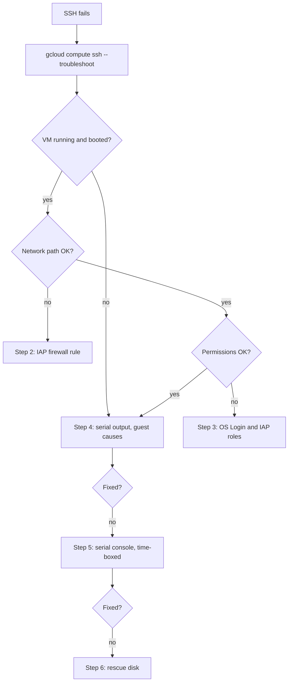

How to get back into a Compute Engine VM when `gcloud compute ssh` fails. Lockouts usually follow a change: a hardening run that rewrote `sshd_config`, a firewall rule removed in a clean-up, an IAM change that dropped an OS Login role, a disk that filled up, or a guest environment that stopped working. Work from the outside in (network path, then identity, then the guest itself) and keep the powerful tools for last: the interactive serial console and the rescue disk both bypass normal access controls, so they are time-boxed, recorded and removed afterwards.

> [!info] Scope and verification
> The commands were not run against a live VM and the note is not marked `verified`. Command names, flags, metadata keys, the IAP source range and the IAM permission names were checked against the `gcloud` help and the `gcloud` SDK source (SDK 570.0.0) on 2026-10-21. No Google Cloud documentation page could be read; items marked **not verified** need checking against the current Compute Engine and IAP documentation.

## When to use

- `gcloud compute ssh` hangs, times out, or ends with `Permission denied (publickey)`.
- IAP tunnelling fails with an error about the tunnel or about missing permissions.
- SSH worked yesterday and a hardening, firewall, IAM or OS Login change went out since.
- The VM is up in the console, but it does not answer and its workload is degraded.

For GKE nodes, do not rescue the VM: cordon, drain and let the node pool replace it. See [[gke-node-notready-triage]]. For a VM in a managed instance group with autohealing, the group may recreate the VM while you work on it; remove the health check with `gcloud compute instance-groups managed update GROUP --zone "$ZONE" --clear-autohealing` (`GROUP` is the group's name; use `--region` for a regional group), restore it afterwards with `--health-check` and `--initial-delay`, or prefer replacing the VM from its template.

## Preconditions

- Read access to the instance, its serial port output and the firewall rules (`roles/compute.viewer`), and to IAM policies.
- An incident or change record. Steps 5 and 6 grant temporary access or touch the boot disk; both must be recorded and reverted.
- For temporary privilege, use your just-in-time process; see [[privileged-access-just-in-time-gcp-gke]].

```bash title="variables"
PROJECT=example-project
ZONE=europe-west1-b
VM=app-vm-1
NETWORK=prod-vpc
gcloud config set project "$PROJECT"
```

## Steps



### 1. Classify with the built-in troubleshooter

`gcloud compute ssh` has a troubleshoot mode that runs checks and prints recommendations for VM status, network connectivity, user permissions, VPC settings and VM boot. With `--tunnel-through-iap` it also checks IAP port forwarding.

```bash
gcloud compute ssh "$VM" --zone "$ZONE" --troubleshoot --tunnel-through-iap

gcloud compute instances describe "$VM" --zone "$ZONE" \
  --format="yaml(status,networkInterfaces[].networkIP,networkInterfaces[].accessConfigs[].natIP,tags.items,serviceAccounts[].email,metadata.items)"

gcloud compute instances get-serial-port-output "$VM" --zone "$ZONE" --port 1 | tail -100
```

Read the result before changing anything:

- **Status not `RUNNING`:** start it, or find out why it stopped (quota, a stopped-by-policy event, a failed maintenance event).
- **The serial output ends in a kernel panic, an emergency shell, or `fsck` waiting for input:** the guest did not boot; go to step 4 and likely step 6.
- **Boot looks normal, SSH times out:** the network path; step 2.
- **Connection opens, then `Permission denied (publickey)`:** identity or guest-side key handling; step 3, then step 4.

### 2. Network path: the IAP firewall rule

With IAP TCP forwarding, SSH connections reach the VM from Google's IAP range, not from your laptop. The `gcloud` SDK's troubleshooter uses **35.235.240.0/20** as that range and checks that a firewall rule allows it. Confirm the range in the current IAP TCP forwarding documentation before you write it into a rule.

```bash
gcloud compute firewall-rules list --filter="network:$NETWORK AND direction=INGRESS" \
  --format="table(name,priority,sourceRanges.list(),allowed[].map().firewall_rule().list(),denied[].map().firewall_rule().list(),targetTags.list(),disabled)"
```

Look for a rule that allows `tcp:22` (or your SSH port) from `35.235.240.0/20` to the VM's network tags or service account, and for a higher-priority deny rule that wins over it. Hierarchical firewall policies at the folder or organization level can also deny it; check them with your network team.

The fix belongs in Terraform; the equivalent command for an outage is:

```bash
gcloud compute firewall-rules create allow-iap-ssh \
  --network "$NETWORK" --direction INGRESS --action allow \
  --rules tcp:22 --source-ranges 35.235.240.0/20 \
  --target-tags ssh-via-iap --priority 1000

gcloud compute ssh "$VM" --zone "$ZONE" --tunnel-through-iap
```

Do not open port 22 to `0.0.0.0/0` to get in quickly. That creates a new exposure for the length of the incident and is easy to forget. See [[zero-trust-access-iap-and-vpc-service-controls]] and [[load-balancers-firewalls-and-network-troubleshooting]].

### 3. Identity: OS Login, IAP and service account permissions

Check which login method the VM uses. The `enable-oslogin` metadata key at instance or project level switches OS Login on; `enable-oslogin-2fa` adds two-factor; `block-project-ssh-keys` stops project-wide metadata keys from working on this VM.

```bash
gcloud compute instances describe "$VM" --zone "$ZONE" --format=json \
  | jq -r '.metadata.items[]? | select(.key | test("^(enable-oslogin|enable-oslogin-2fa|block-project-ssh-keys)$")) | "instance \(.key)=\(.value)"'
gcloud compute project-info describe --format=json \
  | jq -r '.commonInstanceMetadata.items[]? | select(.key | test("^(enable-oslogin|enable-oslogin-2fa)$")) | "project \(.key)=\(.value)"'
```

Instance-level values normally take precedence over project-level ones (check the OS Login documentation for the exact rules). No output means the key is not set at that level.

What the SDK's permission check expects (from the `gcloud` SDK source):

| Need                         | Permission or role                                                                                                     |
| ---------------------------- | ---------------------------------------------------------------------------------------------------------------------- |
| Log in through OS Login      | `roles/compute.osLogin`, or `roles/compute.osAdminLogin` for sudo                                                      |
| Use the IAP tunnel           | `iap.tunnelInstances.accessViaIAP`, which the IAP-Secured Tunnel User role (`roles/iap.tunnelResourceAccessor`) grants |
| VM runs as a service account | `iam.serviceAccounts.actAs` on that service account, for example through `roles/iam.serviceAccountUser`                |
| Find and use the instance    | `compute.instances.get` and `compute.instances.use`                                                                    |

Check what the affected user actually has, then grant the missing role through your access process, time-boxed, rather than adding a broad role:

```bash
gcloud projects get-iam-policy "$PROJECT" --flatten="bindings[].members" \
  --filter="bindings.members:user:alice@example.com" --format="table(bindings.role)"
```

An organization policy can also require OS Login or restrict external IPs and serial port access; see [[gcp-organization-policy-guardrails]]. For how users, groups and sudo map on the host itself, see [[linux-users-permissions-sudo-and-ssh]] and [[gcp-iam-and-service-accounts]].

### 4. Guest-side causes in the serial output

The serial port output is readable without logging in and is the best evidence of what the guest is doing.

```bash
gcloud compute instances get-serial-port-output "$VM" --zone "$ZONE" --port 1 > serial-1.log
grep -nEi 'no space left|read-only file system|sshd|ssh\.service|guest-agent|google_guest|oslogin|emergency|fsck|out of memory|killed process' serial-1.log | tail -50
```

| What the serial output shows                          | Cause                                                                     | Fix                                                                                       |
| ----------------------------------------------------- | ------------------------------------------------------------------------- | ----------------------------------------------------------------------------------------- |
| `No space left on device`                             | Full root disk; the guest cannot create users, keys or logs               | Resize the disk and grow the file system (below), or free space from a rescue VM.         |
| `sshd` failed to start, a config error line           | A bad `sshd_config` from a hardening run                                  | Fix the file via serial console (step 5) or rescue disk (step 6); fix the hardening code. |
| Guest agent errors, or no guest agent lines at all    | The guest environment that creates users and installs keys is not running | Restart it from the serial console, or reinstall it from a rescue VM.                     |
| Read-only file system, `fsck` prompts, emergency mode | File system errors or a bad `/etc/fstab` entry                            | Rescue disk (step 6): run `fsck`, fix `fstab`.                                            |
| Out of memory, processes killed                       | Memory pressure kills `sshd` or the agent                                 | Stop the VM, change the machine type, start it, then fix the leak.                        |

The guest agent's service and file names differ by image and version and are **not verified** here; check the guest environment documentation for your image.

**A full disk** often has a fix that needs no login: grow the persistent disk, then let the guest grow the partition and file system on the next boot (many Google-provided images do this at boot; **not verified** for yours).

```bash
BOOT_DISK=$(gcloud compute instances describe "$VM" --zone "$ZONE" --format=json \
  | jq -r '.disks[] | select(.boot) | .source | split("/") | last')
gcloud compute disks resize "$BOOT_DISK" --zone "$ZONE" --size 50GB
gcloud compute instances reset "$VM" --zone "$ZONE"   # hard reset; the guest does not shut down cleanly
```

A disk can only grow, never shrink, and a hard reset is the same as pulling the power. Take a snapshot first (step 6, first command) if the data matters.

For host baseline and hardening tooling that caused the lockout, see [[linux-host-hardening-with-chef-and-inspec]] and fix the source so the next run does not repeat it.

### 5. Interactive serial console, time-boxed

The interactive serial console gives you a login prompt on the VM's virtual serial port, independent of the network, the firewall and `sshd`. That makes it powerful: anyone who can open it and knows a local password has a way in that no firewall rule sees. Organizations often block it with the `compute.disableSerialPortAccess` constraint; see [[gcp-organization-policy-guardrails]].

> [!warning] The serial console bypasses network controls
> Enable it on the one VM only (never in project-wide metadata, which enables it for every VM in the project), for the shortest time, under an incident record, and disable it straight after. `gcloud compute connect-to-serial-port` also makes sure your public SSH key is present in the **project** metadata, so check project metadata for added keys afterwards and remove them if your policy does not allow project-wide keys.

```bash
# Is serial port access blocked by organization policy for this project?
gcloud resource-manager org-policies describe compute.disableSerialPortAccess --project "$PROJECT" --effective

# Enable on this VM only
gcloud compute instances add-metadata "$VM" --zone "$ZONE" --metadata serial-port-enable=TRUE

# Connect (uses the same key pair as gcloud compute ssh)
gcloud compute connect-to-serial-port "$VM" --zone "$ZONE"
```

To log in at the prompt you need a local account with a password on the VM. Many hardened images have none, which is by design; in that case go to step 6, or use a startup script (below) to make the fix without logging in. How the serial console interacts with OS Login and two-factor is **not verified**.

Once in, fix the cause (for example `sshd -t` to validate the config, then restart the SSH service; or restart the guest agent), then disable the console:

```bash
gcloud compute instances remove-metadata "$VM" --zone "$ZONE" --keys serial-port-enable
gcloud compute project-info describe --format="yaml(commonInstanceMetadata.items)" | grep -n ssh-keys
```

**Alternative without a login: a one-off startup script.** The `startup-script` metadata key runs a script as root at boot on images with the guest environment. Use it for a single, specific repair, for example restoring a known-good `sshd_config` from the image's backup, and remove it after one boot.

```bash title="fix-sshd.sh"
#!/bin/bash
set -euo pipefail
cp -a /etc/ssh/sshd_config "/etc/ssh/sshd_config.broken.$(date +%s)"
cp -a /etc/ssh/sshd_config.known-good /etc/ssh/sshd_config
sshd -t
systemctl restart sshd || systemctl restart ssh
```

```bash
gcloud compute instances add-metadata "$VM" --zone "$ZONE" --metadata-from-file startup-script=fix-sshd.sh
gcloud compute instances reset "$VM" --zone "$ZONE"
# after it booted and SSH works
gcloud compute instances remove-metadata "$VM" --zone "$ZONE" --keys startup-script
```

The `sshd_config.known-good` path is an example: use whatever known-good copy your configuration management keeps, or write the corrected lines in the script. Anyone who can set instance metadata can run code as root this way, which is another reason metadata permissions belong in the privileged access process. The startup script behaviour was **not verified** against the current documentation.

### 6. Rescue disk: repair the boot disk from another VM

When the guest cannot boot, or nothing above works, attach the broken boot disk to a healthy rescue VM in the same zone, repair it there, and move it back.

```bash
BOOT_DISK=$(gcloud compute instances describe "$VM" --zone "$ZONE" --format=json \
  | jq -r '.disks[] | select(.boot) | .source | split("/") | last')
RESCUE=rescue-vm-1   # an existing small VM in the same zone, or create one from a standard image

# 1. Snapshot first: this is the rollback point
gcloud compute disks snapshot "$BOOT_DISK" --zone "$ZONE" --snapshot-names "rescue-$VM-$(date +%Y%m%d%H%M)"

# 2. Stop the VM and detach its boot disk
gcloud compute instances stop "$VM" --zone "$ZONE"
gcloud compute instances detach-disk "$VM" --zone "$ZONE" --disk "$BOOT_DISK"

# 3. Attach it to the rescue VM as a secondary disk
gcloud compute instances attach-disk "$RESCUE" --zone "$ZONE" --disk "$BOOT_DISK" --device-name rescued
```

> [!danger] Stopping the VM and moving its boot disk
> Stopping can discard data on local SSDs attached to the VM; check for them first and read the current documentation for your machine type. Detaching a disk that is still mounted can lose in-flight writes, which is why the VM is stopped first. That a boot disk can only be detached from a stopped instance is **not verified**, but stopping is required for a clean detach anyway. Keep the snapshot until the VM has run normally for a while.

On the rescue VM:

```bash
lsblk -o NAME,SIZE,FSTYPE,UUID,MOUNTPOINT
ls -l /dev/disk/by-id/ | grep rescued        # Google images name it google-<device-name>; verify on yours
sudo mkdir -p /mnt/rescue
sudo mount /dev/disk/by-id/google-rescued-part1 /mnt/rescue   # XFS root from the same image: add -o nouuid

# Typical repairs
sudo df -h /mnt/rescue
sudo du -xh /mnt/rescue/var --max-depth=2 | sort -h | tail -20
sudo sshd -t -f /mnt/rescue/etc/ssh/sshd_config
sudo cat /mnt/rescue/etc/fstab
sudo tail -100 /mnt/rescue/var/log/messages /mnt/rescue/var/log/syslog 2>/dev/null

# Unmount before detaching
sudo umount /mnt/rescue
```

Run `fsck` only on an unmounted file system. When the rescue VM uses the same image as the broken one, both root file systems can share a UUID; XFS refuses to mount a duplicate UUID without `-o nouuid`.

Then move the disk back and start:

```bash
gcloud compute instances detach-disk "$RESCUE" --zone "$ZONE" --disk "$BOOT_DISK"
gcloud compute instances attach-disk "$VM" --zone "$ZONE" --disk "$BOOT_DISK" --boot
gcloud compute instances start "$VM" --zone "$ZONE"
gcloud compute instances get-serial-port-output "$VM" --zone "$ZONE" | tail -50
```

## Validation

```bash
gcloud compute ssh "$VM" --zone "$ZONE" --tunnel-through-iap --command 'id; sudo -n true && echo sudo-ok; df -h /; systemctl is-active sshd || systemctl is-active ssh'
gcloud compute instances describe "$VM" --zone "$ZONE" --format="value(metadata.items)" | grep -c serial-port-enable   # 0
gcloud compute project-info describe --format="yaml(commonInstanceMetadata.items)" | grep -c ssh-keys                # as before the incident
```

- SSH works through IAP for a normal user with the normal roles, not only for the person who fixed it.
- `serial-port-enable` and `startup-script` are gone from the instance metadata; no new project-wide SSH keys remain.
- Temporary IAM grants and firewall rules made during the incident are removed or replaced by their Terraform equivalents.
- The application on the VM is healthy, and the rescue VM is deleted or stopped.

## Rollback

- **Disk repair went wrong:** stop the VM, create a disk from the snapshot taken in step 6, and attach it as the boot disk (`gcloud compute disks create NEW_DISK --zone "$ZONE" --source-snapshot SNAPSHOT`, then the detach and `attach-disk --boot` steps above).
- **Metadata, firewall and IAM changes:** remove what you added; Terraform should then show no drift.
- **Disk resize:** cannot be undone; the larger disk stays.

## Prevention

- Run SSH through IAP only, with OS Login and group-based roles; keep the IAP firewall rule in Terraform so clean-ups cannot remove it unnoticed.
- Test hardening changes on a canary VM and validate `sshd_config` (`sshd -t`) before restarting the service in the hardening code.
- Alert on disk usage before it reaches the point where the guest cannot write; see [[node-resource-pressure-triage]] for the same idea on nodes.
- Keep VMs replaceable from an image and a template, so that "rebuild" is a faster option than "rescue".
- Keep `compute.disableSerialPortAccess` enforced, with a documented exception process for incidents.

## Troubleshooting

| Symptom                                                           | Likely cause and fix                                                                                                                                                                                                                    |
| ----------------------------------------------------------------- | --------------------------------------------------------------------------------------------------------------------------------------------------------------------------------------------------------------------------------------- |
| IAP tunnel error about connecting to the backend                  | No firewall rule from the IAP range to the SSH port, or a deny rule with higher priority. Step 2.                                                                                                                                       |
| IAP error about missing permission                                | The user lacks `iap.tunnelInstances.accessViaIAP`. Step 3.                                                                                                                                                                              |
| `Permission denied (publickey)` with OS Login on                  | Missing `osLogin` role, a 2FA requirement not met, or the guest agent is not running. Steps 3 and 4.                                                                                                                                    |
| `Permission denied (publickey)` with metadata keys                | `block-project-ssh-keys` is set, the key expired, or `authorized_keys` permissions on the guest are wrong. Steps 3 and 6.                                                                                                               |
| Serial console refuses the connection                             | `serial-port-enable` not set on the instance, or blocked by `compute.disableSerialPortAccess`. Step 5.                                                                                                                                  |
| Serial console prompt, but no account can log in                  | No local password, by design. Use the startup script or the rescue disk.                                                                                                                                                                |
| VM is recreated while you work on it                              | It belongs to a managed instance group with autohealing. Remove the health check with `gcloud compute instance-groups managed update GROUP --clear-autohealing` and restore it afterwards, or replace the VM from its template instead. |
| `mount: wrong fs type` or a duplicate UUID error on the rescue VM | XFS with the same UUID; mount with `-o nouuid`, or use a rescue VM from a different image.                                                                                                                                              |

## Related

- [[linux-users-permissions-sudo-and-ssh]] for users, keys and sudo on the host.
- [[0056-vm-access-through-os-login-and-iap]] for the decision that VM access goes through OS Login and IAP.
- [[zero-trust-access-iap-and-vpc-service-controls]] for the access model that IAP TCP forwarding belongs to.
- [[gcp-organization-policy-guardrails]] for the serial port and OS Login constraints.
- [[privileged-access-just-in-time-gcp-gke]] for time-boxed grants during the incident.
- [[linux-host-hardening-with-chef-and-inspec]] for hardening that does not lock you out.
- [[gke-node-notready-triage]] for the GKE node equivalent.
- [[backup-architecture-gke-cloud-sql-gcs]] for snapshot policies.

## Sources

- `gcloud` built-in help, SDK 570.0.0, 2026-10-21: `compute ssh` (`--troubleshoot`, `--tunnel-through-iap`), `compute connect-to-serial-port` (metadata key, project key side effect), `compute instances get-serial-port-output`, `add-metadata`, `remove-metadata`, `stop`, `detach-disk` (unmounted detach warning), `attach-disk` (`--boot`), `compute disks snapshot`.
- `gcloud` SDK source, 2026-10-21: the SSH troubleshooters (the IAP source range, the IAP checklist, the OS Login and IAP permission names) and the `compute.disableSerialPortAccess` constraint name.
- See also, not read for this note: [IAP TCP forwarding overview](https://cloud.google.com/iap/docs/tcp-forwarding-overview), [Using IAP for TCP forwarding](https://cloud.google.com/iap/docs/using-tcp-forwarding), [Interacting with the serial console](https://cloud.google.com/compute/docs/instances/interacting-with-serial-console), [Compute Engine IAM roles](https://cloud.google.com/compute/docs/access/iam#predefinedroles).
