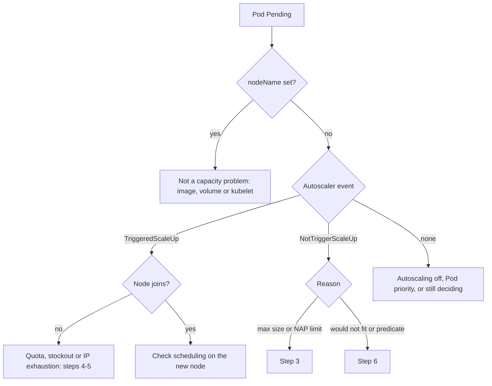

How to find out why Pods stay `Pending` on GKE while the cluster autoscaler adds no node, and how to fix it without creating a bigger problem. The autoscaler only adds a node when it can prove that a new node from some node pool would let the Pod schedule, that the pool is allowed to grow, and that Compute Engine can actually create the VM. Each of those can fail on its own, and each leaves a different trace. Read the trace first, then fix the one thing that is wrong.

> [!info] Scope and verification
> The commands were not run against a live cluster and the note is not marked `verified`. Flags were checked against the built-in `gcloud` help (SDK 570.0.0) and event names against the upstream cluster autoscaler FAQ on 2026-10-21; no Google Cloud documentation page could be read. GKE runs its own managed build of the autoscaler, so upstream defaults may differ on GKE. Items marked **not verified** must be checked against the current GKE documentation before you rely on them.

## When to use

- `kubectl get pods` shows `Pending`, `kubectl describe pod` shows a `FailedScheduling` event, and no new node appears after several minutes.
- A node pool sits at a steady size while a queue of Pods (CI jobs, batch work, a scale-out) waits; see [[gitlab-runner-jobs-stuck-pending]] for the CI runner case.
- A new node appears in the node pool's managed instance group (MIG) list but never joins the cluster, or appears and disappears.
- After a migration to [[0018-gke-autopilot-for-new-clusters|Autopilot]], Pods wait for capacity that never arrives.

Standard clusters with plain node pool autoscaling and clusters with node auto-provisioning (NAP) are covered below. Autopilot provisions nodes itself, so there are no node pool limits to tune, but quota, zone stockouts, IP exhaustion and Pod-side constraints still apply. How Autopilot reports these is **not verified**; read the Pod events and check the Autopilot documentation.

For background on what the autoscaler does and does not do, see [[kubernetes-autoscaling]].

## Preconditions

- `container.clusters.get` and `compute.instanceGroupManagers.list` (the Compute Viewer role covers the second), plus `logging.logEntries.list` to read logs.
- Node pools are managed in Terraform. Emergency `gcloud` changes below must be written back to Terraform the same day, or the next `terraform apply` reverts them; see [[terraform-basics-on-gcp]].
- An incident or change record if you will raise limits, add node pools or change networking.

```bash title="variables"
PROJECT=example-project
CLUSTER=prod-gke
LOCATION=europe-west1          # region for a regional cluster, zone for a zonal one
REGION=europe-west1
NS=app
POD=worker-7d9c6b6f4-abcde
gcloud config set project "$PROJECT"
gcloud container clusters get-credentials "$CLUSTER" --location "$LOCATION"
```

## Steps



### 1. Confirm the Pod is unschedulable, not waiting on something else

A Pod in phase `Pending` is not always waiting for a node. If `.spec.nodeName` is already set, the scheduler placed it and the wait is on the node: image pull, volume mount or the kubelet. That is a different runbook: [[kubernetes-pod-troubleshooting]] or [[gke-image-pull-registry-failures]].

```bash
kubectl get pods -A --field-selector=status.phase=Pending \
  -o custom-columns='NS:.metadata.namespace,POD:.metadata.name,NODE:.spec.nodeName,PRIO:.spec.priority,AGE:.metadata.creationTimestamp'

kubectl -n "$NS" get pod "$POD" -o jsonpath='{.spec.nodeName}{"\n"}{.status.conditions[?(@.type=="PodScheduled")]}{"\n"}'
kubectl -n "$NS" describe pod "$POD" | sed -n '/Events:/,$p'
```

Read the `FailedScheduling` message from the scheduler. It sums up why each existing node was rejected (insufficient CPU or memory, untolerated taint, node affinity mismatch, volume node affinity conflict). Then rule out the two common non-capacity causes:

- **An unbound PersistentVolumeClaim.** The scheduler reports that the Pod has unbound claims. Check `kubectl -n "$NS" get pvc`; a claim waiting on a storage class or a provisioner is not fixed by a new node.
- **A Pod that is nominated for preemption.** `kubectl -n "$NS" get pod "$POD" -o jsonpath='{.status.nominatedNodeName}'` shows a node where the scheduler is evicting lower-priority Pods to make room; see [[priority-classes-and-preemption]].

### 2. Read the autoscaler's verdict

The cluster autoscaler writes events on the Pod. The upstream FAQ documents these:

| Event on the Pod    | Meaning                                                                                    |
| ------------------- | ------------------------------------------------------------------------------------------ |
| `TriggeredScaleUp`  | The autoscaler decided to scale up a node group for this Pod. Go to step 4 if no node joins. |
| `NotTriggerScaleUp` | No node group could be scaled up to make this Pod schedulable. The message says why.       |
| (no event)          | Autoscaling is off for every fitting pool, the Pod's priority is too low, or the decision is still pending. |

```bash
kubectl -n "$NS" get events --field-selector involvedObject.name="$POD" \
  --sort-by=.lastTimestamp -o custom-columns='TIME:.lastTimestamp,REASON:.reason,SOURCE:.source.component,MESSAGE:.message'

# Cluster-wide view of autoscaler decisions in the last hour of retained events
kubectl get events -A --field-selector reason=NotTriggerScaleUp --sort-by=.lastTimestamp | tail -20
kubectl get events -A --field-selector reason=TriggeredScaleUp --sort-by=.lastTimestamp | tail -20
```

A typical `NotTriggerScaleUp` message lists, per node group, why a new node would not help: for example that the Pod would not fit even on an empty node, that it fails a node selector or affinity predicate, or that the group is at its maximum size. That message usually points straight at step 3 or step 6.

Kubernetes events expire (often after about an hour), so for an incident that started earlier, use the GKE autoscaler visibility logs in Cloud Logging. GKE writes autoscaler decisions (scale-up, no-scale-up and the reasons) as structured log entries.

> [!warning] Not verified: visibility log name and reason codes
> The log name below, the `noScaleUp` and `scaleUp` payload structure and the reason codes inside it were not confirmed against current documentation. Check the GKE page on viewing cluster autoscaler events before building alerts on them. If the query returns nothing, open Logs Explorer, select the cluster's resource and look for the autoscaler visibility log there.

```bash
gcloud logging read \
  "resource.type=\"k8s_cluster\" AND resource.labels.cluster_name=\"$CLUSTER\" AND logName=\"projects/$PROJECT/logs/container.googleapis.com%2Fcluster-autoscaler-visibility\"" \
  --freshness=6h --limit=50 --format=json > autoscaler-visibility.json

jq -r '.[] | [.timestamp, (.jsonPayload | keys | join(","))] | @tsv' autoscaler-visibility.json | head -20
```

Upstream behaviour worth knowing, with the caveat that GKE may use different values:

- A node the autoscaler requested is expected to register within 15 minutes (`--max-node-provision-time`, upstream default 15m).
- After a failed scale-up, the node group is put in backoff: initial 5 minutes, at most 30 minutes, reset after 3 hours (upstream defaults). During backoff the autoscaler tries other groups or nothing, so one failed attempt can look like "it stopped trying".

### 3. Check node pool limits and auto-provisioning limits

**Node pool autoscaling.** List each pool with its limits, then count its current nodes per zone.

```bash
gcloud container node-pools list --cluster "$CLUSTER" --location "$LOCATION" \
  --format="table(name,config.machineType,locations.list(),autoscaling.enabled,autoscaling.minNodeCount,autoscaling.maxNodeCount,autoscaling.totalMinNodeCount,autoscaling.totalMaxNodeCount,autoscaling.locationPolicy)"

kubectl get nodes -L cloud.google.com/gke-nodepool,topology.kubernetes.io/zone --no-headers \
  | awk '{print $6, $7}' | sort | uniq -c
```

Adjust the `awk` columns if your `kubectl get nodes` output has a different number of columns. Points that trip people up:

- `--min-nodes` and `--max-nodes` are **per zone**. A regional pool in three zones with `--max-nodes=5` stops at 15 nodes, and at 5 in a zone where the other two cannot take the Pod (for example a zonal disk). `--total-min-nodes` and `--total-max-nodes` set the limit for the whole pool instead; the two styles are mutually exclusive.
- `--location-policy` is `BALANCED` (best-effort balance across zones) or `ANY` (prefer unused reservations and lower Spot preemption risk). Which one is the default for your pool type is **not verified**; read it from the describe output above.
- A pool with `autoscaling.enabled` empty or false never scales, however long the queue.

**Node auto-provisioning (NAP).** NAP limits are cluster-wide. Whether they also cap the autoscaling of node pools you created yourself is **not verified** here; check the GKE node auto-provisioning documentation. If they do, a cluster at its NAP CPU or memory maximum stops growing even when every pool is below its own maximum, so compare current cluster totals with the limits below.

```bash
gcloud container clusters describe "$CLUSTER" --location "$LOCATION" \
  --format="yaml(autoscaling.enableNodeAutoprovisioning,autoscaling.resourceLimits,autoscaling.autoscalingProfile,autoscaling.autoprovisioningLocations)"

# Current total allocatable CPU and memory, to compare with the limits
kubectl get nodes -o json | jq -r '
  [.items[].status.capacity] |
  {cpu: (map(.cpu | tonumber) | add),
   memory_gib: (map(.memory | sub("Ki$";"") | tonumber) | add / 1048576 | floor)}'
```

NAP limits are expressed in cores and gigabytes of memory for the whole cluster. Whether GKE counts node capacity or allocatable against them is **not verified**, so compare the limit with capacity (the larger number) to be safe. Adjust the `jq` unit handling if your nodes report memory in a unit other than `Ki`. A Pod that needs a GPU also needs a `--max-accelerator` limit for that accelerator type, or NAP cannot create a pool for it.

**Fix through Terraform** (the change in the existing resources):

```hcl title="gke/node_pools.tf"
resource "google_container_node_pool" "general" {
  name     = "general"
  cluster  = google_container_cluster.prod.id
  location = "europe-west1"

  autoscaling {
    total_min_node_count = 3
    total_max_node_count = 45 # was 30; capacity review in the incident record
    location_policy      = "BALANCED"
  }

  # node_config, management and upgrade_settings unchanged
}
```

```hcl title="gke/cluster.tf"
resource "google_container_cluster" "prod" {
  # ...
  cluster_autoscaling {
    enabled             = true
    autoscaling_profile = "BALANCED"
    resource_limits {
      resource_type = "cpu"
      minimum       = 0
      maximum       = 512
    }
    resource_limits {
      resource_type = "memory"
      minimum       = 0
      maximum       = 2048
    }
  }
}
```

Keep both the `cpu` and `memory` blocks, and check the provider documentation before removing a `resource_limits` block. Plan, review and apply as usual. In an outage the equivalent `gcloud` change is:

```bash
gcloud container node-pools update general --cluster "$CLUSTER" --location "$LOCATION" \
  --enable-autoscaling --total-min-nodes=3 --total-max-nodes=45

gcloud container clusters update "$CLUSTER" --location "$LOCATION" \
  --enable-autoprovisioning --max-cpu=512 --max-memory=2048
```

Write the same values into Terraform straight after. Raising a maximum raises the cost ceiling; record it, and see [[finops-cost-allocation-and-guardrails]] for who approves that.

### 4. Check quota and zone stockouts

When the Pod shows `TriggeredScaleUp` but no node joins, the autoscaler asked the node pool's MIG to grow and Compute Engine refused or could not deliver. The MIG keeps the errors.

```bash
POOL=general
gcloud container node-pools describe "$POOL" --cluster "$CLUSTER" --location "$LOCATION" \
  --format="value(instanceGroupUrls)" | tr ';' '\n' > mig-urls.txt
cat mig-urls.txt

# Each URL ends in .../zones/<zone>/instanceGroupManagers/<name>
while read -r url; do
  zone=$(echo "$url" | awk -F/ '{for(i=1;i<=NF;i++) if($i=="zones") print $(i+1)}')
  mig=$(basename "$url")
  echo "== $zone $mig"
  gcloud compute instance-groups managed list-errors "$mig" --zone "$zone" --limit 10 \
    --format="table(timestamp,error.code,error.message)"
done < mig-urls.txt
```

The error codes to look for (quote these; the full message wording varies):

- `ZONE_RESOURCE_POOL_EXHAUSTED` or `ZONE_RESOURCE_POOL_EXHAUSTED_WITH_DETAILS`: a **stockout**. The zone has no capacity for that machine type (or for Spot or GPU capacity) right now. Your quota is fine.
- `QUOTA_EXCEEDED`: a regional or project **quota** is used up, commonly CPUs, a CPU family, in-use addresses, persistent disk or GPUs.

Check regional quota usage directly:

```bash
gcloud compute regions describe "$REGION" --flatten=quotas \
  --format="table(quotas.metric,quotas.usage,quotas.limit)" \
  | awk 'NR==1 || ($3>0 && $2/$3 > 0.8)'
```

Mitigations, roughly in order of speed:

| Cause                    | Short term                                                                                                   | Lasting fix                                                                            |
| ------------------------ | ------------------------------------------------------------------------------------------------------------ | -------------------------------------------------------------------------------------- |
| Stockout in one zone     | Let a regional pool grow in the other zones (raise the per-zone max or use total limits); move non-zonal Pods. | Spread pools across three zones; keep a second machine family as a fallback pool.       |
| Stockout of a family     | Add a node pool with a different machine family that fits the requests (Terraform, then apply).               | Reservations for baseline capacity; with `ANY` location policy, unused reservations are preferred. |
| Spot capacity gone       | Let a standard (on-demand) pool take the work, if its taints and priorities allow it.                         | A mixed Spot and on-demand design with a priority cut-off.                              |
| Quota exceeded           | Free unused resources in the same region (idle pools, orphaned disks and addresses).                          | Request a quota increase through the Google Cloud quota process before the next peak.  |

How quota increase requests are made and how fast they are granted change over time and are **not verified** here; check the current Cloud Quotas documentation.

### 5. Check Pod IP and node IP exhaustion

On a VPC-native cluster every node takes a block of Pod IPs from the cluster's Pod secondary range, sized from the node's maximum Pods. Per the GKE API reference, the block is twice the max Pods per node rounded up to the next power of two: with 30 max Pods per node, each node takes 64 addresses (a `/26`). When the Pod range has no free block left, no new node can be created, whatever the node pool limits say.

```bash
gcloud container clusters describe "$CLUSTER" --location "$LOCATION" \
  --format="yaml(ipAllocationPolicy.clusterSecondaryRangeName,ipAllocationPolicy.clusterIpv4CidrBlock,ipAllocationPolicy.servicesSecondaryRangeName,ipAllocationPolicy.defaultPodIpv4RangeUtilization,ipAllocationPolicy.additionalPodRangesConfig,defaultMaxPodsConstraint,subnetwork)"

gcloud container node-pools list --cluster "$CLUSTER" --location "$LOCATION" \
  --format="table(name,maxPodsConstraint.maxPodsPerNode,networkConfig.podRange,networkConfig.podIpv4CidrBlock)"
```

`defaultPodIpv4RangeUtilization` is the share of the default Pod range already handed to nodes; at or near `1` the range is full. Worked example: a `/20` Pod range holds 4096 addresses; at 64 addresses per node that is 64 nodes, across all zones and pools that use the range.

The defaults for max Pods per node on Standard and Autopilot, and the default per-node range size, are **not verified** here; read the values above from your cluster instead of assuming them.

Fixes, from least to most invasive:

1. **Add another Pod range to the cluster (discontiguous multi-Pod CIDR).** Create a new secondary range on the subnet, then make it available to the cluster, then put a new node pool on it.

```bash
SUBNET=gke-prod-nodes
NEW_RANGE=gke-prod-pods-2
NEW_CIDR=10.80.0.0/18   # must not overlap any range in the VPC or in peered and on-premises networks

gcloud compute networks subnets update "$SUBNET" --region "$REGION" \
  --add-secondary-ranges="$NEW_RANGE=$NEW_CIDR"

gcloud container clusters update "$CLUSTER" --location "$LOCATION" \
  --additional-pod-ipv4-ranges="$NEW_RANGE"

gcloud container node-pools create general-2 --cluster "$CLUSTER" --location "$LOCATION" \
  --pod-ipv4-range="$NEW_RANGE" --max-pods-per-node=64 \
  --machine-type=e2-standard-8 --enable-autoscaling --total-min-nodes=0 --total-max-nodes=30
```

In Terraform these are `secondary_ip_range` on `google_compute_subnetwork`, `ip_allocation_policy.additional_pod_ranges_config.pod_range_names` on the cluster, and `network_config.pod_range` on the new node pool. A node pool's Pod range **cannot be changed after creation**, so moving existing workloads means a new pool and a migration; see [[gke-node-pool-upgrade-strategies]]. The maximum number of additional ranges and the minimum GKE version are **not verified**.

2. **Lower max Pods per node on a new pool.** Halving max Pods halves the address block per node, so the same range holds twice as many nodes. Check that the Pods per node you actually run fit under the new value.

3. **Node (primary) range full.** Nodes take their own IPs from the subnet's primary range. If that is exhausted, the primary range can be expanded:

```bash
gcloud compute networks subnets describe "$SUBNET" --region "$REGION" --format="value(ipCidrRange)"
gcloud compute networks subnets expand-ip-range "$SUBNET" --region "$REGION" --prefix-length=20
```

> [!danger] Subnet expansion only grows
> Per the Compute Engine API reference the new primary range must be a superset of the old one, so there is no shrinking it back: plan it as a one-way change. Check first that the larger range does not overlap other subnets, peered VPCs, VPN or Interconnect routes, or on-premises networks; see [[ip-addressing-and-subnets]]. The `gcloud` help states that this command does not work for secondary ranges, so it is not a fix for a full Pod range.

For the address plan behind these ranges, see [[gke-platform-topology-and-tenancy]] and [[gcp-vpc-compute-and-cloud-sql]].

### 6. Check Pod-side blockers

If `NotTriggerScaleUp` says the Pod would not fit on a new node from any group, the Pod asks for something no node pool can provide.

```bash
kubectl -n "$NS" get pod "$POD" -o json | jq '{
  requests: [.spec.containers[].resources.requests],
  nodeSelector: .spec.nodeSelector,
  affinity: .spec.affinity.nodeAffinity,
  tolerations: .spec.tolerations,
  topologySpread: .spec.topologySpreadConstraints,
  priorityClassName: .spec.priorityClassName,
  priority: .spec.priority,
  volumes: [.spec.volumes[]? | select(.persistentVolumeClaim) | .persistentVolumeClaim.claimName]
}'

kubectl get nodes -o custom-columns='NODE:.metadata.name,POOL:.metadata.labels.cloud\.google\.com/gke-nodepool,TYPE:.metadata.labels.node\.kubernetes\.io/instance-type,CPU:.status.allocatable.cpu,MEM:.status.allocatable.memory,TAINTS:.spec.taints[*].key'
```

| Blocker                                   | How to see it                                                                                       | Fix                                                                                                           |
| ----------------------------------------- | --------------------------------------------------------------------------------------------------- | ------------------------------------------------------------------------------------------------------------- |
| Requests larger than any node             | Requests exceed the allocatable of the largest machine type in any pool, after DaemonSet overhead.  | Right-size the request ([[0021-mandatory-resource-requests]]) or add a pool with a larger machine type.      |
| Node selector or required node affinity   | Labels that no pool's node template carries (a typo, or a pool that was renamed).                   | Fix the selector, or add the label to the pool's Terraform `node_config.labels`.                             |
| Taints without tolerations                | Every pool that could fit is tainted (GPU, Spot, dedicated tenant pools).                           | Add the right toleration, or let a general pool take the Pod.                                                 |
| Zonal volume                              | The Pod's PVC is bound to a zonal disk, and the pool cannot grow in that zone (max, stockout).      | Allow growth in that zone; for StatefulSets in multi-zone pools, the upstream FAQ recommends one pool per zone. See [[stateful-workloads-gke]]. |
| Topology spread or anti-affinity          | `DoNotSchedule` spread constraints or required anti-affinity that new nodes cannot satisfy.         | Relax to `ScheduleAnyway` or preferred anti-affinity, or allow the pool in more zones.                       |
| Low priority                              | Upstream, Pods below a priority cut-off do not trigger scale-up. The cut-off on GKE is **not verified**. | Give real workloads a normal PriorityClass; see [[priority-classes-and-preemption]].                       |

Remember that a new node must fit the Pod **plus** every DaemonSet that will land on it. A Pod that fits the machine type on paper can still fail to fit once logging, monitoring and security agents take their share.

### 7. Short-term mitigation while the fix lands

When the real fix (quota, a new range, a capacity review) takes hours, buy time in this order:

1. Pause or scale down low-priority work that competes for the same pool (batch jobs, non-urgent CI), so the Pods that matter fit on existing nodes.
2. Add a temporary node pool in another zone or machine family through Terraform, with an owner and a removal date in the incident record.
3. Lower over-sized requests for the blocked workload if usage data supports it.
4. Do not delete PodDisruptionBudgets or evict Pods by force to make room; that trades a capacity problem for an availability problem. See [[pods-stuck-terminating-and-blocked-drains]].

## Validation

```bash
kubectl -n "$NS" get pod "$POD" -o wide                         # Running, on a node
kubectl get events -A --field-selector reason=TriggeredScaleUp --sort-by=.lastTimestamp | tail -5
kubectl get nodes -L cloud.google.com/gke-nodepool,topology.kubernetes.io/zone   # new nodes Ready
kubectl get pods -A --field-selector=status.phase=Pending --no-headers | wc -l     # back to the usual level

while read -r url; do
  zone=$(echo "$url" | awk -F/ '{for(i=1;i<=NF;i++) if($i=="zones") print $(i+1)}')
  gcloud compute instance-groups managed list-errors "$(basename "$url")" --zone "$zone" --limit 3
done < mig-urls.txt                                             # no new errors since the fix

gcloud container clusters describe "$CLUSTER" --location "$LOCATION" \
  --format="value(ipAllocationPolicy.defaultPodIpv4RangeUtilization)"
```

Then watch the next real peak: the Pending count should return to near zero within the time it takes to provision a node, and the autoscaler should show `TriggeredScaleUp` followed by new nodes, not `NotTriggerScaleUp`.

## Rollback

- **Limits and node pools:** revert the Terraform change and apply. Lowering a maximum below the current size lets the autoscaler scale down over time; it does not delete nodes at once. Remove a temporary pool only after its Pods have moved, by draining it.
- **gcloud emergency changes:** if they were not written back, the next Terraform apply reverts them; decide which value you want and make Terraform say it.
- **Additional Pod range:** delete the node pools that use it first, then remove it with `gcloud container clusters update "$CLUSTER" --location "$LOCATION" --remove-additional-pod-ipv4-ranges="$NEW_RANGE"`, then remove the secondary range from the subnet. Whether removal is refused while a pool still uses the range is **not verified**.
- **Subnet primary range expansion:** cannot be rolled back. That is why it comes last and needs an address plan review.

## Troubleshooting

| Symptom                                                             | Likely cause and fix                                                                                                   |
| ------------------------------------------------------------------- | ---------------------------------------------------------------------------------------------------------------------- |
| No autoscaler event at all on the Pod                               | Autoscaling disabled on the fitting pools, or the Pod's priority is below the cut-off. Check step 3 and step 6.        |
| `TriggeredScaleUp`, then nothing for 15 minutes or more              | MIG errors: stockout or quota (step 4), or a node that is created but never registers (check its serial output and [[gke-node-notready-triage]]). |
| `NotTriggerScaleUp` mentioning max size                             | Per-zone maximum reached in the zone the Pod needs, or the NAP cluster limit. Step 3.                                  |
| `NotTriggerScaleUp`: would not fit even on a new node                | Requests, selectors, taints or affinity. Step 6.                                                                       |
| Scale-up works in two zones, never in the third                     | Stockout or a zonal disk constraint in that zone. Step 4 and the zonal volume row in step 6.                           |
| New nodes appear, Pods still Pending                                | DaemonSet overhead or a spread constraint; or the Pods want another pool. Compare node allocatable with requests.      |
| Many Pods Pending after an upgrade or pool migration                | Surge capacity or quota consumed by the upgrade; see [[gke-cluster-upgrade]].                                          |
| Pods Pending only during peaks, cleared later                       | Scale-up latency, not a fault. Consider over-provisioning with low-priority placeholder Pods; see [[kubernetes-autoscaling]]. |

## Related

- [[kubernetes-pod-troubleshooting]] for Pods that are scheduled but do not start.
- [[kubernetes-autoscaling]] for how HPA, VPA and the cluster autoscaler fit together.
- [[priority-classes-and-preemption]] for priority, preemption and placeholder Pods.
- [[0018-gke-autopilot-for-new-clusters]] and [[0021-mandatory-resource-requests]] for the decisions behind cluster mode and requests.
- [[gke-platform-topology-and-tenancy]] for node pool and address planning.
- [[finops-cost-allocation-and-guardrails]] for the cost side of raising limits.
- [[gitlab-runner-jobs-stuck-pending]] for CI job Pods waiting on capacity.
- [[pods-stuck-terminating-and-blocked-drains]] for the opposite problem: nodes that will not drain.

## Sources

- [Cluster autoscaler FAQ (upstream)](https://github.com/kubernetes/autoscaler/blob/master/cluster-autoscaler/FAQ.md): Pod and node event names, reasons for no scale-up, the one-pool-per-zone advice for zonal volumes, and the upstream provisioning and backoff defaults. Read 2026-10-21.
- `gcloud` built-in help, SDK 570.0.0, 2026-10-21: `container node-pools update|create` (autoscaling, location policy, Pod range and max Pods flags), `container clusters update` (NAP limits, additional Pod ranges), `compute instance-groups managed list-errors`, `compute networks subnets update|expand-ip-range`.
- Google API reference (discovery documents) for `container.googleapis.com` v1 and `compute` v1, 2026-10-21: the per-node Pod CIDR sizing example, `defaultPodIpv4RangeUtilization`, node pool Pod range immutability, and the superset rule for subnet expansion.
- [Terraform google provider: google_container_node_pool](https://registry.terraform.io/providers/hashicorp/google/latest/docs/resources/container_node_pool) and [google_container_cluster](https://registry.terraform.io/providers/hashicorp/google/latest/docs/resources/container_cluster): autoscaling and `cluster_autoscaling` fields (read from the provider source).
- See also, not read for this note: [GKE cluster autoscaler](https://cloud.google.com/kubernetes-engine/docs/concepts/cluster-autoscaler), [Viewing cluster autoscaler events](https://cloud.google.com/kubernetes-engine/docs/how-to/cluster-autoscaler-visibility), [Node auto-provisioning](https://cloud.google.com/kubernetes-engine/docs/how-to/node-auto-provisioning), [Expanding a subnet](https://cloud.google.com/vpc/docs/using-vpc#expand-subnet).
