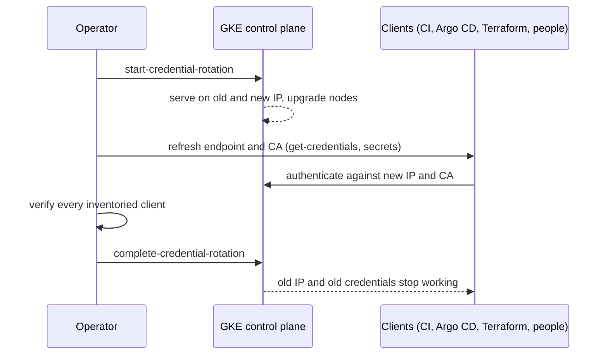

How to rotate a GKE cluster's credentials (its cluster certificate authority and the credentials derived from it) together with the control plane IP address. The rotation runs in two phases. Starting it gives the cluster a new IP and new credentials while the old IP keeps serving; completing it stops the old IP and invalidates the old credentials. Everything outside the cluster that pinned the old CA or the old address (CI pipelines, Argo CD, Terraform providers, kubeconfigs on laptops, firewall allowlists) breaks at the moment of completion unless it was refreshed in between. The work in this runbook is mostly that inventory and refresh, not the two commands.

> [!info] Scope and verification
> The commands were not run against a live cluster and the note is not marked `verified`. The rotation flags, their one-line effects and the `describe` fields were checked against the `gcloud` help (SDK 570.0.0) and the GKE API reference on 2026-10-21. The note was not checked against the GKE credential rotation documentation page. Its details (CA lifetime, exactly which nodes are recreated, whether old credentials stay valid during the rotation, automatic completion and any way to abort) are marked **not verified** below; read the current page before you start.

## When to use

- The cluster CA is approaching its expiry date (step 1 shows how to read it).
- Cluster credentials may have leaked or the cluster may be compromised, and you need old credentials to stop working; see [[compromised-cloud-cluster-containment]] and [[leaked-credential-rotation]].
- You need the control plane IP to change. If only the IP must change, `gcloud` also has a separate `--start-ip-rotation` and `--complete-ip-rotation` pair; this runbook covers the combined credential rotation.

If the control plane is unreachable rather than due for rotation, see [[gke-control-plane-unavailable]].

## Preconditions

- **A window and a change record.** Starting the rotation triggers a node upgrade (per the `gcloud` help), so treat it like a node pool upgrade: no change freeze, capacity for surge, and PDBs that allow drains. See [[change-freezes-and-maintenance-windows]], [[production-change-checklist]] and [[gke-cluster-upgrade]].
- **A client inventory** (step 2), with an owner for each client and a tested refresh method.
- **Permission** to update the cluster (`container.clusters.update`, for example through Kubernetes Engine Cluster Admin) and to change the CI variables, Argo CD cluster secrets and Terraform state that hold the old values.
- **No other cluster operation in progress.** Check that the cluster is `RUNNING`, not `RECONCILING`.

```bash title="variables"
PROJECT=example-project
CLUSTER=prod-gke
LOCATION=europe-west1
gcloud config set project "$PROJECT"
```

## Steps



### 1. Read the current endpoint, CA and cluster state

The cluster `describe` output carries the CA certificate (base64-encoded) and the endpoints, but no expiry field, so read the expiry from the certificate itself.

```bash
gcloud container clusters describe "$CLUSTER" --location "$LOCATION" \
  --format="yaml(status,currentMasterVersion,endpoint,privateClusterConfig,controlPlaneEndpointsConfig)"

gcloud container clusters describe "$CLUSTER" --location "$LOCATION" \
  --format="value(masterAuth.clusterCaCertificate)" | base64 -d > cluster-ca-before.pem

openssl x509 -in cluster-ca-before.pem -noout -subject -enddate -fingerprint -sha256
```

On macOS, `base64 -d` works on recent versions; older ones need `base64 -D`. Keep `cluster-ca-before.pem` and the `endpoint` value in the change record: you will compare them after each phase. The CA certificate is public material, not a secret, but the endpoint and fingerprint are internal details that do not belong in public tickets.

Note which endpoints exist:

- `endpoint` and `controlPlaneEndpointsConfig.ipEndpointsConfig` hold the IP-based endpoints (public and private).
- `controlPlaneEndpointsConfig.dnsEndpointConfig.endpoint` is the DNS-based endpoint, if enabled. The `gcloud` help calls DNS-based control plane access recommended.

> [!warning] Not verified: IP changes on private and DNS endpoints
> Whether the rotation changes the private endpoint IP, how it behaves for clusters that use Private Service Connect, and whether clients that use the DNS-based endpoint are unaffected by the IP change are not verified. Clients on the DNS endpoint still need the new CA if they pin it. Read the GKE credential rotation page for your cluster type before the window.

### 2. Inventory every client that holds the CA or the endpoint

This is reasoning about your estate, not something GKE tells you. Search for both the old endpoint IP and the CA, and list each client with its owner and how it refreshes.

| Client                                                                                                 | What it pins                                                                                   | How to refresh                                                                                                                           |
| ------------------------------------------------------------------------------------------------------ | ---------------------------------------------------------------------------------------------- | ---------------------------------------------------------------------------------------------------------------------------------------- |
| People's kubeconfigs                                                                                   | Server address and `certificate-authority-data`                                                | `gcloud container clusters get-credentials` after start. Announce it before the window.                                                  |
| CI jobs that run `get-credentials` at job start                                                        | Nothing long-lived                                                                             | Nothing. This is the pattern to aim for; see [[iam-groups-and-ci-workload-identity-federation]].                                         |
| CI jobs with a stored kubeconfig variable                                                              | Server and CA inside the stored file                                                           | Replace the variable after start, or better, switch the job to `get-credentials` with workload identity federation.                      |
| Argo CD managing this cluster as an external cluster                                                   | `server` and, inside the `config` field's JSON, `tlsClientConfig.caData` in the cluster Secret | Update the Secret (declaratively, in Git) after start; see [[argocd-sync-failure-and-drift]] and [[gitops-repo-topology-and-promotion]]. |
| Terraform `kubernetes` and `helm` providers                                                            | Host and CA, usually read from the `google_container_cluster` resource or data source          | A refresh or plan after start picks up the new values if the provider reads them from the resource; hard-coded values must be edited.    |
| Firewall rules, proxies and allowlists                                                                 | The control plane IP, as an egress destination                                                 | Add the new IP after start; remove the old one after completion.                                                                         |
| Monitoring and probes that hit the API server                                                          | Address and CA                                                                                 | Update and confirm they still report.                                                                                                    |
| Other clusters or tools (service meshes, backup tools, policy engines registered against this cluster) | Varies                                                                                         | Check each product's docs for how it stores cluster credentials.                                                                         |

Useful searches, run in your infrastructure repositories (not in public places):

```bash
OLD_ENDPOINT=$(gcloud container clusters describe "$CLUSTER" --location "$LOCATION" --format="value(endpoint)")
CA_B64=$(gcloud container clusters describe "$CLUSTER" --location "$LOCATION" --format="value(masterAuth.clusterCaCertificate)")
# First 40 characters of the base64 CA are enough to find copies
git grep -n -e "$OLD_ENDPOINT" -e "${CA_B64:0:40}" -- . ':!*.lock'
case $? in 0) ;; 1) echo "no copies in this repository" ;; *) echo "STOP: git grep failed; nothing was searched" ;; esac

# Argo CD: list cluster Secrets and their server addresses
kubectl -n argocd get secrets -l argocd.argoproj.io/secret-type=cluster \
  -o jsonpath='{range .items[*]}{.metadata.name}{"\t"}{.data.server}{"\n"}{end}' \
  | while IFS=$'\t' read -r name server; do printf '%s\t%s\n' "$name" "$(echo "$server" | base64 -d)"; done
```

The Argo CD commands run against the cluster that hosts Argo CD. The `${CA_B64:0:40}` expansion works in bash and zsh.

### 3. Start the rotation

```bash
gcloud container clusters update "$CLUSTER" --location "$LOCATION" --start-credential-rotation
```

Per the `gcloud` help, this makes the cluster **serve on two IPs** and **starts a node upgrade** so nodes point to the new IP. Expect:

- The cluster status to show `RECONCILING` while work is in progress.
- Nodes to be upgraded or recreated in the usual surge or blue-green way; Pods get drained, so PDBs and capacity matter. Which node pools are affected and how is **not verified**; watch them.
- A new `endpoint` and a new CA in `describe` output.

```bash
gcloud container operations list --filter="targetLink~$CLUSTER" --sort-by=~startTime --limit=5
gcloud container clusters describe "$CLUSTER" --location "$LOCATION" --format="value(status,endpoint)"
kubectl get nodes -o wide
```

Whether the old credentials and old CA are accepted alongside the new ones until completion is **not verified**; the `gcloud` help says only that the cluster serves on two IPs. Plan as if clients must move to the new IP and CA before completion, and test that they do.

Wait until the operation is done and the status is back to `RUNNING` before step 4.

### 4. Refresh every client

Start with your own kubeconfig and compare with the values from step 1:

```bash
gcloud container clusters get-credentials "$CLUSTER" --location "$LOCATION"
kubectl config view --minify -o jsonpath='{.clusters[0].cluster.server}{"\n"}'
kubectl get --raw /readyz

gcloud container clusters describe "$CLUSTER" --location "$LOCATION" \
  --format="value(masterAuth.clusterCaCertificate)" | base64 -d > cluster-ca-new.pem
openssl x509 -in cluster-ca-new.pem -noout -subject -enddate -fingerprint -sha256
if ! openssl x509 -in cluster-ca-new.pem -noout 2>/dev/null; then echo "STOP: cluster-ca-new.pem is missing or not a certificate"
elif cmp -s cluster-ca-before.pem cluster-ca-new.pem; then echo "CA unchanged: check the operation"
elif [ -s cluster-ca-before.pem ]; then echo "new CA in place"
else echo "STOP: cluster-ca-before.pem is missing; compare with the fingerprint recorded in step 1"; fi
```

Then work through the inventory from step 2, updating each client through its normal change path. For Argo CD, update the cluster Secret in Git with the new `server` and, inside the `config` field's JSON, the new `tlsClientConfig.caData` (base64 of the new CA), let it sync, and check that the cluster shows as connected in Argo CD before going on. For stored CI kubeconfigs, replace the variable and run a read-only job (`kubectl version`, `kubectl auth can-i --list`) against the cluster.

Tick off each client in the change record with the time it was verified. Do not move to step 5 with any client unticked.

### 5. Complete the rotation

```bash
gcloud container clusters update "$CLUSTER" --location "$LOCATION" --complete-credential-rotation
```

> [!danger] Completion invalidates the old credentials and stops the old IP
> Per the `gcloud` help, completing makes the cluster stop serving its old IP, return to a single IP, and invalidate old credentials. Any client still on the old endpoint or CA fails from that moment, and there is no command in `gcloud` to undo it. Complete only after step 4 is fully ticked off. In a compromise, completion is the point at which the attacker's copy of the old credentials stops working, so do not delay it longer than the client refresh needs.

### 6. Do not leave the rotation half done

A rotation that is started and never completed leaves the cluster serving on two IPs with the old credentials still in play, which defeats the purpose after a compromise. GKE is understood to complete a pending rotation automatically after a period, but that deadline is **not verified**; read it from the current GKE page and schedule the completion well inside it. If anything forces a pause between start and complete, record the deadline and an owner.

## Validation

```bash
gcloud container clusters describe "$CLUSTER" --location "$LOCATION" --format="value(status,endpoint)"   # RUNNING, new IP
kubectl get --raw /readyz
kubectl get nodes                                       # all Ready, on the expected versions
openssl x509 -in cluster-ca-new.pem -noout -enddate     # the new expiry, recorded in the change
```

Then confirm from the outside, for every client in the inventory:

- A CI pipeline that deploys to the cluster runs green.
- Argo CD shows the cluster connected and applications `Synced` and `Healthy`.
- `terraform plan` for the cluster's Kubernetes-level resources runs without authentication errors.
- Monitoring that scrapes or probes the API server still reports.
- A connection to the **old** IP fails (proves completion took effect). Remove the old IP from allowlists.

Set a reminder well ahead of the new CA's expiry date.

## Rollback

- **Before completion:** do not complete. Clients that have not moved keep working on the old IP for as long as the rotation stays open (until the automatic completion deadline, which is not verified). Fix the broken clients, then complete. No `gcloud` command to cancel a started rotation was found; check the GKE documentation if you need one.
- **After completion:** there is no rollback. The old credentials are invalid by design. Recover each broken client by refreshing it (`get-credentials`, new CA in its Secret or variable, new IP in its allowlist).
- **Client changes** (Argo CD Secrets, CI variables, firewall rules) follow their own Git or change history; revert only the ones that were wrong, never back to the old CA after completion.

## Troubleshooting

| Symptom                                                             | Likely cause and fix                                                                                                     |
| ------------------------------------------------------------------- | ------------------------------------------------------------------------------------------------------------------------ |
| `x509: certificate signed by unknown authority`                     | The client still has the old CA. Re-run `get-credentials`, or update the CA in the Secret or variable.                   |
| Timeouts or `connection refused` to the API server after completion | The client still uses the old IP, or a firewall or proxy allowlist does not include the new IP.                          |
| Argo CD cluster shows a connection error or `Unknown` status        | The cluster Secret has the old `server` or `caData`. Update it in Git and resync; see [[argocd-sync-failure-and-drift]]. |
| Terraform `kubernetes` provider fails with x509 or timeout          | Hard-coded host or CA, or a plan using stale data. Read both from the cluster resource or data source and re-plan.       |
| Node upgrade during start stalls on one node                        | A PDB with no allowed disruptions. See [[pods-stuck-terminating-and-blocked-drains]].                                    |
| Cluster stays `RECONCILING` for a long time                         | Node upgrade in progress. Follow `gcloud container operations list`; do not start other cluster operations meanwhile.    |
| `get-credentials` works but `kubectl` still hits the old address    | Several kubeconfig contexts for the same cluster. Check `kubectl config get-contexts` and delete the stale one.          |

## Related

- [[gke-control-plane-unavailable]] for API server reachability problems.
- [[compromised-cloud-cluster-containment]] for when the rotation is part of incident response.
- [[argocd-sync-failure-and-drift]] and [[gitops-repo-topology-and-promotion]] for refreshing GitOps cluster registrations.
- [[iam-groups-and-ci-workload-identity-federation]] for CI that fetches credentials per job instead of storing them.
- [[tls-certificate-renewal]] for certificate expiry checks in general.
- [[production-change-checklist]] for running it as a planned change.
- [[private-gke-and-controlled-egress]] for private control plane endpoints and allowlists.

## Sources

- `gcloud container clusters update --help`, SDK 570.0.0, 2026-10-21: `--start-credential-rotation`, `--complete-credential-rotation`, the IP-only rotation pair, and the DNS endpoint flags (`--enable-dns-access` and related).
- Google API reference (discovery document) for `container.googleapis.com` v1, 2026-10-21: `startIpRotation` with `rotateCredentials`, `completeIpRotation`, and the `Cluster` fields `status`, `endpoint`, `masterAuth.clusterCaCertificate` and `controlPlaneEndpointsConfig`.
- See also, not read for this note: [GKE: Rotate your cluster credentials](https://cloud.google.com/kubernetes-engine/docs/how-to/credential-rotation) and [GKE: Rotate your control plane IP](https://cloud.google.com/kubernetes-engine/docs/how-to/ip-rotation). Read these for the CA lifetime, node behaviour, validity of old credentials during rotation and automatic completion.
- [Argo CD: Declarative setup, clusters](https://argo-cd.readthedocs.io/en/stable/operator-manual/declarative-setup/#clusters) for the cluster Secret format (not read for this note; check the field names for your Argo CD version).
