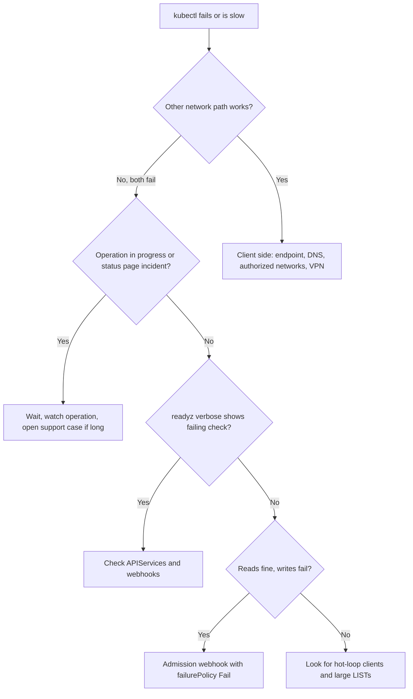

How to work out why `kubectl` and controllers cannot reach a GKE API server, or why it answers slowly or with 5xx errors, and who owns the fix. The control plane is managed by Google, so most of the work is ruling things out: your network path, your admission webhooks, your aggregated APIs and your own clients are far more often the cause than the control plane itself.

> [!info] Scope and verification
> The commands in this note were not run against a live cluster and the note is not marked `verified`. Check the flags with `gcloud container clusters describe --help` and `gcloud container operations list --help`, and compare behaviour with the current GKE troubleshooting and maintenance documentation before relying on any timing or limit.

## When to use

- `kubectl` hangs, times out, or returns `Unable to connect to the server`, `504`, `503` or `etcdserver: request timed out` style errors.
- Controllers (Argo CD, cert-manager, operators) log API errors at the same time and lag behind.
- Creates and updates fail with `failed calling webhook`, but reads still work.
- Everything is slow, but `gcloud container clusters describe` still reports `RUNNING`.

If only one node is unhealthy, use [[gke-node-notready-triage]]. If the symptom is a single expired certificate on a webhook, go straight to [[admission-webhook-certificate-expiry]].

## Preconditions

- Credentials that work outside the cluster: `gcloud` access with `roles/container.viewer` at least, and a second network path if you have one (a bastion, Cloud Shell, or a different VPN) so you can tell a client problem from a server problem.
- A named incident lead and channel if impact is broad; start [[incident-response]] first and triage second.
- Know whether the cluster is zonal or regional. A zonal cluster has a single control plane replica, so its control plane can be briefly unavailable during upgrades or resizes; a regional cluster has replicated control planes. Check the current regional cluster documentation for exactly what that buys you.

```bash
PROJECT=example-project
LOCATION=europe-west1     # region for a regional cluster, zone for a zonal one
CLUSTER=prod-1
gcloud config set project "$PROJECT"
```

> [!note] No etcd commands here
> etcd on GKE is managed by Google and is not reachable from your project. There is nothing to defragment, snapshot or restore yourself. If the evidence points at the datastore, the path forward is a support case, not a command.

## Steps



### 1. Is it us or GKE?

Start with what Google says and what GKE is doing to the cluster right now.

```bash
# Cluster status and any status message
gcloud container clusters describe "$CLUSTER" --location "$LOCATION" \
  --format="yaml(status,statusMessage,currentMasterVersion,endpoint,privateClusterConfig)"

# Recent and running operations: upgrades, repairs, resizes, config updates
gcloud container operations list --filter="targetLink:$CLUSTER" \
  --format="table(name,operationType,status,startTime,endTime)" --limit=15
```

Interpret the result:

- Status `RECONCILING`, or a running `UPDATE_CLUSTER`, `UPGRADE_MASTER` or `REPAIR_CLUSTER` operation: the control plane is being changed. On a zonal cluster a short API interruption during that window is expected. Check the maintenance documentation for what is and is not expected, and do not assume a duration.
- Status `ERROR` or `DEGRADED` with a status message: read the message, then open a support case with the operation name.
- `RUNNING` and nothing in flight: continue, the fault is probably not the managed control plane.

Also check the Google Cloud service health dashboard for your region and the Personalized Service Health view for your project. Check the documented location of both before an incident.

### 2. Client side

Prove the path before blaming the server.

```bash
# What endpoint does kubeconfig use, and is it the one you intend?
kubectl config view --minify -o jsonpath='{.clusters[0].cluster.server}{"\n"}'

# Re-fetch credentials (fixes stale tokens and rotated endpoints)
gcloud container clusters get-credentials "$CLUSTER" --location "$LOCATION"

# Network reachability and TLS to the endpoint, with timing (replace with your endpoint)
ENDPOINT=203.0.113.10
curl -sk -o /dev/null -w 'code=%{http_code} connect=%{time_connect}s total=%{time_total}s\n' \
  "https://$ENDPOINT/healthz"
```

An HTTP `401` or `403` from `curl` still proves the network path works. A timeout does not distinguish a dead endpoint from a blocked path, so test from a second location. Things that commonly break the client path:

- Authorized networks no longer include your egress address (a VPN or office change).
- A private endpoint reached from outside the VPC. See [[private-gke-and-controlled-egress]] for how the endpoints and routes fit together.
- The DNS-based endpoint is in use and your resolver cannot resolve it.
- An IAP, bastion or proxy hop is down or throttling.
- An expired or revoked credential: `kubectl auth whoami` or `gcloud auth list` tells you what you are using.

### 3. Ask the API server how it feels

If you can connect at all, the health endpoints list the failing sub-checks. See the Kubernetes health-check documentation for the current semantics.

```bash
kubectl get --raw='/readyz?verbose' | grep -v '\[+\]'
kubectl get --raw='/livez?verbose'  | grep -v '\[+\]'
```

Lines starting with `[-]` name the failing check. Checks tied to a webhook, an aggregated API or a post-start hook point you to the steps below. Checks that point at the storage backend belong to Google, so collect the output and the time and open a support case.

### 4. Broken aggregated APIs

An `APIService` that is not `Available` slows discovery and can break `kubectl`, namespace deletion and garbage collection. The usual culprit is `metrics-server` or another extension API whose backend Pods are gone.

```bash
kubectl get apiservices | grep -v 'True'

kubectl describe apiservice v1beta1.metrics.k8s.io | sed -n '/Status:/,$p'
kubectl -n kube-system get pods -l k8s-app=metrics-server
```

If the backend is down, restore it. If an addon was uninstalled and left a stale `APIService` behind, deleting that `APIService` object is safe once you are sure nothing uses it. Discovery failures are also the first cause to check when a namespace refuses to delete; see [[namespace-stuck-terminating]].

### 5. Webhooks that fail closed

The signature is that reads work and writes fail with `failed calling webhook`. A `ValidatingWebhookConfiguration` or `MutatingWebhookConfiguration` with `failurePolicy: Fail` blocks every matching request when its backend is unreachable, including requests from Argo CD and Helm.

```bash
kubectl get validatingwebhookconfigurations,mutatingwebhookconfigurations \
  -o custom-columns='KIND:.kind,NAME:.metadata.name,POLICY:.webhooks[*].failurePolicy,TIMEOUT:.webhooks[*].timeoutSeconds'

# Which webhook and which service does the error name?
kubectl get validatingwebhookconfigurations <name> -o jsonpath='{range .webhooks[*]}{.name}{" -> "}{.clientConfig.service.namespace}{"/"}{.clientConfig.service.name}{"\n"}{end}'
kubectl -n <namespace> get endpoints <service>
```

An empty `endpoints` list means the backend is down. Restore it, or, if the cause is an expired certificate, follow [[admission-webhook-certificate-expiry]]. A temporary bypass of a webhook is a security decision: record it, back up the configuration first and restore it afterwards.

> [!warning] Do not delete webhook configurations as a first move
> Deleting a policy or security webhook removes enforcement cluster-wide and some operators recreate it immediately. Prefer fixing the backend; if you must bypass, scope it and write down the revert time.

### 6. Load from clients

A healthy control plane can still be slow because someone is hammering it. Look for hot loops, informers that relist constantly, large unpaged LISTs and CronJobs that fan out.

```bash
# API server request metrics, if your client has access to them
kubectl get --raw /metrics | grep -E '^apiserver_(request_duration_seconds_count|current_inflight_requests|flowcontrol_rejected_requests_total)' | head -40
```

Use Cloud Logging for Kubernetes audit logs to find the heaviest callers by user and user agent. A filter such as `protoPayload.serviceName="k8s.io"` combined with the verb and `protoPayload.authenticationInfo.principalEmail` is a starting point; check the audit log schema in the docs. When you find the offender:

- Scale the controller to zero or fix its resync interval, then restore it gradually.
- Add pagination or field selectors to the caller.
- Review API Priority and Fairness rejections (`flowcontrol_rejected_requests_total`) to see which flow is being throttled.

## Validation

```bash
kubectl get --raw='/readyz?verbose' | tail -3
kubectl get apiservices | grep -vc True        # expect 0
kubectl get nodes
kubectl auth can-i create pods -n default      # a quick write-path check
kubectl -n default create configmap probe-$(date +%s) --from-literal=ok=1 --dry-run=server -o name
```

The `--dry-run=server` create exercises the admission chain without storing anything. Then confirm controllers have caught up: Argo CD apps are synced, queue depths in operators have drained, and error rates on your own services are back to baseline.

## Rollback

Triage changes little, so rollback is mostly reverting what you did:

- Webhook bypass: restore the saved configuration (`kubectl apply -f webhook-backup.yaml`) and confirm it with `kubectl get ... -o yaml`.
- Scaled-down controllers: scale back up in steps, watching API latency.
- Authorized-networks change: remove the temporary range you added, with a change record.
- Deleted stale `APIService`: reinstall the addon that owns it if it was still needed.

## Troubleshooting

| Symptom                                                      | Likely cause and fix                                                                                            |
| ------------------------------------------------------------ | --------------------------------------------------------------------------------------------------------------- |
| Timeout from one office or VPN only                          | Authorized networks or private endpoint reachability. Test from another path; fix the network, not the cluster. |
| Everything fails, operation of type `UPGRADE_MASTER` running | Control plane change in progress. Wait and watch the operation; contact support if it exceeds expectations.     |
| `kubectl` slow only on first call                            | Discovery cost with a broken `APIService`. Fix or remove the stale one.                                         |
| Creates fail, reads work                                     | A `failurePolicy: Fail` webhook with no healthy backend.                                                        |
| `429 Too Many Requests` in controllers                       | Priority and fairness throttling from a noisy client. Find it in audit logs and slow it down.                   |
| `x509` errors from `kubectl`                                 | Stale kubeconfig CA after a credential rotation. Re-run `get-credentials`.                                      |
| Namespace deletion hangs at the same time                    | Discovery failure from an unavailable `APIService`. See [[namespace-stuck-terminating]].                        |

## Related

- [[gke-cluster-upgrade]] for planned control plane changes and their expected impact.
- [[admission-webhook-certificate-expiry]] for the most common webhook failure.
- [[namespace-stuck-terminating]] for deletion problems caused by broken discovery.
- [[private-gke-and-controlled-egress]] and [[gke-platform-topology-and-tenancy]] for the network and topology context.
- [[incident-response]] for roles, comms and the postmortem.

## Sources

- [GKE troubleshooting](https://cloud.google.com/kubernetes-engine/docs/troubleshooting)
- [GKE maintenance windows and exclusions](https://cloud.google.com/kubernetes-engine/docs/concepts/maintenance-windows-and-exclusions)
- [GKE regional clusters](https://cloud.google.com/kubernetes-engine/docs/concepts/regional-clusters)
- [Kubernetes API health endpoints](https://kubernetes.io/docs/reference/using-api/health-checks/)
