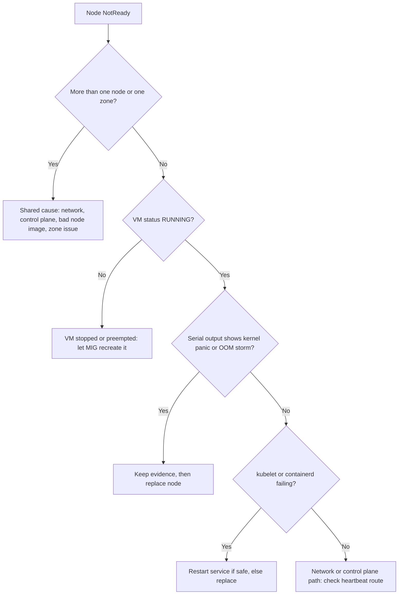

How to handle a GKE node that reports `NotReady` or `Unknown`: find out which layer failed, preserve the evidence before auto-repair destroys it, and recover the workloads. This note is about the node going away or its kubelet stopping reporting. A node that is Ready but slow or evicting Pods is a different problem; see [[node-resource-pressure-triage]].

> [!info] Scope and verification
> The commands were not run against a live cluster and the note is not marked `verified`. Auto-repair and eviction timings change between releases and are deliberately not quoted here. Check the current node auto-repair and taints-and-tolerations documentation, and `gcloud ... --help`, before relying on any flag or duration.

## When to use

- `kubectl get nodes` shows `NotReady` or `Unknown`.
- Pods on a node are `Unknown`, `Terminating` for a long time, or being rescheduled unexpectedly.
- A node pool alert fires for node count or readiness.
- The node is Ready but pressured (`MemoryPressure`, `DiskPressure`, `PIDPressure`): use [[node-resource-pressure-triage]] instead.

## Preconditions

- `roles/container.viewer` and `roles/compute.viewer` as a minimum; `roles/compute.instanceAdmin.v1` to read serial output and delete instances.
- A way to reach the node if it is still up: IAP TCP forwarding, OS Login, or the existing bastion. If you have none, the serial console output is your main evidence.
- A change or incident record. Deleting nodes is a production action; see [[production-change-checklist]].
- Workloads that survive a node loss (replicas spread across zones, PDBs); see [[stateful-workloads-gke]] for what is different for storage.

```bash
PROJECT=example-project
LOCATION=europe-west1
CLUSTER=prod-1
NODE=gke-prod-1-default-pool-abc123-wxyz
ZONE=europe-west1-b
gcloud config set project "$PROJECT"
```



## Steps

### 1. Read the node conditions and heartbeat

```bash
kubectl get nodes -o wide
kubectl describe node "$NODE" | sed -n '/Conditions:/,/Addresses:/p'
kubectl get node "$NODE" -o jsonpath='{range .status.conditions[*]}{.type}{"\t"}{.status}{"\t"}{.lastHeartbeatTime}{"\t"}{.reason}{"\n"}{end}'
kubectl describe node "$NODE" | sed -n '/Taints:/,/Unschedulable/p;/Events:/,$p'
```

Read it like this:

- `Ready=Unknown` with an old `lastHeartbeatTime`: the control plane stopped hearing from the kubelet. The node may be dead, partitioned, or the kubelet may be hung.
- `Ready=False` with a reason such as `KubeletNotReady`: the kubelet is alive and reporting a fault (runtime not ready, CNI not ready, PLEG unhealthy). The message names the layer.
- Taints `node.kubernetes.io/unreachable` or `node.kubernetes.io/not-ready` are added automatically. Pods without a matching toleration are evicted after the toleration period. Check the taints-and-tolerations documentation for the default period, which is not the same as the auto-repair delay.

### 2. Establish scope

One node, one pool, or one zone changes the diagnosis completely.

```bash
kubectl get nodes -L topology.kubernetes.io/zone,cloud.google.com/gke-nodepool \
  --no-headers | awk '{print $2, $NF}' | sort | uniq -c

kubectl get nodes -o json | jq -r '.items[] | select(([.status.conditions[]|select(.type=="Ready")][0].status)!="True") | .metadata.name'
```

- Many nodes across pools at once: suspect the control plane path, a bad DaemonSet, a network change or a platform event. Go to [[gke-control-plane-unavailable]] and check the Google Cloud status page.
- All nodes in one zone: a zonal incident or a zone-specific network change.
- One node: continue below.
- All nodes of one pool shortly after a change: a node image, taint or kubelet config change. Roll that back.

### 3. Check the VM

```bash
gcloud compute instances describe "$NODE" --zone "$ZONE" \
  --format="yaml(status,lastStartTimestamp,scheduling.preemptible,scheduling.provisioningModel)"

# Collect evidence BEFORE any repair or delete (see warning below)
gcloud compute instances get-serial-port-output "$NODE" --zone "$ZONE" > "serial-$NODE.txt"
tail -n 80 "serial-$NODE.txt"
grep -iE 'panic|oom|out of memory|blocked for more than|i/o error|segfault' "serial-$NODE.txt" | tail -20
```

- `TERMINATED` or `STOPPED`: Spot or preemptible reclaim, a host event, or a manual stop. The managed instance group normally recreates it.
- `RUNNING` with a kernel panic or a stream of OOM kills in the serial log: memory exhaustion or a kernel fault. Capture the log and replace the node.
- `RUNNING` and a quiet serial log: the failure is in userspace or the network.

Cloud Logging for the instance (`resource.type="gce_instance"`) and the GKE node logs may hold more. Check which logs your cluster ships.

> [!warning] Repair destroys evidence
> Auto-repair or a manual delete recreates the VM and its boot disk. Save the serial output, the node description and the relevant Cloud Logging entries first. Without them a repeating fault cannot be root-caused.

### 4. Node services, if you can reach the node

```bash
gcloud compute ssh "$NODE" --zone "$ZONE" --tunnel-through-iap
```

On the node (see section 7 of [[node-resource-pressure-triage]] for the full kubelet and containerd checks, which are not repeated here):

```bash
sudo systemctl is-active kubelet containerd
sudo journalctl -u kubelet --since "30 min ago" --no-pager | tail -60
sudo journalctl -u containerd --since "30 min ago" --no-pager | tail -40
df -h / /var/lib/containerd 2>/dev/null
```

Typical findings: kubelet cannot reach the API (network or credentials), the container runtime is hung (restart it only if you accept brief disruption on a node you are about to replace anyway), the disk is full, or the node has lost its default route.

If you cannot SSH, that is itself a signal: sshd, the network stack or the whole VM is unhealthy. Move on.

### 5. What GKE is already doing

```bash
gcloud container operations list --filter="targetLink:$CLUSTER" \
  --format="table(name,operationType,status,startTime)" --limit=10
gcloud container node-pools describe default-pool --cluster "$CLUSTER" --location "$LOCATION" \
  --format="yaml(management,upgradeSettings,status)"
```

If node auto-repair is enabled on the pool, GKE will repair a node that stays unhealthy for a period. Check the current auto-repair documentation for the conditions and the waiting time before it acts, because they differ from the Pod eviction timing. Auto-repair may also be blocked while a conflicting operation is running, or when repair would exceed limits.

### 6. Recover

Pick the least destructive option that fits.

1. **Do nothing yet** if the node is only just unhealthy and auto-repair is enabled, but you have collected the evidence. Set a time box.
2. **Cordon** so nothing new schedules there: `kubectl cordon "$NODE"`.
3. **Drain** if the node still responds and you want an orderly move. This honours PodDisruptionBudgets:

```bash
kubectl drain "$NODE" --ignore-daemonsets --delete-emptydir-data --timeout=300s
```

4. **Delete the instance** so the managed instance group recreates it. This is how you force a replacement when repair is slow:

```bash
# Pool instance group name from the node's metadata or the console; do not guess it
gcloud compute instances delete "$NODE" --zone "$ZONE"
```

Deleting through `kubectl delete node` removes only the Node object. The VM keeps running and the kubelet will re-register. Remove the instance itself.

> [!warning] Local data is lost on replacement
> Local SSD and `emptyDir` data do not survive node replacement. Persistent disks reattach to the replacement, but a zonal disk must be reattached in the same zone. For stateful workloads, confirm backups and read [[stateful-workloads-gke]] before deleting.

If a Pod is stuck `Terminating` on a dead node and its volume will not detach, see [[kubernetes-pod-troubleshooting]] and wait for the attach/detach controller before force-deleting; force deletion of a Pod on an unreachable node can double-run a stateful Pod.

## Validation

```bash
kubectl get nodes                                         # replacement Ready
kubectl get pods -A -o wide --field-selector=spec.nodeName="$NODE"   # empty for the old node
kubectl get pods -A --field-selector=status.phase!=Running,status.phase!=Succeeded
kubectl get pdb -A
gcloud container node-pools describe default-pool --cluster "$CLUSTER" --location "$LOCATION" --format="value(status)"
```

Confirm pool size is back at the expected count, Pods are spread across zones again, and the alert has cleared. Keep the saved serial output with the incident record.

## Rollback

There is no undo for a deleted instance, so the rollback is containment:

- Uncordon a node you cordoned by mistake: `kubectl uncordon "$NODE"`.
- If a pool-wide setting caused the failure (taint, image, kubelet config), revert that setting through your Terraform or `gcloud container node-pools update`, then let the pool recreate nodes.
- Restore data on stateful workloads from backup; see [[backup-architecture-gke-cloud-sql-gcs]].

## Troubleshooting

| Symptom                                         | Likely cause and fix                                                                                             |
| ----------------------------------------------- | ---------------------------------------------------------------------------------------------------------------- |
| `Ready=Unknown`, VM `RUNNING`, serial log quiet | Kubelet hung or network partition. Try SSH; if unreachable, replace the node.                                    |
| `KubeletNotReady: container runtime not ready`  | containerd unhealthy. Check `journalctl -u containerd`; replace if it does not recover.                          |
| `KubeletNotReady: cni plugin not initialized`   | Network plugin Pod missing on this node. Check the CNI DaemonSet Pod in `kube-system`.                           |
| Node returns and flaps repeatedly               | Underlying disk or memory problem. Replace it, and look at [[node-resource-pressure-triage]].                    |
| Auto-repair does not act                        | Disabled on the pool, a conflicting operation is running, or the waiting period has not elapsed. Check the docs. |
| Stateful Pod stuck on a dead node               | Volume not detached. Wait for detach, then follow the Pod and volume steps; do not force-delete blindly.         |
| Whole pool NotReady after a change              | Roll back the change; do not delete nodes one by one.                                                            |

To test this path on purpose, use the node-loss scenario in [[game-day-chaos-gke]].

## Related

- [[node-resource-pressure-triage]] for slow, pressured or evicting nodes.
- [[kubernetes-pod-troubleshooting]] for Pod-level symptoms after a reschedule.
- [[gke-cluster-upgrade]] for planned node replacement through upgrades.
- [[stateful-workloads-gke]] for volumes and failover.
- [[game-day-chaos-gke]] for rehearsing node loss.

## Sources

- [GKE node auto-repair](https://cloud.google.com/kubernetes-engine/docs/how-to/node-auto-repair)
- [Kubernetes node status](https://kubernetes.io/docs/reference/node/node-status/)
- [Kubernetes nodes](https://kubernetes.io/docs/concepts/architecture/nodes/)
- [Taints and tolerations](https://kubernetes.io/docs/concepts/scheduling-eviction/taint-and-toleration/)
