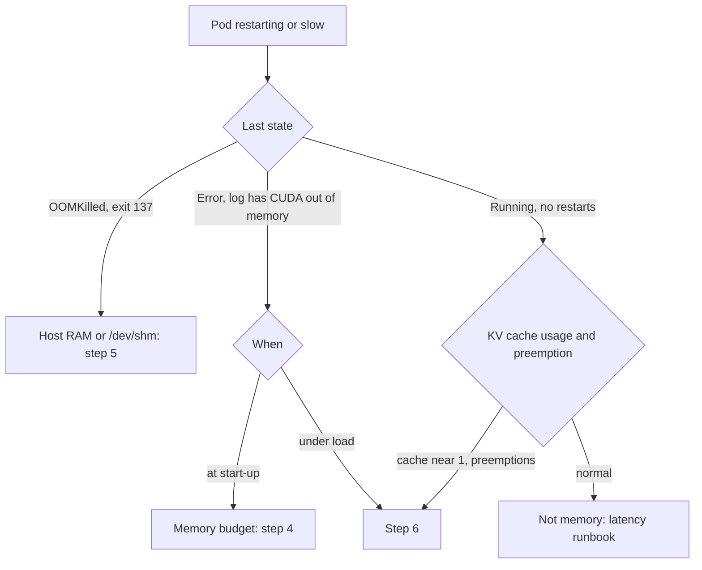

How to find out which kind of "out of memory" a vLLM pod on GKE has hit and fix that one. Three different things get called OOM, and they have different causes and different fixes. **CUDA out of memory** is the GPU running out of its own memory: the model weights plus the KV cache and working buffers do not fit, and the process raises an error. **OOMKilled** is Linux killing a process in the container, usually because it exceeded its Kubernetes memory limit on the host (a node-level out-of-memory event can also cause it); that is system RAM, not GPU memory, and raising GPU settings does nothing for it. **KV cache exhaustion** is not a crash at all: the server is healthy but the cache is full, so vLLM queues or preempts requests and latency climbs. Classify first, then change one thing.

> [!info] Scope and verification
> The commands were not run against a live cluster and the note is not marked `verified`. vLLM flags, metrics and behaviour were checked against the vLLM documentation (repository commit 8530a77) and Kubernetes statements against the Kubernetes website repository (commit 491f14e), both on 2026-11-01. No Google Cloud documentation page could be read, and the engine argument reference is generated from source, so defaults are not quoted; read them from `vllm serve --help` for your version. Items listed under "Not verified" in the Evidence section must be checked before you rely on them.

## When to use

- A vLLM pod is in `CrashLoopBackOff` or restarts at start-up and the log mentions out of memory or a CUDA allocation failure.
- `kubectl describe pod` shows the last state `OOMKilled`, or the container exit code is 137.
- After a model, image, context length or GPU change, the server will not start or starts with far less cache than before.
- Under load the server stays up but latency rises, the log shows preemption warnings, and the KV cache usage metric sits at its ceiling.

Use something else when:

- The pod is `Pending` and never starts: [[gpu-pods-pending-on-gke]].
- Latency is bad but memory is fine, or you have not yet looked at queue, prefill and decode time: [[llm-serving-latency-regression]].
- The node itself is out of memory and evicting pods: [[node-resource-pressure-triage]].
- The container is killed for another reason (probe failure, eviction): [[kubernetes-pod-troubleshooting]].

Background: [[kv-cache-capacity-and-paging]] for how the cache is sized, [[self-hosted-llm-inference-on-gke]] for the platform, and [[quantization-quality-and-performance-tradeoffs]] for shrinking the model.

## Preconditions

- Namespace access: `get`, `list` and `watch` on pods, `pods/log` and events; `create` on `pods/exec`; `patch` on `deployments` and `horizontalpodautoscalers`. Cluster-scoped `get` and `patch` on nodes are needed for `kubectl describe node` and `kubectl cordon`; without them, use a named escalation path to someone who has them. Credentials come from `gcloud container clusters get-credentials` (the IAM permission it needs is not verified, see Evidence).
- Helm release access in the namespace (release secrets) and the chart source, if Helm owns the Deployment; and Prometheus access through a port-forward, for example `kubectl -n monitoring port-forward svc/prometheus-operated 9090:9090 &` (service name and namespace are examples).
- The model server's configuration lives in Helm values or Git. Emergency `kubectl` edits below must be written back the same day; see [[helm-release-rollback]]. Before any live edit, check who owns the Deployment: `kubectl -n "$NS" get deploy "$DEPLOY" -o jsonpath='{.metadata.labels}{"\n"}{.metadata.annotations}{"\n"}'`. If Argo CD auto-sync or self-heal is on, a live `set resources` or HPA patch is reverted within minutes: commit the change to Git and sync, or suspend auto-sync on the Application and record that in the incident ([[argocd-sync-failure-and-drift]]).
- You know the previous working configuration (image, arguments, memory limit, GPU count). `kubectl rollout history` keeps it for Deployments.
- An incident record. Raising limits and adding GPUs costs money.

```bash title="variables"
PROJECT=example-project
CLUSTER=prod-gke
LOCATION=europe-west1
NS=llm-serving
POOL=gpu-inference   # the value of the pool label your platform sets on the GPU node pool
DEPLOY=vllm-llama-8b
APP_LABEL=app=llm-server
CONTAINER=vllm   # the model server container name in the pod
HPA=vllm-llama-8b   # example; the name of your HorizontalPodAutoscaler
PROM_URL=http://localhost:9090   # a port-forward to your Prometheus query endpoint
gcloud config set project "$PROJECT"
gcloud container clusters get-credentials "$CLUSTER" --location "$LOCATION"
# The failing pod is the one with the most restarts, not the newest one.
# Re-run these two lines after every rollout: a rollout replaces the pods.
POD=$(kubectl -n "$NS" get pods -l "$APP_LABEL" -o jsonpath='{range .items[*]}{.status.containerStatuses[0].restartCount}{" "}{.metadata.name}{"\n"}{end}' | sort -rn | head -1 | cut -d' ' -f2)
NODE=$(kubectl -n "$NS" get pod "$POD" -o jsonpath='{.spec.nodeName}')
echo "$POD on $NODE"

q() { curl -sG "$PROM_URL/api/v1/query" --data-urlencode "query=$1" \
  | jq -r 'if (.data.result | length) == 0 then "NO DATA (series absent or empty, not zero)" else (.data.result[] | [(.metric | del(.__name__) | tostring), .value[1]] | @tsv) end'; }
```

## Steps



### 1. Classify the failure

```bash
kubectl -n "$NS" get pods -l "$APP_LABEL" -o wide

# Last termination reason and exit code per container
kubectl -n "$NS" get pod "$POD" -o jsonpath='{range .status.containerStatuses[*]}{.name}{"\trestarts="}{.restartCount}{"\treason="}{.lastState.terminated.reason}{"\texit="}{.lastState.terminated.exitCode}{"\n"}{end}'

# Events, newest last
kubectl -n "$NS" describe pod "$POD" | sed -n '/Last State:/,/Ready:/p;/Events:/,$p'

# The log of the previous (crashed) container
kubectl -n "$NS" logs "$POD" -c "$CONTAINER" --previous | grep -iE "out of memory|OutOfMemory|CUDA error|KV cache|memory" | tail -20
```

Read the result with this table. The key question is whether Kubernetes or CUDA raised the alarm.

| What you see                                                                                                                                                        | What it is                                                                                                                                                        | Where to go                       |
| ------------------------------------------------------------------------------------------------------------------------------------------------------------------- | ----------------------------------------------------------------------------------------------------------------------------------------------------------------- | --------------------------------- |
| `reason=OOMKilled`, `exit=137`; the log just stops                                                                                                                  | The kernel OOM killer ended a process in the container: usually the container passed its memory limit (host RAM or tmpfs), but a node-level OOM can also cause it | Step 5                            |
| `reason=Error` (exit 1 or similar) and a log line with `CUDA out of memory`                                                                                         | The GPU ran out of memory in the process                                                                                                                          | Step 4 or 6                       |
| `reason` is not `OOMKilled`, events say `failed startup probe, will be restarted` or `Liveness probe failed`, and the log ends with `KeyboardInterrupt: terminated` | The kubelet killed a healthy but slow-starting server                                                                                                             | Step 5, last row                  |
| Pod `.status.reason` is `Evicted` (read it below), node condition `MemoryPressure`                                                                                  | The node ran short of memory and the kubelet evicted the pod                                                                                                      | [[node-resource-pressure-triage]] |
| No restarts, `Running`, but `vllm:kv_cache_usage_perc` near 1                                                                                                       | KV cache exhaustion, not a crash                                                                                                                                  | Step 6                            |
| Start-up succeeds but the log reports a tiny KV cache, or startup fails complaining about cache size                                                                | The weights leave too little room for cache                                                                                                                       | Step 4                            |

Kubernetes records `OOMKilled` when the kernel's OOM killer ended a process in the container. That is usually the container going over its own memory limit, but in a node-level out-of-memory event the killer picks the container with the highest score whatever its own limit is (Node-pressure Eviction, "Node out of memory behavior"), so compare peak usage with the limit before you raise it. A pod-level eviction does not appear in the container's last state; read it with `kubectl -n "$NS" get pod "$POD" -o jsonpath='{.status.reason}{"\t"}{.status.message}{"\n"}'`. A CUDA error is raised inside the process, written to its own log, and the container exits normally with a non-zero code. The two never produce each other's evidence. Wording of the CUDA message varies with the library version, so match loosely (`out of memory`).

If you are unsure which GPU you have, read it from the node. For a pod that is not running (crash loop), `exec` fails because no container is running, so use node-level views; they also show other GPU consumers on the node:

```bash
kubectl get node "$NODE" -L pool,node.kubernetes.io/instance-type
kubectl get nodes -l pool="$POOL"
kubectl get pods -A -o wide --field-selector spec.nodeName="$NODE"
kubectl describe node "$NODE" | grep nvidia.com/gpu
```

`pool` is a label the operator sets on the GPU node pool, with `--node-labels=pool=gpu-inference` on `gcloud container node-pools create` or `update` (or `labels` in the Terraform `node_config`); the GPU pool is also tainted with `dedicated=gpu:NoSchedule`, which the serving pods tolerate. The machine type in the last column (`INSTANCE-TYPE`) tells you the GPU family. If the pool column is empty, list the labels the nodes actually have with `kubectl get nodes --show-labels`, and label the pool with `gcloud container node-pools update ... --node-labels` before relying on the selector; `update` replaces all user-specified labels, so repeat the ones the pool already has.

Only for a pod that is currently `Running`, and if `nvidia-smi` is present in the image, you can also run `kubectl -n "$NS" exec "$POD" -c "$CONTAINER" -- nvidia-smi`; it shows only that pod's own GPU view, not a time-sliced co-tenant.

### 2. Capture evidence

Do this for every crashing pod before any mitigation. A rollback or a pod delete removes the pod, and its `--previous` log, last state and events go with it. The log is the only evidence for the CUDA-versus-`OOMKilled` call and the postmortem needs it.

```bash
kubectl -n "$NS" logs "$POD" -c "$CONTAINER" --previous > "oom-$POD.log"
kubectl -n "$NS" get pod "$POD" -o yaml > "pod-$POD.yaml"
kubectl -n "$NS" describe pod "$POD" > "describe-$POD.txt"
kubectl -n "$NS" get events --sort-by=.lastTimestamp > "events-$NS.txt"
```

### 3. Mitigate first

Only after the capture step above. Mitigate before you tune anything, then diagnose in peace.

- **A change caused it** (new image, new arguments, a larger model, a longer context): roll back. A rollback is another rollout and a model load, but it returns to a state that worked.

```bash
kubectl -n "$NS" rollout history deployment/"$DEPLOY"
kubectl -n "$NS" rollout undo deployment/"$DEPLOY"
kubectl -n "$NS" rollout status deployment/"$DEPLOY" --timeout=30m
```

If Argo CD or Helm owns the Deployment, revert the commit or run `helm rollback` instead, or the next sync reapplies the bad version ([[helm-release-rollback]], [[argocd-sync-failure-and-drift]]).

- **Only some replicas crash** (for example after a node pool change): keep the healthy ones serving. Scale out on a node type that worked, and cordon the bad nodes: `kubectl cordon "$NODE"`. See [[gke-node-pool-upgrade-strategies]].
- **Under load, the cache is full and requests are slow**: lower the pressure now. Cap output tokens and prompt length at the gateway, shed low-priority traffic and add replicas (details in step 6 and in [[llm-serving-latency-regression]]).
- **Restart loops hide the cause**: a `CrashLoopBackOff` back-off delays each retry, so avoid deleting the pod before the capture step is done.

### 4. CUDA out of memory at start-up

At start-up vLLM measures memory, loads the weights, then reserves a share of GPU memory for the KV cache. The budget below is an approximation inferred for this note, not taken from the vLLM docs (see Not verified):

```text
usable GPU memory = GPU memory x gpu-memory-utilization
KV cache          = usable GPU memory - weights - activation peak - CUDA graph memory
```

The vLLM optimization guide describes `gpu_memory_utilization` only as the share of GPU memory vLLM pre-allocates for its cache, and the memory guide lists CUDA graphs as extra memory use. A start-up failure means one of these terms is too large for the GPU. Rule of thumb for weights: parameter count times bytes per parameter (about 2 bytes in 16-bit formats, less when quantized). An 8-billion-parameter model in 16-bit needs about 16 GB for weights alone; a 24 GB GPU at utilization 0.9 has about 21.6 GB, which leaves only a few GB for cache, activations and graphs. A 70-billion-parameter model needs about 140 GB for weights and cannot start on a single smaller GPU at all.

Check what the pod is configured to do:

```bash
kubectl -n "$NS" get deploy "$DEPLOY" -o jsonpath='{.spec.template.spec.containers[0].args}{"\n"}{.spec.template.spec.containers[0].resources}{"\n"}'
```

Look at `--model`, any quantization option, `--tensor-parallel-size`, `--max-model-len`, `--max-num-seqs`, `--gpu-memory-utilization`, `--kv-cache-dtype` and the GPU count in `limits`. On a server that started, the log prints the cache it obtained:

```bash
kubectl -n "$NS" logs "$POD" | grep -E "GPU KV cache size|Maximum concurrency"
```

Example (illustrative):

```text
GPU KV cache size: 643,232 tokens
Maximum concurrency for 40,960 tokens per request: 15.70x
```

The first line is the total number of tokens the cache can hold across all running requests; the second divides it by the configured maximum model length. If a worst-case request cannot fit, or concurrency is below what you need, the budget is wrong for the workload.

Change the cheapest term first. Each row is one lever from the vLLM memory guidance; apply one at a time and re-measure.

| Lever                                      | Effect                                                                                | Cost and caution                                                                                                                                                               |
| ------------------------------------------ | ------------------------------------------------------------------------------------- | ------------------------------------------------------------------------------------------------------------------------------------------------------------------------------ |
| Lower `--max-model-len`                    | A smaller worst-case request, so fewer cache tokens are needed per sequence           | Requests longer than the new limit are rejected; check real lengths from the token histograms first                                                                            |
| Lower `--max-num-seqs`                     | Fewer concurrent sequences, less activation and cache pressure                        | Lower throughput; queue grows sooner                                                                                                                                           |
| Raise `--gpu-memory-utilization`           | More memory for cache                                                                 | Leaves less headroom; if it is too high the start-up fails, and buffers outside the budget (for example collective-communication internals) have no room. Raise in small steps |
| Raise `--tensor-parallel-size`             | Weights split across GPUs, so each GPU has more room for cache                        | The pod needs that many GPUs in `limits` on one node, adds synchronisation cost, and each process reads the whole checkpoint (longer load time)                                |
| Quantize the model weights                 | Smaller weights                                                                       | Quality and speed effects; evaluate first ([[quantization-quality-and-performance-tradeoffs]])                                                                                 |
| `--kv-cache-dtype fp8`                     | Smaller cache per token                                                               | Accuracy effect; see the vLLM quantized KV cache page and test before production                                                                                               |
| Reduce CUDA graph memory                   | Frees GPU memory used by graph capture; `--enforce-eager` disables capture completely | Slower decoding; use only as a stopgap                                                                                                                                         |
| Multi-modal limits (`limit_mm_per_prompt`) | Smaller reserved activation memory for image, video or audio inputs                   | Fewer items per prompt; set unused modalities to zero                                                                                                                          |
| A larger GPU or a different node pool      | More memory per GPU                                                                   | Cost and quota; see [[gpu-pods-pending-on-gke]]                                                                                                                                |

When a pinned cache size (`--kv-cache-memory`, which skips memory profiling, as described in the vLLM optimization guide) is in the arguments, remove it first if start-up began failing after a hardware or co-tenant change: the value is only valid on the same GPU with the same initial free memory. The CLI reference lists the same setting as `--kv-cache-memory-bytes`; check the spelling your version accepts with `vllm serve --help`.

If several pods share one GPU through time-slicing, each server profiles memory when it starts and the others may already hold some of it, so two servers that each fit alone can fail together. Check [[gpu-sharing-on-kubernetes]] for how the pool is configured and prefer a dedicated GPU for a server that must have a stable cache.

Make the change in Git or Helm values and roll it out. The `args` list replaces the whole array, so the file you apply must contain the complete list, including any `--tensor-parallel-size` or quantization flags already in use. Example of a change to arguments for an 8B model on a small GPU (illustrative; add the flags your release already has):

```yaml title="values-vllm-llama-8b.yaml"
args:
  - --model=meta-llama/Llama-3.1-8B-Instruct
  - --max-model-len=8192 # was 32768; real p99 prompt plus output is under 6000 tokens
  - --max-num-seqs=64 # was 256
  - --gpu-memory-utilization=0.90
```

```bash
# Dump the live values first so nothing is lost and you can roll back
helm -n "$NS" get values "$DEPLOY" -o yaml > values-before.yaml
# Preview the change (helm-diff plugin), then apply with the full set of values
helm -n "$NS" diff upgrade "$DEPLOY" ./charts/vllm -f values-before.yaml -f values-vllm-llama-8b.yaml
helm -n "$NS" upgrade "$DEPLOY" ./charts/vllm -f values-before.yaml -f values-vllm-llama-8b.yaml --wait --timeout 30m
kubectl -n "$NS" logs deploy/"$DEPLOY" -c "$CONTAINER" | grep -E "GPU KV cache size|Maximum concurrency"
```

If a GitOps tool owns the release, change the values in Git only; a manual `helm upgrade` fights the next sync. Changing these values changes behaviour for users (shorter limit, lower concurrency). Tell the owners of the callers.

### 5. OOMKilled: host RAM, not GPU

`OOMKilled` means the kernel OOM killer ended a process in the container: usually the container went over `resources.limits.memory`, but a node-level OOM can also kill it (Node-pressure Eviction, "Node out of memory behavior"). Compare peak usage with the limit before you raise it. Kubernetes enforces memory limits through the kernel's out-of-memory killer, and it counts more than the process heap: the Kubernetes documentation states that pages in memory-backed volumes count, and that the kubelet tracks a `tmpfs` `emptyDir` as container memory use. A vLLM pod often has one, because the vLLM Kubernetes guide mounts `/dev/shm` as a memory-backed `emptyDir` for tensor-parallel inference.

```bash
kubectl -n "$NS" get deploy "$DEPLOY" -o jsonpath='{.spec.template.spec.containers[0].resources}{"\n"}'
kubectl -n "$NS" get deploy "$DEPLOY" -o jsonpath='{.spec.template.spec.volumes}{"\n"}'
kubectl -n "$NS" describe pod "$POD" | grep -iE "OOMKilled|Reason|Exit Code|Started|Finished"
```

Work out when it dies:

| When the kill happens                  | Likely cause                                                                                                                                                                                                                                                                                                           | Fix                                                                                                                               |
| -------------------------------------- | ---------------------------------------------------------------------------------------------------------------------------------------------------------------------------------------------------------------------------------------------------------------------------------------------------------------------- | --------------------------------------------------------------------------------------------------------------------------------- |
| During model load                      | Loading the checkpoint can use a lot of host memory (vLLM troubleshooting guide); with tensor parallelism each process reads the whole model, which lengthens load (vLLM memory guide) and may raise host memory use (not verified)                                                                                    | Raise the memory limit to cover the checkpoint, and convert to a sharded checkpoint so load time and memory stay flat as TP grows |
| Shortly after start, before serving    | Multi-modal processor cache (`mm_processor_cache_gb`, documented default 4 GiB) plus the base process                                                                                                                                                                                                                  | Lower `mm_processor_cache_gb`, or raise the limit                                                                                 |
| Under load, memory climbs with traffic | Host-side buffers, tokenization, a large number of concurrent streams, or an unbounded client-side queue in the gateway                                                                                                                                                                                                | Raise the limit after measuring; cap concurrency; check for a leak in a sidecar                                                   |
| With `/dev/shm` filling                | A memory-backed volume counts against the limit; its `sizeLimit` is too large or the limit too small                                                                                                                                                                                                                   | Set an explicit `sizeLimit` on the `emptyDir`, and size the container limit to hold it plus the process                           |
| Reason not `OOMKilled`, probe events   | The kubelet killed the container after a failed probe (identify it by the `failed startup probe, will be restarted` or `Liveness probe failed` events and the `KeyboardInterrupt: terminated` log line): the startup or liveness probe gave up before the model finished loading ([[inference-cold-start-mitigation]]) | Raise the startup probe `failureThreshold` or add a `startupProbe`; measure the real start-up time                                |

| Usage below the limit at the kill | A node-level OOM killed the container although it was under its own limit | Check node memory pressure ([[node-resource-pressure-triage]]); keep requests equal to limits for memory |

Pick the limit from observation, not by doubling: read the peak memory of the previous container from your metrics, add margin, and keep requests equal to limits for memory so the pod does not become the first victim of a node-level OOM ([[kubernetes-resource-requests-and-limits]]).

```bash
# Record the old values first; without -c, set resources changes every container (sidecars too)
kubectl -n "$NS" get deploy "$DEPLOY" -o jsonpath='{.spec.template.spec.containers[?(@.name=="'"$CONTAINER"'")].resources}' > resources-before.json
kubectl -n "$NS" set resources deployment/"$DEPLOY" -c "$CONTAINER" --limits=memory=48Gi --requests=memory=48Gi
kubectl -n "$NS" rollout status deployment/"$DEPLOY" --timeout=30m
```

A limit larger than the node's allocatable memory leaves the pod `Pending`; check `kubectl describe node` for the node pool's machine type before raising it. The command above changes the live Deployment only; write the same numbers into Helm values, or Argo CD may revert them (see Preconditions).

### 6. KV cache exhaustion and preemption storms under load

The KV cache is allocated at start-up, so once the server is healthy a full cache is not a crash. When it fills, vLLM cannot admit more requests and may preempt running ones. In vLLM V1 the default is to recompute: a preempted request returns to the waiting queue and its prefill is done again. A storm happens when recomputation adds load, which fills the cache further, which causes more preemption.

```bash
# Find the preemption series your version exposes first; an absent series prints NO DATA, which is not zero
curl -sG "$PROM_URL/api/v1/label/__name__/values" | jq -r '.data[]' | grep -i preempt

# KV cache fill per pod (0 to 1), waiting requests and preemptions
q 'max by (pod) (vllm:kv_cache_usage_perc)'
q 'sum(vllm:num_requests_waiting)'
q 'sum(rate(vllm:request_num_preemptions_sum[5m]))'

# Log evidence of preemption
kubectl -n "$NS" logs "$POD" -c "$CONTAINER" --since=30m | grep -i "preempt" | tail -5
```

`vllm:request_num_preemptions` is a per-request histogram recorded when a request finishes, so its rate trails a storm that is still in progress; use the log and the cache usage to see a live storm. If a dedicated preemption counter exists in your version (not verified), prefer it.

The vLLM warning reads like `Sequence group ... is preempted by PreemptionMode.RECOMPUTE mode because there is not enough KV cache space`. Cumulative preemption counts also appear in the periodic statistics log, which is on by default and is turned off by `--disable-log-stats` (Per-request metrics page); `VLLM_LOG_STATS_INTERVAL` makes it more frequent.

Mitigate in this order, stopping when the metrics recover:

1. **Reduce demand per request.** Lower the maximum output tokens and the prompt length at the gateway, and shed batch or low-priority traffic ([[ai-gateway-architecture-and-policy]], [[rate-limits-backpressure-and-queue-design]]).
2. **Add replicas** so each server holds fewer concurrent sequences. Follow step 2a (scale out) of [[llm-serving-latency-regression]], which raises the HPA bounds and, if needed, the GPU node pool limits; save the current HPA bounds to `hpa-before.txt` first, because Rollback below restores them. Pending pods go to [[gpu-pods-pending-on-gke]].
3. **Lower `--max-num-seqs` or `--max-num-batched-tokens`** so fewer sequences compete for the cache.
4. **Give the cache more memory**: raise `--gpu-memory-utilization` in small steps, use `--tensor-parallel-size` for more weight sharding, quantize weights or the cache (step 4).
5. **Bound the queue** with `--max-num-queued-reqs` and `--max-num-queued-tokens`, so the server rejects new work (counted in `vllm:admission_rejections_total`) instead of building an unbounded queue. Sizing and the restart it needs are in step 2c of [[llm-serving-latency-regression]]; callers must handle rejections ([[llm-retry-timeout-and-circuit-breaker-policy]]).

Check that prompts and outputs match what the cache was sized for: `histogram_quantile(0.99, sum by (le) (rate(vllm:request_prompt_tokens_bucket[1h])))` and the same for `vllm:request_generation_tokens_bucket`. A rise in either explains a cache that used to be sufficient. For sizing, see [[llm-inference-capacity-planning]].

A GPU OOM that appears only under load, after a clean start, points to memory used outside the budget vLLM reserved (the vLLM docs note that some communication buffers do not count against `gpu_memory_utilization`) or to a large multi-modal input. Lower `--gpu-memory-utilization` a little to leave headroom, and set multi-modal limits.

### 7. Roll out and verify the fix

Roll out one change at a time, with spare capacity so the service does not shrink during the model load.

```bash
kubectl -n "$NS" rollout status deployment/"$DEPLOY" --timeout=30m
kubectl -n "$NS" get pods -l "$APP_LABEL" -o wide
kubectl -n "$NS" logs deploy/"$DEPLOY" | grep -E "GPU KV cache size|Maximum concurrency"
```

## Validation

```bash
kubectl -n "$NS" get pods -l "$APP_LABEL"       # all Ready, restarts not increasing
kubectl -n "$NS" get pods -l "$APP_LABEL" -o jsonpath='{range .items[*]}{.metadata.name}{"\t"}{.status.containerStatuses[0].restartCount}{"\t"}{.status.containerStatuses[0].lastState.terminated.reason}{"\n"}{end}'
q 'max by (pod) (vllm:kv_cache_usage_perc)'                    # below its ceiling at peak
q 'sum(rate(vllm:request_num_preemptions_sum[15m]))'           # 0 or close to it; NO DATA means the series is absent, not zero
q 'sum(vllm:num_requests_waiting)'                             # near 0 outside bursts
q 'histogram_quantile(0.95, sum by (le) (rate(vllm:time_to_first_token_seconds_bucket[15m])))'   # within the objective
```

Run the load that failed (a replay of the peak, or a load test through the gateway; see [[load-and-performance-testing]]) and watch the same metrics. A fix is proven only by a full peak with no restarts, no preemption storm and the latency objective met. The `GPU KV cache size` and `Maximum concurrency` lines should now match the numbers you planned in [[llm-inference-capacity-planning]].

## Rollback

- **Deployment change:** `kubectl -n "$NS" rollout undo deployment/"$DEPLOY"`, or `helm rollback`, or a Git revert if a GitOps tool owns it. Each is a rollout with a model load.
- **Memory limits:** set `resources` back to the values saved in `resources-before.json`. Lowering a limit below the real peak brings the `OOMKilled` back, so lower it only after a measured peak.
- **Flag changes** (`--max-model-len`, `--max-num-seqs`, `--max-num-batched-tokens`, `--gpu-memory-utilization`, `--kv-cache-dtype`, `--enforce-eager`, `--tensor-parallel-size`, a removed `--kv-cache-memory`, multi-modal limits, `--max-num-queued-reqs` and `--max-num-queued-tokens`): revert in Helm values (`values-before.yaml`). Revert `--tensor-parallel-size` together with the `nvidia.com/gpu` limits, or pods sit `Pending` holding GPUs. Revert queue bounds only after callers stop seeing rejections (`vllm:admission_rejections_total` flat). Reverting `--max-model-len` upward may stop the server starting again if the cache no longer fits; revert together with the GPU change that made it fit.
- **Gateway caps and shedding:** lift once the capacity is back, one step at a time.
- **HPA bounds and node pool limits:** restore the values in `hpa-before.txt` after the stabilisation window; scaling down fast gives up capacity that costs a full cold start to regain. If you suspended Argo CD auto-sync, re-enable it once Git matches the live state.
- **Cordoned nodes:** `kubectl uncordon "$NODE"` after the node is cleared.

## Troubleshooting

| Symptom                                                                                        | Likely cause and fix                                                                                                                             |
| ---------------------------------------------------------------------------------------------- | ------------------------------------------------------------------------------------------------------------------------------------------------ |
| `OOMKilled` and raising GPU settings changes nothing                                           | It is host RAM or tmpfs, not GPU. Step 5.                                                                                                        |
| `CUDA out of memory` at start-up right after a model change                                    | Weights plus cache do not fit. Smaller model, quantization, more tensor parallel GPUs or a larger GPU. Step 4.                                   |
| Start-up fails after raising `--gpu-memory-utilization`                                        | Not enough free GPU memory outside the budget (other process on the GPU, graph capture, buffers). Lower it in small steps.                       |
| Start-up worked yesterday, fails today with the same configuration                             | A co-tenant on the GPU, a different node or GPU type, or a pinned `--kv-cache-memory` value that no longer matches free memory. Step 4.          |
| Server starts but `GPU KV cache size` is tiny                                                  | Weights take most of the GPU. More parallelism, quantization or a lower `--max-model-len`. Step 4.                                               |
| Tensor-parallel pod crashes with a shared-memory or NCCL error                                 | `/dev/shm` missing or too small, or the pod got fewer GPUs than `--tensor-parallel-size`. Mount a memory-backed `emptyDir` and request the GPUs. |
| Restarts with log ending in `KeyboardInterrupt: terminated` and a `failed startup probe` event | Startup probe too short for model load (vLLM Kubernetes guide). Raise `failureThreshold`. Step 5, last row.                                      |
| Pod `Evicted`                                                                                  | Node memory pressure, not the container limit. [[node-resource-pressure-triage]].                                                                |
| Latency climbs with traffic, cache usage near 1, preemptions non-zero                          | KV cache exhaustion. Step 6.                                                                                                                     |
| Preemption stops after a restart, then returns within hours                                    | Traffic mix with longer prompts or outputs; the cache is just too small for it. Re-size ([[llm-inference-capacity-planning]]).                   |
| Memory error appears only for requests with images or audio                                    | Multi-modal profiling and cache. Set `limit_mm_per_prompt`, lower `mm_processor_cache_gb`.                                                       |
| Pod `Pending` after raising the memory limit or GPU count                                      | No node can hold the new request. [[gpu-pods-pending-on-gke]].                                                                                   |

## Related

- [[llm-serving-latency-regression]] for latency that worsens without a crash.
- [[gpu-pods-pending-on-gke]] for pods that cannot be scheduled on the GPU you asked for.
- [[model-or-prompt-rollout-quality-regression]] for quality changes after a smaller or quantized model.
- [[llm-token-spend-spike]] and [[llm-api-rate-limit-429-storm]] for cost and rejection effects of the same shifts in traffic.
- [[kv-cache-capacity-and-paging]], [[llm-inference-capacity-planning]] and [[self-hosted-llm-inference-on-gke]] for the design.
- [[gpu-sharing-on-kubernetes]] and [[gpu-utilization-and-serving-efficiency]] for GPU-level behaviour.
- [[kubernetes-pod-troubleshooting]], [[node-resource-pressure-triage]], [[kubernetes-resource-requests-and-limits]] and [[helm-release-rollback]] for general triage and rollback.

## Evidence

### Sources checked

- [Conserving Memory - vLLM](https://docs.vllm.ai/en/latest/configuration/conserving_memory/): tensor parallelism splits the model across GPUs and each process reads the whole checkpoint (a sharded checkpoint keeps load time constant); quantization; `max_model_len` and `max_num_seqs`; CUDA graph memory and `enforce_eager`; `mm_processor_cache_gb` with a 4 GiB default; `limit_mm_per_prompt`. Checked 2026-11-01, vLLM repository commit 8530a77.
- [Optimization and Tuning - vLLM](https://docs.vllm.ai/en/latest/configuration/optimization/): preemption in V1 uses recompute, the warning text, the guidance to raise `gpu_memory_utilization` or tensor or pipeline parallel size and lower `max_num_seqs` or `max_num_batched_tokens`, `disable_log_stats`; the `--kv-cache-memory` start-up shortcut and its validity limits. Checked 2026-11-01, commit 8530a77.
- [Metrics - vLLM](https://docs.vllm.ai/en/latest/design/metrics/) and [Production Metrics](https://docs.vllm.ai/en/latest/usage/metrics/): `vllm:kv_cache_usage_perc` as a 0 to 1 fraction, `vllm:num_requests_running` and its `_waiting` variant, `vllm:request_num_preemptions` (a histogram, listed in the Custom Histogram Buckets table), `vllm:admission_rejections_total`, `vllm:request_prompt_tokens`, `vllm:request_generation_tokens`, `vllm:time_to_first_token_seconds`. Checked 2026-11-01, commit 8530a77.
- [Parallelism and Scaling - vLLM](https://docs.vllm.ai/en/latest/serving/parallelism_scaling/): the `GPU KV cache size` and `Maximum concurrency` log lines and their meaning; tensor parallel size for a single node. Checked 2026-11-01, commit 8530a77.
- [Using Kubernetes - vLLM](https://docs.vllm.ai/en/latest/deployment/k8s/): `/dev/shm` as a memory-backed `emptyDir` for tensor parallel inference, `nvidia.com/gpu` limits, `/health` probes, and the startup probe failure that kills the container with `KeyboardInterrupt: terminated` in the log. Checked 2026-11-01, commit 8530a77.
- [Weight transfer - vLLM](https://docs.vllm.ai/en/latest/training/weight_transfer/sharded_rdt/): NCCL and NIXL internals do not count against `gpu_memory_utilization`. [Troubleshooting - vLLM](https://docs.vllm.ai/en/latest/usage/troubleshooting/): model load can use a lot of host RAM; `VLLM_LOG_STATS_INTERVAL`. [Quantized KV Cache - vLLM](https://docs.vllm.ai/en/latest/features/quantization/quantized_kvcache/): `--kv-cache-dtype fp8`. [Data Parallel Deployment - vLLM](https://docs.vllm.ai/en/latest/serving/data_parallel_deployment/): `--max-num-queued-reqs` and `--max-num-queued-tokens`, counted across all in-flight requests. [Per-request metrics - vLLM](https://docs.vllm.ai/en/latest/features/per_request_metrics/): server-side statistics logging is on by default and is turned off by `--disable-log-stats`. Checked 2026-11-01, commit 8530a77.
- `gcloud container node-pools create --help` and `update --help` (Google Cloud SDK 570.0.0): `--node-labels` and `--node-taints` apply Kubernetes labels and taints to the nodes of a pool, `update` replaces all user-specified labels. Checked 2026-11-02 (help text only).
- [Terraform google_container_cluster](https://registry.terraform.io/providers/hashicorp/google/latest/docs/resources/container_cluster): `node_config` `labels` and the `taint` block (`key`, `value`, `effect` `NO_SCHEDULE`). Checked 2026-11-02, commit c4248bd.
- [Taints and Tolerations](https://kubernetes.io/docs/concepts/scheduling-eviction/taint-and-toleration/) and [Assigning Pods to Nodes](https://kubernetes.io/docs/concepts/scheduling-eviction/assign-pod-node/): `NoSchedule` taints and tolerations, `nodeSelector` on node labels. Checked 2026-11-02, commit 491f14e.
- [Resource Management for Pods and Containers | Kubernetes](https://kubernetes.io/docs/concepts/configuration/manage-resources-containers/): memory limits enforced by kernel OOM kills; pages in memory-backed volumes and `tmpfs` `emptyDir` count as container memory. [Assign Memory Resources to Containers and Pods](https://kubernetes.io/docs/tasks/configure-pod-container/assign-memory-resource/): `OOMKilled` reason and exit code 137 in the container's last state. [Node-pressure Eviction](https://kubernetes.io/docs/concepts/scheduling-eviction/node-pressure-eviction/): node OOM behaviour and `oom_score_adj` by QoS class. [Volumes](https://kubernetes.io/docs/concepts/storage/volumes/): `emptyDir.medium: Memory`. [Deployments](https://kubernetes.io/docs/concepts/workloads/controllers/deployment/): `rollout history`, `undo`, `status`. [Nodes](https://kubernetes.io/docs/concepts/architecture/nodes/): `kubectl cordon`. Checked 2026-11-01, Kubernetes website repository commit 491f14e.

### Not verified

- Anything depending on Google Cloud documentation: GPU memory sizes of GKE accelerator types, quota and stock-out behaviour, node pool upgrade behaviour, and the memory available to pods on a given machine type.
- The exact CUDA out-of-memory message and the exact start-up error wording when the cache cannot hold one full-length sequence; these come from PyTorch and vLLM source, which was not available. The commands match loosely on "out of memory".
- Default values of `--gpu-memory-utilization`, `--max-model-len`, `--max-num-seqs` and `--max-num-batched-tokens`: the engine argument reference is generated from source and is not in the local docs. Only an example value of 0.9 for `gpu_memory_utilization` appears in the metrics page output.
- Whether `--kv-cache-memory` or `--kv-cache-memory-bytes` is the accepted flag spelling in your version; both appear in the vLLM docs.
- That `nvidia-smi` is present in the serving image, and its output; no `nvidia-smi` or DCGM exporter metric names are used.
- Behaviour of two vLLM servers sharing one GPU by time-slicing at start-up (stated generically), and which memory allocations fall outside `gpu_memory_utilization` beyond the examples named in the vLLM weight-transfer page.
- The rule of thumb for weights (parameters times bytes per parameter) and the example numbers are engineering arithmetic, not documented claims.
- That the `_sum` of `vllm:request_num_preemptions` counts preemptions per finished request (so the rate lags in-flight preemption), and whether a dedicated preemption counter exists in your version.
- The memory budget formula in step 4 (utilization as the share of total GPU memory for the whole instance, with weights, activation peak and CUDA graphs subtracted) is inferred, not documented in the local vLLM docs.
- That tensor parallelism raises host memory use at model load; the memory guide says only that each process reads the whole model, which lengthens load.
- The exit code of a container killed after a probe failure (137, 143 or other); the vLLM guide gives only the log line and the event message.
- The pod status reason string `Evicted` and the IAM permission needed for `gcloud container clusters get-credentials` (commonly `container.clusters.get`); neither is in the local sources.
- That `kubectl set resources` without `-c` changes all containers, the `helm upgrade` values-reuse behaviour, and the helm-diff plugin: these come from the `kubectl`/Helm tools' own help, not read locally here.
- Helm chart layout (`./charts/vllm`), values keys and the HPA name in the commands are examples for this note's variables block.
- Nothing was run against a live cluster.

### Environment

The steps assume a self-hosted vLLM server (V1 engine) on NVIDIA GPU nodes in a GKE Standard cluster, `kubectl`, `helm`, `gcloud` (SDK 570.0.0 help was checked), `jq` and `curl`, and a Prometheus-compatible query endpoint. Flag spellings and defaults must be confirmed with `vllm serve --help` for the deployed version.

### Prerequisites

See the Preconditions section above: cluster and namespace access, configuration kept in Helm or Git, the previous working configuration, and an incident record.

### Expected results

Step 1 names the failure class from the container's last state, exit code and log. After the fix, pods stay Ready with no new restarts, the start-up log shows a `GPU KV cache size` and `Maximum concurrency` that match the plan, KV cache usage stays below its ceiling at peak, and the preemption rate is zero or close to it.

### Failure conditions

Pods that still restart, an `OOMKilled` that returns after a GPU-side change (it was host RAM), a CUDA error that returns after a memory limit change (it was the GPU), a KV cache usage metric that sits at its ceiling during the next peak, or a new `Pending` pod because the changed request fits no node.

### Cleanup and rollback

See the Rollback section above: undo or roll back the Deployment, restore memory limits and flag values from Helm history, lift gateway caps, return HPA and node pool bounds, and uncordon cordoned nodes. Delete the saved `oom-*.log` files once the incident record has them.

## Sources

- [Conserving Memory - vLLM](https://docs.vllm.ai/en/latest/configuration/conserving_memory/): levers for fitting a model in GPU memory.
- [Optimization and Tuning - vLLM](https://docs.vllm.ai/en/latest/configuration/optimization/): preemption behaviour and the settings that reduce it.
- [Metrics - vLLM](https://docs.vllm.ai/en/latest/design/metrics/): KV cache, queue and preemption metrics.
- [Using Kubernetes - vLLM](https://docs.vllm.ai/en/latest/deployment/k8s/): the reference Deployment, shared memory and probes.
- [Resource Management for Pods and Containers | Kubernetes](https://kubernetes.io/docs/concepts/configuration/manage-resources-containers/): how memory limits and memory-backed volumes are enforced.
- [Assign Memory Resources to Containers and Pods | Kubernetes](https://kubernetes.io/docs/tasks/configure-pod-container/assign-memory-resource/): reading `OOMKilled` from pod status.
- [Node-pressure Eviction | Kubernetes](https://kubernetes.io/docs/concepts/scheduling-eviction/node-pressure-eviction/): node-level OOM versus eviction.
