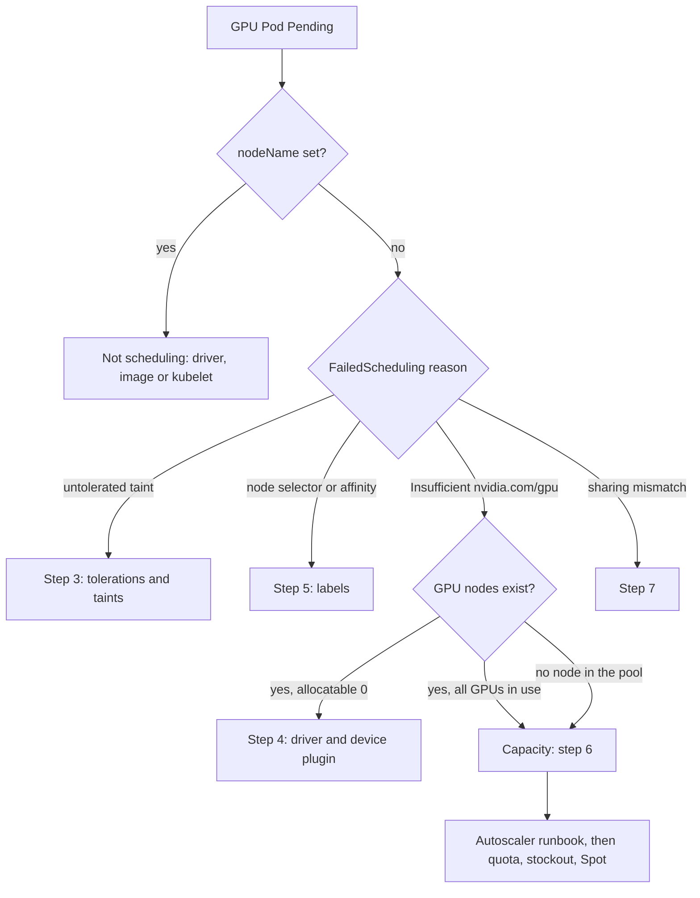

How to find out why model-serving or batch Pods that request `nvidia.com/gpu` stay `Pending` on GKE, and how to get them running without making capacity worse. A GPU Pod needs four things at once: a node that carries the accelerator, a Pod that tolerates that node's taints and matches its labels, a node that advertises free `nvidia.com/gpu` capacity, and a cloud that can create such a node when none is free. Each fails differently and leaves a different trace. Read the trace first, then fix the one thing that is wrong.

> [!info] Scope and verification
> The commands were not run against a live system and the note is not marked `verified`. Kubernetes behaviour was checked against the Kubernetes website sources and flags against the built-in `gcloud` help (SDK 570.0.0) on 2026-11-01. The Terraform provider documentation for the GKE cluster and node pool resources was read (commit c4248bd). No Google Cloud documentation page could be read. GKE-specific names (the exact taint and labels GKE sets, GPU quota names, stockout error text) are therefore listed as **not verified** below and in the Evidence section. Read each from your own cluster output before you rely on it.

## When to use

- A model server or batch Deployment, Job or StatefulSet requests `nvidia.com/gpu`, and its Pods stay `Pending` with a `FailedScheduling` event.
- A GPU node pool scaled up but the new node never offers a GPU: the Pod stays `Pending` on a node that shows `nvidia.com/gpu` capacity or allocatable of `0` or no entry at all.
- A rollout of an inference service stalls because the new Pods cannot find a GPU, while the old ones still hold them.
- You suspect a quota, stockout or Spot problem for a specific GPU type in one region or zone.

If the Pod is `Pending` and also requests only CPU and memory, use [[gke-cluster-autoscaler-not-scaling-up]]. If the Pod is scheduled and then dies from a CUDA out-of-memory error, use [[gpu-out-of-memory-and-kv-cache-exhaustion]]. If the Pod runs but is slow, use [[llm-serving-latency-regression]]. For Pods that are scheduled but do not start, use [[kubernetes-pod-troubleshooting]].

For the cluster layout this runbook assumes, see [[self-hosted-llm-inference-on-gke]]. For the generic autoscaler checks (node pool limits, Pod IP exhaustion, Pod-side blockers) this runbook does not repeat them; it links to the steps that cover them.

## Preconditions

- Read-only steps (1, 2, 5, the checks in 3, 4, 6 and 7, Validation): `compute.instanceGroupManagers.list` (the `list-errors` help names this permission and the Compute Viewer role), plus `container.clusters.get`, `compute.regions.get` for quota and `logging.logEntries.list` to read logs. The last three permission names are **not verified**.
- Write steps (3 pool creation, 4 node deletion, 8 mitigation, Rollback): permission to create, update and delete node pools (for example Kubernetes Engine Cluster Admin or a custom role; exact permission names **not verified**); Kubernetes RBAC to patch, pause, resume and undo Deployments in `$NS`, scale workloads in the batch namespaces, cordon, drain and delete nodes, and read Pods and logs in `kube-system` or the GPU operator namespace; and permission to list reservations if step 8 item 5 is used.
- Check whether the Deployment is managed by Argo CD before you change anything by hand (see step 0 below and [[argocd-sync-failure-and-drift]]).
- GPU node pools are managed in Terraform. Emergency `gcloud` changes below must be written back the same day, or the next `terraform apply` reverts them; see [[terraform-basics-on-gcp]].
- An incident or change record if you will add node pools, raise limits or move a workload to another zone. GPUs are billed while the node exists, whether or not a Pod uses it; see [[finops-cost-allocation-and-guardrails]].

```bash title="variables"
PROJECT=example-project
CLUSTER=prod-gke
LOCATION=europe-west1          # region for a regional cluster, zone for a zonal one
REGION=europe-west1
ZONE=europe-west1-b            # a zone where the GPU pool runs
NS=llm-serving
POD=llm-chat-7d9c6b6f4-abcde
POOL=gpu-inference
GPU_TYPE=nvidia-l4             # a name from: gcloud compute accelerator-types list
DEPLOY=llm-chat
APP_LABEL='app=llm-chat'
gcloud config set project "$PROJECT"
gcloud container clusters get-credentials "$CLUSTER" --location "$LOCATION"
```

## Steps



### 0. Check who manages the Deployment

Imperative changes in steps 3, 5, 7 and 8 are reverted if Argo CD self-heal is on.

```bash
kubectl -n "$NS" get deploy "$DEPLOY" -o jsonpath='{.metadata.labels.app\.kubernetes\.io/instance}{"\n"}{.metadata.annotations}{"\n"}'
```

If the output shows an Argo CD application, make the change through Git, or turn off auto-sync and self-heal for that application for the length of the incident and record that in the incident. Re-enable it at the end (see Rollback). See [[argocd-sync-failure-and-drift]].

### 1. Confirm the Pod requests GPUs and read what the scheduler says

A Pod in phase `Pending` is not always waiting for a node. If `.spec.nodeName` is set, the scheduler placed it and the wait is on the node (image pull, volume, driver); see [[kubernetes-pod-troubleshooting]].

```bash
kubectl -n "$NS" get pod "$POD" -o jsonpath='{.spec.nodeName}{"\n"}'
kubectl -n "$NS" get pod "$POD" -o json | jq '{
  gpu: [.spec.containers[] | {name, limits: .resources.limits, requests: .resources.requests}],
  nodeSelector: .spec.nodeSelector,
  tolerations: .spec.tolerations,
  affinity: .spec.affinity.nodeAffinity,
  priorityClassName: .spec.priorityClassName
}'
kubectl -n "$NS" describe pod "$POD" | sed -n '/Events:/,$p'
```

Kubernetes rules for GPU requests (from the "Schedule GPUs" page): GPUs are given in `limits`; you may set `requests` as well but the two must be equal; `requests` without `limits` is rejected. Extended resources are integers, so a fraction is never valid (the API server restricts them to whole numbers, per the "Resource Management for Pods and Containers" page). If the Pod asks for `nvidia.com/gpu` in `requests` only, or for more GPUs than any node has, fix the manifest first; no capacity change will help.

Read the `FailedScheduling` message. It sums up, per reason, how many nodes were rejected. For an extended resource the Kubernetes documentation shows a reason of the form `Insufficient <resource name>`, here `Insufficient nvidia.com/gpu`. The exact sentence around it differs between Kubernetes versions, so match on the reason, not on the full text. Then sort the message into one of these groups:

| Reason in the message                   | Meaning                                                   | Go to        |
| --------------------------------------- | --------------------------------------------------------- | ------------ |
| Untolerated taint                       | GPU nodes exist but the Pod does not tolerate their taint | Step 3       |
| Node selector or affinity did not match | No node carries the label the Pod asks for                | Step 5       |
| `Insufficient nvidia.com/gpu`           | Nodes match, but none has a free GPU                      | Step 4 and 6 |
| No nodes at all in the pool             | The pool is at zero, or cannot create a node              | Step 6       |

Also rule out two non-capacity causes: an unbound PersistentVolumeClaim (`kubectl -n "$NS" get pvc`; a new node does not fix it) and a Pod that is nominated for preemption (`kubectl -n "$NS" get pod "$POD" -o jsonpath='{.status.nominatedNodeName}'`; see [[priority-classes-and-preemption]]).

### 2. Look at the GPU nodes and the pool in one view

```bash
# Every node that has an accelerator, with what it advertises
kubectl get nodes -o custom-columns='NODE:.metadata.name,POOL:.metadata.labels.cloud\.google\.com/gke-nodepool,ZONE:.metadata.labels.topology\.kubernetes\.io/zone,GPU_CAP:.status.capacity.nvidia\.com/gpu,GPU_ALLOC:.status.allocatable.nvidia\.com/gpu,TAINTS:.spec.taints[*].key'

# What is using them
kubectl get pods -A -o json | jq -r '
  .items[] | select(.spec.nodeName != null)
  | select([.spec.containers[].resources.limits["nvidia.com/gpu"]] | any(. != null))
  | [.metadata.namespace, .metadata.name, .spec.nodeName,
     ([.spec.containers[].resources.limits["nvidia.com/gpu"] // "0" | tonumber] | add)] | @tsv'

# The pool as GKE sees it
gcloud container node-pools describe "$POOL" --cluster "$CLUSTER" --location "$LOCATION" \
  --format="yaml(name,config.machineType,config.accelerators,config.spot,config.taints,config.labels,locations,autoscaling,status)"
```

Expected on a healthy pool: each GPU node shows the same non-empty `GPU_CAP` and `GPU_ALLOC`, and the second command lists the Pods that hold them. If every GPU is allocated, the cluster is simply full: go to step 6. If the node pool list is empty, or shows no `config.accelerators`, go to step 3. If `GPU_CAP` is empty or `GPU_ALLOC` is `0` on a node of the GPU pool, go to step 4.

### 3. Check the accelerator, the taint and the toleration

Confirm the pool really attaches a GPU and which taints it carries.

```bash
gcloud container node-pools describe "$POOL" --cluster "$CLUSTER" --location "$LOCATION" \
  --format="yaml(config.accelerators,config.taints)"
```

Read the taints from this output, not from memory. Whether GKE adds its own `nvidia.com/gpu` taint to GPU pools, and whether it adds a matching toleration to Pods that request GPUs, is **not verified** here. The Kubernetes documentation describes the general mechanism: taint the nodes with the extended resource name, and the `ExtendedResourceToleration` admission controller adds the matching toleration to Pods that request that resource. Upstream, that controller is disabled by default (admission controllers reference); whether GKE turns it on is **not verified**, so unless it does, the Pod needs an explicit toleration. So compare the node taints with the Pod's tolerations directly:

```bash
kubectl get nodes -l cloud.google.com/gke-nodepool="$POOL" -o json \
  | jq '.items[0].spec.taints'
kubectl -n "$NS" get pod "$POD" -o json | jq '.spec.tolerations'
```

Every taint with effect `NoSchedule` or `NoExecute` on the node needs a toleration with the same key (or an empty key with `operator: Exists`), a matching value (or `operator: Exists`), and the same effect or no effect (an empty effect matches all effects for that key). A custom taint such as `dedicated=llm-inference:NoSchedule`, added to keep other GPU jobs off the pool, needs its own toleration in the Deployment:

```yaml title="deployment-fragment.yaml"
spec:
  template:
    spec:
      tolerations:
        - key: dedicated
          operator: Equal
          value: llm-inference
          effect: NoSchedule
        - key: nvidia.com/gpu
          operator: Exists
          effect: NoSchedule
      containers:
        - name: server
          resources:
            limits:
              nvidia.com/gpu: 1
```

If the pool has no `config.accelerators`, the pool was created without a GPU (a wrong Terraform `guest_accelerator` block, or the wrong pool name in the Pod's selector). The accelerator `type`, `count` and `gpu_partition_size` cannot be changed on an existing pool (the GKE API does not support it; Terraform re-creates the pool, per the provider docs), so create a new pool. Before creating it, run the quota and accelerator-types checks in step 6, so the replacement does not fail for the same reason. Copy the old pool's service account, image type, disk and Spot setting from `describe`. Create the replacement with the same machine type and the GPU attached:

```bash
MACHINE_TYPE=g2-standard-8      # a machine type that fits the GPU type; check the GKE GPU page

gcloud container node-pools create gpu-inference-2 \
  --cluster "$CLUSTER" --location "$LOCATION" \
  --node-locations "$ZONE" \
  --machine-type "$MACHINE_TYPE" \
  --accelerator "type=${GPU_TYPE},count=1,gpu-driver-version=default" \
  --node-taints "dedicated=llm-inference:NoSchedule" \
  --node-labels "workload=llm-inference" \
  --num-nodes 1 --enable-autoscaling --min-nodes 0 --max-nodes 2
```

`--num-nodes` is set because gcloud otherwise defaults to 3 nodes per zone, above `--max-nodes`. Then validate the pool before moving any Pods to it. A healthy node shows `READY=True` and a non-empty `GPU_ALLOC`:

```bash
kubectl get nodes -l cloud.google.com/gke-nodepool=gpu-inference-2 \
  -o custom-columns='NODE:.metadata.name,READY:.status.conditions[?(@.type=="Ready")].status,GPU_ALLOC:.status.allocatable.nvidia\.com/gpu'
```

The new pool has a new name, so a Deployment that selects `cloud.google.com/gke-nodepool=gpu-inference` never lands on it. Select on `workload=llm-inference` instead and confirm the Deployment's nodeSelector and affinity match the new pool's labels.

Write the same pool into Terraform right after, with an owner and a removal date for the old one. Which machine types go with which GPU types is **not verified**; the node pool create call rejects an invalid pair.

### 4. Nodes exist but advertise no GPU: driver and device plugin

A node can carry the accelerator and still show no `nvidia.com/gpu`. Kubernetes only learns of the GPU when a device plugin registers it with the kubelet, and the plugin needs a working driver on the node. The Kubernetes documentation says an administrator installs the vendor driver and runs the vendor device plugin; once the plugin is registered the cluster exposes `nvidia.com/gpu`. A device the plugin reports as unhealthy lowers the node's allocatable count while capacity stays the same, so `capacity: 1, allocatable: 0` points at an unhealthy device, and an empty capacity points at a plugin that never registered.

First decide how drivers are installed on this pool:

```bash
gcloud container node-pools describe "$POOL" --cluster "$CLUSTER" --location "$LOCATION" \
  --format="yaml(config.accelerators)"
```

The `--accelerator` flag takes `gpu-driver-version` with these values (from the `gcloud` help): `default` installs the default driver for the GKE version; `latest` installs the newest available for that version and works only on Container-Optimized OS; `disabled` skips installation, and you must install a driver yourself. The help says `default` is the default from GKE 1.30.1-gke.1156000, and `disabled` was the default before that, so a pool created on an older version may have no driver at all. The provider docs say the same (`GPU_DRIVER_VERSION_UNSPECIFIED` installs the default driver; before GKE `1.30.1-gke.1156000` no driver is installed; `LATEST` is COS only). How the installation status shows up in the output above is **not verified**.

```bash
NODE=$(kubectl get nodes -l cloud.google.com/gke-nodepool="$POOL" -o name | head -1)
kubectl describe "$NODE" | sed -n '/Capacity:/,/System Info:/p'
kubectl get pods -A -o wide --field-selector spec.nodeName="${NODE#node/}" \
  | grep -iE 'nvidia|gpu|device-plugin'
kubectl get ds -A | grep -iE 'nvidia|gpu'
```

Expected on a working node: `nvidia.com/gpu` appears under both `Capacity` and `Allocatable`, and a GPU driver installer and a device plugin Pod run on the node. The names of those DaemonSets differ between GKE versions and between a GKE-managed install and the NVIDIA GPU Operator, so the `grep` matches loosely. If the driver DaemonSet or Pod is crash-looping or `Pending`, read its logs:

```bash
read DRIVER_NS DRIVER_POD < <(kubectl get pods -A --field-selector spec.nodeName="${NODE#node/}" --no-headers \
  | awk 'tolower($2) ~ /nvidia|gpu|device-plugin/ {print $1, $2; exit}')
kubectl -n "$DRIVER_NS" logs "$DRIVER_POD" --all-containers --tail=100
kubectl -n "$DRIVER_NS" logs "$DRIVER_POD" --all-containers --previous --tail=100
```

Driver installers often work in an init container, so `--all-containers` and `--previous` matter for a crash-looping install. Common causes: `gpu-driver-version=disabled` with no self-managed install; a driver version that does not support the GPU type or the node image; a node image type that does not allow the option you chose (`latest` is Container-Optimized OS only). Fixes, in order of safety:

1. Update the existing pool with `gpu-driver-version=default`: the provider docs say `gpu_driver_installation_config` is updated in place, and the `node-pools update` help accepts `--accelerator` with `gpu-driver-version`. Whether this replaces the nodes is **not verified**. If that is not enough, re-create the pool with `gpu-driver-version=default` (step 3 shows the command); new nodes then install the driver themselves.
2. If you manage drivers yourself (the NVIDIA GPU Operator or your own DaemonSet), check that its Pods run on the GPU nodes and that their tolerations match the pool's taints, or they will not start on tainted nodes.
3. Drain and delete one node so the pool re-creates it, and watch whether the new node reaches `nvidia.com/gpu` allocatable. Do this only if the pool has other nodes serving traffic. First save the evidence, because deleting the node destroys it, and check quota and zone room (step 6), since a deleted GPU node may not be replaced during a stockout or once quota is used:

```bash
N="${NODE#node/}"
kubectl describe node "$N" > node-describe.txt
kubectl -n "$DRIVER_NS" logs "$DRIVER_POD" --all-containers --previous > driver-previous.log
gcloud compute instances get-serial-port-output "$N" --zone "$ZONE" > serial.txt
kubectl cordon "$N"
kubectl drain "$N" --ignore-daemonsets --delete-emptydir-data --timeout=10m
MIG="$(gcloud container node-pools describe "$POOL" --cluster "$CLUSTER" --location "$LOCATION" \
  --format="value(instanceGroupUrls)" | tr ';' '\n' | grep "/zones/$ZONE/" | xargs -n1 basename)"
echo "MIG=$MIG"   # exactly one name; the node must be in $ZONE
gcloud compute instance-groups managed recreate-instances "$MIG" --instances "$N" --zone "$ZONE"
```

`recreate-instances` deletes the VM and creates a new one from the group's current instance template, so the pool keeps its size. Do not use `delete-instances` here: it deletes the VM and reduces the group's target size, so no replacement node is created. `$MIG` is the pool's managed instance group in `$ZONE`; check the node is in that zone first (`kubectl get node "$N" -L topology.kubernetes.io/zone`).

If one node differs from the rest of the pool, treat it as a node fault: cordon it, capture the evidence above, let the pool replace it, and see [[gke-node-notready-triage]].

### 5. Check the node selector and the accelerator label

A Pod that selects a GPU type needs a node label that exists. The Kubernetes "Schedule GPUs" page shows the generic approach: label nodes by accelerator type, then select on that label from the Pod; the label key in its example is only an example. What labels GKE puts on GPU nodes, and whether `cloud.google.com/gke-accelerator` is one of them, is **not verified**: the `gcloud` help and the provider documentation available for this review do not show it. List what your nodes carry and select on that:

```bash
kubectl get nodes -l cloud.google.com/gke-nodepool="$POOL" --show-labels | tr ',' '\n' | sort -u | grep -iE 'accel|gpu|pool|zone'
kubectl -n "$NS" get pod "$POD" -o jsonpath='{.spec.nodeSelector}{"\n"}{.spec.affinity.nodeAffinity}{"\n"}'
```

If the selector asks for a label no node has (a typo, a value that differs by one character, or a label from another cloud), correct the Deployment. A label you set yourself with `--node-labels` is under your control and does not depend on GKE; for example `workload=llm-inference`, set on the pool in Terraform and selected on in the Pod, survives a pool re-creation. The `gcloud` help for `node-pools update --node-labels` says labels are applied to existing nodes in place and to new nodes.

### 6. No GPU is free and none can be created: capacity

When the Pod is waiting for a GPU that no existing node has free, the question is whether the cluster autoscaler can add a node. The generic part of that question (autoscaler events, per-zone node maximums, node auto-provisioning limits, Pod IP exhaustion, Pod-side constraints) is in [[gke-cluster-autoscaler-not-scaling-up]]; do those steps there and come back for the GPU-specific causes below. Two GPU specifics to add to that runbook:

- If you rely on node auto-provisioning to create GPU pools, the `--max-accelerator` flag (`gcloud container clusters update` help) sets the per-type cap in the cluster. That NAP will not create a GPU pool without such a limit is **not verified**; the provider docs say only that `cpu` and `memory` limits are required.
- `--max-nodes` is per zone. A pool with `--max-nodes 2` in one zone stops at two GPU nodes. With several GPUs per node, the node maximum times the GPUs per node must still fit inside the quota in the next check.

**GPU quota.** A node creation can fail because the project's quota for that GPU type in the region is used up. List the regional quotas that mention GPUs and compare usage with the limit:

```bash
gcloud compute regions describe "$REGION" --flatten=quotas \
  --format="table(quotas.metric,quotas.usage,quotas.limit)" \
  | awk 'NR==1 || /GPU/'
```

The output has one row per quota metric. Which metric names exist for which GPU type, and whether Spot GPUs use separate preemptible metrics, is **not verified**; the `/GPU/` filter in the awk command is a guess at the naming. If it returns nothing for your type, print the whole table and read it. Quota can also exist per project and globally, outside this region view; whether a global GPU quota applies here is **not verified**. When usage equals the limit, a new node cannot be created, and the managed instance group records the failure:

```bash
gcloud container node-pools describe "$POOL" --cluster "$CLUSTER" --location "$LOCATION" \
  --format="value(instanceGroupUrls)" | tr ';' '\n' > mig-urls.txt

while read -r url; do
  zone=$(echo "$url" | awk -F/ '{for(i=1;i<=NF;i++) if($i=="zones") print $(i+1)}')
  echo "== $zone $(basename "$url")"
  gcloud compute instance-groups managed list-errors "$(basename "$url")" --zone "$zone" --limit 10 \
    --format="table(timestamp,error.code,error.message)"
done < mig-urls.txt
```

Read the error code and message. A quota failure and a stockout look different, but the exact codes and wording for GPUs are **not verified** here; the generic runbook names two codes for regular machine types (`ZONE_RESOURCE_POOL_EXHAUSTED` for a stockout, `QUOTA_EXCEEDED` for quota), and they may also appear for GPUs. Treat them as likely, not guaranteed.

**The GPU type may not be offered in the zone.** Not every zone offers every accelerator type. Ask Compute Engine which zones list the type:

```bash
gcloud compute accelerator-types list --filter="zone ~ ^${REGION}- AND name=${GPU_TYPE}" --format="value(zone.basename())"
```

If your zone is missing from the output, the pool cannot ever create a node there, whatever the quota. Move the pool's `--node-locations` to a zone that is listed. If the list shows the zone but node creation still fails with a resource-pool message, that is a **stockout**: the zone has no free GPUs of that type at the moment. It clears on its own or never; do not wait for it during an incident.

**Spot GPUs.** A pool created with `--spot` runs on Spot capacity, which can be reclaimed at any time and may be unavailable when you need it. Check whether the pool is Spot:

```bash
gcloud container node-pools describe "$POOL" --cluster "$CLUSTER" --location "$LOCATION" --format="value(config.spot)"
kubectl get events -A --field-selector reason=Preempted --sort-by=.lastTimestamp | tail
```

A Spot pool that keeps losing nodes shows Pods going `Pending` again and again right after a node disappears. The event reason shown here is a guess; node preemption events in GKE are **not verified**, so also check the node's absence from `kubectl get nodes` and the MIG's recent operations. A serving workload should have a floor on a non-Spot pool; see [[gke-spot-vms-for-workloads]].

**Autoscaling maximum.** From step 2's `describe`, compare `autoscaling.maxNodeCount` (per zone) or `autoscaling.totalMaxNodeCount` with the number of GPU nodes you have. If the pool is at its maximum, raise it only if the quota check above leaves room.

### 7. Check GPU sharing and partition mismatches

With GPU sharing, one physical GPU appears as several schedulable units. That changes what `nvidia.com/gpu: 1` means and where Pods can run. The `--accelerator` flag accepts `gpu-sharing-strategy` (the provider docs list `TIME_SHARING` and `MPS`), `max-shared-clients-per-gpu` (the number of containers that may share each GPU, used with the strategy) and `gpu-partition-size` (for multi-instance GPUs). See [[gpu-sharing-on-kubernetes]] for the design.

```bash
gcloud container node-pools describe "$POOL" --cluster "$CLUSTER" --location "$LOCATION" \
  --format="yaml(config.accelerators)"
kubectl get nodes -l cloud.google.com/gke-nodepool="$POOL" \
  -o custom-columns='NODE:.metadata.name,GPU_CAP:.status.capacity.nvidia\.com/gpu,GPU_ALLOC:.status.allocatable.nvidia\.com/gpu'
```

Mismatches that leave Pods `Pending`:

- A Deployment asks for `nvidia.com/gpu: 2` on a pool whose nodes advertise only one schedulable unit each. The Pod then never fits; the message is `Insufficient nvidia.com/gpu` even though the pool is idle.
- A pool is time-shared or partitioned and a Pod expects a whole GPU for its model, so the Pod schedules but later fails for lack of memory (a different runbook), or a team assumes a request of 1 means a whole device and requests more than the node offers.
- The capacity a node advertises is the number of replicas or partitions, not the number of physical GPUs, so a namespace quota written in GPUs admits more or fewer Pods than intended; see [[gpu-sharing-on-kubernetes]].
- GPUs of the same type are split across a shared pool and an exclusive pool, and the Pod's selector chooses the wrong one.

Fix the Pod's request, the selector or the pool's sharing settings so that all three agree. The provider docs say `gpu_sharing_config` can be updated in place, and changing `gpu_partition_size` re-creates the pool. Whether an in-place sharing change replaces the nodes is **not verified**, so plan it with the capacity of a pool replacement in mind.

### 8. Short-term mitigation while the fix lands

Mitigate in this order, and stop at the first step that restores service:

1. **Keep what works.** Do not delete or scale down the old Deployment version until the new Pods are `Ready`. During a rollout stall, pause it: `kubectl -n "$NS" rollout pause deployment/"$DEPLOY"`. If the stall came from a surge Pod that cannot get a GPU, set `maxSurge: 0` and `maxUnavailable: 1` so the rollout reuses the GPU it frees. Do this only if replicas are at least 2 and the remaining replicas can carry peak traffic (check `kubectl -n "$NS" get deploy,pdb` first). Record the original strategy first, then patch:

   ```bash
   kubectl -n "$NS" get deploy "$DEPLOY" -o jsonpath='{.spec.strategy}{"\n"}' | tee strategy-before.json
   kubectl -n "$NS" patch deployment/"$DEPLOY" --type merge -p '{"spec":{"strategy":{"rollingUpdate":{"maxSurge":0,"maxUnavailable":1}}}}'
   ```

   A paused Deployment does not progress, so the patch has no effect until you resume. After the `maxSurge: 0` patch, resume right away (`kubectl -n "$NS" rollout resume deployment/"$DEPLOY"`), because that strategy needs no extra GPU. If you leave the strategy unchanged, keep the rollout paused and resume it once capacity is back.

2. **Shed load.** Scale down batch or low-priority GPU Pods first: it is the fastest, cheapest and fully reversible way to free a GPU. Record replica counts before scaling so the change can be undone, for example `kubectl -n BATCH_NS get deploy,statefulset -o jsonpath='{range .items[*]}{.kind}/{.metadata.name}={.spec.replicas}{"\n"}{end}' > batch-replicas.txt`. The holders are listed in step 2. See [[priority-classes-and-preemption]]. If no capacity can be found in time, route traffic to a fallback model or provider; see [[model-provider-failover-and-routing]].
3. **Another zone.** Add or enable the pool in a zone that `accelerator-types list` shows and where the MIG has no errors. In a regional cluster, add the zone to `--node-locations` through Terraform. With a zonal volume for model weights, the Pod may be pinned to one zone; see [[stateful-workloads-gke]].
4. **Another pool.** Add a second GPU pool with a different GPU type or machine family that the model fits on, and let the Deployment select either by a shared label. Check that the model fits in the other GPU's memory first, and see [[llm-inference-capacity-planning]].
5. **On-demand fallback.** If the Spot pool is gone, create an on-demand pool with the same labels so Pods land there. It costs more per hour; set an owner and a removal date.
6. **A reservation.** If you have a Compute Engine reservation for the GPU type, a pool can draw from it with `--reservation-affinity specific --reservation NAME` (or `any`). List them with `gcloud compute reservations list`. Creating and sizing reservations is slow and a commercial decision; do not try it during the incident.

The `gcloud container node-pools create` help also lists `--flex-start` and `--enable-queued-provisioning`, which obtain nodes through other provisioning models. Their behaviour and fit for serving are **not verified**; read the current GKE documentation before using them. Cold start after any new node (driver, image pull, weight load) takes time; see [[inference-cold-start-mitigation]] and [[model-capacity-forecasting]] for avoiding a repeat at the next peak.

## Validation

```bash
kubectl -n "$NS" get pod "$POD" -o wide                                  # Running, on a GPU node, Ready
kubectl -n "$NS" get pods -l "$APP_LABEL"                                # all replicas Ready
kubectl get nodes -L cloud.google.com/gke-nodepool                       # new GPU nodes Ready
kubectl get nodes -l cloud.google.com/gke-nodepool="$POOL" \
  -o custom-columns='NODE:.metadata.name,GPU_ALLOC:.status.allocatable.nvidia\.com/gpu'   # non-empty on every node
kubectl get pods -A --field-selector=status.phase=Pending -o json | jq '.items | length'  # back to the usual level

# FIX_TIME: set when the fix is applied
FIX_TIME=$(date -u +%FT%TZ)
# Regenerate the MIG list for every pool you touched, not only $POOL
for p in "$POOL" gpu-inference-2; do
  gcloud container node-pools describe "$p" --cluster "$CLUSTER" --location "$LOCATION" \
    --format="value(instanceGroupUrls)" 2>/dev/null | tr ';' '\n'
done | grep . > mig-urls-validate.txt
while read -r url; do
  zone=$(echo "$url" | awk -F/ '{for(i=1;i<=NF;i++) if($i=="zones") print $(i+1)}')
  gcloud compute instance-groups managed list-errors "$(basename "$url")" --zone "$zone" \
    --filter="timestamp>=${FIX_TIME}" --limit 3
done < mig-urls-validate.txt                                             # no errors after FIX_TIME
```

Then check the service, not only the Pod: run one request through the gateway and look at the model server's readiness and its time to first token (TTFT) and inter-token latency for the first minutes; see [[llm-serving-latency-regression]]. Watch the next peak: the Pending count should return to near zero within the time it takes to create a node and load the model, and a rollout should finish without surge Pods waiting.

## Rollback

- **Deployment changes** (tolerations, selectors, GPU count): kubectl refuses to undo a paused Deployment, so resume first, then undo, then restore the strategy recorded in step 8:

  ```bash
  kubectl -n "$NS" rollout resume deployment/"$DEPLOY"
  kubectl -n "$NS" rollout undo deployment/"$DEPLOY"
  kubectl -n "$NS" patch deployment/"$DEPLOY" --type merge -p '{"spec":{"strategy":{"rollingUpdate":{"maxSurge":"25%","maxUnavailable":"25%"}}}}'
  ```

  Use the values from `strategy-before.json` if they differ from 25%; `rollout undo` reverts only the Pod template. If Argo CD manages the Deployment, revert the Git commit instead, and re-enable auto-sync and self-heal if you turned them off. Undoing a rollout that stalled for lack of GPUs does not need any capacity.

- **Scaled-down batch workloads:** restore the replica counts saved in `batch-replicas.txt`.
- **A new node pool:** if it is the fix (it replaced a broken pool in step 3 or 4), this is not a rollback; deleting it removes your only working GPU capacity. Otherwise confirm the serving Pods are Ready on another pool with free GPU allocatable, then `kubectl cordon -l cloud.google.com/gke-nodepool=gpu-inference-2` and `kubectl drain -l cloud.google.com/gke-nodepool=gpu-inference-2 --ignore-daemonsets --delete-emptydir-data --timeout=10m`, wait for Pods to move, then delete the pool: `gcloud container node-pools delete gpu-inference-2 --cluster "$CLUSTER" --location "$LOCATION"`. Deleting a pool deletes its nodes and any data on local disks; weights should live in object storage or a persistent volume. Remove the pool from Terraform at the same time.
- **Raised maximums or an on-demand fallback pool:** revert in Terraform. Lowering a maximum below the current size lets the autoscaler scale down over time; it does not delete nodes at once. An on-demand fallback raises cost until it is removed.
- **A reservation or a quota increase:** a reservation is billed whether or not it is used; deleting it releases the capacity and may not be recoverable in a stocked-out zone. A granted quota increase is not normally rolled back; how to reduce one is **not verified**.
- **Gone for good:** a Spot node that was reclaimed, a deleted GPU node (it may not be replaced during a stockout or once quota is used), and the GPU capacity you held on it. A zone that stocked out may not give the capacity back when you want it, so do not delete a working GPU pool to "re-create it cleanly" unless you have capacity lined up.

## Troubleshooting

| Symptom                                                            | Likely cause and fix                                                                                    |
| ------------------------------------------------------------------ | ------------------------------------------------------------------------------------------------------- |
| `FailedScheduling`: untolerated taint on every node                | Pod lacks a toleration for the GPU pool's taint. Step 3.                                                |
| `Insufficient nvidia.com/gpu`, GPU nodes exist, all GPUs allocated | Cluster is full. Free GPUs held by lower-priority Pods, or add capacity. Steps 2 and 6.                 |
| `Insufficient nvidia.com/gpu`, node shows capacity empty           | Device plugin not registered or driver missing. Step 4.                                                 |
| Node shows capacity `1`, allocatable `0`                           | Device reported unhealthy. Check the device plugin logs, drain and replace the node. Step 4.            |
| Node selector or affinity did not match                            | The label does not exist on any node. List node labels and correct the selector. Step 5.                |
| Autoscaler `TriggeredScaleUp`, node never appears                  | Quota or stockout in the MIG errors. Step 6.                                                            |
| Autoscaler `NotTriggerScaleUp`, pool at its maximum                | Per-zone maximum reached. See the autoscaler runbook, step 3, and check quota before raising it.        |
| Scale-up works in two zones, never in the third                    | GPU type not offered in that zone, or a stockout there. `accelerator-types list`, step 6.               |
| Node comes up, Pod runs, then GPU Pods Pending again after hours   | Spot reclaim. Add an on-demand floor. Step 6.                                                           |
| Pod requests 2 GPUs, pool idle, still Pending                      | Nodes advertise one schedulable unit each, or sharing changed the count. Step 7.                        |
| Rollout stuck, old Pods hold all GPUs                              | `maxSurge` needs a spare GPU that does not exist. Set `maxSurge: 0` and `maxUnavailable: 1`. Step 8.    |
| GPU pool node is created, stays `NotReady`                         | Node fault, not a scheduling fault. See [[gke-node-notready-triage]].                                   |
| Pods Pending only after an upgrade                                 | Surge node needs spare GPU quota. See [[gke-node-pool-upgrade-strategies]] and [[gke-cluster-upgrade]]. |
| Pending with no GPU in the request                                 | Not a GPU problem. Use [[gke-cluster-autoscaler-not-scaling-up]].                                       |

## Related

- [[gke-cluster-autoscaler-not-scaling-up]] for the generic autoscaler, node pool limit, IP exhaustion and Pod-side checks.
- [[self-hosted-llm-inference-on-gke]] for the GPU node pool, serving Deployment and rollback this runbook assumes.
- [[gpu-sharing-on-kubernetes]] for time-slicing and partitioning, and what a GPU request means on each.
- [[llm-inference-capacity-planning]] and [[model-capacity-forecasting]] for sizing GPU capacity before a peak.
- [[inference-cold-start-mitigation]] for the delay between a new node and a ready replica.
- [[kubernetes-pod-troubleshooting]] for Pods that are scheduled but do not start.
- [[gke-spot-vms-for-workloads]] for a Spot design with an on-demand floor.
- [[gpu-out-of-memory-and-kv-cache-exhaustion]], [[llm-serving-latency-regression]], [[model-or-prompt-rollout-quality-regression]], [[llm-token-spend-spike]] and [[llm-api-rate-limit-429-storm]] for the neighbouring AI serving runbooks.
- [[argocd-sync-failure-and-drift]] for Argo CD managed Deployments and self-heal.
- [[incident-response]] for declaring and running the incident.

## Evidence

Source-reviewed on 2026-11-01. Nothing was run and no cluster or Google Cloud project was used. Read this section before using the note.

### Sources checked

- `gcloud compute instance-groups managed recreate-instances --help` and `delete-instances --help` (SDK 570.0.0): recreate deletes the VM and creates it again from the current instance template; delete removes it and reduces the group size. Checked 2026-11-01.
- [Schedule GPUs | Kubernetes](https://kubernetes.io/docs/tasks/manage-gpus/scheduling-gpus/): GPUs are exposed as custom resources such as `nvidia.com/gpu` by a vendor device plugin after the administrator installs the driver; GPUs go in `limits`, `requests` may be omitted or must equal `limits`, `requests` alone is not allowed; labelling nodes by accelerator type and selecting with node selectors, and that the label key in the page is only an example. Checked 2026-11-01 against the Kubernetes website repository, commit 491f14e.
- [Device Plugins | Kubernetes](https://kubernetes.io/docs/concepts/extend-kubernetes/compute-storage-net/device-plugins/): a device plugin registers with the kubelet and advertises a resource; an unhealthy device lowers the allocatable count while capacity is unchanged; plugins are expected to re-register after a kubelet restart. Checked 2026-11-01, commit 491f14e.
- [Taints and Tolerations | Kubernetes](https://kubernetes.io/docs/concepts/scheduling-eviction/taint-and-toleration/): a pod needs a matching toleration to schedule onto a tainted node; tainting special hardware with the extended resource name together with the `ExtendedResourceToleration` admission controller adds the toleration to pods that request it. Checked 2026-11-01, commit 491f14e.
- [Advertise Extended Resources for a Node | Kubernetes](https://kubernetes.io/docs/tasks/administer-cluster/extended-resource-node/) and [Assign Extended Resources to a Container | Kubernetes](https://kubernetes.io/docs/tasks/configure-pod-container/extended-resource/): extended resources are advertised in integer amounts; the `Insufficient <resource name>` reason in a `FailedScheduling` event. Checked 2026-11-01, commit 491f14e.
- [Resource Management for Pods and Containers | Kubernetes](https://kubernetes.io/docs/concepts/configuration/manage-resources-containers/): the API server restricts quantities of extended resources to whole numbers. Checked 2026-11-01, commit 491f14e.
- [Admission Controllers Reference | Kubernetes](https://kubernetes.io/docs/reference/access-authn-authz/admission-controllers/): `ExtendedResourceToleration` is disabled by default. Checked 2026-11-01, commit 491f14e.
- Terraform provider for Google docs, commit c4248bd, `container_cluster.html.markdown` (`guest_accelerator` block; `type`, `count` and `gpu_partition_size` changes re-create the pool while `gpu_driver_installation_config` and `gpu_sharing_config` update in place; driver modes and the pre-1.30.1-gke.1156000 default; sharing strategies `TIME_SHARING` and `MPS`; `max_shared_clients_per_gpu`; `cluster_autoscaling.resource_limits`) and `container_node_pool.html.markdown` (autoscaling `max_node_count` per zone, `total_max_node_count`, `reservation_affinity`).
- `gcloud` built-in help, SDK 570.0.0, checked 2026-11-01: `container node-pools create` and `update` (`--accelerator` with `type`, `count`, `gpu-driver-version` values `default`, `latest` and `disabled` and their stated defaults, `gpu-partition-size`, `gpu-sharing-strategy`, `max-shared-clients-per-gpu`; `--node-taints`, `--node-labels`, `--node-locations`, `--spot`, `--enable-autoscaling`, `--max-nodes` per zone, `--total-max-nodes`, `--reservation`, `--reservation-affinity`, `--flex-start`, `--enable-queued-provisioning`), `compute accelerator-types list` (zone filter), `compute regions describe`, `compute reservations list`, `compute instance-groups managed list-errors` (names the `compute.instanceGroupManagers.list` permission and Compute Viewer role), `container clusters update` (`--max-accelerator`).

### Not verified

- Everything that depends on Google Cloud documentation, which could not be read.
- The exact taint, if any, that GKE puts on GPU node pools, and whether GKE adds a matching toleration to Pods that request GPUs (including whether GKE enables the `ExtendedResourceToleration` admission controller; upstream it is off by default).
- The permission names `container.clusters.get`, `compute.regions.get` and `logging.logEntries.list`, and the exact permissions for node pool changes.
- That node auto-provisioning will not create a GPU pool without an accelerator resource limit.
- Whether an in-place update of driver or sharing settings replaces the nodes.
- The labels GKE puts on GPU nodes, including whether `cloud.google.com/gke-accelerator` exists and what its value is; the note tells the reader to list node labels instead.
- GPU quota metric names and how Spot or preemptible GPU quota is counted, whether a global GPU quota also applies, and the `GPU` filter in the quota command.
- The error codes and message text for a GPU stockout or quota failure in the managed instance group; the two codes borrowed from the autoscaler runbook are not confirmed for GPUs.
- How GKE reports driver installation status, the names of the driver and device plugin DaemonSets, and whether a driver version or node image combination is rejected.
- Which machine types pair with which GPU types, and which zones offer which GPU type (the note uses `gcloud compute accelerator-types list` for that).
- The exact `FailedScheduling` sentence in your Kubernetes version; only the `Insufficient <resource>` reason form is documented in the pages read.
- Node preemption events for Spot nodes in GKE, including the `Preempted` event reason used in step 6.
- The behaviour of `--flex-start`, `--enable-queued-provisioning` and reservations for serving workloads, and how a quota increase is requested or reduced.
- Rollout settings (`maxSurge`, `maxUnavailable`), drain behaviour and the mitigation order are engineering practice, not documented claims. Nothing was run.

### Environment

A GKE Standard cluster with NVIDIA GPU node pools, `kubectl` and `jq`, and `gcloud` (flags checked on SDK 570.0.0). The shell lines assume bash. Autopilot clusters provision nodes themselves; how they report these failures is not covered.

### Prerequisites

See Preconditions. Also: a change record before creating pools or raising maximums, and the name of the owner who approves GPU spend.

### Expected results

See Validation. After the fix every GPU node shows a non-empty `nvidia.com/gpu` allocatable value, the Pods are `Running` and `Ready` on those nodes, the Pending count returns to its usual level, and the managed instance groups show no new errors.

### Failure conditions

See Troubleshooting. Stop and escalate if: quota is used up and no increase is possible in time; every zone you may use is stocked out; the driver installs fail on a pool you cannot re-create; or the only way to restore service is to delete a working GPU pool.

### Cleanup and rollback

See Rollback. Remove temporary pools, on-demand fallbacks and the local `mig-urls.txt`, `mig-urls-validate.txt`, `strategy-before.json` and `batch-replicas.txt` files once the incident record says the fix has held, and write every `gcloud` change back into Terraform.

## Sources

- [Schedule GPUs | Kubernetes](https://kubernetes.io/docs/tasks/manage-gpus/scheduling-gpus/): how GPU requests and node selection work.
- [Device Plugins | Kubernetes](https://kubernetes.io/docs/concepts/extend-kubernetes/compute-storage-net/device-plugins/): how GPU capacity is advertised and what an unhealthy device does.
- [Taints and Tolerations | Kubernetes](https://kubernetes.io/docs/concepts/scheduling-eviction/taint-and-toleration/): taint, toleration and the extended resource toleration pattern.
- [Assign Extended Resources to a Container | Kubernetes](https://kubernetes.io/docs/tasks/configure-pod-container/extended-resource/): the `Insufficient` scheduling reason for an extended resource.
- [Resource Management for Pods and Containers | Kubernetes](https://kubernetes.io/docs/concepts/configuration/manage-resources-containers/): extended resources are whole numbers.
- [Admission Controllers Reference | Kubernetes](https://kubernetes.io/docs/reference/access-authn-authz/admission-controllers/): `ExtendedResourceToleration` default.
- Terraform provider for Google, `google_container_cluster` and `google_container_node_pool` documentation: `guest_accelerator` behaviour.
- `gcloud` built-in help, SDK 570.0.0: `container node-pools create|update|describe`, `compute accelerator-types list`, `compute regions describe`, `compute reservations list`, `compute instance-groups managed list-errors`.
- See also, not read for this note: [Run GPUs in GKE Standard node pools](https://cloud.google.com/kubernetes-engine/docs/how-to/gpus), [GPU time-sharing in GKE](https://cloud.google.com/kubernetes-engine/docs/concepts/timesharing-gpus), [GPU quota and regions](https://cloud.google.com/compute/docs/gpus/gpu-regions-zones).
