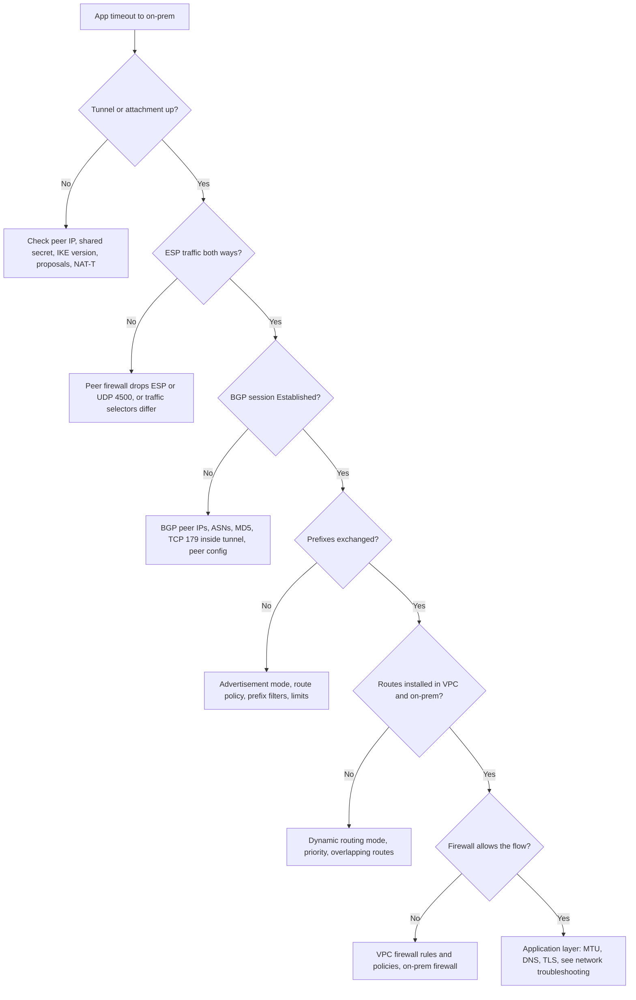

A hybrid link between an on-prem network and GCP has several layers that fail in different ways: the tunnel or attachment, the IKE and IPsec negotiation, the BGP session, the routes that session carries, and the firewalls at both ends. This runbook walks those layers in order, so you stop at the first one that is broken instead of guessing. It covers Cloud VPN (HA VPN) and Cloud Interconnect VLAN attachments, both using Cloud Router for dynamic routing.

DNS over the link is out of scope; see [[cloud-dns-hybrid-and-multi-project]]. For a path that is up but slow, dropping large packets or failing TLS, use [[network-troubleshooting-dns-mtu-tls-load-balancers]]. The design this link normally plugs into is in [[shared-vpc-hub-and-spoke]].

> [!warning] Not verified: environment-specific facts and limits
> This note was written from general knowledge of GCP hybrid networking and was not run against a live link. These items are **not verified**: Cloud Router limits (prefixes per session, sessions per router, custom advertisement limits), HA VPN SLA requirements (a topology with two tunnels to two peer interfaces is needed for the SLA, but the exact conditions must be read from the Google Cloud documentation), the exact `gcloud` subcommands and flags below (check `gcloud ... --help` for your installed version), the Cloud Logging resource types and field names, and which hybrid option (HA VPN, Partner or Dedicated Interconnect, or both) your environment uses. All sample output is illustrative and uses documentation address ranges.

## When to use

- A VPN tunnel shows `FIRST_HANDSHAKE`, `NO_INCOMING_PACKETS` or any state other than `ESTABLISHED`.
- A BGP session is not `Established`, or flaps.
- The tunnel and session are up but a prefix is missing on one side, or traffic takes the wrong path.
- A VLAN attachment is not `ACTIVE`, or its BGP session is down.
- Applications report timeouts to on-prem systems that worked before. If production is affected, open an incident first and follow [[incident-response]].

## Preconditions

- `roles/compute.networkViewer` (or equivalent read access) on the project that owns the tunnels and Cloud Router, usually the network host project. Changing anything needs more, and changes to a production link should go through the normal change process.
- `roles/networkmanagement.admin` or a role that can create Connectivity Tests, if you want to use them. Connectivity Tests analyse configuration; they do not send packets (see the Connectivity Tests step).
- Contact with the on-prem network team. Half of the evidence lives on their router or firewall. They need the ticket template in the last step.
- The variables below set once per shell. Replace the values with your own.

```bash
PROJECT="my-network-host-project"   # project that owns the VPN gateway and Cloud Router
REGION="europe-west1"               # region of the gateway, router and attachment
TUNNEL="vpn-tunnel-to-onprem-0"     # tunnel name
ROUTER="cr-hybrid-europe-west1"     # Cloud Router name
GATEWAY="ha-vpn-gw-europe-west1"    # HA VPN gateway name
ATTACHMENT="vlan-onprem-0"          # Interconnect VLAN attachment name, if used
NETWORK="vpc-shared"                # VPC network name
gcloud config set project "$PROJECT"
```

## Steps

### 1. Layered flow

Work from the bottom up. A higher layer cannot work while a lower one is broken, and the symptom at the top (a timeout) looks the same for every cause.



| Layer           | What fails                                     | First evidence                                                                                    |
| --------------- | ---------------------------------------------- | ------------------------------------------------------------------------------------------------- |
| Tunnel / IKE    | Negotiation never completes                    | `vpn-tunnels describe` detailed status, gateway logs                                              |
| IPsec / ESP     | Tunnel up, no data, or one direction only      | Packet counters on both ends, on-prem `show crypto`                                               |
| BGP session     | Session stuck in `Idle`, `Active` or `Connect` | `routers get-status`, on-prem `show ip bgp summary`                                               |
| Route exchange  | Session up, prefix missing                     | `routers get-status` best routes, advertised routes                                               |
| Route selection | Traffic uses another path or no path           | `routers get-status` bestRoutes; `routes list` for static/peering overlaps; on-prem routing table |
| Firewall        | Route exists, packets die                      | VPC firewall logs, Connectivity Test, on-prem firewall                                            |

### 2. Tunnel and IKE checks

Start with the tunnel status and its detailed status text.

```bash
gcloud compute vpn-tunnels describe "$TUNNEL" \
  --region "$REGION" \
  --format="yaml(name,status,detailedStatus,ikeVersion,peerIp,vpnGatewayInterface,router)"

# All tunnels in the region at a glance.
gcloud compute vpn-tunnels list \
  --filter="region:($REGION)" \
  --format="table(name,status,peerIp,ikeVersion,vpnGatewayInterface)"
```

Illustrative output for a tunnel that never completes IKE:

```yaml
detailedStatus: Waiting for the peer to respond to the first handshake message.
ikeVersion: 2
name: vpn-tunnel-to-onprem-0
peerIp: 203.0.113.10
router: https://www.googleapis.com/compute/v1/projects/my-network-host-project/regions/europe-west1/routers/cr-hybrid-europe-west1
status: FIRST_HANDSHAKE
vpnGatewayInterface: 0
```

Read the status as a pointer to a layer. The names and texts below are the ones commonly seen; the full list and the wording are **not verified**, so check the Cloud VPN documentation for your case.

| Status (typical)                          | Likely cause                                                                                                       |
| ----------------------------------------- | ------------------------------------------------------------------------------------------------------------------ |
| `PROVISIONING`, `WAITING_FOR_FULL_CONFIG` | The gateway or tunnel is not fully configured yet (for example no router attached).                                |
| `FIRST_HANDSHAKE`                         | The peer does not answer. Wrong peer IP, peer firewall blocks UDP 500 or 4500, or the peer has no matching config. |
| `NO_INCOMING_PACKETS`                     | Google sends but receives nothing. Peer is down, a return path is blocked, or NAT is in between.                   |
| `NEGOTIATION_FAILURE`                     | Proposals do not match: IKE version, ciphers, DH group, lifetimes, or a wrong pre-shared key.                      |
| `ESTABLISHED`                             | IKE and IPsec are up. Move to BGP.                                                                                 |

Checks, in order of how often they are the cause:

1. **Peer address.** The `peerIp` must be the public address of the on-prem VPN device (or its NAT address) and the on-prem side must accept traffic from the matching Google gateway interface address. HA VPN gateways have two interfaces with two different public addresses; each tunnel pairs with one.
   ```bash
   gcloud compute vpn-gateways describe "$GATEWAY" \
     --region "$REGION" \
     --format="yaml(name,network,vpnInterfaces)"
   ```
2. **IKE version.** Both sides must use the same version. HA VPN supports IKEv2 and Google recommends it; whether IKEv1 is still accepted for your gateway is **not verified**.
3. **Pre-shared key.** A mismatch looks like a negotiation failure. The secret is not shown by `describe`. Rotate it on both sides instead of trying to read it back (handle it as a credential; for a leaked secret follow [[leaked-credential-rotation]]).
4. **Proposals.** Compare the cipher, integrity, DH group and lifetimes in the Google documentation for supported values with what the on-prem device sends. Supported sets change; use the current documentation, not this note.
5. **Ports and protocols.** IKE uses UDP 500, NAT traversal uses UDP 4500, and the data plane is ESP (IP protocol 50). A device behind NAT that does not forward ESP or UDP 4500 gives a tunnel that negotiates and then passes no data.
6. **Traffic selectors.** With dynamic routing (BGP) the selectors should be wide (any to any), and routes decide what flows. Narrow, policy-based selectors on the peer are a common source of "up but no traffic" when the other side is route-based. Which selector setups HA VPN supports is **not verified**.

Read the gateway logs for the negotiation messages. The filter below is a starting point.

```text
resource.type="vpn_gateway"
resource.labels.gateway_id="GATEWAY_NUMERIC_ID"
severity>=WARNING
```

```bash
GATEWAY_ID="$(gcloud compute vpn-gateways describe "$GATEWAY" --region "$REGION" --format='value(id)')"

gcloud logging read \
  "resource.type=\"vpn_gateway\" AND resource.labels.gateway_id=\"${GATEWAY_ID}\" AND severity>=WARNING" \
  --project "$PROJECT" --freshness=1h --limit=50 \
  --format="table(timestamp,severity,jsonPayload.message,textPayload)"
```

The resource type `vpn_gateway`, the label name `gateway_id` and the payload field names are **not verified**. If the query returns nothing, open the Logs Explorer, pick the VPN gateway resource from the list, and copy the filter it generates. Also confirm that logging for the tunnel is on and who can read it.

On the on-prem side, ask for the IKE and IPsec state. For a Cisco IOS XE style device (command names differ by vendor and software):

```text
show crypto ikev2 sa
show crypto ipsec sa peer 198.51.100.20
show crypto ikev2 session detail
```

Illustrative output of a healthy IKEv2 association:

```text
 Tunnel-id Local                 Remote                fvrf/ivrf            Status
 1         203.0.113.10/500      198.51.100.20/500     none/none            READY
      Encr: AES-CBC, keysize: 256, PRF: SHA256, Hash: SHA256, DH Grp:14, Auth sign: PSK, Auth verify: PSK
      Life/Active Time: 36000/1204 sec
```

Compare the encrypt and decrypt counters in `show crypto ipsec sa`. Encrypts rising with decrypts at zero means packets leave but nothing comes back. That points at the path between the two devices, or at Google not sending, and sends you back to the `NO_INCOMING_PACKETS` branch.

### 3. BGP session states

When the tunnel is `ESTABLISHED` (or the attachment is `ACTIVE`), check the BGP session on the Cloud Router.

```bash
gcloud compute routers get-status "$ROUTER" \
  --region "$REGION" \
  --format="yaml(result.bgpPeerStatus,result.bestRoutes)"

# Configuration of the router and its peers.
gcloud compute routers describe "$ROUTER" \
  --region "$REGION" \
  --format="yaml(name,bgp,bgpPeers,interfaces)"
```

Illustrative `bgpPeerStatus` for a healthy session:

```yaml
- advertisedRoutes:
    - destRange: 192.0.2.0/24
      priority: 100
  ipAddress: 169.254.10.1
  name: bgp-peer-onprem-0
  numLearnedRoutes: 2
  peerIpAddress: 169.254.10.2
  state: Established
  status: UP
  uptime: 3 days, 4 hours
```

BGP uses a link-local /30 inside the tunnel for the session; the Cloud Router address and the peer address in the output must be the two ends of that /30, and the on-prem device must have the other one configured on its tunnel interface. The standard BGP states tell you what is wrong:

| State         | Meaning                                              | Look at                                                                                                                |
| ------------- | ---------------------------------------------------- | ---------------------------------------------------------------------------------------------------------------------- |
| `Idle`        | No attempt in progress (or waiting after a failure). | Tunnel down, peer disabled, peer address missing on the interface.                                                     |
| `Connect`     | TCP connection to port 179 is being attempted.       | The tunnel carries no traffic, a firewall blocks TCP 179 inside the tunnel, or an MD5 mismatch drops the TCP segments. |
| `Active`      | TCP failed, retrying.                                | Same as `Connect`; also a wrong peer IP, or an MD5 mismatch (the session never gets past this state).                  |
| `OpenSent`    | TCP is up, waiting for the peer's OPEN message.      | Peer ASN mismatch often shows as a cycle between states.                                                               |
| `OpenConfirm` | OPEN received, waiting for KEEPALIVE.                | Capability or hold-timer mismatch.                                                                                     |
| `Established` | Session up, routes can be exchanged.                 | Go to route advertisement.                                                                                             |

Checks:

- **ASNs.** The Cloud Router ASN and the peer ASN in `bgpPeers[].peerAsn` must match what the on-prem device expects. A private ASN range is typical; which ranges are accepted is **not verified**.
- **Peer addresses.** The IPs in `interfaces` and `bgpPeers` must match the on-prem tunnel interface.
- **Authentication.** If MD5 is configured on one side it must be on both, with the same key.
- **Timers.** Very different hold timers cause flaps. Use the defaults on both sides unless you have a reason.
- **Flapping.** Correlate `uptime` resets with tunnel state changes in the gateway logs. Frequent rekeys, a device reboot, or an unstable internet path all show up here.

On-prem, ask for:

```text
show ip bgp summary
show ip bgp neighbors 169.254.10.1
show ip bgp neighbors 169.254.10.1 advertised-routes
show ip bgp neighbors 169.254.10.1 routes
```

Illustrative `show ip bgp summary`:

```text
Neighbor        V    AS MsgRcvd MsgSent   TblVer  InQ OutQ Up/Down  State/PfxRcd
169.254.10.1    4 64512    4521    4520       12    0    0 3d04h    1
```

The last column is the number of prefixes received from Google. A state name there (`Active`, `Idle`) instead of a number means the session is down. A `0` means the session is up and Google is advertising nothing, which sends you to the next step.

### 4. Route advertisement and priority

A session that is `Established` can still carry the wrong routes.

**What Google advertises to on-prem.** The Cloud Router either advertises the subnets of the VPC (default mode) or only the ranges you configured (custom mode).

```bash
gcloud compute routers describe "$ROUTER" --region "$REGION" \
  --format="yaml(bgp.advertiseMode,bgp.advertisedGroups,bgp.advertisedIpRanges,bgpPeers[].advertiseMode,bgpPeers[].advertisedIpRanges)"

# What is actually sent on this session.
gcloud compute routers get-status "$ROUTER" --region "$REGION" \
  --format="yaml(result.bgpPeerStatus[].advertisedRoutes)"
```

- In the default mode, which subnets are advertised depends on the **dynamic routing mode** of the VPC. With `REGIONAL`, the router advertises only subnets in its own region; with `GLOBAL`, all regions. A subnet in another region that on-prem cannot reach is usually this.
  ```bash
  gcloud compute networks describe "$NETWORK" --format="value(routingConfig.routingMode)"
  ```
- In a Shared VPC design the router lives in the host project. Subnets of service projects are part of the same network and are advertised too; see [[shared-vpc-hub-and-spoke]] for the address plan.
- If you use custom advertisements, a new subnet is **not** advertised until you add it. This is a frequent cause of "the new environment cannot reach on-prem".

**What Google learns from on-prem.** The learned prefixes become dynamic routes in the VPC.

```bash
gcloud compute routers get-status "$ROUTER" --region "$REGION" \
  --format="table(result.bestRoutes[].destRange,result.bestRoutes[].nextHopIp,result.bestRoutes[].priority,result.bestRoutes[].routeType)"

# Dynamic routes learned by Cloud Router are not listed by `gcloud compute routes list`.
# The bestRoutes output above is where they appear (not verified for your version).
gcloud compute routes list \
  --filter="network:${NETWORK}" \
  --format="table(name,destRange,priority,nextHopGateway,nextHopPeering)"
# The second command is only for finding static, subnet or peering routes that overlap.
```

Things to check:

- **Priority (MED).** With two tunnels or two attachments, Google chooses between routes to the same prefix by priority; lower wins, and equal priorities allow load sharing across tunnels (ECMP). Set the same priority for active/active and a worse one on the standby. The default base priority is commonly 100, but this is **not verified**.
- **On-prem preference.** The on-prem side picks the return path from what Google advertises (MED, AS path, local preference). If it prefers a different tunnel than Google does, you get asymmetric routing. Stateful firewalls on either side drop that. Make both sides prefer the same path.
- **Overlapping prefixes.** A more specific route wins over a less specific one regardless of priority. A static route, a peering route or a subnet route that overlaps the on-prem range can steal traffic. Check `gcloud compute routes list` for anything that overlaps the destination.
- **Limits.** Cloud Router limits the number of learned and advertised prefixes per session or router. Exceeding a limit can drop routes or reset the session. The numbers are **not verified**; look them up in the current quotas page, and summarise on-prem routes (a default or a few aggregates) rather than sending thousands.

### 5. Interconnect attachments

For Cloud Interconnect, the equivalents of the tunnel are the VLAN attachment and the physical connection. BGP and route steps above apply unchanged to the Cloud Router that the attachment uses.

```bash
gcloud compute interconnects attachments describe "$ATTACHMENT" \
  --region "$REGION" \
  --format="yaml(name,state,operationalStatus,type,bandwidth,router,cloudRouterIpAddress,customerRouterIpAddress,vlanTag8021q,pairingKey)"

gcloud compute interconnects attachments list \
  --format="table(name,region.basename(),state,operationalStatus,type)"
```

| Item                  | What to check                                                                                                                                                                                                    |
| --------------------- | ---------------------------------------------------------------------------------------------------------------------------------------------------------------------------------------------------------------- |
| Attachment state      | For a Partner attachment, it must be activated after the service provider has configured their side (state names are **not verified**).                                                                          |
| Dedicated connection  | Light levels, link state and LACP on the router. Google's interconnect status shows the circuit; ask the colocation or carrier if it is down.                                                                    |
| VLAN ID and addresses | The VLAN tag and the link-local /29 BGP addresses on the on-prem interface must match the attachment output.                                                                                                     |
| BGP                   | Same states and checks as the VPN case, over the VLAN interface.                                                                                                                                                 |
| Redundancy            | The documented redundant topologies need attachments in different edge availability domains and metros. Which topology gives which availability target is **not verified**; read the Interconnect documentation. |

If the physical link shows down, the problem is outside GCP in the cross-connect, the carrier or the on-prem optics. Collect the circuit ID and open it with the provider; no change on the Cloud Router will help.

### 6. Connectivity Tests

Connectivity Tests simulate a path through the configuration (routes, firewall rules, VPN, attachments) and report where a packet would be dropped. They check what you configured, not what the network does, so they find missing routes and blocking firewall rules quickly and cannot see a dead peer device.

```bash
SRC_INSTANCE="projects/${PROJECT}/zones/${REGION}-b/instances/app-vm-1"   # example VM
DEST_IP="10.20.0.25"                                                   # example on-prem host

gcloud network-management connectivity-tests create hybrid-to-onprem-db \
  --source-instance="$SRC_INSTANCE" \
  --destination-ip-address="$DEST_IP" \
  --destination-port=5432 \
  --protocol=TCP

gcloud network-management connectivity-tests describe hybrid-to-onprem-db \
  --format="yaml(reachabilityDetails.result,reachabilityDetails.traces)"
```

For the opposite direction (on-prem to GCP), use the on-prem address as the source with `--source-ip-address` and `--source-network`. The flags above are **not verified**; check `gcloud network-management connectivity-tests create --help`, and whether the test can use a VPN tunnel or attachment as the endpoint in your version.

Interpret the result as `REACHABLE`, `UNREACHABLE`, `AMBIGUOUS` or `UNDETERMINED`, and read the final state and the step where it ended (for example a `DROP` with a firewall rule name, or no route). Delete tests you do not need to keep:

```bash
gcloud network-management connectivity-tests delete hybrid-to-onprem-db
```

If the VPC firewall is the suspect, also check the logs of the rule that should allow the flow, and confirm that the source range of on-prem is in the rule. The implied deny-ingress rule blocks on-prem traffic until you allow it.

### 7. What to ask the on-prem team

Send one ticket with the evidence you have and specific questions, so the answer is one round trip. Edit the values in angle brackets.

```text
Subject: Hybrid link <name> to GCP project <project>: <tunnel/BGP/route> problem since <time UTC>

What we see (GCP side, <UTC time>):
- Tunnel <tunnel> (peer <203.0.113.10>, gateway interface <0>): status <FIRST_HANDSHAKE>, detail "<text>"
- Cloud Router <router>, peer <169.254.10.2>, ASN <64512>: state <Active>, uptime <n/a>
- Prefixes we advertise to you: <192.0.2.0/24>; prefixes learned from you: <n>
- Connectivity Test result: <REACHABLE/UNREACHABLE and the step>

Impact: <which systems, since when, how many users>.

Please send, from your device:
1. Output of show crypto ikev2 sa and show crypto ipsec sa peer <google gateway interface IP>
   (state, SPIs, encrypt and decrypt counters).
2. Output of show ip bgp summary and show ip bgp neighbors <169.254.10.1>
   (state, last reset reason, prefixes sent and received).
3. Your IKE and IPsec proposal (version, ciphers, DH group, lifetimes) and the traffic selectors.
4. Any change in the last <48 hours>: firmware, config, firewall policy, ISP or NAT change.
5. Whether UDP 500, UDP 4500 and ESP (protocol 50) from <google gateway interface IP> are permitted,
   and TCP 179 inside the tunnel between <169.254.10.1> and <169.254.10.2>.
6. The routes you originate toward us and any route filters or prefix limits you apply.

We have not changed: <list>. We will change nothing else until we hear back, or tell you before we do.
Do not send pre-shared keys in the ticket.
```

## Validation

The link is healthy again when all of these hold:

```bash
gcloud compute vpn-tunnels describe "$TUNNEL" --region "$REGION" --format="value(status)"
gcloud compute routers get-status "$ROUTER" --region "$REGION" \
  --format="table(result.bgpPeerStatus[].name,result.bgpPeerStatus[].state,result.bgpPeerStatus[].status,result.bgpPeerStatus[].numLearnedRoutes)"
```

- The tunnel status is `ESTABLISHED` (or the attachment `ACTIVE`) and every BGP session is `Established` and `UP`.
- Learned and advertised prefixes match the design. Compare with the agreed list, not with the previous state, since the previous state may have been wrong.
- A real test from an application host works end to end, for example `nc -vz 10.20.0.25 5432` from a VM in the VPC, and the equivalent from on-prem.
- Both tunnels (or both attachments) of a redundant pair are up. A link that works on one path only has lost its redundancy and will fail on the next incident; do not close the ticket until both are up.
- Watch for a full BGP hold timer and one IKE rekey interval without a flap.

## Rollback

Look first, change second. When you do change something, change one thing at a time and write it in the ticket.

- A change to the Cloud Router, tunnel or peer: revert the Terraform commit and apply, or reapply the previous values. Keep the previous `describe` output from this runbook as the reference.
- Do not delete and recreate a tunnel to "reset" it unless the peer is coordinated. A recreated HA VPN tunnel needs the same shared secret and configuration on the peer, and recreating gateway resources can change their public addresses, which the on-prem side has allow-listed.
- Changing the advertisement mode or the dynamic routing mode of the VPC changes what every peer learns. Treat it as a network-wide change with review and a rollback plan, because it can drop or add routes for other environments.
- During an outage, if a second path exists (the other tunnel, another attachment, or an HA VPN as backup for Interconnect), fail traffic over by raising the advertised route priority value (making it less preferred) on the broken path rather than editing the broken one.

## Troubleshooting

| Symptom                                               | Likely cause and fix                                                                                                                    |
| ----------------------------------------------------- | --------------------------------------------------------------------------------------------------------------------------------------- |
| Tunnel is `ESTABLISHED`, BGP stays `Active`           | Peer link-local address not configured on the tunnel interface, or TCP 179 blocked inside the tunnel on the peer.                       |
| Tunnel flaps every few hours                          | Rekey mismatch (lifetimes or PFS settings) or an unstable path. Check the gateway logs around the flap times and the peer's rekey logs. |
| BGP up, 0 prefixes received on-prem                   | Advertisement mode custom without ranges, or regional routing mode and the subnets are in another region.                               |
| BGP up, 0 prefixes learned by Google                  | On-prem route policy does not originate or export them, or a prefix filter or limit drops them.                                         |
| Works from some VMs only                              | Different subnet or region (routing mode), a VM firewall tag, or a more specific route that overlaps.                                   |
| Pings work, large transfers hang                      | MTU or MSS problem over the tunnel. Follow the MTU section of [[network-troubleshooting-dns-mtu-tls-load-balancers]].                   |
| One direction only, stateful firewall logs show drops | Asymmetric routing: the two sides prefer different tunnels. Align priorities and on-prem preference.                                    |
| Name resolution fails but IPs work                    | Not a link problem. See [[cloud-dns-hybrid-and-multi-project]].                                                                         |
| Connectivity Test says `REACHABLE` but traffic fails  | The test checks configuration only. Look at the peer, the on-prem firewall and application listeners.                                   |
| Everything is up but a capture is needed              | Capture on the VM or pod side; see [[kubernetes-packet-capture]] for Kubernetes workloads.                                              |

If more than one service or team is affected, or the link is the only path for production traffic, declare an incident ([[incident-response]]) and keep the on-prem team on the same call.
