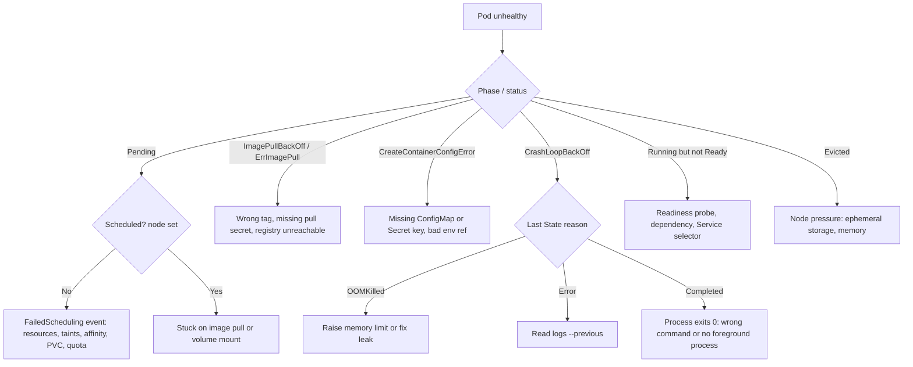

A pod is not doing what its Deployment says it should. This runbook gets from "something is wrong with this pod" to a named cause in a few commands, then to the fix for each common cause. It is written for kubectl against any conformant cluster, with GKE notes where behaviour differs.

## When to use

- A pod is stuck in `Pending`, `CrashLoopBackOff`, `ImagePullBackOff`, `ErrImagePull`, `CreateContainerConfigError` or `Error`.
- A pod is `Running` but not `Ready`, or was `OOMKilled` or `Evicted`.
- A rollout is not progressing (`kubectl rollout status` hangs).

If many pods across many nodes fail at once, treat it as an incident first: see [[incident-response]]. Node-level failures (`NotReady`, kubelet down) are out of scope here. For a bad release that you simply want to undo, see [[helm-release-rollback]].

## Preconditions

- `kubectl` access to the right cluster and namespace. Check before you start, because the wrong context is the most common mistake.
- Permission to `get`, `describe` and read logs of pods and events. Ephemeral debug containers additionally need `update` on `pods/ephemeralcontainers`.
- The variables below set once per shell.

```bash
NS=my-namespace
POD=my-pod-abc123
kubectl config current-context
kubectl get pod "$POD" -n "$NS" -o wide
```

## Steps

### 1. Read the status, then the events

Always start with the same three commands. They answer most cases without guessing.

```bash
# Phase, reason, restart count, node
kubectl get pod "$POD" -n "$NS" -o wide

# Conditions, container states, last state, events at the bottom
kubectl describe pod "$POD" -n "$NS"

# Namespace events, oldest first (events expire after about an hour by default)
kubectl get events -n "$NS" --sort-by=.metadata.creationTimestamp

# Only events for this pod
kubectl get events -n "$NS" --field-selector involvedObject.name="$POD" --sort-by=.lastTimestamp
```

In `describe`, read **State**, **Last State** (with `Reason` and `Exit Code`), **Ready**, and the **Events** section. The exit code is a strong hint: `137` is SIGKILL (usually OOM kill or a failed liveness probe), `143` is SIGTERM, `1` is an application error, `126`/`127` is a command that cannot execute or is not found.

### 2. Pick the branch



### 3. Pending

A `Pending` pod has been accepted but is not running. First check whether it has been scheduled.

```bash
kubectl get pod "$POD" -n "$NS" -o jsonpath='{.spec.nodeName}{"\n"}'
kubectl describe pod "$POD" -n "$NS" | sed -n '/^Events:/,$p'
```

- Empty node name and a `FailedScheduling` event: the message lists the reasons, such as `Insufficient cpu`, `Insufficient memory`, `node(s) had untolerated taint`, `didn't match Pod's node affinity/selector`, or `unbound immediate PersistentVolumeClaims`.
- Resource shortfall: compare requests with what nodes can give. Over-sized requests are a frequent cause, see [[kubernetes-resource-requests-and-limits]].

```bash
kubectl describe nodes | grep -A8 "Allocated resources"
kubectl get pvc -n "$NS"
kubectl get resourcequota -n "$NS"
```

- On GKE Standard the cluster autoscaler adds nodes only if the pod fits some node pool. Look for `TriggeredScaleUp` or `NotTriggerScaleUp` events on the pod; the latter names the reason.
- Node assigned but still `Pending` (shown as `ContainerCreating`): look for `FailedMount` or `FailedAttachVolume` events (PVC, CSI driver, missing Secret or ConfigMap volume) and for image pulls in progress.

### 4. ImagePullBackOff and ErrImagePull

The kubelet cannot pull the image. The event gives the registry error verbatim.

```bash
kubectl describe pod "$POD" -n "$NS" | grep -iE "pull|image|denied|not found|unauthorized"
kubectl get pod "$POD" -n "$NS" -o jsonpath='{.spec.containers[*].image}{"\n"}'
kubectl get pod "$POD" -n "$NS" -o jsonpath='{.spec.imagePullSecrets}{"\n"}'
```

- `manifest unknown` or `not found`: wrong tag or digest, or the CI job that pushes it failed. Check the registry (Artifactory or Artifact Registry) directly.
- `unauthorized` or `denied`: missing or expired pull secret, or the node service account lacks `roles/artifactregistry.reader`. Verify the secret is of type `kubernetes.io/dockerconfigjson` and is in the pod's namespace.
- `i/o timeout` or `no such host`: network or DNS egress from the node to the registry.

Test a pull secret without touching the workload:

```bash
kubectl get secret regcred -n "$NS" -o jsonpath='{.data.\.dockerconfigjson}' | base64 -d | jq '.auths | keys'
```

### 5. CreateContainerConfigError

The container was not created because its configuration cannot be resolved. The event names the missing object.

```bash
kubectl describe pod "$POD" -n "$NS" | grep -iE "configmap|secret|key|couldn't find"
kubectl get configmap,secret -n "$NS"
```

Typical messages: `configmap "x" not found`, `couldn't find key FOO in Secret ns/name`, or a `runAsNonRoot` conflict with an image that runs as root. Create the missing object or fix the reference. If secrets come from an operator, check it synced, see [[external-secrets-with-secret-manager]].

### 6. CrashLoopBackOff and OOMKilled

The container starts and exits; the kubelet restarts it with an exponentially growing delay. The current container often has no logs yet, so read the previous one.

```bash
CONTAINER=app
kubectl logs "$POD" -n "$NS" -c "$CONTAINER" --previous --tail=200
kubectl logs "$POD" -n "$NS" --all-containers --previous --timestamps
kubectl get pod "$POD" -n "$NS" -o jsonpath='{.status.containerStatuses[*].lastState}{"\n"}'
```

- `OOMKilled` (exit 137): the container exceeded its memory limit. Compare usage with the limit:

  ```bash
  kubectl top pod "$POD" -n "$NS" --containers
  kubectl get pod "$POD" -n "$NS" -o jsonpath='{.spec.containers[*].resources}{"\n"}'
  ```

  Raise the limit only after checking for a leak or an unbounded cache; JVM and Node.js heaps need their own flags to stay inside the limit.

- Exit 137 without `OOMKilled`: often a failed liveness probe. Look for `Liveness probe failed` events and loosen `initialDelaySeconds`, or add a `startupProbe` for slow starters.
- Exit 0 (`Completed`) in a loop: the main process ended. A Deployment needs a foreground process.
- Exit 1 or other: the log shows it. Usual causes are a bad config value, an unreachable dependency at startup, or a migration failure.

### 7. Running but not Ready

```bash
kubectl describe pod "$POD" -n "$NS" | grep -iE "readiness|ready|probe"
kubectl get endpointslices -n "$NS" -l kubernetes.io/service-name=my-service
kubectl get svc my-service -n "$NS" -o jsonpath='{.spec.selector}{"\n"}'
kubectl get pods -n "$NS" -l app=my-app --show-labels
```

- `Readiness probe failed`: the event shows the HTTP status or connection error. Run the probe by hand with the debug step below.
- Probe passes but the Service has no endpoints: the selector does not match the pod labels, or the `targetPort` is wrong.
- Pods flap between Ready and not: the probe checks a dependency, so one database blip removes every pod from the Service. Probe the process, not its dependencies.

### 8. Evicted

```bash
kubectl get pods -n "$NS" --field-selector=status.phase=Failed
kubectl describe pod "$POD" -n "$NS" | grep -iE "evict|pressure|ephemeral|The node was low"
kubectl describe node "$(kubectl get pod "$POD" -n "$NS" -o jsonpath='{.spec.nodeName}')" | grep -A6 Conditions
```

The message says what ran short: memory, `ephemeral-storage` or disk. Fix the cause (logs written to the container filesystem, `emptyDir` growth, missing ephemeral-storage requests) rather than deleting evicted pods. Delete the leftovers afterwards:

```bash
kubectl delete pod -n "$NS" --field-selector=status.phase=Failed
```

### 9. Debug with an ephemeral container

When the image has no shell (distroless) or the pod crashes too fast to exec, attach an ephemeral debug container. Ephemeral containers cannot be removed from a pod, so they are cleaned up when the pod is replaced.

```bash
# Share the process namespace of the target container
kubectl debug -it "$POD" -n "$NS" --image=busybox:1.36 --target="$CONTAINER" -- sh

# Debug a crashing pod on a copy, leaving the original untouched
kubectl debug "$POD" -n "$NS" -it --copy-to="${POD}-debug" --container="$CONTAINER" -- sh

# Node-level debugging (host filesystem mounted at /host)
kubectl debug node/NODE_NAME -it --image=busybox:1.36
```

From inside, test DNS (`nslookup`), connectivity (`wget -qO- http://svc:port/healthz`) and the mounted files. Delete copies and node debug pods when done:

```bash
kubectl delete pod "${POD}-debug" -n "$NS"
```

## Validation

The fix worked when all of these hold:

```bash
kubectl rollout status deployment/my-app -n "$NS" --timeout=300s
kubectl get pods -n "$NS" -l app=my-app        # READY n/n, RESTARTS not increasing
kubectl get events -n "$NS" --sort-by=.lastTimestamp | tail -20   # no new Warning events
```

Watch restarts for at least one back-off window (five minutes) before declaring success. If the workload is behind a Service, call it through the Service, not the pod IP.

## Rollback

Changes made while troubleshooting are small; undo the one you made.

- Resource or config change applied with `kubectl edit` or `patch`: revert with `kubectl rollout undo deployment/my-app -n "$NS"`, then check `kubectl rollout status`. `rollout undo` only reverts the pod template, not a ConfigMap, Secret or Service. In a GitOps setup, revert the commit instead, otherwise the controller overwrites your manual change; see [[argocd-vs-flux]].
- Debug copies and node debug pods: delete them as shown above.
- Deleted pods are recreated by their controller; a bare pod without one is gone for good, so export it first with `kubectl get pod "$POD" -n "$NS" -o yaml > pod-backup.yaml`.

## Troubleshooting

| Symptom                                                                     | Cause and fix                                                                                                                                 |
| --------------------------------------------------------------------------- | --------------------------------------------------------------------------------------------------------------------------------------------- |
| `kubectl logs --previous` says "previous terminated container not found"    | The container has not restarted yet, or the pod was recreated. Use plain `logs`, or check your log backend.                                   |
| `kubectl debug` fails with "ephemeral containers are disabled" or forbidden | Missing RBAC on `pods/ephemeralcontainers`. Use `--copy-to` instead, which needs only create on pods.                                         |
| Events list is empty                                                        | Events expire. Reproduce, or query your cluster logging for `Warning` events.                                                                 |
| Pod `Terminating` forever                                                   | A finalizer or a volume detach is stuck. Check `kubectl get pod -o yaml` for `finalizers`; force-delete only as a last resort.                |
| Fixed in the manifest but pod unchanged                                     | The Deployment did not roll out: check `kubectl rollout status` and whether the ConfigMap change needs a restart (`kubectl rollout restart`). |
| Many pods fail together after a deploy                                      | Shared cause (bad image, config or dependency). Stop, follow [[incident-response]], and roll back first.                                      |

Why a probe or limit is set the way it is lives in the patterns notes, for example [[zero-downtime-deployments-kubernetes]].
