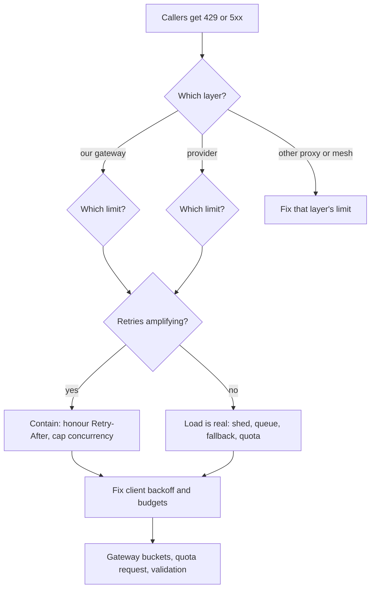

How to respond when callers get HTTP 429 (and sometimes 503 or 529) from the model API or from our own gateway while the provider is otherwise healthy. A 429 is a limit doing its job, but clients that retry at once turn a small overrun into a storm: every rejected request comes back, often together, and the limit stays hit. The order is: **find which layer said no, find which limit, check whether retries make it worse, contain, then fix the client and the limit.**

> [!info] Scope and verification
> Nothing here was run against a live system or a provider account. The HTTP meaning of 429 and `Retry-After` is cited from the RFCs but the RFC text could not be fetched in this session (see Not verified). The PromQL functions were checked against the Prometheus docs (commit ef78ff6) and the OpenTelemetry GenAI attributes against the semantic-conventions checkout (commit 244465e), both on 2026-11-01. Gateway metrics (`llm_gateway_*`) and the admin API are this site's example names, not a standard. Provider limit types, header names such as `x-ratelimit-*`, status 529 and quota procedures are provider specific and are not verified.

## When to use

- Callers log `429 Too Many Requests` from a model call, or the gateway returns 429 to a team, while the provider status page is green.
- Error rate rises together with request rate (a retry storm), or batch jobs stall with many retries and little progress.
- You see a few 503 or 529 responses mixed with the 429s, and no provider incident is declared.

Use something else when:

- The provider is down or degraded (errors across all keys, status page incident): [[model-provider-outage-runbook]].
- Latency is the symptom and calls succeed: [[llm-serving-latency-regression]].
- Our own GPU-backed model server rejects or stalls on memory: [[gpu-out-of-memory-and-kv-cache-exhaustion]]; Pods that never schedule: [[gpu-pods-pending-on-gke]].
- Tokens and cost, not errors, jumped: [[llm-token-spend-spike]]. A retry storm often causes both; contain the storm here, then see that note.

## Preconditions

- Read access to the gateway's Prometheus and logs, and to client logs for the failing service ([[llm-observability-tracing-and-slos]]).
- Admin rights on the gateway for per-tenant limits and priority rules ([[ai-gateway-architecture-and-policy]]); the right to change client config or scale the failing workload.
- `kubectl` access to the GKE cluster (`gcloud container clusters get-credentials "$CLUSTER" --location "$LOCATION"`) with get and list on pods and `pods/log` in `$NS` and `$APP_NS`, and patch on Deployments, HorizontalPodAutoscalers, CronJobs and Jobs in `$APP_NS`.
- For the direct provider call in step 2: a provider test key from the secret manager, usable only from an approved host.
- The provider's current limits for your account (requests, tokens, concurrency) and the quota-increase process, from the provider console or your account manager.
- An incident record; the severity scale is in [[incident-response]]. A 429 storm that affects a user-facing feature is normally SEV2 or SEV3.

```bash title="variables"
PROM=https://prometheus.example.internal
GATEWAY=https://llm-gateway.example.internal
NS=llm-gateway
TEAM=payments
KEY_ID=k-7f3a   # used in the step 2 log filter
MODEL=example-model-large
INC_DIR=./INC-0000   # where evidence and "before" state are saved; mkdir -p "$INC_DIR"
GW_LABEL=app=llm-gateway   # label selector of the gateway pods; adjust to your labels
PROVIDER_CHAT_URL=https://api.provider.example/v1/chat/completions   # only for the direct call in step 2; take the path from the provider API reference
CLUSTER=prod-gke
LOCATION=europe-west1
HPA=invoice-summarizer   # the caller HPA, if it has one
JOB=invoice-summarizer-nightly-29338560   # a running Job of the suspended CronJob (kubectl -n "$APP_NS" get jobs)
APP_NS=payments
APP=invoice-summarizer
# Tokens come from the secret manager, never from the shell history:
#   export LLM_GATEWAY_TOKEN=...        (the caller's key, for the curl test)
#   export LLM_GATEWAY_ADMIN_TOKEN=...  (operator token for admin calls)
#   export PROVIDER_TOKEN=...           (provider test key, only from an approved host)
```

The helper runs an instant PromQL query and prints one line per series.

```bash
q() { curl -sG "$PROM/api/v1/query" --data-urlencode "query=$1" \
  | jq -r '.data.result[] | [(.metric | to_entries | map("\(.key)=\(.value)") | join(",")), .value[1]] | @tsv'; }
```

## Steps



### 1. Establish what is failing

Get the scope before anything else: which callers, which models, which status codes, and since when.

```bash
# Responses by status, whole gateway, last 15 minutes
q 'sum by (status) (rate(llm_gateway_requests_total[15m]))'

# 429s by team and model
q 'topk(10, sum by (team, model) (rate(llm_gateway_requests_total{status="429"}[5m])))'

# Share of requests that are 429, per team (1.0 is all of them)
q 'sum by (team) (rate(llm_gateway_requests_total{status="429"}[5m])) / sum by (team) (rate(llm_gateway_requests_total[5m]))'
```

`rate` gives the per-second average over the window, which suits counters that reset. One team, one model, or everything? One team points at that team's limit or its client. One model across teams points at the provider's limit on that model. Everything at once, with 5xx too, leans toward [[model-provider-outage-runbook]].

### 2. Tell which layer returned the 429

A 429 can come from the provider, from our gateway, or from something between (a service mesh, ingress, a corporate proxy). Look at the response itself. Send one real request to the chat-completions HTTP API through the same path as the failing caller and keep the headers:

```bash
curl -i -sS "$GATEWAY/v1/chat/completions" \
  -H "Authorization: Bearer $LLM_GATEWAY_TOKEN" \
  -H 'Content-Type: application/json' \
  -d '{"model":"'"$MODEL"'","messages":[{"role":"user","content":"ping"}],"max_tokens":8}' \
  | head -30
```

Read, in this order:

1. **The status line and body.** A JSON error body names a limit in words when the layer is cooperative. Note the exact message.
2. **`Retry-After`.** Per RFC 9110 this response header tells the client how long to wait before another request, either as a number of seconds or as an HTTP date. The 429 status itself is defined in RFC 6585. A missing `Retry-After` does not mean "retry now"; it means the server did not say.
3. **Who added the headers.** Our gateway should add a stable marker, for example a `server` or `x-gateway-request-id` header, and a reason header or body field (this site's gateway uses `x-gateway-limit` with `key`, `team` or `global`). Headers from the provider typically carry the provider's own request id and may carry limit and remaining counters under provider-specific names, often `x-ratelimit-*`. The names and meaning are not verified here; read the provider's current API reference.
4. **Compare with a direct call.** If your policy allows a test with a provider key from a safe host, call the provider directly with a tiny request (`curl -i -sS "$PROVIDER_CHAT_URL" -H "Authorization: Bearer $PROVIDER_TOKEN" ...`, with the path and auth scheme from the provider's API reference). If the direct call succeeds while the gateway path returns 429, the gateway (or something before it) is the limiter. If both fail, the provider is.

Then check the logs, which are more reliable than one probe:

```bash
# Gateway: which component rejected, and with what reason
# (-l reads every matching pod; "deploy/NAME" would read only one pod. Lines that are not JSON are skipped.)
kubectl -n "$NS" logs -l "$GW_LABEL" --since=15m --tail=-1 --prefix --max-log-requests=20 \
  | sed 's/^[^ ]* //' \
  | jq -R -c 'fromjson? | select(.status==429) | {ts, key_id, team, model, limit: .limit_reason, upstream: .upstream_status, retry_after: .retry_after_s}' \
  | head -20

# Same, restricted to one key, to follow a single caller
kubectl -n "$NS" logs -l "$GW_LABEL" --since=15m --tail=-1 --prefix --max-log-requests=20 \
  | sed 's/^[^ ]* //' \
  | jq -R -c --arg k "$KEY_ID" 'fromjson? | select(.status==429 and .key_id==$k)' | head -5

# Count by limit_reason, and by whether the upstream was even called
kubectl -n "$NS" logs -l "$GW_LABEL" --since=15m --tail=-1 --prefix --max-log-requests=20 \
  | sed 's/^[^ ]* //' \
  | jq -R -r 'fromjson? | select(.status==429) | [.limit_reason // "none", (.upstream_status // "not-called" | tostring)] | @tsv' \
  | sort | uniq -c | sort -rn
```

To spot one bad replica, count 429s per pod: keep the `--prefix` text (the pod name) and run `awk '{print $1}' | sort | uniq -c` on the 429 lines instead of stripping it with `sed`.

How to read the result (field names are this site's gateway log format):

| Log shows                                        | Layer that said 429                                                                           |
| ------------------------------------------------ | --------------------------------------------------------------------------------------------- |
| `upstream_status` not called; `limit_reason` set | Our gateway rejected it before calling the provider. Go to step 3 for its limit.              |
| `upstream_status` 429                            | The provider rejected it; the gateway passed it on (or retried and then passed it).           |
| 429 in the client log, nothing in the gateway    | A layer before the gateway (ingress, mesh, proxy) or the client's own limiter.                |
| 503 or 529 with `upstream_status` the same       | Provider overload or capacity, not a quota. Treat as in step 4 and watch the provider status. |

A trace helps when logs are sparse. On a model-call span, the OpenTelemetry GenAI conventions record `error.type` (set to the error code returned by the provider or the client library when the call failed), together with `gen_ai.request.model` and `gen_ai.provider.name`. Group failing spans by those to see whether one model or one provider route is the problem. Whether `error.type` holds `429`, a name or something else depends on your instrumentation.

### 3. Find which limit was hit

Providers and gateways typically limit more than one thing at once; the one that trips decides the fix. Common types are a requests-per-minute limit, a tokens-per-minute limit, a concurrency limit (requests in flight) and, for output, a separate cap on output tokens. They can apply per key, per team or project, per model, or per whole organisation. Which of these exist for your provider, and how they are counted, is not verified here.

Work from what you can measure:

```bash
# Requests per minute and tokens per minute for the failing team
q "sum(rate(llm_gateway_requests_total{team=\"$TEAM\"}[1m])) * 60"
q "sum(rate(llm_gateway_tokens_total{team=\"$TEAM\"}[1m])) * 60"

# Requests in flight (example gauge), and its limit
q "sum by (team) (llm_gateway_inflight_requests{team=\"$TEAM\"})"
q "max by (team) (llm_gateway_limit{team=\"$TEAM\", limit=\"concurrency\"})"

# The whole organisation, which can be limited even if no team is
q 'sum(rate(llm_gateway_requests_total[1m])) * 60'
q 'sum(rate(llm_gateway_tokens_total[1m])) * 60'
```

Compare each with the configured limit:

| Pattern                                                   | Limit most likely hit                                                                                                         |
| --------------------------------------------------------- | ----------------------------------------------------------------------------------------------------------------------------- |
| Requests per minute at the limit; tokens well below       | Requests per minute. Many small calls.                                                                                        |
| Tokens per minute at the limit; requests modest           | Tokens per minute. Large prompts or large `max_tokens`.                                                                       |
| In-flight count at the concurrency limit; slow responses  | Concurrency. Long generations hold slots; see [[llm-serving-latency-regression]].                                             |
| One team at its gateway limit, others fine                | Per-key or per-team limit at our gateway.                                                                                     |
| All teams 429 at once, org totals near the provider limit | Organisation limit at the provider.                                                                                           |
| 429s with totals far below every known limit              | A different limit than you think (per model, per region), or limits applied per replica. Compare the provider's account page. |

Some limiters count **requested** tokens (prompt plus the `max_tokens` you ask for) at admission, not the tokens actually produced. A large default `max_tokens` can then use up the tokens-per-minute allowance with short answers. Whether your provider does this is not verified; check the docs and the response headers.

### 4. Check whether retries are amplifying it

Compare the load at the edge with the load of distinct work. If every failure comes back, request rate far exceeds useful rate.

```bash
# Requests per second at the gateway, split by outcome
q "sum by (status) (rate(llm_gateway_requests_total{team=\"$TEAM\"}[1m]))"

# Attempts per logical request, if the client exports it (example metric)
q "sum(rate(llm_client_attempts_total{app=\"$APP\"}[5m])) / sum(rate(llm_client_requests_total{app=\"$APP\"}[5m]))"

# Did the request rate rise after the first 429s?
q "sum(rate(llm_gateway_requests_total{team=\"$TEAM\"}[1m]))"
q "sum(rate(llm_gateway_requests_total{team=\"$TEAM\"}[1m] offset 30m))"
```

Look for these amplifiers in the client code and config, then confirm in its logs:

| Amplifier                       | How to see it                                                                                                                                                                         |
| ------------------------------- | ------------------------------------------------------------------------------------------------------------------------------------------------------------------------------------- |
| No backoff or fixed short delay | Retries logged at the same interval (for example every 1 s) with no growth.                                                                                                           |
| No jitter                       | Retries from many pods land in the same second; the request graph shows sharp spikes at regular steps.                                                                                |
| Ignoring `Retry-After`          | The log shows a retry sooner than the `Retry-After` the previous response carried.                                                                                                    |
| Unlimited or high attempt count | Attempts per request far above the configured budget; some requests tried tens of times.                                                                                              |
| Retries at several layers       | The SDK, the app and the gateway each make up to 3 attempts, so the layers multiply: up to 3 x 3 x 3 = 27 attempts per request (with 3 retries per layer, 4 attempts each, it is 64). |
| Synchronised start              | A CronJob or batch starts all workers at one time, or workers restart together and retry together.                                                                                    |
| Fan-out of one task             | One user action creates many parallel calls (tool calls, map steps, chunks) that all hit the limit.                                                                                   |

```bash
kubectl -n "$APP_NS" logs -l app="$APP" --since=15m --tail=-1 --prefix --max-log-requests=50 \
  | grep -E '429|Too Many|retry|backoff' | tail -30

kubectl -n "$APP_NS" logs -l app="$APP" --since=15m --tail=-1 --max-log-requests=50 \
  | jq -R -r 'fromjson? | select(.msg=="llm retry") | [.ts, .attempt, .delay_ms, .retry_after_s] | @tsv' | head -20
```

The second command assumes structured client logs with these example fields. If `delay_ms` is smaller than `retry_after_s * 1000`, the client is ignoring the server's hint.

If attempts per request are above about 1.5 and rising, treat the storm as the main problem. Reducing the retry rate often clears the 429s with no change to the limit.

### 5. Contain

Do these in order, cheapest and most reversible first. Each one reduces load; stop when 429s fall below your alert level. Contain before you root-cause.

**5.0 Record state and save evidence first.** A rollout deletes the old pods and their logs, and `set env VAR-` loses the earlier value, so save both before any change.

```bash
mkdir -p "$INC_DIR"
kubectl -n "$APP_NS" logs -l app="$APP" --since=30m --tail=-1 --prefix --max-log-requests=50 > "$INC_DIR/$APP-logs.txt"
kubectl -n "$NS" logs -l "$GW_LABEL" --since=30m --tail=-1 --prefix --max-log-requests=20 > "$INC_DIR/gateway-logs.txt"
kubectl -n "$APP_NS" get deploy "$APP" -o yaml > "$INC_DIR/$APP-deploy-before.yaml"
kubectl -n "$APP_NS" get hpa -o yaml > "$INC_DIR/hpa-before.yaml"
kubectl -n "$APP_NS" get cronjob,job -o wide > "$INC_DIR/cronjobs-before.txt"
curl -sS -H "Authorization: Bearer $LLM_GATEWAY_ADMIN_TOKEN" "$GATEWAY/admin/teams/$TEAM/limits" > "$INC_DIR/limits-before.json"
```

The limits call is this site's example admin API. If a GitOps controller (for example Argo CD) manages these objects, it may revert manual `set env`, `scale` or patch changes; pause its sync for them first.

**5.1 Shed low-priority traffic and pause producers.** Interactive and revenue-affecting calls come first; batch, backfills, evaluation runs and noisy experiments can wait. This does not touch interactive pods and is easy to reverse. At the gateway, reject or defer the low classes with a clear status and `Retry-After`:

```bash
curl -sS -X PATCH "$GATEWAY/admin/teams/$TEAM/limits" \
  -H "Authorization: Bearer $LLM_GATEWAY_ADMIN_TOKEN" \
  -H 'Content-Type: application/json' \
  -d '{"priority_class":"batch","action":"defer","max_inflight":2,"reason":"INC-0000 429 storm"}' | jq .
```

This admin call is this site's example; use your gateway's real mechanism. Also pause the batch producers so the queue does not refill. List them first, then suspend each one and write the names in the incident record for the Rollback:

```bash
kubectl -n "$APP_NS" get cronjob,job -o wide
kubectl -n "$APP_NS" patch cronjob "$CJ" -p '{"spec":{"suspend":true}}'
```

Suspending a CronJob does not stop Jobs that are already running. Decide whether to suspend those too (`kubectl -n "$APP_NS" patch job "$JOB" -p '{"spec":{"suspend":true}}'`, which deletes that Job's running pods).

**5.2 Cap concurrency at the caller.** Lower the number of parallel model calls the workload makes. First check whether an HPA controls the Deployment, because it manages `.spec.replicas` and will undo `kubectl scale`:

```bash
kubectl -n "$APP_NS" get hpa -o wide
# If an HPA targets $APP, lower the HPA instead of using scale (N below current .status.replicas):
kubectl -n "$APP_NS" patch hpa "$HPA" -p '{"spec":{"minReplicas":2,"maxReplicas":2}}'   # pin at the size you recorded
# If there is no HPA:
kubectl -n "$APP_NS" scale deploy/"$APP" --replicas=N
# or lower the worker pool size if it is a setting (starts a rollout, see 5.3):
kubectl -n "$APP_NS" set env deploy/"$APP" LLM_MAX_CONCURRENCY=8
kubectl -n "$APP_NS" get deploy "$APP" -w   # confirm the count holds
```

Pick N from the saved `.status.replicas` so the change is a reduction, not a scale-up.

**5.3 Honour `Retry-After` and slow the retries.** If the client has a config flag or environment variable, set it; otherwise this needs a release or a gateway-side measure.

```bash
kubectl -n "$APP_NS" set env deploy/"$APP" \
  LLM_RETRY_MAX_ATTEMPTS=3 LLM_RETRY_BASE_DELAY_MS=1000 LLM_RETRY_MAX_DELAY_MS=60000 LLM_RETRY_HONOUR_RETRY_AFTER=true
kubectl -n "$APP_NS" rollout status deploy/"$APP"
```

The variable names are an example for this site's client wrapper. `set env` starts a rolling update. By default it replaces up to 25% of pods at a time (`maxUnavailable` and `maxSurge` both 25%). New pods start with empty retry state, so on a large Deployment lower `.spec.strategy.rollingUpdate.maxUnavailable` and `maxSurge` (for example to 1) so pods start in small batches.

**5.4 Queue batch work.** Move deferred work to a bounded queue with a worker rate set below the limit, as in [[rate-limits-backpressure-and-queue-design]]. A bounded queue turns a burst into a delay; an unbounded one hides the problem until it is huge.

**5.5 Route to a fallback model, only if quality allows.** If another model or provider has spare quota, send traffic that tolerates it there, per [[model-provider-failover-and-routing]] and [[fallback-model-selection-and-quality-degradation]]. Do not move work that needs the original model's quality, or work with data-residency or contract limits ([[model-region-selection-and-data-residency]]). A fallback also has its own limits, and an abrupt switch of full traffic can start a new storm there: shift a share, not everything.

**5.6 Stop a runaway source.** If one caller makes the load because it is looping, stop it first: [[runaway-or-compromised-ai-agent-response]]; limits in [[bounded-agent-loops-and-stop-conditions]].

Record each change and its time in the incident channel. Check progress after each step:

```bash
q "sum by (status) (rate(llm_gateway_requests_total{team=\"$TEAM\"}[1m]))"
```

Expected: the 429 share falls within a few minutes, and the total request rate falls too, because retries stop. If total requests fall but 429s stay at the same share, the limit itself is too low or is shared with other users (step 6).

### 6. Fix the cause

**Client: backoff with jitter and a retry budget.** Exponential backoff alone still synchronises clients, so add jitter, honour `Retry-After` as a minimum, and cap total attempts and total time ([[llm-retry-timeout-and-circuit-breaker-policy]]):

```python title="retry policy (sketch)"
import random, time

def call_with_retry(send, max_attempts=4, base=1.0, cap=60.0, deadline_s=120.0):
    start = time.monotonic()
    for attempt in range(1, max_attempts + 1):
        resp = send()
        if resp.status_code not in (429, 503, 529):
            return resp
        if attempt == max_attempts or time.monotonic() - start > deadline_s:
            return resp                      # give up, surface the error
        hinted = float(resp.headers.get("Retry-After", 0) or 0)  # seconds form only in this sketch
        backoff = random.uniform(0, min(cap, base * 2 ** attempt))  # "full jitter"
        time.sleep(max(hinted, backoff))
    return resp
```

`Retry-After` can also be an HTTP date; a real client must parse both forms. Retry only on statuses the provider documents as retryable, never on 400-class errors other than 429, and never after partial streamed output. Add a process-wide retry budget (for example, retries may be at most 10% of first attempts over a window) so a broad failure cannot multiply load. Use one retry layer, not three.

**Gateway: a token bucket per tenant.** Admit work against a per-team bucket sized in requests and in tokens, so one team cannot use the whole organisation allowance. Return 429 with `Retry-After` at the gateway, before the provider is called, and size each bucket from observed use:

```yaml title="gateway limits (illustrative, this site's format)"
limits:
  - scope: team
    match: { team: payments }
    requests_per_minute: 600
    tokens_per_minute: 400000
    max_inflight: 24
    burst: 1.5 # bucket capacity as a multiple of one minute's rate
    priority:
      interactive: { reserved_share: 0.5 }
      batch: { max_share: 0.3, action: queue }
```

The org-level sum of team buckets should stay below the provider's organisation limit, or the provider will reject what the gateway admitted. See [[rate-limits-backpressure-and-queue-design]] for the quota-versus-capacity split and [[llm-denial-of-service-and-resource-exhaustion]] for abuse cases.

**Request a quota increase.** If real, steady load exceeds the provider limit, ask for more. Include: the model, the current limits, the peak request and token rates from the queries in step 3, the growth forecast and the use case. Quota changes take time and may not be granted in full; the process and lead time are not verified here. Keep the gateway buckets and client backoff as the interim control, and do not size clients as if the new quota already exists.

**Reduce the demand.** Lower default `max_tokens`, trim prompts ([[context-window-budgeting]]), cache what repeats ([[llm-caching-correctness-and-safety]]), and batch non-urgent work off the interactive path ([[inference-batching-and-queueing]]).

**Alerts.** Alert on the 429 share per team and on attempts per request, not on single errors:

```yaml title="llm-429-alerts.yaml"
groups:
  - name: llm-429
    rules:
      - alert: LlmGateway429ShareHigh
        expr: |
          sum by (team) (rate(llm_gateway_requests_total{status="429"}[5m]))
            / sum by (team) (rate(llm_gateway_requests_total[5m])) > 0.05
        for: 10m
        labels:
          severity: warning
        annotations:
          summary: "Over 5% of requests from {{ $labels.team }} are rate limited"
```

The 5% threshold and 10-minute duration are examples. Test the rule with `promtool test rules` before deploying.

## Validation

```bash
q "sum by (status) (rate(llm_gateway_requests_total{team=\"$TEAM\"}[5m]))"                     # 429 near zero
q "sum(rate(llm_client_attempts_total{app=\"$APP\"}[5m])) / sum(rate(llm_client_requests_total{app=\"$APP\"}[5m]))"   # close to 1.0
q "sum by (team) (llm_gateway_inflight_requests{team=\"$TEAM\"})"                               # below the concurrency limit
curl -i -sS "$GATEWAY/v1/chat/completions" -H "Authorization: Bearer $LLM_GATEWAY_TOKEN" \
  -H 'Content-Type: application/json' \
  -d '{"model":"'"$MODEL"'","messages":[{"role":"user","content":"ping"}],"max_tokens":8}' | head -1   # HTTP/2 200
```

Then run a controlled load test in staging at 1.5x the expected peak. Confirm that the client backs off with spread-out retries (not spikes), the gateway returns 429 with `Retry-After` for the over-limit tenant while others are unaffected, and shed batch work resumes in order when load drops. The incident is over when the 429 share stays below the alert level through a normal peak.

## Rollback

- **Client retry settings:** compare with `$INC_DIR/$APP-deploy-before.yaml`. Re-apply any value the variable had before (`set env VAR=old`); use `VAR-` (for example `kubectl -n "$APP_NS" set env deploy/"$APP" LLM_RETRY_MAX_ATTEMPTS- LLM_RETRY_BASE_DELAY_MS- LLM_RETRY_MAX_DELAY_MS- LLM_RETRY_HONOUR_RETRY_AFTER-`) only for variables that were absent before. Reverting to the old no-backoff behaviour is not advisable; revert only if the new settings break the feature.
- **Concurrency and replicas:** remove `LLM_MAX_CONCURRENCY` (`set env ... LLM_MAX_CONCURRENCY-`) or restore its saved value. Restore the replica count from the saved Deployment YAML, in steps, and watch the 429 share after each step so you do not recreate the storm. If you patched an HPA, patch `minReplicas` and `maxReplicas` back to the values in `$INC_DIR/hpa-before.yaml`, and resume any paused GitOps sync.
- **Shedding and suspended jobs:** restore the gateway limits by PATCHing the saved `$INC_DIR/limits-before.json` back (or removing the deferral), then resume the CronJobs listed in the incident record with `suspend: false` one at a time, outside peak. Without `.spec.startingDeadlineSeconds`, unsuspending runs the Jobs missed while suspended immediately; set a starting deadline first, or expect an immediate run. Resume suspended Jobs the same way. Drain queued work at a controlled rate.
- **Fallback routing:** move the shifted share back gradually; confirm the primary's limits have recovered first.
- **Gateway buckets:** restore the previous values from `$INC_DIR/limits-before.json` or the configuration history (Git) and apply them the normal way. A limit that is too low is itself an outage; record the values before and after.

## Troubleshooting

| Symptom                                            | Likely cause and fix                                                                                                                                              |
| -------------------------------------------------- | ----------------------------------------------------------------------------------------------------------------------------------------------------------------- |
| 429 with no gateway log entry                      | A layer before the gateway (ingress, mesh, client-side limiter). Check its logs and limits.                                                                       |
| 429s continue after clients are slowed             | The limit is genuinely too low, or shared with another consumer of the same org allowance. Compare org totals (step 3).                                           |
| Only large requests get 429                        | Tokens-per-minute limit, possibly counting requested `max_tokens`. Lower `max_tokens`, shrink prompts.                                                            |
| 429s at the start of every hour                    | Scheduled jobs start together. Add start jitter, stagger CronJobs ([[scheduled-autonomous-agent-jobs]]).                                                          |
| Retries bunch at regular intervals                 | No jitter, or a fixed delay. Add full jitter (step 6).                                                                                                            |
| Requests per second doubled after the first 429s   | Retry amplification. Cap attempts, honour `Retry-After`, remove duplicate retry layers.                                                                           |
| 503 or 529 with a few 429s and a green status page | Provider-side overload, not your quota. Back off, route a share to a fallback, and watch the provider status. Meaning of 529 is not verified here.                |
| Gateway returns 429 but its own limits look fine   | Limits applied per replica instead of globally (a 3-replica gateway allows 3x), or a stale limit cache. Use a shared counter or divide the limit by replicas.     |
| Fallback model also returns 429                    | Traffic moved all at once. Shift a share, check the fallback's own quota.                                                                                         |
| Batch queue grows without bound after shedding     | Producers not paused or queue unbounded. Suspend producers, add a queue bound and an age limit.                                                                   |
| `Retry-After` is absent                            | The server did not say; the client must still back off with jitter and a cap.                                                                                     |
| `Retry-After` is very large                        | A daily or monthly cap, not a per-minute limit. Retrying will not help; this is a quota or budget decision ([[llm-token-spend-spike]], [[llm-api-cost-control]]). |

## Related

- [[model-provider-outage-runbook]] for a provider incident, as opposed to limits.
- [[llm-token-spend-spike]] for the cost side of a runaway caller.
- [[llm-retry-timeout-and-circuit-breaker-policy]] and [[rate-limits-backpressure-and-queue-design]] for the policy behind step 6.
- [[model-provider-failover-and-routing]] and [[fallback-model-selection-and-quality-degradation]] for routing in step 5.5.
- [[ai-gateway-architecture-and-policy]] and [[llm-api-cost-control]] for the gateway that holds the buckets.
- [[llm-serving-latency-regression]], [[gpu-out-of-memory-and-kv-cache-exhaustion]], [[gpu-pods-pending-on-gke]] and [[model-or-prompt-rollout-quality-regression]] for neighbouring failures.
- [[timeouts-retries-load-shedding]] for the general pattern outside LLM calls.

## Evidence

### Sources checked

- [kubectl logs](https://kubernetes.io/docs/reference/kubectl/generated/kubectl_logs/): with a label selector and no `--tail`, kubectl returns only the last 10 lines per pod even when `--since` is set; `--tail=-1` lifts that cap. Checked 2026-11-01 in the kubectl source, `pkg/cmd/logs/logs.go` (`selectorTail = 10` and the `--tail` flag help), kubernetes/kubectl commit 8f64009.
- [Prometheus querying functions](https://prometheus.io/docs/prometheus/latest/querying/functions/) and [operators](https://prometheus.io/docs/prometheus/latest/querying/operators/): `rate()`, `topk`, `sum by`, and the `offset` modifier (querying basics). Checked 2026-11-01 in the Prometheus repository docs, commit ef78ff6.
- [OpenTelemetry semantic conventions for generative AI](https://github.com/open-telemetry/semantic-conventions/tree/main/docs/gen-ai): `error.type` (conditionally required when the operation ends in an error; should match the error code returned by the provider or client library), `gen_ai.request.model`, `gen_ai.provider.name` (Development); `error.type` is Stable. The inference span document (docs/gen-ai/client-inference.md) is Development. Checked 2026-11-01 in the local semantic-conventions checkout, commit 244465e.
- [Kubernetes Deployment](https://kubernetes.io/docs/concepts/workloads/controllers/deployment/) (default RollingUpdate: 25% max unavailable, 25% max surge), [CronJob](https://kubernetes.io/docs/concepts/workloads/controllers/cron-jobs/) (unsuspending without a starting deadline schedules missed Jobs immediately) and [Horizontal Pod Autoscaling](https://kubernetes.io/docs/concepts/workloads/autoscaling/horizontal-pod-autoscale/) (an HPA manages the Deployment's `replicas`). Checked 2026-11-01 in the local website checkout, commit 491f14e: concepts/workloads/controllers/deployment.md, concepts/workloads/controllers/cron-jobs.md, concepts/workloads/autoscaling/horizontal-pod-autoscale.md.
- The notes linked above, for this site's retry, queue, gateway and fallback guidance. Read 2026-11-01.

### Not verified

- Nothing was run against a live system, a gateway or a provider account; command output is an expectation.
- The RFC citations were not re-read: [RFC 6585](https://www.rfc-editor.org/rfc/rfc6585) (429 Too Many Requests) and [RFC 9110](https://www.rfc-editor.org/rfc/rfc9110) (`Retry-After` as seconds or an HTTP date, 503 Service Unavailable) are cited from the RFC text as remembered, not re-read here; the host could not be reached.
- Provider limit types (requests, tokens, concurrency, per model, per organisation), whether requested `max_tokens` counts against a token limit, and how limits are shared.
- Header names such as `x-ratelimit-*`, whether and how a provider returns `Retry-After`, and the meaning of status 529.
- Quota-increase process, lead time and what evidence a provider asks for.
- Provider pricing and any billing effect of failed or retried calls.
- The `llm_gateway_*` and `llm_client_*` metrics, gateway log fields, admin API, client environment variables and the retry sketch are this site's examples, not a standard; the sketch was not executed.
- `kubectl logs` behaviour (`-l` selector, `--prefix`, `--max-log-requests`, and that `deploy/NAME` reads one pod) is not in the local Kubernetes docs and `kubectl` was not available; check `kubectl logs --help`. Pod labels such as `app=llm-gateway` are examples.
- That `kubectl scale` on an HPA-controlled Deployment is overwritten within one sync period: the docs say the HPA manages `replicas`, the timing is not verified.
- Whether `error.type` holds `429` in your instrumentation.

### Environment

A Prometheus server that scrapes an LLM gateway exposing the example `llm_gateway_*` and `llm_client_*` metrics, Kubernetes with `kubectl`, and `curl` and `jq` on the operator host. Versions were not recorded because nothing was run.

### Prerequisites

See the Preconditions section: read access to gateway and client metrics and logs, gateway admin rights, the provider's current limits and an incident record.

### Expected results

The 429 share falls below the alert level, attempts per logical request return close to 1, and in-flight requests stay under the concurrency limit. See the Validation section.

### Failure conditions

The 429 share stays unchanged after retries are slowed (the limit is too low or shared), a fallback route also returns 429, or queues grow without bound. See the Troubleshooting section.

### Cleanup and rollback

See the Rollback section: remove client retry overrides, scale back up in steps, resume suspended jobs one at a time and restore gateway limits from the saved state.

## Sources

- [Prometheus documentation: querying](https://prometheus.io/docs/prometheus/latest/querying/basics/): the PromQL functions and `offset` modifier used in the queries.
- [OpenTelemetry semantic conventions for generative AI](https://github.com/open-telemetry/semantic-conventions/tree/main/docs/gen-ai): `error.type` and request attributes for model-call spans.
- [Kubernetes documentation: Deployment, CronJob, Horizontal Pod Autoscaling](https://kubernetes.io/docs/concepts/workloads/): rollout defaults, CronJob unsuspend behaviour and HPA ownership of replicas.
- [RFC 6585: Additional HTTP Status Codes](https://www.rfc-editor.org/rfc/rfc6585): defines 429 Too Many Requests (not re-read here).
- [RFC 9110: HTTP Semantics](https://www.rfc-editor.org/rfc/rfc9110): defines `Retry-After` and 503 (not re-read here).
