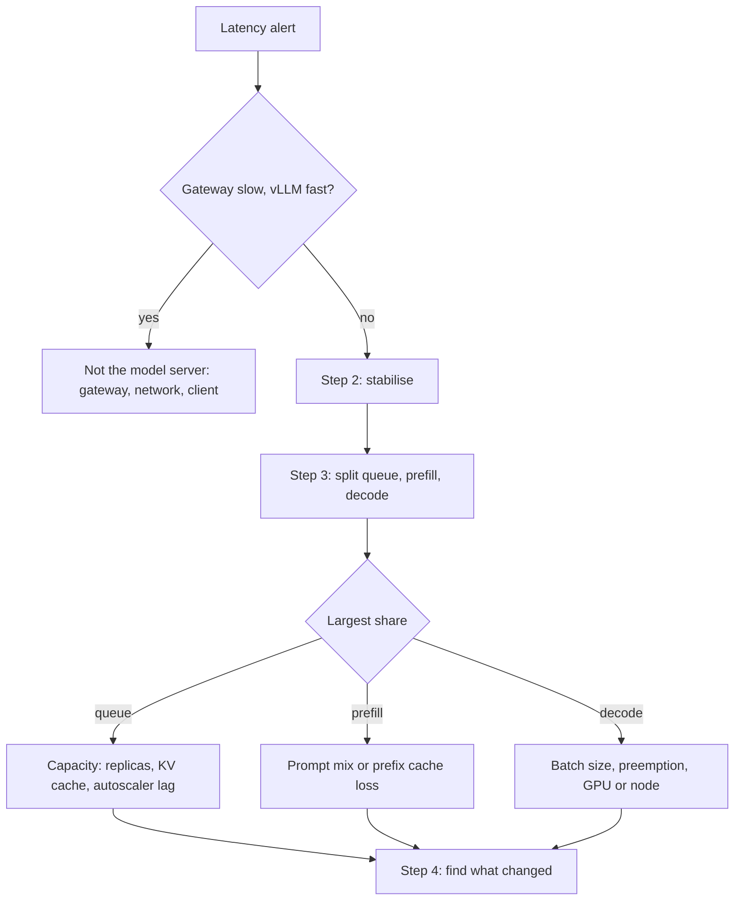

How to find out why a self-hosted vLLM service on GKE suddenly answers more slowly, and how to bring latency back before you know the root cause. Two numbers matter to users: time to first token (TTFT), which is how long they wait before anything appears, and inter-token latency (ITL), which is how smooth the stream feels afterwards. They break for different reasons. TTFT usually degrades when requests wait for a slot or have a lot of prompt to process; ITL usually degrades when the GPU is shared among too many sequences, when requests are being preempted, or when the GPU itself is slower. Read the metrics first, mitigate, then fix the one thing that changed.

> [!info] Scope and verification
> The commands were not run against a live cluster and the note is not marked `verified`. vLLM metric names, flags and behaviour were checked against the vLLM documentation (repository commit 8530a77), Kubernetes statements against the Kubernetes website repository (commit 491f14e), and PromQL against the Prometheus documentation (commit ef78ff6), all on 2026-11-01. No Google Cloud documentation page could be read, so GKE-specific statements are listed under "Not verified" in the Evidence section. Exposed metric names can differ by vLLM version: confirm them in the `/metrics` output of the version you run.

## When to use

- A latency alert fired: TTFT or ITL percentiles, or the end-to-end latency objective from [[llm-slo-definition-and-error-budgets]], are above target.
- Users report that answers start late or stream in stutters, and the error rate is normal.
- Latency got worse after a deploy, a node pool change, a traffic campaign or a scale-down, and nobody knows which.

Use something else when:

- Pods are `Pending` and there is no capacity to serve at all: [[gpu-pods-pending-on-gke]].
- Requests fail with errors rather than being slow, or the callers see HTTP 429: [[llm-api-rate-limit-429-storm]].
- Answers are fast but worse after a model or prompt change: [[model-or-prompt-rollout-quality-regression]].
- The bill, not the latency, jumped: [[llm-token-spend-spike]].
- The container restarts or fails at start-up with an out-of-memory error: [[gpu-out-of-memory-and-kv-cache-exhaustion]].

Background on the platform is in [[self-hosted-llm-inference-on-gke]], on how the metrics relate to scaling in [[llm-serving-autoscaling-signals]], and on budgets per phase in [[streaming-inference-latency-budgets]].

## Preconditions

- `kubectl` access to the namespace with `get`, `describe`, `logs`, `patch` and `scale` on Deployments and HPAs, and `container.clusters.get` to fetch credentials.
- Further Kubernetes rights used below: `get`, `describe` and `patch` on `nodes` (cluster-scoped, for describe, cordon and uncordon); `delete` on pods in `$NS`; `list` on pods in all namespaces (4g); `create` on `pods/portforward` (4c and the Prometheus port-forward); `get` and `list` on Secrets in `$NS` if you use Helm (`helm history` and `helm rollback` read and write release Secrets).
- Permission to change the gateway policy (step 2b).
- Permission to change node pool autoscaling limits (`container.nodePools.update`) if scaling out needs more GPU nodes.
- A Prometheus (or compatible) query endpoint that scrapes the vLLM `/metrics` endpoint, reachable through a URL or a working port-forward for `$PROM_URL`, and read access to the gateway's own latency metrics.
- Model server changes are made through Helm or GitOps. Emergency `kubectl` changes below must be written back the same day, or the next sync reverts them; see [[helm-release-rollback]].
- An incident record. A scale-out has a cost, and a token cap changes what users get.

```bash title="variables"
PROJECT=example-project
CLUSTER=prod-gke
LOCATION=europe-west1
NS=llm-serving
DEPLOY=vllm-llama-8b
HPA=vllm-llama-8b
POOL=gpu-l4
APP_LABEL=app=llm-server
RELEASE=vllm-llama-8b            # the Helm release name (see `helm -n "$NS" list`), if Helm manages the Deployment
PROM_URL=http://localhost:9090   # a port-forward to your Prometheus query endpoint
# POD and NODE are deliberately not preset: step 4b and 4e set them from the slow pod,
# so a step that uses them unset fails loudly instead of acting on the wrong object.
# Port-forward to Prometheus (this example uses namespace monitoring and service prometheus-operated;
# use your own), then check it answers:
#   kubectl -n monitoring port-forward svc/prometheus-operated 9090:9090 &
#   curl -sf "$PROM_URL/-/ready" || echo 'Prometheus unreachable'
gcloud config set project "$PROJECT"
gcloud container clusters get-credentials "$CLUSTER" --location "$LOCATION"

# Small helper: run an instant PromQL query and print one line per series
q() { curl -sfG "$PROM_URL/api/v1/query" --data-urlencode "query=$1" \
  | jq -r '.data.result[] | [(.metric | del(.__name__) | tostring), .value[1]] | @tsv'; }
```

## Steps



### 1. Confirm the slowdown is in the model server

Compare latency as the client sees it, at the gateway, with latency inside vLLM. Metrics recorded by vLLM cover the time in the server process; they do not include time spent in front of the pod (a gateway queue, the load balancer, the network, a slow client reading the stream).

```bash
# TTFT p95 inside vLLM over 5 minutes, compared with the same time yesterday
q 'histogram_quantile(0.95, sum by (le) (rate(vllm:time_to_first_token_seconds_bucket[5m])))'
q 'histogram_quantile(0.95, sum by (le) (rate(vllm:time_to_first_token_seconds_bucket[5m] offset 1d)))'

# ITL p95 inside vLLM
q 'histogram_quantile(0.95, sum by (le) (rate(vllm:inter_token_latency_seconds_bucket[5m])))'
```

Query the gateway's own TTFT for the same route and window with whatever metric your gateway exposes. Then decide:

| Gateway latency | vLLM latency | Meaning                                                                                                                                                                                           |
| --------------- | ------------ | ------------------------------------------------------------------------------------------------------------------------------------------------------------------------------------------------- |
| Worse           | Worse        | Model server problem. Continue with step 2.                                                                                                                                                       |
| Worse           | Unchanged    | Time is lost before vLLM: gateway queueing or retries, load balancer, network, or clients. See [[ai-gateway-architecture-and-policy]] and [[network-troubleshooting-dns-mtu-tls-load-balancers]]. |
| Unchanged       | Worse        | A route or client that bypasses the gateway, or one model behind a mixed route. Check the per-model labels.                                                                                       |
| Unchanged       | Unchanged    | Look at the client: slow readers hold streams open and a client-side timeout can look like latency.                                                                                               |

If the vLLM histograms are empty, check that `/metrics` is being scraped before going further; the endpoint is served by the vLLM API server next to `/health`.

Next, find out how wide the problem is. A single bad pod points to a node or GPU (step 4e); every pod points to load, configuration or a shared dependency.

```bash
# Per-pod TTFT p95. The pod label depends on your scrape configuration; adjust it if needed.
q 'histogram_quantile(0.95, sum by (le, pod) (rate(vllm:time_to_first_token_seconds_bucket[5m])))'
q 'histogram_quantile(0.95, sum by (le, pod) (rate(vllm:inter_token_latency_seconds_bucket[5m])))'

kubectl -n "$NS" get pods -l "$APP_LABEL" -o wide
```

### 2. Stabilise first

Do this before the root cause is known, because queueing makes everything else worse. Pick the mitigation that matches what you have seen so far. Each one can be reversed (see Rollback), but 2c needs a restart and has a cost of its own.

**a. Scale out.** If the deployment is managed by an HPA, change the HPA, not the Deployment, otherwise the HPA overrules you within a minute.

```bash
# Record the current values first; Rollback needs them
kubectl -n "$NS" get hpa "$HPA" -o jsonpath='{.spec.minReplicas} {.spec.maxReplicas}{"\n"}'

# Patch minReplicas and maxReplicas together, to values above the current ones
# (minReplicas cannot exceed maxReplicas, and lower values would remove capacity)
kubectl -n "$NS" patch hpa "$HPA" --type merge -p '{"spec":{"minReplicas":6,"maxReplicas":10}}'

# Without an HPA:
# kubectl -n "$NS" scale deployment/"$DEPLOY" --replicas=6

kubectl -n "$NS" get pods -l "$APP_LABEL" -w
```

Raising `minReplicas` only helps if the GPU node pool can grow. New pods that stay `Pending` mean the pool is at its maximum, out of quota or out of stock; raise the pool maximum if there is headroom and go to [[gpu-pods-pending-on-gke]] if not.

```bash
gcloud container node-pools describe "$POOL" --cluster "$CLUSTER" --location "$LOCATION" \
  --format="yaml(autoscaling,config.machineType,config.accelerators)"

# Keep the limit style the pool already uses: --min-nodes/--max-nodes are per zone,
# --total-min-nodes/--total-max-nodes are for the whole pool, and the two styles are
# mutually exclusive. Set values above the ones just recorded.
gcloud container node-pools update "$POOL" --cluster "$CLUSTER" --location "$LOCATION" \
  --enable-autoscaling --total-min-nodes=2 --total-max-nodes=8
```

Save the HPA values and the `autoscaling` output in the incident record before you change anything. Then check that the change helped: `kubectl -n "$NS" get hpa "$HPA"` shows the new desired count, the new pods become Ready, and the queue and waiting queries from step 3 fall. For the node pool side, including the per-zone and total limit styles, see [[gke-cluster-autoscaler-not-scaling-up]] instead of repeating it here.

A new replica is not useful until it has loaded the model and passes its readiness check; see [[inference-cold-start-mitigation]] for how long that takes in your setup. Scaling out does not help while the cause is a per-request cost (long prompts, preemption); it only dilutes it.

**b. Cap or shed at the gateway.** If the cause is a few very long requests, cap what a single request may cost. Lower the maximum output tokens the gateway allows per request (the request's `max_completion_tokens` or `max_tokens` field), cap the prompt length, and shed or defer the lowest-priority traffic, such as batch or evaluation callers. Do it in the gateway policy, not in vLLM, so it takes effect without restarting pods; see [[ai-gateway-architecture-and-policy]], [[rate-limits-backpressure-and-queue-design]] and [[timeouts-retries-load-shedding]]. Tell callers: a cap truncates answers.

**c. Bound the queue in vLLM.** Use this only after 2a and 2b, with `maxUnavailable` at 0 and spare replicas, because it needs a flag change and a restart, which empties every prefix cache and briefly removes capacity (roll it out as in step 5). vLLM can reject new requests once too many are in flight (`--max-num-queued-reqs` counts running plus waiting requests) or once the prefill backlog is too large (`--max-num-queued-tokens`). Size `--max-num-queued-reqs` as roughly `data-parallel-size * max-num-seqs` plus the queue depth you want to allow; setting it to the queue depth alone would cap total concurrency. Both limits apply to the whole server, not per data parallel rank. Rejections are counted in `vllm:admission_rejections_total` (by reason). Rejecting early is better than a queue that makes every request slow, but callers must handle the rejection. How the server reports a rejection to the caller is not verified here; test it first.

**d. Stop retries amplifying load.** If callers retry on timeout, a latency problem becomes a load problem. Check the retry and circuit-breaker policy in [[llm-retry-timeout-and-circuit-breaker-policy]].

### 3. Split the latency: queue, prefill, decode

vLLM records timestamps for queueing, first scheduling and each new token, and exposes the intervals as histograms. TTFT runs from frontend arrival (the `arrival_time`, which starts when tokenization begins) and is roughly input processing plus queue time plus prefill time. Decode time is the rest of the request.

```bash
# p95 of each phase. The three together tell you where the time goes.
q 'histogram_quantile(0.95, sum by (le) (rate(vllm:request_queue_time_seconds_bucket[5m])))'
q 'histogram_quantile(0.95, sum by (le) (rate(vllm:request_prefill_time_seconds_bucket[5m])))'
q 'histogram_quantile(0.95, sum by (le) (rate(vllm:request_decode_time_seconds_bucket[5m])))'

# Server state: how many requests run and how many wait
q 'sum(vllm:num_requests_running)'
q 'sum(vllm:num_requests_waiting)'
```

Example output during a queueing problem (illustrative values, seconds):

```text
{}	4.8      # queue p95
{}	0.41     # prefill p95
{}	3.2      # decode p95
{}	118      # requests running
{}	64       # requests waiting
```

| What is high                 | What it says                                                          | Go to                                |
| ---------------------------- | --------------------------------------------------------------------- | ------------------------------------ |
| Queue time, waiting > 0      | Not enough capacity for the arrival rate, or capacity blocked         | 4a (load), 4b (KV cache), 4f (scale) |
| Prefill time                 | More prompt tokens to process per request, or fewer prefix cache hits | 4a (mix), 4c (prefix cache)          |
| Decode time or ITL           | The batch is large, requests are preempted, or the GPU runs slower    | 4b (preemption), 4e, 4g              |
| All three, only on some pods | The pod, its node or its GPU                                          | 4e, 4g                               |
| None of them                 | The time is outside the model server; step 1 was wrong                | Step 1                               |

If `vllm:num_requests_waiting` is above zero while the KV cache is not full, the limit is the scheduler's batch settings (`--max-num-seqs`, `--max-num-batched-tokens`) or raw compute. If waiting is above zero and the KV cache usage sits near its ceiling, new requests cannot get cache blocks, which is the KV cache case in 4b.

Two configuration levers trade TTFT against ITL. In vLLM V1, chunked prefill is on by default whenever possible and decode requests are scheduled before prefill. A smaller `--max-num-batched-tokens` (the docs give 2048 as an example) gives better ITL because fewer prefill tokens slow each step, and a larger value gives better TTFT. Treat this as a tuning decision after the incident, not as a first mitigation.

### 4. Find what changed

Work through the causes in this order. Each is quick to check and each has a different fix.

#### 4a. Traffic mix shifted to longer prompts or outputs

A flat request rate can still mean much more work if requests got longer.

```bash
# Average prompt and generated tokens per request now, and a day earlier
q 'sum(rate(vllm:request_prompt_tokens_sum[15m])) / sum(rate(vllm:request_prompt_tokens_count[15m]))'
q 'sum(rate(vllm:request_prompt_tokens_sum[15m] offset 1d)) / sum(rate(vllm:request_prompt_tokens_count[15m] offset 1d))'
q 'sum(rate(vllm:request_generation_tokens_sum[15m])) / sum(rate(vllm:request_generation_tokens_count[15m]))'

# Share of requests that ended because they hit the length limit
q 'sum(rate(vllm:request_success_total{finished_reason="length"}[15m])) / sum(rate(vllm:request_success_total[15m]))'

# Request rate and token throughput
q 'sum(rate(vllm:request_success_total[5m]))'
q 'sum(rate(vllm:prompt_tokens_total[5m]))'
```

If average prompt length doubled, prefill work per request doubled with it. Find the caller: group the gateway's own request metrics by route, tenant or API key. Fixes: cap prompt length for that caller, move the caller to its own pool or deployment, or add capacity; see [[llm-inference-capacity-planning]] and [[inference-batching-and-queueing]].

#### 4b. KV cache saturation and preemption

The KV cache holds the attention state of every running request. When it is full, vLLM cannot admit more requests, and it may preempt running ones: a preempted request goes back to the waiting queue and its prefill is computed again later. That shows up as higher ITL for the affected requests and higher TTFT for waiting ones. Background: [[kv-cache-capacity-and-paging]].

```bash
# Fraction of KV cache blocks in use (0 to 1), per pod
q 'max by (pod) (vllm:kv_cache_usage_perc)'

# Preemptions per second (the histogram's sum counts preemptions across requests)
q 'sum(rate(vllm:request_num_preemptions_sum[5m]))'

# Log evidence on the pod with the fullest KV cache (set POD by hand from the first query if this does not parse)
POD=$(q 'topk(1, max by (pod) (vllm:kv_cache_usage_perc))' | sed -E 's/.*"pod":"([^"]+)".*/\1/')
echo "POD=$POD"
kubectl -n "$NS" logs "$POD" --since=30m | grep -i "preempt" | tail -5
```

A KV cache usage that stays close to 1 together with a non-zero preemption rate is the signature. If it affects only some pods, check the log on each of them, not just one. Fix it with step 6 (KV cache exhaustion and preemption storms) of [[gpu-out-of-memory-and-kv-cache-exhaustion]], which holds the ordered remedies and the flag changes; this runbook does not repeat them. Adding replicas (step 2a) also leaves each one with fewer concurrent sequences.

The vLLM start-up log prints the `GPU KV cache size` in tokens and a `Maximum concurrency` estimate for the configured maximum model length; compare them with the real prompt and output lengths from 4a. Changing server flags needs a rollout (step 5).

#### 4c. Prefix cache hit rate dropped

With prefix caching, vLLM reuses cached blocks for requests that share a prefix, so a system prompt or shared document is not recomputed. When hits fall, prefill time and TTFT rise although the traffic looks the same. Only full blocks are cached.

```bash
# Prefix cache hit ratio, now and a day earlier. Counters get a `_total` suffix on the series; confirm the exact names in /metrics.
q 'sum(rate(vllm:prefix_cache_hits_total[15m])) / sum(rate(vllm:prefix_cache_queries_total[15m]))'
q 'sum(rate(vllm:prefix_cache_hits_total[15m] offset 1d)) / sum(rate(vllm:prefix_cache_queries_total[15m] offset 1d))'

# Is prefix caching on, and are all replicas configured the same? One series per pod,
# with an enable_prefix_caching label
q 'vllm:cache_config_info'

# Or ask each pod directly (port-forward to a deployment reaches only one pod, so loop)
for p in $(kubectl -n "$NS" get pods -l "$APP_LABEL" -o name); do
  kubectl -n "$NS" port-forward "$p" 8000:8000 & pf=$!
  sleep 3
  echo "$p"; curl -s localhost:8000/metrics | grep '^vllm:cache_config_info'
  kill $pf
done
```

Typical reasons for a drop:

- **A prompt template change** put something unique early in the prompt (a timestamp, a request ID, a user name), so no two requests share a prefix. Move variable text to the end.
- **Requests are spread across replicas** with no affinity (a gateway or Service change), so each replica sees a smaller share of each prefix. The cache is per replica.
- **Replicas restarted or were replaced**, and each starts with an empty cache. This is expected after a rollout and recovers on its own.
- **The cache was reset.** vLLM has a `/reset_prefix_cache` endpoint that the security guidance warns can disrupt service. It exists only when the server runs with `VLLM_SERVER_DEV_MODE=1`; check the pod environment for that variable first, then who can reach the endpoint.
- **Cache isolation changed**: a cache salt or LoRA adapter ID is part of the block hash, so per-tenant salts split a formerly shared prefix.
- **Prefix caching was switched off** in a flag change. The `cache_config_info` line above shows `enable_prefix_caching` per replica.

#### 4d. A configuration or image change

```bash
kubectl -n "$NS" rollout history deployment/"$DEPLOY"
kubectl -n "$NS" rollout history deployment/"$DEPLOY" --revision=7   # replace 7 with the previous revision
kubectl -n "$NS" get deploy "$DEPLOY" -o jsonpath='{.spec.template.spec.containers[0].image}{"\n"}{.spec.template.spec.containers[0].args}{"\n"}'
kubectl -n "$NS" get pods -l "$APP_LABEL" -o custom-columns='POD:.metadata.name,IMAGE:.spec.containers[0].image,START:.status.startTime'
```

Compare the time latency changed with the start times. Look for a new image tag or digest (a new vLLM version changes scheduler and kernel behaviour), changed arguments (`--max-num-seqs`, `--max-num-batched-tokens`, `--gpu-memory-utilization`, `--max-model-len`, `--tensor-parallel-size`, `--enable-chunked-prefill`, quantization options), a different model revision, or a changed environment variable. Replicas on different configurations are a hint of a half-finished rollout: a mix of old and new pods gives a bimodal latency distribution. Revert with step 5 if the timing matches.

#### 4e. A node or GPU change

```bash
kubectl -n "$NS" get pods -l "$APP_LABEL" -o wide
kubectl get nodes -L pool,node.kubernetes.io/instance-type
kubectl get nodes -l pool="$POOL"
```

`pool` is a label the operator sets on the node pool, with `--node-labels=pool="$POOL"` on `gcloud container node-pools create` or `update` (or `labels` in the Terraform `node_config`); the GPU pool is also tainted with `dedicated=gpu:NoSchedule`, which the serving pods tolerate. If the pool column is empty, list the labels the nodes actually have with `kubectl get nodes --show-labels`, and label the pool with `gcloud container node-pools update ... --node-labels` before relying on the selector; `update` replaces all user-specified labels, so repeat the ones the pool already has.

Set `POD` to the slow pod (from the per-pod queries in step 1), then derive `NODE` from it. Do not reuse a `POD` left over from 4b unless it is the slow pod.

```bash
POD=<slow pod from the per-pod query in step 1>
NODE=$(kubectl -n "$NS" get pod "$POD" -o jsonpath='{.spec.nodeName}')
echo "$POD on $NODE"
kubectl describe node "$NODE" | sed -n '/Conditions:/,/Addresses:/p;/Allocated resources:/,/Events:/p'
```

Questions to answer: did a node pool upgrade, auto-repair or Spot reclamation move pods to new nodes ([[gke-node-pool-upgrade-strategies]])? Is the slow pod on a different machine type, GPU type or driver version than the healthy ones? Is the node under CPU or memory pressure, which slows tokenisation and request handling on the host ([[node-resource-pressure-triage]])? If one pod is slow and the cause is not visible, cordon its node and delete the pod so it is rescheduled; keep the node for investigation.

Deleting the pod discards its container log, so save the evidence first, and confirm there is spare capacity (a spare replica or GPU node, no `Pending` pods, `kubectl -n "$NS" get hpa "$HPA"`) before you remove a replica during an incident.

```bash
kubectl -n "$NS" logs "$POD" --since=1h > "$POD.log"
kubectl -n "$NS" describe pod "$POD" > "$POD.describe"
kubectl cordon "$NODE"
kubectl -n "$NS" delete pod "$POD"
```

GPU-level telemetry (clocks, throttling, ECC errors) comes from your GPU exporter; see [[gpu-utilization-and-serving-efficiency]]. If the same node keeps producing slow pods, replace it.

#### 4f. Autoscaler lag

Latency that is bad only during ramps and fine at steady state is a scaling delay, not a fault. The chain is metric collection, HPA decision, pod scheduling, possibly a new node, image pull, model load and readiness; each takes time ([[llm-serving-autoscaling-signals]]).

```bash
kubectl -n "$NS" describe hpa "$HPA" | sed -n '/Metrics:/,$p'
kubectl -n "$NS" get pods -l "$APP_LABEL" --sort-by=.metadata.creationTimestamp
kubectl -n "$NS" get events --sort-by=.lastTimestamp | tail -20
```

Look at: `<unknown>` metrics (the HPA cannot read its signal, so it does not scale); `desiredReplicas` above ready replicas for many minutes (pods are slow to become ready or are `Pending`); scale-down shortly before the spike (the stabilisation window was too short, so capacity was removed and has to be re-created). Fixes: a higher `minReplicas` at known peak times, a scale-up policy that adds more than one pod per period, a lower queue-depth target, or a warm pool ([[inference-cold-start-mitigation]]).

#### 4g. A noisy neighbour on a shared GPU

If the GPU pool uses time-slicing or another sharing mode, other workloads on the same GPU take compute from the model server, and ITL grows without any change in the server's own load. Signs: ITL and decode time are high while `vllm:num_requests_running` and KV cache usage are normal; latency changes when another workload starts or stops; only pods on shared nodes are affected.

```bash
# What else runs on the slow pod's node?
kubectl get pods -A -o wide --field-selector spec.nodeName="$NODE"
kubectl describe node "$NODE" | grep -E 'nvidia.com/gpu'
```

Check how the pool was configured with [[gpu-sharing-on-kubernetes]]. A serving pod with a latency objective belongs on a dedicated GPU or a hardware partition, not on a time-sliced device. The immediate fix is to move the other workload or the serving pods to a dedicated pool.

### 5. Apply the lasting fix and roll it out safely

Whatever the cause, make the fix in Git or Helm values and roll it out one replica at a time; do not edit live Deployments except as a stopgap.

```bash
kubectl -n "$NS" rollout status deployment/"$DEPLOY" --timeout=30m
kubectl -n "$NS" get pods -l "$APP_LABEL" -o wide
```

A rollout restarts replicas, which loads the model again and empties each prefix cache, so expect a short, local latency increase. Set `maxUnavailable` to zero in the rollout strategy and keep spare capacity so the service does not shrink while pods load. To undo a bad change:

```bash
# If the release is managed by Helm: pick the last good REVISION from the history
helm -n "$NS" history "$RELEASE"
REV=<last good revision from the history above>
helm -n "$NS" rollback "$RELEASE" "$REV" --wait

# Only for a Deployment not managed by Helm or GitOps:
kubectl -n "$NS" rollout undo deployment/"$DEPLOY"
# or to a known revision:
# kubectl -n "$NS" rollout undo deployment/"$DEPLOY" --to-revision=7
```

On a Helm-managed release, `kubectl rollout undo` leaves Helm drifted and the next upgrade re-applies the bad change; if you used it as a stopgap, write the change back to Git. When Argo CD manages the Deployment, revert the commit instead, or the sync will undo the rollback ([[argocd-sync-failure-and-drift]]). `rollout undo` restores only the pod template. It does not revert ConfigMap or Secret contents, model files replaced in place at the same path, or HPA and Service changes; revert those separately. Afterwards check that the old image and args are back with the jsonpath command from 4d.

## Validation

Do not call it fixed until the numbers hold over a full traffic cycle, not for five minutes.

```bash
q 'histogram_quantile(0.95, sum by (le) (rate(vllm:time_to_first_token_seconds_bucket[15m])))'     # back under the TTFT objective
q 'histogram_quantile(0.95, sum by (le) (rate(vllm:inter_token_latency_seconds_bucket[15m])))'     # back under the ITL objective
q 'sum(vllm:num_requests_waiting)'                                                                  # near 0 outside bursts
q 'max by (pod) (vllm:kv_cache_usage_perc)'                                                         # clear of its ceiling
q 'sum(rate(vllm:request_num_preemptions_sum[15m]))'                                                # 0 or close to it
q 'sum(rate(vllm:prefix_cache_hits_total[15m])) / sum(rate(vllm:prefix_cache_queries_total[15m]))'     # back to the earlier ratio
kubectl -n "$NS" get pods -l "$APP_LABEL"                                                           # all Ready, no restarts
```

Then send one streamed request through the real path (the chat-completions HTTP API behind the gateway) and time the first byte:

```bash
# AUTH_HEADER_FILE holds one line, "Authorization: Bearer $TOKEN" with the real token, readable only by you
curl -s -o /dev/null -w 'ttfb=%{time_starttransfer}s total=%{time_total}s\n' \
  -H @"$AUTH_HEADER_FILE" \
  -H 'Content-Type: application/json' \
  -d '{"model":"meta-llama/Llama-3.1-8B-Instruct","stream":true,"max_completion_tokens":64,"messages":[{"role":"user","content":"Reply with one short sentence."}]}' \
  https://llm-gateway.example.com/v1/chat/completions
```

Read the authentication header from a file as shown (curl 7.55 or newer); do not paste the token into the command line, the shell history or the incident record. The value is a rough TTFT as the client sees it. Finally, remove temporary mitigations in a controlled order: lift the token cap and the shedding first, then lower `minReplicas` after the stabilisation period, and watch that latency holds after each step.

## Rollback

- **Replica count and HPA bounds:** set `minReplicas` and `maxReplicas` back to the values recorded in step 2a. The HPA scales down on its own after its stabilisation window; scaling down quickly gives up capacity that a new load spike needs and costs a full cold start to regain.
- **Node pool limits:** revert the limits to the values recorded in step 2a, in Terraform as well as `gcloud`. How the autoscaler behaves when a maximum is lowered below the current size is not verified here (see Not verified).
- **Gateway caps and shedding:** revert the policy change and tell the callers it is lifted.
- **vLLM flags, image or model change:** `kubectl rollout undo` or `helm rollback` as in step 5. A rollback is another rollout with a model load and an empty prefix cache; do it during a calmer period if latency is tolerable.
- **Cordoned node:** `kubectl uncordon "$NODE"` once the node is judged healthy, or leave it cordoned until it is replaced.

## Troubleshooting

| Symptom                                                              | Likely cause and fix                                                                                                                                             |
| -------------------------------------------------------------------- | ---------------------------------------------------------------------------------------------------------------------------------------------------------------- |
| Gateway latency is high, vLLM histograms are normal                  | The delay is before the model server: gateway queue, retries, network or slow clients. Step 1.                                                                   |
| Queue time and waiting requests are high, KV cache usage is moderate | Scheduler limits or compute: raise replicas, or tune `--max-num-seqs` and `--max-num-batched-tokens`. Steps 2a and 3.                                            |
| Queue time and waiting are high, KV cache usage near its ceiling     | KV cache saturation. Step 4b.                                                                                                                                    |
| ITL jumps while TTFT is fine                                         | Preemption, a larger running batch, or GPU contention. Steps 4b, 4e and 4g.                                                                                      |
| TTFT jumps while ITL is fine                                         | Longer prompts or a lower prefix cache hit ratio. Steps 4a and 4c.                                                                                               |
| Latency good at steady state, bad during ramps                       | Autoscaler lag. Step 4f.                                                                                                                                         |
| One pod is slow, others are fine                                     | Its node or GPU. Step 4e; cordon and reschedule.                                                                                                                 |
| New replicas never take load                                         | They are `Pending` ([[gpu-pods-pending-on-gke]]) or still loading the model; check readiness and [[inference-cold-start-mitigation]].                            |
| Latency regressed right after a rollout, mixed old and new pods      | The rollout is half done, or the new image or flags are slower. Step 4d; undo the rollout.                                                                       |
| `curl http://pod:8000/metrics` works but Prometheus shows no series  | The scrape is blocked by a NetworkPolicy or has the wrong port; see [[kubernetes-network-policies]].                                                             |
| Latency worse after the token cap or admission limit was set         | The limits are too tight and requests are rejected or truncated. Check `vllm:admission_rejections_total` and the finish reasons; loosen gradually.               |
| A fix works for an hour, then latency returns                        | The cause is traffic-driven (4a), or capacity was added but the autoscaler removed it again (4f). Fix the demand or the scale-down window, not only the symptom. |

## Related

- [[gpu-out-of-memory-and-kv-cache-exhaustion]] for CUDA out-of-memory at start-up and out-of-memory kills.
- [[gpu-pods-pending-on-gke]] for replicas that cannot be scheduled.
- [[model-or-prompt-rollout-quality-regression]] for answers that are fast but worse.
- [[llm-token-spend-spike]] for a cost jump with the same traffic shift.
- [[llm-api-rate-limit-429-storm]] for callers that see rejections and retries.
- [[self-hosted-llm-inference-on-gke]], [[kv-cache-capacity-and-paging]], [[llm-serving-autoscaling-signals]] and [[inference-batching-and-queueing]] for the design behind these controls.
- [[streaming-inference-latency-budgets]] and [[llm-slo-definition-and-error-budgets]] for the latency objectives.
- [[gpu-sharing-on-kubernetes]], [[gpu-utilization-and-serving-efficiency]] and [[quantization-quality-and-performance-tradeoffs]] for GPU-level levers.
- [[kubernetes-pod-troubleshooting]], [[node-resource-pressure-triage]] and [[helm-release-rollback]] for general triage and rollback.

## Evidence

### Sources checked

- [Metrics - vLLM](https://docs.vllm.ai/en/latest/design/metrics/) and [Production Metrics](https://docs.vllm.ai/en/latest/usage/metrics/): metric names and types used above (`vllm:time_to_first_token_seconds`, `vllm:inter_token_latency_seconds`, `vllm:request_queue_time_seconds`, `vllm:request_prefill_time_seconds`, `vllm:request_decode_time_seconds`, `vllm:num_requests_running` and its `_waiting` variant, `vllm:kv_cache_usage_perc` as a 0 to 1 fraction, `vllm:prefix_cache_queries` and `vllm:prefix_cache_hits` (Counters, exposed with a `_total` suffix because prometheus_client adds it to counter series, design/metrics.md lines 633-638), `vllm:prompt_tokens_total`, `vllm:generation_tokens_total`, `vllm:request_prompt_tokens`, `vllm:request_generation_tokens`, `vllm:request_success_total` with a `finished_reason` label, `vllm:admission_rejections_total`, `vllm:request_num_preemptions`, `vllm:cache_config_info`); that `vllm:request_num_preemptions` is a histogram (usage/metrics.md lines 93-114: the custom-bucket table lists histograms only); that TTFT is measured from the frontend `arrival_time`, which starts when tokenization begins, so it includes input processing and excludes time before the vLLM process (design/metrics.md lines 258-263); the queue, prefill, decode and inter-token interval definitions; the effect of preemption on those intervals; `/metrics` and `/health` endpoints. Checked 2026-11-01, vLLM repository commit 8530a77.
- [Optimization and Tuning - vLLM](https://docs.vllm.ai/en/latest/configuration/optimization/): preemption in V1 uses recompute, the four-item guidance for frequent preemption (raise `gpu_memory_utilization`, lower `max_num_seqs` or `max_num_batched_tokens`, or raise tensor or pipeline parallel size); chunked prefill on by default in V1 with decodes prioritised; effect of `max_num_batched_tokens` on ITL and TTFT. Checked 2026-11-01, commit 8530a77.
- [Data Parallel Deployment - vLLM](https://docs.vllm.ai/en/latest/serving/data_parallel_deployment/): `--max-num-queued-reqs` and `--max-num-queued-tokens` apply to the whole server; the request cap counts in-flight requests (running plus waiting) and should be sized as roughly `data-parallel-size * max-num-seqs` plus the desired queue depth. Checked 2026-11-01, commit 8530a77.
- [Automatic Prefix Caching - vLLM](https://docs.vllm.ai/en/latest/design/prefix_caching/): block hashing includes the prefix, LoRA IDs and cache salts; only full blocks are cached. [Security - vLLM](https://docs.vllm.ai/en/latest/usage/security/): `/reset_prefix_cache` can disrupt service and exists only when `VLLM_SERVER_DEV_MODE=1`. Checked 2026-11-01, commit 8530a77.
- [Parallelism and Scaling - vLLM](https://docs.vllm.ai/en/latest/serving/parallelism_scaling/): the `GPU KV cache size` and `Maximum concurrency` start-up log lines. Checked 2026-11-01, commit 8530a77.
- [Deployments | Kubernetes](https://kubernetes.io/docs/concepts/workloads/controllers/deployment/): `kubectl rollout history`, `--revision`, `rollout undo`, `--to-revision` and `rollout status`; `maxUnavailable` in the rolling update strategy. [Horizontal Pod Autoscaling](https://kubernetes.io/docs/concepts/workloads/autoscaling/horizontal-pod-autoscale/): the HPA acts on the target named in `scaleTargetRef`. [Nodes](https://kubernetes.io/docs/concepts/architecture/nodes/): `kubectl cordon`. Checked 2026-11-01, Kubernetes website repository commit 491f14e.
- [Query functions | Prometheus](https://prometheus.io/docs/prometheus/latest/querying/functions/) and [HTTP API](https://prometheus.io/docs/prometheus/latest/querying/api/): `histogram_quantile` over `sum by (le) (rate(..._bucket[...]))` and `GET /api/v1/query`. Checked 2026-11-01, Prometheus repository commit ef78ff6.
- `gcloud container node-pools create --help` and `update --help`, SDK 570.0.0, 2026-11-02: `--enable-autoscaling`, `--total-min-nodes`, `--total-max-nodes`; `--node-labels` and `--node-taints` apply Kubernetes labels and taints to the nodes of a pool, and `update` replaces all user-specified labels (help text only).
- [Terraform google_container_cluster](https://registry.terraform.io/providers/hashicorp/google/latest/docs/resources/container_cluster): `node_config` `labels` and the `taint` block (`key`, `value`, `effect` `NO_SCHEDULE`). Checked 2026-11-02, commit c4248bd.
- [Taints and Tolerations](https://kubernetes.io/docs/concepts/scheduling-eviction/taint-and-toleration/) and [Assigning Pods to Nodes](https://kubernetes.io/docs/concepts/scheduling-eviction/assign-pod-node/): `NoSchedule` taints and tolerations, `nodeSelector` on node labels. Checked 2026-11-02, commit 491f14e.

### Not verified

- Anything depending on Google Cloud documentation: GPU quota and stock-out behaviour, node pool upgrade and auto-repair behaviour, Spot reclamation, and how a managed Prometheus service labels scraped series (the `pod` label used in the per-pod queries).
- The `config.accelerators` field path in the `gcloud container node-pools describe --format` projection; the other fields are shown by the same command in other notes.
- That each observation of `vllm:request_num_preemptions` is the per-request preemption count; the name suggests it, the local docs do not define it. A dedicated preemption counter may exist; the local docs do not name one.
- How the GKE node pool autoscaler behaves when a maximum is lowered below the current node count. The gcloud help and Terraform docs only define the flags as bounds.
- What a client receives when `--max-num-queued-reqs` or `--max-num-queued-tokens` rejects a request.
- The effect of GPU time-slicing on a model server's inter-token latency, which is stated generically.
- GPU-level telemetry such as DCGM exporter metrics (for example `DCGM_FI_DEV_FB_USED`) and throttling indicators: not available locally and not used in any command.
- Prefix cache reset and replica-spread causes in 4c, the HPA failure patterns in 4f and the gateway caps in step 2b are operating guidance, not documented claims.
- Nothing was run against a live cluster.

### Environment

The steps assume a self-hosted vLLM server (V1 engine, Prometheus metrics enabled) in a GKE Standard cluster, `kubectl` and `gcloud` (SDK 570.0.0 help was checked), `jq` and `curl`, and a Prometheus-compatible query endpoint that scrapes the server. Exposed metric names and flags must be confirmed on the vLLM version you run.

### Prerequisites

See the Preconditions section above: cluster and namespace access, permission to change HPA and node pool limits, a metrics endpoint, a way to change gateway policy, and an incident record.

### Expected results

Step 1 shows whether the vLLM histograms moved with the gateway latency. Step 3 returns one p95 value per phase (queue, prefill, decode) and the running and waiting request counts. After the fix, the Validation queries show TTFT and ITL under their objectives, waiting requests near zero, no preemptions and all pods Ready.

### Failure conditions

Empty query results (the server is not scraped or a metric name differs), a mitigation that has no effect because the HPA reverts a manual scale, new pods that stay `Pending`, or latency that returns once a temporary cap or replica count is removed.

### Cleanup and rollback

See the Rollback section above: restore the HPA bounds, node pool limits and gateway caps, undo or roll back the rollout, and uncordon any node you cordoned. Remove temporary mitigations one at a time while watching the Validation queries.

## Sources

- [Metrics - vLLM](https://docs.vllm.ai/en/latest/design/metrics/): the metric names, types and interval definitions this runbook queries.
- [Optimization and Tuning - vLLM](https://docs.vllm.ai/en/latest/configuration/optimization/): preemption, chunked prefill and the batch settings that trade TTFT against ITL.
- [Automatic Prefix Caching - vLLM](https://docs.vllm.ai/en/latest/design/prefix_caching/): what makes a prefix cache block reusable.
- [Data Parallel Deployment - vLLM](https://docs.vllm.ai/en/latest/serving/data_parallel_deployment/): the queue admission limits.
- [Deployments | Kubernetes](https://kubernetes.io/docs/concepts/workloads/controllers/deployment/): rollout history, status and undo.
- [Horizontal Pod Autoscaling | Kubernetes](https://kubernetes.io/docs/concepts/workloads/autoscaling/horizontal-pod-autoscale/): why the HPA, not the Deployment, owns the replica count.
- [Query functions | Prometheus](https://prometheus.io/docs/prometheus/latest/querying/functions/): `histogram_quantile` and `rate`.
