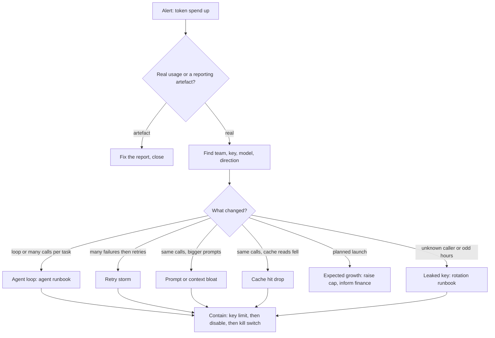

How to respond when a budget alert fires or the daily token bill jumps. The order is: **confirm the number is real, find the key and caller, classify the cause, contain with the least blast radius, keep the evidence, then recover and add the cap that would have caught it.** Most spikes are one caller doing more work than intended (a loop, a retry storm, a larger prompt). A few are abuse of a leaked key. The first six steps tell these apart in minutes without stopping anyone who is behaving normally.

> [!info] Scope and verification
> Nothing here was run against a live system. The OpenTelemetry GenAI attribute and metric names were checked against the local semantic-conventions checkout (commit 244465e) and the PromQL functions against the Prometheus docs (commit ef78ff6), both on 2026-11-01. The gateway metrics (`llm_gateway_*`) and the gateway admin API in the examples are **this site's example names, not a standard**; map them to your gateway. Provider pricing, billing lag and rate-limit headers are not verifiable here and are listed under [Not verified](#not-verified).

## When to use

- A budget or token-rate alert fires (`LlmTokenRateHigh`, `LlmJobRunaway` in [[llm-api-cost-control]]), or finance or the provider console shows a daily bill well above the usual level.
- A team reports its quota is already used up for the day or month.
- A chargeback report ([[token-usage-metering-and-chargeback]]) shows one team or key far above its history.

Use something else when:

- The spend comes from an agent that is writing, committing or following injected instructions as well as spending: start with [[runaway-or-compromised-ai-agent-response]] and come back here for the cost analysis.
- The provider is failing and requests are erroring, not costing: [[model-provider-outage-runbook]]. If the symptom is HTTP 429, use [[llm-api-rate-limit-429-storm]].
- Latency, not cost, moved: [[llm-serving-latency-regression]].
- Quality dropped after a model or prompt change, with no cost effect: [[model-or-prompt-rollout-quality-regression]].

## Preconditions

- Read access to the gateway's Prometheus and its logs or traces ([[llm-observability-tracing-and-slos]]). Read access to the provider's usage console or billing export.
- Admin rights on the gateway to set a per-key limit, disable a key and flip the kill switch ([[ai-gateway-architecture-and-policy]]). Use an operator token, never the suspect key.
- Per-team keys, so a key identifies one owner ([[llm-api-cost-control]]). If keys are shared, step 3 stops at team level and containment is coarser.
- An incident record; use the severity scale in [[incident-response]]. A spend spike with no writes is normally SEV3.
- A `kubectl` context for the gateway cluster (for GKE, `gcloud container clusters get-credentials CLUSTER --region REGION --project PROJECT`), with get and list on pods, `pods/log` and configmaps in `$NS`. Check it with `kubectl auth can-i get pods/log -n "$NS"`.
- For containment of an agent or job: rights to scale or patch the caller's Deployment in its own namespace, or access to its pipeline to cancel it. For the cronjob check in Troubleshooting: cluster-wide list on cronjobs.
- Read access to Cloud Logging on the project (for example `roles/logging.viewer`) if pod logs have already rotated or the pods restarted.

```bash title="variables"
PROM=https://prometheus.example.internal
GATEWAY=https://llm-gateway.example.internal
NS=llm-gateway
TEAM=payments
KEY_ID=k-7f3a
MODEL=example-model-large
INCIDENT=INC-0000
# Operator tokens come from the secret manager, never from the shell history:
#   export LLM_GATEWAY_ADMIN_TOKEN=...   (set it from your vault tooling)
```

The helper below runs an instant PromQL query and prints one line per series. Every query in this note uses it.

```bash
q() { curl -sG "$PROM/api/v1/query" --data-urlencode "query=$1" \
  | jq -r '.data.result[] | [(.metric | to_entries | map("\(.key)=\(.value)") | join(",")), .value[1]] | @tsv'; }
```

## Steps



### 1. Confirm the spike is real

Rule out three artefacts before you stop anyone.

**Metering lag.** Provider usage and billing exports arrive late and in batches, so a "jump" can be several hours of usage landing together. Compare with the gateway's own counter, which moves in real time:

```bash
# Tokens in the last hour, whole gateway
q 'sum(increase(llm_gateway_tokens_total[1h]))'
# The same hour yesterday, for comparison
q 'sum(increase(llm_gateway_tokens_total[1h] offset 1d))'
```

`increase` returns the growth of the counter over the window, extrapolated to the window edges, so expect small non-integer values. The `offset` modifier shifts the query back in time. Compute the ratio directly. A value near 1 means the gateway sees no spike and the alert source is the lagging one (provider export or billing):

```bash
q 'sum(increase(llm_gateway_tokens_total[1h])) / sum(increase(llm_gateway_tokens_total[1h] offset 1d))'
```

These are instant queries, so each returns one value. For a series of hourly points use the `/api/v1/query_range` endpoint with `step=1h`.

**A pricing or model change.** The spend per token can change with no change in tokens: a model alias moved to a larger model, or the provider changed its prices. Check whether tokens rose or only cost did, and whether the model label shifted:

```bash
q 'sum by (model) (increase(llm_gateway_tokens_total[1d]))'
q 'sum by (model) (increase(llm_gateway_tokens_total[1d] offset 1d))'
```

If tokens are flat but cost rose, compare the price table your cost estimate uses ([[per-request-cost-estimation]]) with the provider's current price list. Prices are provider specific and are not checked here.

**A reporting double count.** Two exporters, or a retry that is logged twice, can inflate a dashboard. Reconcile one team's gateway tokens with its meter records (see [[token-usage-metering-and-chargeback]]):

```bash
q "sum(increase(llm_gateway_tokens_total{team=\"$TEAM\"}[1d]))"
```

Compare with the usage record sum for the same team and window. If the gateway counter and the meter disagree by about a factor of two, suspect a duplicate emitter, for example two gateway replicas both scraped through a Service and a PodMonitor. A real spike shows up in every independent source.

### 2. Measure the size and shape

Get the rate, the start time and whether it is still running. A spike that already ended needs analysis, not containment.

```bash
# Current tokens per second, whole gateway, and the 7-day-ago baseline
q 'sum(rate(llm_gateway_tokens_total[5m]))'
q 'sum(rate(llm_gateway_tokens_total[5m] offset 7d))'

# Input versus output tokens (direction label: input or output)
q 'sum by (direction) (rate(llm_gateway_tokens_total[5m]))'

# Request rate and mean tokens per request
q 'sum(rate(llm_gateway_requests_total[5m]))'
q 'sum(rate(llm_gateway_tokens_total[5m])) / sum(rate(llm_gateway_requests_total[5m]))'
```

Read the shape. Both numbers matter, because they separate the causes in step 4:

| Requests per second | Tokens per request | Points at                                                |
| ------------------- | ------------------ | -------------------------------------------------------- |
| Up a lot            | Flat               | Loop, retry storm, new traffic, abuse                    |
| Flat                | Up a lot           | Prompt or context bloat, a larger `max_tokens`, no cache |
| Up                  | Up                 | Launch of a new feature, or two causes at once           |
| Flat                | Flat, but cost up  | Model switch or a price change (step 1)                  |

### 3. Find the key, team and model

Rank by growth, not by size, so a large steady consumer does not hide a small new one.

```bash
# Top 5 keys by tokens in the last hour
q 'topk(5, sum by (team, key_id, model) (increase(llm_gateway_tokens_total[1h])))'

# Top 5 keys by growth against the same hour yesterday
q 'topk(5, (sum by (team, key_id) (increase(llm_gateway_tokens_total[1h])) - sum by (team, key_id) (increase(llm_gateway_tokens_total[1h] offset 1d))) or sum by (team, key_id) (increase(llm_gateway_tokens_total[1h])))'

# Keys with no traffic in the same day yesterday (new or leaked keys)
q 'sum by (team, key_id) (increase(llm_gateway_tokens_total[1h])) unless sum by (team, key_id) (increase(llm_gateway_tokens_total[1d] offset 1d))'
```

`topk(k, v)` returns the `k` series with the largest value and keeps their labels, which is why the labels must be listed in `sum by`. Plain subtraction (`A - B`) uses one-to-one vector matching and drops any key that has no series on the right-hand side, so a key that did not exist yesterday would never appear. The `or` fallback keeps such a key, with its whole last-hour value. The third query lists new keys directly. If either returns a key that did not exist yesterday, note that: it is a lead for step 4. Record the result in the incident channel with the time range, then check how much of the total it explains. If one key explains most of the growth, go on. If growth is spread over many keys, the cause is shared: a gateway change, a model alias move, a cache that stopped working, or a provider price change.

For the requests behind the key, use the gateway log first, because it is cheap and holds the caller metadata:

```bash
kubectl -n "$NS" logs -l app.kubernetes.io/name=llm-gateway --since=1h --max-log-requests=50 --prefix=false \
  | jq -c --arg k "$KEY_ID" 'select(.key_id==$k) | {ts, route, model, status, in_tok: .input_tokens, out_tok: .output_tokens, client: .user_agent, ip: .client_ip}' \
  | head -20
```

`kubectl logs deploy/NAME` reads the logs of a single pod, not of every replica, so use a label selector as above (match the real label of your gateway pods). Logs of a pod that restarted or was rescheduled are gone from `kubectl`; on GKE, read Cloud Logging for those (see step 5.0). The log field names above are this site's gateway format. Look for one user agent or source IP, a single route, repeated identical prompt sizes (a loop), and a status mix with many 429 or 5xx (a retry storm).

Then look at traces. In OpenTelemetry's GenAI conventions, a model call is a span, and its token use is recorded on the span as `gen_ai.usage.input_tokens` and `gen_ai.usage.output_tokens`. `gen_ai.usage.input_tokens` includes cached tokens, and `gen_ai.usage.cache_read.input_tokens` is the cached part of it. Other useful attributes on the model-call span are `gen_ai.request.model`, `gen_ai.response.model`, `gen_ai.operation.name` and `gen_ai.conversation.id`, plus `error.type` when the call failed. `gen_ai.agent.name` is not on the model-call span: it is set on the agent spans (such as `invoke_agent`) and on the `execute_tool` span, so join to the parent agent span to get the agent name. In a trace store that supports attribute search (the query syntax depends on your store), find the biggest calls:

```text
spans where gen_ai.request.model = "$MODEL"
        and gen_ai.usage.input_tokens > 50000
group by gen_ai.conversation.id   (or by trace ID)
order by sum(gen_ai.usage.input_tokens) desc
```

Then read `gen_ai.agent.name` from the parent `invoke_agent` span of the top conversation. Replace `$MODEL` with the value of the variable; the query text is not shell.

A single `gen_ai.conversation.id` with hundreds of spans is a loop. Many conversations whose `gen_ai.usage.input_tokens` are all large is bloat. Prompt text is opt-in in those conventions and may be absent or redacted by design; see [[llm-tracing-with-sensitive-data-controls]]. Do not turn content capture on during an incident without the data owner's approval.

> [!note] Metric names in the OpenTelemetry conventions
> At the checked commit the GenAI client token counters are named `gen_ai.client.inference.usage.input_tokens` and `gen_ai.client.inference.usage.output_tokens` (unit `{token}`), broken down by `gen_ai.token.modality` and `gen_ai.request.model`. They are marked Development, so names can change; a metric or dashboard built on a different name may come from an older or custom convention. How a name appears in Prometheus depends on your collector's translation. Check the names in your own metrics before you copy a query.

### 4. Classify the cause

Use the evidence from steps 2 and 3. Contain first (step 5) if the spike is still running; classify in parallel.

| Cause                   | Evidence                                                                                                                               | Next                                                                                                   |
| ----------------------- | -------------------------------------------------------------------------------------------------------------------------------------- | ------------------------------------------------------------------------------------------------------ |
| Runaway agent loop      | One conversation or job with a huge span count; same tool called again and again; requests per task far above normal.                  | [[runaway-or-compromised-ai-agent-response]]; limits in [[bounded-agent-loops-and-stop-conditions]].   |
| Retry storm             | Many 429, 5xx or timeouts in the status mix; attempts per logical request well above 1; the spike follows a provider or gateway error. | Use [[llm-api-rate-limit-429-storm]] for 429s and [[llm-retry-timeout-and-circuit-breaker-policy]].    |
| Prompt or context bloat | Requests flat, input tokens per request up; started at a deploy; a new retrieval depth, a pasted document or a lost truncation.        | Roll back the change; see [[context-window-budgeting]].                                                |
| Cache hit drop          | Same request pattern, but cache-read tokens fell and input cost rose; a prompt prefix changed, or a cache was cleared.                 | Step 4a below; see [[llm-caching-correctness-and-safety]] and [[prompt-caching-and-data-isolation]].   |
| New feature launch      | Matches a release or announcement; the traffic is from the expected service with a normal status mix.                                  | Expected: raise the cap with approval, tell finance, set a forecast.                                   |
| Abuse with a leaked key | A key used from an unfamiliar IP, user agent or region; traffic at odd hours; no matching service deploy; a key from a public repo.    | [[leaked-credential-rotation]] right away; see also [[llm-denial-of-service-and-resource-exhaustion]]. |

**4a. Check for a cache hit drop.** If your gateway exports cached input tokens as a separate counter, the share of input served from cache is:

```bash
q "sum(rate(llm_gateway_cache_read_tokens_total{team=\"$TEAM\"}[15m])) / sum(rate(llm_gateway_tokens_total{team=\"$TEAM\",direction=\"input\"}[15m]))"
q "sum(rate(llm_gateway_cache_read_tokens_total{team=\"$TEAM\"}[15m] offset 1d)) / sum(rate(llm_gateway_tokens_total{team=\"$TEAM\",direction=\"input\"}[15m] offset 1d))"
```

A fall from, say, a steady share to near zero means the cached prefix no longer matches: a timestamp or request id at the start of the prompt, a changed system prompt, or a model change. Whether a provider discounts cached tokens, and by how much, is provider specific and not checked here.

### 5. Contain, smallest blast radius first

Move down this list only as far as the spike requires, and stop as soon as the rate is back to normal. Rows 1 to 4 are reversible. Row 5 is not: a new provider key has to be issued and rolled out everywhere, so use it only under [[leaked-credential-rotation]] with the incident commander's approval.

| Order | Action                          | Who is affected                  |
| ----- | ------------------------------- | -------------------------------- |
| 1     | Per-key token cap or rate limit | The one key's caller, partly     |
| 2     | Disable the key                 | The one key's caller, fully      |
| 3     | Disable the team or route       | One team or one feature          |
| 4     | Gateway kill switch             | Every consumer                   |
| 5     | Revoke the provider key         | Every consumer, and slow to undo |

The admin calls below show the shape of this site's gateway API; replace them with your gateway's real calls (the policy file in [[llm-api-cost-control]] shows the config style).

**5.0 Snapshot before you change anything.** Save the current state first. Once you cap the key or scale a caller to zero, the old limits and the caller's pod logs may be gone. This takes a minute and does not stop the spike from being contained:

```bash
mkdir -p "evidence-$INCIDENT" && cd "evidence-$INCIDENT"
curl -sS "$GATEWAY/admin/keys/$KEY_ID/limits" \
  -H "Authorization: Bearer $LLM_GATEWAY_ADMIN_TOKEN" > "limits-before-$KEY_ID.json"
kubectl -n "$NS" get configmap llm-gateway-policy -o yaml > policy-before.yaml
# Logs of the caller's pods, before any scale to zero (namespace and workload are the caller's):
#   kubectl -n CALLER_NS logs deploy/CALLER --all-containers > caller.log
test -s "limits-before-$KEY_ID.json" || echo 'EMPTY SNAPSHOT'
```

The limits endpoint is this site's example, like the other admin calls. Step 6 completes the evidence set.

**5.1 Cap the key.** Lower its per-minute token limit to roughly its normal level. The caller degrades with clear errors and does not go dark:

```bash
curl -sS -X PATCH "$GATEWAY/admin/keys/$KEY_ID/limits" \
  -H "Authorization: Bearer $LLM_GATEWAY_ADMIN_TOKEN" \
  -H 'Content-Type: application/json' \
  -d "$(jq -n --arg r "$INCIDENT spend spike" '{tokens_per_minute: 20000, max_output_tokens: 2048, reason: $r}')" | jq .
```

Expected: the response echoes the new limits. Within a few minutes, the key's rate in the step 2 query falls to the cap, and the gateway log shows 429 responses with a reason of your own limit for that key. If the caller retries hard against the new limit, that is a retry storm of its own; see [[llm-api-rate-limit-429-storm]].

**5.2 Disable the key.** Do this when the traffic is not from a legitimate caller, the cap does not hold it, or you suspect abuse:

```bash
curl -sS -X POST "$GATEWAY/admin/keys/$KEY_ID/disable" \
  -H "Authorization: Bearer $LLM_GATEWAY_ADMIN_TOKEN" | jq .
```

Warn the owning team first if it is a known service: a disabled key turns their batch job or product feature into a failure. For an agent, also stop the job itself (cancel the pipeline or scale the Deployment to zero); otherwise it keeps retrying.

**5.3 Disable a team or route.** Use this when the traffic comes from one team or feature but through more than one key. The call below is this site's example shape; replace it with your gateway's:

```bash
curl -sS -X POST "$GATEWAY/admin/teams/$TEAM/disable" \
  -H "Authorization: Bearer $LLM_GATEWAY_ADMIN_TOKEN" | jq .
```

Check that it took effect: the team's rate in the step 2 queries drops to no series or near 0.

**5.4 Kill switch.** Flip the gateway's global flag only if many keys are involved, the cause is unknown and the spend is large and rising. Say in the incident channel who flipped it and when. Clients must treat the error as "feature unavailable", not as "retry" (see [[llm-api-cost-control]]). Practise this before you need it. Example call (this site's shape, not a standard):

```bash
curl -sS -X POST "$GATEWAY/admin/kill-switch" \
  -H "Authorization: Bearer $LLM_GATEWAY_ADMIN_TOKEN" \
  -H 'Content-Type: application/json' \
  -d "$(jq -n --arg r "$INCIDENT spend spike" '{enabled: true, reason: $r}')" | jq .
```

Expected: the response shows `enabled: true`. Check that it held: `q 'sum(rate(llm_gateway_requests_total{status="503"}[5m]))'` rises while `q 'sum(rate(llm_gateway_tokens_total[5m]))'` falls to near 0.

If you suspect the key is leaked, disabling it is the first step of [[leaked-credential-rotation]]; follow that note for revocation, rotation and audit rather than improvising here.

### 6. Keep the evidence

Capture before logs and traces age out, and before any restart changes state. Step 5.0 already saved the limits, the policy and the caller's logs; this step adds the rest. Run it from the same `evidence-$INCIDENT` folder.

```bash
mkdir -p "evidence-$INCIDENT" && cd "evidence-$INCIDENT"
q 'sum by (team, key_id, model, direction) (increase(llm_gateway_tokens_total[6h]))' > tokens-by-key-6h.tsv
kubectl -n "$NS" logs -l app.kubernetes.io/name=llm-gateway --since=6h --max-log-requests=50 --prefix=false \
  | jq -c --arg k "$KEY_ID" 'select(.key_id==$k)' > gateway-log-key.jsonl
test -s gateway-log-key.jsonl || echo 'EMPTY EVIDENCE'
# Pods that restarted in the window are missing above; on GKE also export from Cloud Logging:
gcloud logging read "resource.type=\"k8s_container\" AND resource.labels.namespace_name=\"$NS\" AND jsonPayload.key_id=\"$KEY_ID\"" \
  --freshness=6h --format=json > gateway-log-key-cloudlogging.json
sha256sum * > SHA256SUMS
```

The log lines already carry their own `ts` field, so `--timestamps` is not used: it would put a prefix in front of each JSON line and break `jq`. Add the trace IDs of the largest calls, the provider usage export for the window and the exact limits you changed. Treat the log file as sensitive: it can contain client IPs and, depending on your gateway, request metadata. Store it in the incident folder with restricted access.

### 7. Recover

- Remove the cause: roll back the prompt or context change, fix the loop's stop condition, correct the retry policy, or restore the cached prefix.
- Restore the key's normal limits in steps, not at once. Watch the step 2 queries for 15 minutes after each change.
- For a launch, set a new baseline and budget with the owner, and tell finance.
- If a provider bill was inflated by the incident, raise it with the provider's support using the usage export; refund terms are not checked here.

### 8. Set caps that would have caught it

For the incident record, ask which control would have stopped this at a small cost, and add it:

| Control                           | Example                                                                                              |
| --------------------------------- | ---------------------------------------------------------------------------------------------------- |
| Per-key daily and per-minute caps | Set at about 2x the busiest normal day; a key that reaches it gets a clear error, not silence.       |
| Per-request `max_output_tokens`   | A gateway default that callers can lower but not exceed without review.                              |
| Rate alert on growth              | Alert when a key's rate exceeds a multiple of its own 7-day level, not one global number.            |
| Loop limits                       | Max steps, max tokens and a wall-clock limit per task ([[bounded-agent-loops-and-stop-conditions]]). |
| Retry budgets                     | Attempt cap and a global retry limit ([[llm-retry-timeout-and-circuit-breaker-policy]]).             |
| New-key alert                     | Notify when a key appears that spends over a small threshold in its first hour.                      |

```yaml title="llm-spend-spike-alerts.yaml"
groups:
  - name: llm-spend-spike
    rules:
      - alert: LlmKeyTokenRateGrowth
        expr: |
          sum by (team, key_id) (rate(llm_gateway_tokens_total[15m]))
            > 4 * sum by (team, key_id) (rate(llm_gateway_tokens_total[15m] offset 7d))
          and sum by (team, key_id) (rate(llm_gateway_tokens_total[15m])) > 500
        for: 15m
        labels:
          severity: warning
        annotations:
          summary: "Key {{ $labels.key_id }} ({{ $labels.team }}) uses over 4x its token rate of a week ago"
```

The factor, the floor of 500 tokens per second and the `for` duration are examples; tune them on your history, and test the rule with `promtool` before deploying. A budget alert is a second line, not a cap (see [[llm-api-cost-control]]).

## Validation

```bash
q 'sum(rate(llm_gateway_tokens_total[5m]))'                       # back near the 7-day baseline
q "sum by (key_id) (rate(llm_gateway_tokens_total{key_id=\"$KEY_ID\"}[5m]))"   # at or below its cap, or no series if disabled
q 'sum(rate(llm_gateway_requests_total{status=~"5.."}[5m]))'        # no new error wave from the containment
kubectl -n "$NS" logs -l app.kubernetes.io/name=llm-gateway --since=15m --max-log-requests=50 --prefix=false | jq -c --arg k "$KEY_ID" 'select(.key_id==$k)' | wc -l   # all replicas
```

Then confirm with the owner that their service works under the final limits, and that the next provider usage export matches the gateway counters. The incident is over when the rate is at baseline for a full day-part and the alert has resolved without a silence.

## Rollback

- **Key limit:** set the previous values back with the same `PATCH`; the old values are in `limits-before-$KEY_ID.json` (saved in step 5.0) or in the audit log of the admin API. Do not use a ConfigMap captured after the change.
- **Disabled key:** re-enable it only after the cause is fixed. If the key was leaked, do not re-enable it; rotate it instead ([[leaked-credential-rotation]]).
- **Team or route disable:** call the matching enable endpoint of your gateway (for the example above, `POST $GATEWAY/admin/teams/$TEAM/enable`).
- **Kill switch:** flip it back with the same call and `enabled: false`, then watch for a burst of queued work and of retries from clients that backed up while it was off.
- **Prompt or code rollback:** use the normal release process; a rollback that changes behaviour needs the checks in [[model-or-prompt-rollout-quality-regression]].

## Troubleshooting

| Symptom                                             | Likely cause and fix                                                                                                                                                     |
| --------------------------------------------------- | ------------------------------------------------------------------------------------------------------------------------------------------------------------------------ |
| Provider shows a spike, gateway counters do not     | Traffic bypasses the gateway (a direct key somewhere), or the export is lagging. Find direct keys in the provider console and move them behind the gateway.              |
| Gateway counters and the meter differ by about 2x   | Double scraping or double emitting. Check for two scrape paths to the same pod.                                                                                          |
| No key is the top contributor; growth is spread out | A shared cause: model alias moved, cache drop, price change, or a gateway release. Check deploy history and step 4a.                                                     |
| Cap applied but tokens keep rising                  | The caller has a second key, or limits apply per replica. Check `sum by (key_id)` for new keys and the limit scope.                                                      |
| After the cap, request rate rises but tokens fall   | A retry storm against the cap. Honour `Retry-After` in the caller; see [[llm-api-rate-limit-429-storm]].                                                                 |
| Spike returns every day at the same time            | A scheduled job. Find the CronJob (`kubectl get cronjob -A`) and its owner; see [[scheduled-autonomous-agent-jobs]].                                                     |
| The key is unknown to any team                      | Possible leak or an orphan key. Disable it and follow [[leaked-credential-rotation]].                                                                                    |
| Traces show token counts of 0 or missing            | The instrumentation does not set the usage attributes (they are Recommended, not required, and depend on the provider or library reporting counts). Use the gateway log. |

## Related

- [[llm-api-cost-control]] for the gateway, caps, budgets and kill switch design.
- [[token-usage-metering-and-chargeback]] and [[per-request-cost-estimation]] for the numbers behind the bill.
- [[runaway-or-compromised-ai-agent-response]] when an agent is the cause.
- [[leaked-credential-rotation]] when a key is leaked.
- [[llm-api-rate-limit-429-storm]] when throttling and retries are part of the picture.
- [[model-provider-failover-and-routing]] and [[fallback-model-selection-and-quality-degradation]] if you must route work to a cheaper model.
- [[llm-observability-tracing-and-slos]] and [[incident-response]].
- [[model-or-prompt-rollout-quality-regression]] when the spike started with a model or prompt rollout and answers changed too.
- [[llm-serving-latency-regression]], [[gpu-out-of-memory-and-kv-cache-exhaustion]] and [[gpu-pods-pending-on-gke]] for the self-hosted side, where the cost shows up as GPU time and not tokens.

## Evidence

### Sources checked

- [OpenTelemetry semantic conventions for generative AI](https://github.com/open-telemetry/semantic-conventions/tree/main/docs/gen-ai): span attributes `gen_ai.usage.input_tokens` (includes cached tokens), `gen_ai.usage.output_tokens`, `gen_ai.usage.cache_read.input_tokens`, `gen_ai.request.model`, `gen_ai.response.model`, `gen_ai.operation.name`, `gen_ai.conversation.id`, `error.type`, with `gen_ai.agent.name` as an agent-span (`invoke_agent`) and `execute_tool` attribute, not a model-call one; the metrics `gen_ai.client.inference.usage.input_tokens` and `gen_ai.client.inference.usage.output_tokens` (Counter, unit `{token}`, attribute `gen_ai.token.modality`); status Development. Checked 2026-11-01 in the local semantic-conventions checkout, commit 244465e.
- [Prometheus querying functions](https://prometheus.io/docs/prometheus/latest/querying/functions/) and [operators](https://prometheus.io/docs/prometheus/latest/querying/operators/): `rate()`, `increase()`, `topk`, `sum by`, and the `offset` modifier in the querying basics. Checked 2026-11-01 in the Prometheus repository docs, commit ef78ff6.
- [Prometheus alerting rules](https://prometheus.io/docs/prometheus/latest/configuration/alerting_rules/) and promtool: `for`, `labels`, `annotations` and label templating in `alerting_rules.md`, `promtool check rules` and `promtool test rules` in `command-line/promtool.md` and `configuration/unit_testing_rules.md`. Checked 2026-11-01, commit ef78ff6. Operators docs also checked for one-to-one vector matching, which drops unmatched series.
- `gcloud logging read --help` and `gcloud container clusters get-credentials --help` (SDK 570.0.0): the `--freshness` and `--region` flags. Checked 2026-11-01, help text only.
- The notes linked above, for this site's gateway, cap and kill-switch design. Read 2026-11-01.

### Not verified

- Nothing was run against a live system, a gateway or a provider account; every command output is an expectation.
- The `llm_gateway_*` metric names, gateway log fields and the admin API calls are this site's example names, not a standard.
- Provider pricing, price changes, billing and usage-export lag, cached-token discounts and refund terms.
- Provider rate-limit headers and any behaviour of the provider console.
- How your collector translates OpenTelemetry metric names into Prometheus names.
- Trace-store query syntax for your tools.
- `kubectl` behaviour: `kubectl` is not installed here and its reference is not in the local Kubernetes docs. That `kubectl logs deploy/NAME` reads one pod, the `-l`, `--max-log-requests`, `--prefix` flags and `--timestamps` output format are standard behaviour from memory, not checked locally. The pod label `app.kubernetes.io/name=llm-gateway` is an example.
- The Cloud Logging field names (`jsonPayload.key_id`) and IAM role names.

### Environment

A Prometheus server that scrapes an LLM gateway exposing the example `llm_gateway_*` metrics, Kubernetes with `kubectl`, and `curl` and `jq` on the operator host. Versions were not recorded because nothing was run.

### Prerequisites

See the Preconditions section: gateway admin rights, read access to metrics, logs and traces, and an incident record.

### Expected results

After containment the gateway token rate returns to the 7-day baseline, the capped key stays at or below its limit, and the gateway counters agree with the provider usage export. See the Validation section.

### Failure conditions

The rate does not fall after the key cap, a second key appears, the counters disagree with the meter by about 2x, or the cause is unknown while spend rises. See the Troubleshooting section and the order of escalation in step 5.

### Cleanup and rollback

See the Rollback section: restore key limits from the saved policy, re-enable keys only after the cause is fixed, and rotate any leaked key instead of re-enabling it.

## Sources

- [OpenTelemetry semantic conventions for generative AI](https://github.com/open-telemetry/semantic-conventions/tree/main/docs/gen-ai): the span attributes and token metrics used in step 3.
- [Prometheus documentation: querying](https://prometheus.io/docs/prometheus/latest/querying/basics/): the PromQL functions, aggregations and `offset` modifier used in the queries.
- [[llm-api-cost-control]]: gateway enforcement, budgets, alerts and the kill switch for this site.
