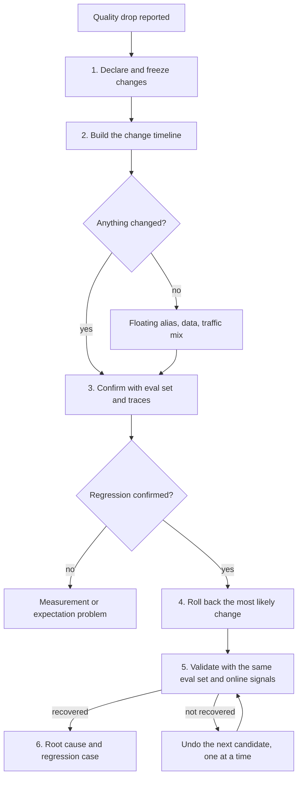

How to respond when answers got worse right after a change to the model version, the prompt template, the system instruction, the retrieval configuration, the decoding parameters or a guardrail. Quality regressions rarely page anyone: there is no error, only worse answers, and several things may have changed at once. The method is the same as for any incident: stop further change, find the candidates, confirm with evidence rather than anecdotes, undo the single most likely change, check that the numbers recover, and only then look for the root cause.

> [!info] Scope and verification
> The commands were not run against a live system and the note is not marked `verified`. The attribute names for tracing were checked against the OpenTelemetry GenAI semantic conventions on 2026-11-01. The rest of the procedure is engineering practice, not a documented claim, and is listed as such under Not verified. The `kubectl rollout` and `gcloud get-credentials` commands were checked against local docs; the `helm`, `argocd`, `redis-cli` and `jq` flags were not; the evaluation runner, gateway configuration and cache layout in the examples are stand-ins for your own.

## When to use

- Users, support or reviewers report that answers are worse, less accurate, more verbose, refuse more or ignore instructions, and the timing matches a deploy.
- An evaluation job, an online quality score or a thumbs-down rate moved after a change to the model, a prompt, a system instruction, retrieval, decoding parameters or a guardrail.
- Nothing was deployed, and quality still moved. Step 2 covers this case.

If the answers are wrong because they are invented rather than worse overall, use [[hallucination-triage-and-remediation]]. If the problem is in search results rather than generated text, use [[search-quality-incident-response]]. If the model is slow rather than worse, use [[llm-serving-latency-regression]]. If the provider is down or throttling, use [[model-provider-outage-runbook]] and [[llm-api-rate-limit-429-storm]]. Cost moving with quality is a separate runbook: [[llm-token-spend-spike]].

## Preconditions

- Read access to deployment history, the prompt and configuration repositories, the gateway configuration and the trace store. For the freeze check, read access to CronJobs in the namespaces that run them (or cluster-wide).
- Push rights on the configuration repository (or a merge request that your approver can merge), and write access to the response cache if you will purge it.
- Permission to run the evaluation set and to roll back the service, the prompt version and the gateway configuration. Know who approves a rollback; see [[llm-change-management-and-release-gates]].
- A golden dataset with expected outcomes and a way to run it against any model and prompt version; see [[golden-dataset-management-for-llms]] and [[regression-testing-for-model-upgrades]].
- An incident record and an incident commander if user impact is real; see [[incident-response]].

```bash title="variables"
PROJECT=example-project
CLUSTER=prod-gke
LOCATION=europe-west1
NS=llm-gateway                                # namespace of the chat gateway; a self-hosted model server runs in llm-serving
APP=chat-gateway
RELEASE=chat-gateway
ARGOCD_APP=chat-gateway-prod      # the Argo CD Application, if Argo CD manages the gateway
GATEWAY_CONFIG=chat-gateway-config          # ConfigMap holding model, prompt and decoding settings
PROMPT_REPO=git@git.example.com:ai/prompts.git
EVAL_RUNNER="python -m evals.run"          # your evaluation job; see the golden dataset note
EVAL_SET=golden-v14
INCIDENT_START="2026-11-01T08:00:00Z"
BEFORE_START="2026-10-30T00:00:00Z"        # start of the known-good comparison window
BEFORE_END="2026-10-31T00:00:00Z"
REVISION=41                                # Helm revision to roll back to, from "helm history"
CONFIG_REPO=git@git.example.com:ai/gateway-config.git
BAD_COMMIT=abc1234                         # the configuration commit to revert
REDIS_HOST=cache.example.internal          # only if you purge a Redis response cache
CACHE_PREFIX='chat:answer:prompt-v27:*'    # key pattern of the affected entries
# On GKE; use your own cluster's credential step elsewhere
gcloud container clusters get-credentials "$CLUSTER" --location "$LOCATION" --project "$PROJECT"
```

## Steps



### 1. Declare and freeze

Treat a confirmed or likely regression as an incident with an owner. Then stop the moving parts, because every new change makes the diagnosis harder.

1. Open the incident and name a commander and a scribe; see [[incident-response]].
2. Freeze deploys of the service, prompt and template changes, retrieval re-indexing, model alias changes and guardrail rule changes. Tell the teams that own each, and pause any automated rollout:

```bash
# Pause an in-flight Deployment rollout, if one is running
kubectl -n "$NS" rollout pause deployment/"$APP"
# Record the Argo CD sync policy first, so you can restore it later
mkdir -p evidence
argocd app get "$ARGOCD_APP" -o yaml > evidence/argocd-app-before.yaml
# Freeze Argo CD auto-sync, if Argo CD manages the app (this also drops self-heal and prune)
argocd app set "$ARGOCD_APP" --sync-policy none
# Check what automation could still change things: scheduled jobs, config reloaders
kubectl get cronjob -A | grep -iE 'prompt|index|embed|eval'
```

A paused Deployment does not roll out pod-template changes and cannot be rolled back until it is resumed, so Step 4 resumes it inside the rollback path you choose. A sync freeze also stops Argo CD from applying your revert; re-enable sync or sync by hand in Step 4. Whatever the outcome, undo both freezes with "Lift the freeze" after Step 6. See [[argocd-sync-failure-and-drift]].

3. Record the time quality was last known good and the time the first report arrived. The window between them is where the cause sits.

Do not roll anything back yet unless users are being harmed right now (for example unsafe or clearly wrong output in a regulated flow). In that case take the state snapshot from Step 4 first, roll back the last change at once and continue with the steps below; an unnecessary rollback of one change is cheaper than continued harm.

### 2. Identify what changed and when

Build a timeline from every source that can change model behaviour. Do not stop at the first change you find.

| Source                    | Where to look                                                                                      |
| ------------------------- | -------------------------------------------------------------------------------------------------- |
| Service deployments       | `helm history`, `kubectl rollout history`, the CI/CD pipeline log                                  |
| Prompt and template       | the prompt repository log, template version in the config, see [[prompt-templates-and-versioning]] |
| System instruction        | its version and approvals, see [[system-instruction-lifecycle]]                                    |
| Gateway configuration     | model name, fallback and routing rules, decoding parameters, token limits, guardrail rules         |
| Model version at provider | a floating alias that now points at a newer build, see [[model-version-pinning-and-upgrade-evals]] |
| Retrieval                 | index rebuilds, embedding model, chunking, filters, top-k, reranker                                |
| Data behind retrieval     | new, deleted or re-ingested documents upstream                                                     |
| Caches                    | a cache that now serves older or newer answers, see [[llm-caching-correctness-and-safety]]         |
| Traffic                   | a new client, language, feature or tenant sending different prompts                                |

```bash
helm -n "$NS" history "$RELEASE" --max 10
kubectl -n "$NS" rollout history deployment/"$APP"

# The live configuration, and who last changed it
kubectl -n "$NS" get configmap "$GATEWAY_CONFIG" -o yaml | grep -E 'model|prompt|temperature|top_p|max_tokens|seed|guardrail|fallback'
CONFIG_DIR=$(mktemp -d) && git clone --quiet "$CONFIG_REPO" "$CONFIG_DIR"
git -C "$CONFIG_DIR" log --since="3 days ago" --format='%h %an %ad %s' --date=iso -- gateway/

# Prompt and system-instruction history
git clone --quiet "$PROMPT_REPO" /tmp/prompts-audit && git -C /tmp/prompts-audit log --since="3 days ago" --format='%h %an %ad %s' --date=iso
```

Pinned versus floating is the first question about the model. A pinned model identifier names one build. A floating alias such as a "latest" or family name can be repointed by the provider without any change on your side. Read what you send and what answers:

```bash
# Trace export (JSON lines): which model was asked for and which model answered, per hour
jq -r 'select(.attributes["gen_ai.request.model"] != null)
  | [(.start_time | .[0:13]), .attributes["gen_ai.request.model"], (.attributes["gen_ai.response.model"] // "unknown")]
  | @tsv' traces-last-48h.jsonl | sort | uniq -c
```

`gen_ai.request.model` is the model a request is made to, and `gen_ai.response.model` is the name of the model that generated the response. If the response model value changed at a time when you deployed nothing, the provider moved the alias. If your telemetry does not record `gen_ai.response.model`, that is a gap to close afterwards; for now ask the provider, check their change notes, and compare a small sample of raw responses before and after. Also look for a prompt name and version attribute (`gen_ai.prompt.name`, `gen_ai.prompt.version`) so you can group traces by prompt version.

**"We didn't change anything."** Quality can move with no deployment. Check these in order:

1. **Floating model alias.** The response model value changed, as above. Fix: pin to a specific model identifier and re-run your evaluation set before moving.
2. **Upstream data behind retrieval.** Documents were added, removed, re-ingested or re-chunked by another team. Compare index document counts and the date of the last ingestion; see [[knowledge-freshness-and-invalidation]] and [[retrieval-cache-invalidation]].
3. **Traffic mix.** The same system handles different inputs: a new client, a new language, longer documents, a marketing campaign. Compare the input distribution (length, language, intent, tenant) before and after the drop. A "regression" may be a harder question mix with no change in per-question quality. Re-run the golden set: if it still scores the same, the system did not get worse on known questions.
4. **Dependency or platform change.** A library, tokenizer, base image or tool API changed in an unpinned build. Compare image digests of the running Pods.
5. **A cache or a rate-limit fallback.** A fallback model took over during throttling and did not return. Check for fallback usage; see [[fallback-model-selection-and-quality-degradation]].

Write the timeline in the incident record: each change, its time, its owner, and whether it overlaps the drop. Rank the candidates by overlap in time and by how directly the change touches the symptom (for example a prompt change for a format problem, a retrieval change for wrong facts, a decoding change for randomness or length).

### 3. Confirm with the golden set and sampled traces

Anecdotes tell you where to look, not whether quality fell. Confirm with two independent measures.

**The golden set.** Run the same frozen evaluation set against the current configuration and against the last known good one. Run both on the same day with the same judge or grader, and the same settings except the change under test.

```bash
$EVAL_RUNNER --suite "$EVAL_SET" --config current   --out eval-current.json
$EVAL_RUNNER --suite "$EVAL_SET" --config last-good --out eval-last-good.json
jq -s '{current: .[0].summary, last_good: .[1].summary}' eval-current.json eval-last-good.json
```

Look at the pass rate per category (not only the mean), the cases that flipped from pass to fail, and the variance between repeated runs. If a model-based judge is used, check it has not changed too; see [[llm-as-judge-validation]]. If the golden set shows no difference, either the set does not cover the failing behaviour (add cases from step 6) or the problem is outside what it measures; use sampled traces.

**Sampled traces.** Pull a random sample of production traces from before and after the change, not the worst complaints. Review them blind if you can, against the same rubric.

```bash
# 100 random traces from each window (replace the time filters with your trace store's query)
jq -c --arg s "$BEFORE_START" --arg e "$BEFORE_END" 'select(.start_time >= $s and .start_time < $e)' traces.jsonl | shuf -n 100 > before.jsonl
jq -c --arg s "$INCIDENT_START" 'select(.start_time >= $s)' traces.jsonl | shuf -n 100 > after.jsonl
# Group by prompt version and model so the sample shows which combination is worse
jq -r '[.attributes["gen_ai.prompt.version"] // "n/a", .attributes["gen_ai.response.model"] // "n/a"] | @tsv' after.jsonl | sort | uniq -c
```

Care with traces: they may hold personal data or confidential prompts. Use the access controls and redaction in [[llm-tracing-with-sensitive-data-controls]]. Count the failure modes you see (wrong fact, format break, refusal, truncated, tone, ignored instruction), because the mode points at the cause: format and refusals point to prompts and guardrails, wrong facts to retrieval or the model, truncation to token limits, randomness to decoding.

**Online signals.** Compare the same windows on the signals you already have: thumbs-down or edit rate, escalation to a human, retry rate, abandoned sessions, refusal rate, average output length and finish reasons (`gen_ai.response.finish_reasons` records why generation stopped; a rise in the provider's token-limit finish reason, for example `length`, means truncation). See [[model-degradation-detection]] for which signals to keep.

Decide: **confirmed** (the golden set or the blind sample shows a drop, and an online signal agrees), **not confirmed** (nothing measurable moved; the reports may be about a different problem or a changed expectation), or **inconclusive** (go to more samples before undoing anything). If not confirmed, lift the freeze (resume the Deployment and restore Argo CD sync, see "Lift the freeze" after step 6), keep the incident open for a short observation window and report that no regression was measured, with the numbers.

### 4. Roll back the single most likely change first

Roll back one change at a time, starting with the best-ranked candidate from step 2. Undoing several at once may fix the problem and teach you nothing, and may undo a good change.

1. Choose the candidate with the closest time match and the most direct link to the failing behaviour. If two are equal, start with the one that is cheapest and safest to undo (a prompt version or a config value before a data re-index).
2. State the hypothesis in the incident record: "If we revert X, the golden-set category Y returns to Z and the sample failure mode disappears."
3. Save the live state first, so the evidence survives the rollback and you can rebuild it by hand. Attach the files to the incident record.
4. Revert it through the normal path and keep everything else frozen.

```bash
# Snapshot before any rollback (also before an emergency one in step 1)
mkdir -p evidence
kubectl -n "$NS" get configmap "$GATEWAY_CONFIG" -o yaml > evidence/configmap-before.yaml
helm -n "$NS" get values "$RELEASE" --all > evidence/values-before.yaml
kubectl -n "$NS" get pods -l app="$APP" -o jsonpath='{range .items[*]}{.metadata.name} {.status.containerStatuses[*].imageID}{"\n"}{end}' > evidence/digests-before.txt
```

Pick one of the three paths below and run only that one. Running two of them rolls back twice.

A paused Deployment cannot be rolled back and ignores template changes, so each path resumes it at the point where the rollback can take effect. Do not resume earlier: the suspect version would finish rolling out while you wait.

```bash
# Path A: Helm-managed release (Argo CD does not own it)
kubectl -n "$NS" rollout resume deployment/"$APP"
helm -n "$NS" rollback "$RELEASE" "$REVISION" --wait --timeout 10m

# Path B: plain Deployment, not managed by Helm or GitOps
kubectl -n "$NS" rollout resume deployment/"$APP"
kubectl -n "$NS" rollout undo deployment/"$APP"

# Path C: GitOps (Argo CD owns the release). Revert in Git only, through a merge request.
git -C "$CONFIG_DIR" revert --no-edit "$BAD_COMMIT"
git -C "$CONFIG_DIR" push origin HEAD:revert-"$BAD_COMMIT"
# Open a merge request, get the named approver to merge it, then sync (or re-enable auto-sync).
# Only after Argo CD has synced the merged revert, resume the Deployment. While it is paused,
# the reverted pod template will not roll out either.
kubectl -n "$NS" rollout resume deployment/"$APP"

# After any path: prove the change rolled out
kubectl -n "$NS" rollout status deployment/"$APP" --timeout 10m
```

If Argo CD owns the release, use a Git revert only; `helm rollback` and `kubectl rollout undo` are reverted by auto-sync or show as drift. See [[helm-release-rollback]] and [[argocd-sync-failure-and-drift]].

A reverted ConfigMap may not reach running Pods, because many gateways read it only at startup. Confirm the values, restart if the gateway does not hot-reload, and check fresh traces before running the step 5 evaluation:

```bash
kubectl -n "$NS" get configmap "$GATEWAY_CONFIG" -o yaml | grep -E 'model|prompt|temperature|max_tokens'
kubectl -n "$NS" rollout restart deployment/"$APP" && kubectl -n "$NS" rollout status deployment/"$APP"
# Fresh traces should show the expected gen_ai.request.model and gen_ai.prompt.version
```

For a model alias, pin the last known good model identifier explicitly (the value your provider documents), then redeploy. Do not point it at another floating alias.

For a floating alias you do not control, you cannot undo the provider's change: the rollback is to pin an earlier build, if the provider still offers it. Whether an earlier build is still available is something to check with the provider, not assume. Otherwise adjust the prompt for the new behaviour, or route to a different model; see [[model-provider-failover-and-routing]].

If the candidate is a retrieval change, revert the index alias or the configuration (top-k, filters, embedding model) rather than re-indexing under pressure; see [[embedding-model-migration]]. If it is a guardrail rule, revert the rule version, and keep a record of anything unsafe it would have let through; see [[output-guardrails-and-content-filtering]].

If the revert does not move the numbers (step 5), re-apply the original change through the same path, unless the reverted state is needed for safety (then record that it stays reverted). Confirm the eval score is back to the regressed baseline, then try the next candidate. Do not stack hypotheses.

**What a rollback cannot undo.** Say these out loud in the incident record:

- **Outputs already sent.** Answers shown to users, emails or tickets created, summaries stored in a database, and tool calls made on bad answers stay as they are. Identify the affected window and requests from the traces and decide on correction, re-processing or customer communication.
- **Cached responses.** A response or prompt cache may keep serving the bad answers after the revert. Purge entries created in the affected window, or those keyed on the bad prompt and model version. Check the cache key includes the model and prompt version, and read [[llm-caching-correctness-and-safety]] and [[prompt-caching-and-data-isolation]] before purging.
- **Derived data.** Embeddings, summaries, labels and training or evaluation data generated by the bad version. Mark or re-generate them; see [[embedding-pipeline-idempotency-and-reprocessing]].
- **A provider-side change.** You cannot revert a model the provider replaced; you can only pin, adapt or switch.
- **Time and trust.** Users who saw worse answers saw them.

```bash
# Example only; adjust the key layout to your cache. Dry run first: save and count the keys.
redis-cli -h "$REDIS_HOST" --tls --scan --pattern "$CACHE_PREFIX" | tee purge-keys.txt | wc -l
# Sample a few cached values into the incident record: they are evidence of the bad answers.
# Then purge from the saved list.
xargs -r -n 100 redis-cli -h "$REDIS_HOST" --tls unlink < purge-keys.txt
```

Purge only the affected prefix, not the whole cache, or you cause a load spike on the model. The purge deletes the cached bad answers, so keep the sample.

### 5. Validate with the same evaluation set and online signals

Use the same evaluation set, the same judge and the same sampling method as in step 3, so the numbers are comparable.

```bash
$EVAL_RUNNER --suite "$EVAL_SET" --config current --out eval-after-rollback.json
jq -s '{after_rollback: .[0].summary, last_good: .[1].summary}' eval-after-rollback.json eval-last-good.json
```

Check that:

- the golden-set score returns to the last-good level, per category, within the run-to-run variance you measured;
- a fresh blind sample of production traces taken after the rollback shows the failure mode gone;
- the online signals (thumbs-down, escalation, refusal rate, output length, finish reasons) move back over a window long enough to be meaningful for your traffic;
- no other signal got worse, in particular latency and cost (the old version may be slower or dearer); see [[llm-serving-latency-regression]] and [[llm-token-spend-spike]].

If the rollback fixed it, keep the freeze for a short soak period, then lift it in a controlled order (see "Lift the freeze" after step 6). If it did not, return to step 4 with the next candidate. If you have gone through all candidates, the cause is probably outside the change list: traffic mix, upstream data, the provider or the judge. Go back to the "we didn't change anything" list.

### 6. Root cause and regression case

After service is restored and the freeze is lifted, find out why the regression got through and make it impossible to repeat.

1. **Reproduce** the failure offline: the exact prompt, model identifier, decoding parameters, retrieved context and settings from a failing trace. Re-run the change against the golden set to see which cases fail. Use a small experiment per change, not all at once.
2. **Name the cause** in terms of mechanism, not blame: for example "a template edit removed the instruction to answer in the user's language", "the alias moved to a build that follows long prompts less closely", "an ingestion job dropped the policy documents".
3. **Add regression cases** to the golden set: at least the failing traces, with their expected outcome, in the right category, and a few neighbours. Keep the set free of leakage from training or tuning data; see [[eval-data-leakage-and-contamination]] and [[representative-evaluation-set-sampling]].
4. **Close the gate that failed.** Pin model versions, require an evaluation run on every prompt, system instruction, retrieval and decoding change, and compare against the last-good result before rollout; see [[llm-change-management-and-release-gates]] and [[model-version-pinning-and-upgrade-evals]]. Roll out in shadow or canary first and compare; see [[shadow-and-canary-evaluation-for-models]].
5. **Close the telemetry gap**: record request and response model, prompt name and version, and retrieval configuration on every trace, so the next timeline takes minutes; see [[llm-observability-tracing-and-slos]].
6. **Write the postmortem**, with the timeline, the measure that confirmed the regression, and what was not undoable; see [[postmortems-for-ai-involved-incidents]].

### Lift the freeze

Use this after the soak period, on the not-confirmed exit from step 3, and in Cleanup. Step 1 paused the Deployment and set Argo CD sync to none; neither undoes itself.

```bash
# Resume the Deployment only if it is still paused (.spec.paused is "true" when paused, empty otherwise)
if [ "$(kubectl -n "$NS" get deployment/"$APP" -o jsonpath='{.spec.paused}')" = "true" ]; then
  kubectl -n "$NS" rollout resume deployment/"$APP"
fi

# Restore the sync policy saved in step 1. Re-enable auto-sync only if the saved policy had
# "automated"; an app that was on manual sync before the incident stays on manual sync.
grep -A6 -E 'syncPolicy' evidence/argocd-app-before.yaml
argocd app set "$ARGOCD_APP" --sync-policy automated   # only if the saved policy had automated
# Add --self-heal and/or --auto-prune only if the saved policy had them
argocd app get "$ARGOCD_APP"
```

Then lift the other freezes (prompt, retrieval, alias and guardrail changes) one team at a time.

## Validation

- The golden-set results after the fix match the last-good run within the measured variance, for every category, not only the mean.
- A blind sample of production traces taken after the fix shows the failure mode gone.
- The online quality signals are back to their usual range for a full traffic cycle.
- Model, prompt and retrieval versions in traces match what you intended to run (`gen_ai.request.model` and `gen_ai.response.model` agree with the pinned model).
- Caches no longer serve answers produced by the bad version (query a known case and inspect the response).
- A regression case for this incident exists in the golden set and fails on the bad version.

## Rollback

The steps above are themselves rollbacks. To undo a rollback that turns out to be wrong:

- **Service or gateway:** `helm -n "$NS" rollback "$RELEASE"` to the revision before your rollback, or `kubectl -n "$NS" rollout undo deployment/"$APP"`, or revert the Git revert commit. Resume a paused Deployment first.
- **Model pin:** change the pin back through the same configuration path, and re-run the evaluation set first.
- **Cache purge:** cannot be undone. The cache refills from the model, which costs tokens and time. Do it in batches by prefix.
- **Frozen changes:** follow "Lift the freeze" after step 6, one team at a time, and stop if the quality signals move.

Not undoable: outputs already sent to users or stored, actions taken on bad answers, a provider-side alias move, and the time the regression ran. See the list at the end of step 4.

## Troubleshooting

| Symptom                                                              | Likely cause and fix                                                                                                                                   |
| -------------------------------------------------------------------- | ------------------------------------------------------------------------------------------------------------------------------------------------------ |
| Complaints but the golden set shows no difference                    | The set does not cover the failing behaviour, or the traffic mix changed. Sample production traces; add cases in step 6.                               |
| Golden set drops but production traces look fine                     | The set is stale or unrepresentative, or the judge changed. Check the judge and the set version; see [[llm-as-judge-validation]].                      |
| Scores differ between two runs of the same configuration             | Sampling randomness. Fix `seed` and `temperature` where the API supports it, repeat runs, and use the variance as the noise floor.                     |
| Response model name changed with no deployment                       | Floating alias moved. Pin a specific model identifier and re-run the set.                                                                              |
| Reverting the prompt did not help                                    | Wrong candidate, or two changes combined. Revert the next candidate, one at a time.                                                                    |
| Rollback done but users still see the bad answers                    | Response cache. Purge the affected prefix; check the cache key includes model and prompt version.                                                      |
| Quality drop only in one language, tenant or client                  | Traffic mix or a filter. Segment the sample; check tenant-specific retrieval filters and prompts.                                                      |
| Answers more refusing or blocked than before                         | Guardrail rule or system instruction change. Check the rule version and the blocked-output log.                                                        |
| Answers cut off mid-sentence                                         | A token limit lowered, or the provider's token-limit finish reason (for example `length`). Check the decoding parameters in the gateway configuration. |
| Wrong facts that were right last week                                | Retrieval data or index changed. Compare document counts and the last ingestion; revert the index alias.                                               |
| Rolled back and score recovered, but latency or cost rose            | The older version is slower or dearer. Accept it for now; plan a forward fix; see [[llm-serving-latency-regression]].                                  |
| Fix works in the evaluation set, regresses again at the next release | No regression case or gate. Add the case and require the evaluation run in the release gate (step 6).                                                  |

## Related

- [[model-version-pinning-and-upgrade-evals]] and [[regression-testing-for-model-upgrades]] for how to prevent this class of incident.
- [[prompt-templates-and-versioning]] and [[system-instruction-lifecycle]] for versioning the text that drives the model.
- [[golden-dataset-management-for-llms]] for keeping the evaluation set useful.
- [[shadow-and-canary-evaluation-for-models]] for comparing a change on live traffic before it is full.
- [[model-degradation-detection]] for signals that find a regression early.
- [[llm-change-management-and-release-gates]] for the approval path of each change type.
- [[hallucination-triage-and-remediation]] and [[search-quality-incident-response]] for the neighbouring quality incidents.
- [[llm-caching-correctness-and-safety]] for cache keys and purging.
- [[postmortems-for-ai-involved-incidents]] and [[incident-response]] for the process around the fix.
- [[llm-serving-latency-regression]], [[gpu-out-of-memory-and-kv-cache-exhaustion]], [[gpu-pods-pending-on-gke]], [[llm-token-spend-spike]] and [[llm-api-rate-limit-429-storm]] for the neighbouring AI serving runbooks.

## Evidence

Source-reviewed on 2026-11-01. Nothing was run and no live system was used. Read this section before using the note.

### Sources checked

- [OpenTelemetry semantic conventions for generative AI: attribute registry](https://github.com/open-telemetry/semantic-conventions-genai/blob/244465e/docs/registry/attributes/gen-ai.md): the attributes `gen_ai.request.model` ("the name of the GenAI model a request is being made to"), `gen_ai.response.model` ("the name of the model that generated the response"), `gen_ai.response.finish_reasons`, `gen_ai.prompt.name`, `gen_ai.prompt.version` ("the version of the prompt template used"), `gen_ai.request.temperature`, `gen_ai.request.top_p`, `gen_ai.request.max_tokens`, `gen_ai.request.seed` and `gen_ai.data_source.id`, and that these are marked as being in development stability. Checked 2026-11-01 against the semantic-conventions repository, commit 244465e (`model/gen-ai/registry.yaml` and `docs/registry/attributes/gen-ai.md`).
- [Kubernetes Deployment concept page](https://kubernetes.io/docs/concepts/workloads/controllers/deployment/): `kubectl rollout history`, `undo` and `pause` exist; a paused Deployment cannot be rolled back until resumed, and pod-template changes do not roll out while it is paused. Checked against the Kubernetes website repository, commit 491f14e (`deployment.md`).
- `gcloud container clusters get-credentials --location` confirmed with `gcloud ... --help`, SDK 570.0.0.

### Not verified

- Almost the whole procedure is engineering practice, not a documented claim: freezing changes, building a change timeline, ranking candidates, one-change-at-a-time rollback, blind sampling of traces, comparing against a last-good run, and the root-cause and regression-case steps. No source was cited for these because none was read.
- That a provider-side floating alias can change the underlying model without a customer-side change, that earlier builds remain available to pin, and how long: provider behaviour was not checked. Ask the provider.
- That your telemetry records `gen_ai.response.model`, `gen_ai.prompt.name` or `gen_ai.prompt.version`: these attributes exist in the conventions but are in development status, and tools may not emit them. The example `jq` filters assume a JSON-lines trace export with that shape, which is invented for the example.
- The evaluation runner and its flags, the gateway ConfigMap layout and the cache key layout are illustrative stand-ins. The `redis-cli --scan`/`unlink` purge assumes a Redis cache, and its flags were not checked against Redis documentation.
- `helm history --max`, `helm rollback --wait --timeout`, `helm get values --all`, `argocd app set --sync-policy none|automated`, `--self-heal`, `--auto-prune` and `argocd app get -o yaml`: no helm or Argo CD binary or docs were available, so flags and the layout of the saved `syncPolicy` were not checked.
- The finish-reason string for a token-limit stop (often `length`) depends on the provider; the conventions show it only as an example.
- Whether `seed` and `temperature` make a given provider's output reproducible: not checked and often false.
- Thresholds for "recovered" (variance, sample size of 100, soak period) are not sourced; set them from your own measurements.

### Environment

Any service that calls a model through a gateway or SDK, runs on Kubernetes with Helm or Argo CD for deployment, stores prompts and gateway configuration in Git, and exports traces and an evaluation set. `kubectl`, `helm`, `git`, `jq` and a POSIX shell. Only the credential step in the variables block is GKE-specific.

### Prerequisites

See Preconditions. Also: the last-known-good configuration identified, an evaluation set that runs against it, and agreement on who may approve a rollback.

### Expected results

See Validation. After the fix the golden-set scores and the blind sample match the last-good level, online signals recover over a full traffic cycle, caches no longer serve the bad answers, and a regression case exists.

### Failure conditions

See Troubleshooting. Stop and escalate if: the regression cannot be confirmed with any measure but users report harm; the cause is a provider-side change with no earlier build to pin; the rollback restores quality but breaks latency or cost beyond limits; or the affected outputs include regulated or safety-relevant decisions that need review.

### Cleanup and rollback

See Rollback. Delete the temporary clone of the prompt repository and any trace exports, which may contain personal data (`rm -rf /tmp/prompts-audit "$CONFIG_DIR" before.jsonl after.jsonl traces*.jsonl`) only after the regression cases are added and the postmortem is written; until then keep them in access-controlled incident storage, see [[llm-tracing-with-sensitive-data-controls]]. Lift the freeze (see "Lift the freeze" after step 6: resume the Deployment, restore Argo CD sync) in a controlled order, and record the final configuration in the incident record.

## Sources

- [Kubernetes Deployment concept page](https://kubernetes.io/docs/concepts/workloads/controllers/deployment/): pause, resume and rollback behaviour.
- [OpenTelemetry GenAI semantic conventions: attribute registry](https://opentelemetry.io/docs/specs/semconv/registry/attributes/gen-ai/): names of the request and response model, prompt name and version, decoding parameter and finish reason attributes used in the examples.
- See also, not read for this note: provider documentation on model versioning and deprecation for the model you use, and the documentation of your tracing and evaluation tools.
