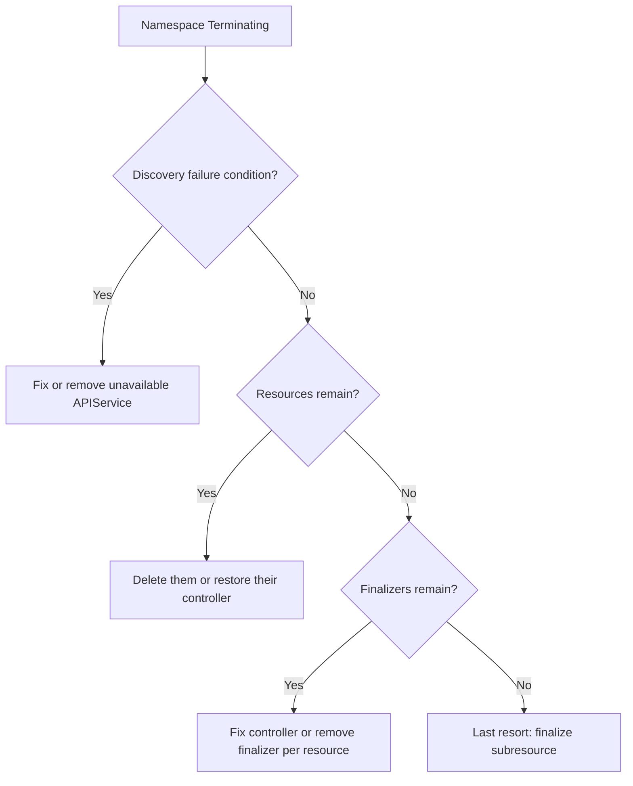

How to get a namespace out of `Terminating`. Deleting a namespace deletes everything in it, and the namespace controller waits until every resource is gone. When it hangs, one of three things is wrong: the API cannot enumerate the resource types, resources remain that a controller must clean up, or a finalizer has no controller to remove it. Work out which, fix the cause, and only then consider forcing.

> [!info] Scope and verification
> The commands were not run against a live cluster and the note is not marked `verified`. The condition names quoted below come from the Kubernetes namespace controller as known to the author; check them against `kubectl get ns -o yaml` on your cluster and the current Kubernetes documentation.

## When to use

- `kubectl get ns` shows `Terminating` for more than a few minutes.
- `kubectl delete ns` returns but the namespace stays.
- A GitOps controller or Terraform run waits on the namespace deletion.

If the stuck object is a volume claim, see [[pvc-stuck-terminating]] first. If the API itself is slow or erroring, see [[gke-control-plane-unavailable]].

## Preconditions

- Permission to read all resource types in the namespace and to patch namespaces. Cluster admin in practice.
- You know what lived in the namespace and who owns it. A namespace delete is irreversible, so confirm it was meant to be deleted.
- A saved copy of anything you may need: `kubectl get all,cm,secret,ingress,pvc -n "$NS" -o yaml > ns-backup.yaml` (this contains Secrets; store it securely and delete it after).

```bash
NS=team-sandbox
kubectl get ns "$NS"
```

## Steps



### 1. Read the namespace conditions

The namespace status tells you what the controller is waiting for.

```bash
kubectl get ns "$NS" -o json | jq '.status'
kubectl get ns "$NS" -o json | jq -r '.status.conditions[] | "\(.type)\t\(.status)\t\(.reason)\t\(.message)"'
```

Expect condition types such as `NamespaceDeletionDiscoveryFailure`, `NamespaceDeletionGroupVersionParsingFailure`, `NamespaceDeletionContentFailure`, `NamespaceContentRemaining` and `NamespaceFinalizersRemaining`. Verify the exact names on your cluster. The messages are the useful part: they list the resource kinds and counts that remain or the API group that failed.

### 2. Discovery failure: an unavailable APIService

If the controller cannot list an API group, it cannot confirm that group's resources are gone, so deletion waits. The message mentions `unable to retrieve the complete list of server APIs` or a group like `metrics.k8s.io/v1beta1`.

```bash
kubectl get apiservices | grep -v 'True'
kubectl describe apiservice v1beta1.metrics.k8s.io | sed -n '/Status:/,$p'
```

Choose:

1. **Fix it**: restore the backing Service and Pods (for example metrics-server), then the `APIService` becomes `Available` and deletion proceeds.
2. **Remove a stale one**: if an addon was uninstalled and left its `APIService` behind with no backend, delete only that object:

```bash
kubectl delete apiservice v1beta1.example.com
```

Confirm nothing in the cluster still uses that API group before you delete. Argo CD or the addon's installer may recreate it, so also check what installed it.

### 3. See what resources remain

`kubectl get all` hides most kinds. Enumerate every namespaced, listable type:

```bash
kubectl api-resources --verbs=list --namespaced -o name \
  | xargs -n1 -I{} sh -c 'kubectl get {} -n "'"$NS"'" --ignore-not-found --show-kind --no-headers 2>/dev/null' \
  | head -100
```

A simpler loop with the same effect:

```bash
for r in $(kubectl api-resources --verbs=list --namespaced -o name); do
  kubectl get "$r" -n "$NS" --ignore-not-found --show-kind --no-headers 2>/dev/null
done
```

Anything listed is a remaining object. Normal deletion normally removes them; if they persist they are either waiting on a finalizer or on a controller that is down. Re-issue the delete once and see:

```bash
kubectl delete <kind> --all -n "$NS" --wait=false
```

### 4. Finalizers whose controller is gone

For each remaining object, read its finalizers and deletion timestamp.

```bash
kubectl get <kind> <name> -n "$NS" -o jsonpath='{.metadata.deletionTimestamp}{"\n"}{.metadata.finalizers}{"\n"}'
```

Common cases:

- **A custom resource whose operator was uninstalled first.** Uninstall order matters: delete the custom resources, then the operator. Fix by reinstalling the operator (or its CRD and controller) so it can run its cleanup, then let the namespace finish.
- **Cloud resource owners**, such as Config Connector resources or ingress and load balancer objects. The finalizer guards a cloud resource. Removing it orphans the real resource, which keeps costing money and may keep ports and addresses reserved. Prefer reinstalling the controller.
- **Volume claims**: see [[pvc-stuck-terminating]].
- **Argo CD applications and resources**: an Argo CD finalizer can wait on its own cleanup; see [[argocd-sync-failure-and-drift]].

If the controller is permanently gone and the cloud resource is already deleted or intentionally abandoned, remove the finalizer on that single object:

```bash
kubectl patch <kind> <name> -n "$NS" --type=merge -p '{"metadata":{"finalizers":null}}'
```

Record what you removed and what external resource it guarded, and then verify that external resource in the cloud console or with `gcloud`.

### 5. Last resort: finalize the namespace itself

If conditions show no content and no finalizers remain on contained objects, yet the namespace stays, the namespace's own `spec.finalizers` (the `kubernetes` finalizer) may be stuck. Clearing it goes through the `/finalize` subresource, not a normal patch.

> [!danger] Forcing finalization can orphan cloud resources
> This tells the cluster to forget the namespace without confirming its contents are cleaned up. Anything still in the namespace may be left behind in etcd or in the cloud: load balancers, disks, Config Connector resources, and workload identity bindings. Use it only after steps 2 to 4, and only for a namespace you are sure is empty.

```bash
kubectl get ns "$NS" -o json \
  | jq '.spec.finalizers = []' > ns-finalize.json
kubectl replace --raw "/api/v1/namespaces/$NS/finalize" -f ns-finalize.json
rm -f ns-finalize.json
```

A common copy-paste fix in the wild uses `kubectl proxy` and `curl` for the same call. Prefer `kubectl replace --raw`, which uses your normal credentials and audit trail.

## Validation

```bash
kubectl get ns "$NS"                       # NotFound
kubectl get apiservices | grep -vc True    # 0
# no orphans: spot-check the cloud side
gcloud compute forwarding-rules list --filter="description~$NS"
gcloud compute disks list --filter="labels.kubernetes_io_created-for_pvc_namespace=$NS"
```

The label and description filters are examples; adapt them to how your clusters tag cloud resources. If Argo CD or Terraform manages the namespace, check that it does not recreate it. Look at the Application's sync policy and `CreateNamespace` option, and decide whether the namespace should exist.

## Rollback

A completed namespace delete cannot be undone. What you can do:

- Recreate the namespace and reapply manifests from git or `ns-backup.yaml`. Secrets and PVC data are not restored by this: use your backup tooling, see [[backup-architecture-gke-cloud-sql-gcs]].
- Restore a deleted `APIService` by reinstalling its addon.
- Reinstall a removed operator if you only uninstalled it to unblock the delete and still need it.
- If you force-finalized and orphaned a cloud resource, delete or adopt it deliberately using its recorded name.

## Troubleshooting

| Symptom                                           | Likely cause and fix                                                                      |
| ------------------------------------------------- | ----------------------------------------------------------------------------------------- |
| Message mentions a group like `metrics.k8s.io`    | Unavailable `APIService`. Fix the backend or remove the stale object.                     |
| Condition lists remaining resources of a CRD kind | Operator or CRD removed first. Reinstall it, delete the resources, then uninstall.        |
| `kubectl get` on a kind returns an error          | That API is broken; the same discovery issue as step 2.                                   |
| Namespace returns right after being deleted       | Argo CD, Flux, Terraform or an operator recreates it. Remove or pause the owner.          |
| `/finalize` call returns `Forbidden`              | Missing RBAC for `namespaces/finalize`. Use a cluster admin identity and keep it audited. |
| Cloud costs continue after the namespace is gone  | Orphaned load balancer or disk. List by labels and delete deliberately.                   |

## Related

- [[pvc-stuck-terminating]] for volume claims and PVs held by finalizers.
- [[gke-control-plane-unavailable]] for API and discovery failures.
- [[argocd-sync-failure-and-drift]] for GitOps recreating or blocking deletion.
- [[kubernetes-pod-troubleshooting]] for Pods that will not terminate.

## Sources

- [Kubernetes: Finalizers](https://kubernetes.io/docs/concepts/overview/working-with-objects/finalizers/)
- [Kubernetes: Garbage collection](https://kubernetes.io/docs/concepts/architecture/garbage-collection/)
- [Kubernetes: Namespaces walkthrough](https://kubernetes.io/docs/tasks/administer-cluster/namespaces/)
