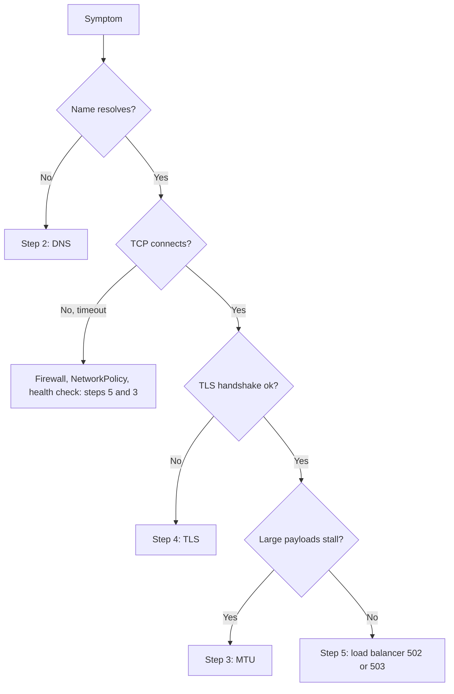

This runbook helps a senior DevOps engineer or on-call responder narrow down a network failure on GKE and GCP by symptom: timeouts, name resolution failures, TLS errors, or 502 and 503 responses from a load balancer. It covers diagnosis only. Pod-level failures are in [[runbooks/kubernetes-pod-troubleshooting]], certificate replacement is in [[runbooks/tls-certificate-renewal]], and policy design is in [[patterns/kubernetes-network-policies]].

> [!info] Scope and sources
> Written against GKE Standard or Autopilot with Cloud DNS or kube-dns, Google Cloud load balancers and VPC networking, using the Kubernetes and Google Cloud networking documentation on kubernetes.io and cloud.google.com.

> [!note] Not verified
> The claims below were written from documentation knowledge and were not checked against a running system or the current docs: default VPC MTU values, load balancer health-check source ranges, `kubectl debug` flags, container names in kube-dns Pods, and output formats. Confirm ranges and defaults in the current documentation before changing firewall rules.

## When to use

- Requests time out or hang between services, or from outside the cluster.
- A client reports `NXDOMAIN`, `no such host` or intermittent resolution failures.
- Clients report certificate, handshake or SNI errors.
- A load balancer returns 502 or 503, or backends show as unhealthy.
- Small requests work but large responses or uploads stall (an MTU symptom).

## Preconditions

- `kubectl` access to the cluster and `gcloud` access to the project with read permissions on compute and DNS resources.
- A debug image with `dig`, `curl`, `openssl` and `ping`. Pin it by tag or digest; do not use `latest`.
- Permission to run a short-lived Pod in the affected namespace. Check that NetworkPolicies allow it, or the debug Pod will not reproduce the real path.
- A note of the exact failing path: source, destination, port, hostname and time of failure.

An ephemeral debug Pod that does not run as root. Trade-off for `ping`: a non-root process gets ICMP only where the node allows unprivileged ICMP sockets (`net.ipv4.ping_group_range`); the `NET_RAW` capability does not help a non-root user when `allowPrivilegeEscalation` is false, and it is rejected under Pod Security `restricted`. Where ping fails, run the MTU check from a short-lived root container that adds only `NET_RAW`, in a namespace at Pod Security `baseline`. This ping behaviour is not verified.

```yaml title="netdebug.yaml"
apiVersion: v1
kind: Pod
metadata:
  name: netdebug
  # No namespace here: it comes from kubectl -n "$NAMESPACE" at apply time.
spec:
  restartPolicy: Never
  automountServiceAccountToken: false
  containers:
    - name: netdebug
      # change: pin a tag or digest of a network tools image you trust
      image: REGISTRY.example.com/tools/netdebug:REPLACE_WITH_PINNED_TAG
      command: ["sleep", "3600"]
      securityContext:
        runAsNonRoot: true
        runAsUser: 65534
        allowPrivilegeEscalation: false
        seccompProfile:
          type: RuntimeDefault
        capabilities:
          drop: ["ALL"]
          # NET_RAW is not added: it does not help a non-root ping (see the note above).
```

## Steps

### 1. Classify the symptom



Run the checks in this order from a Pod in the same namespace as the failing client when you can. A check from your laptop proves little about in-cluster paths.

```bash
set -euo pipefail

NAMESPACE="default"  # change: namespace of the affected workload

kubectl -n "$NAMESPACE" apply -f netdebug.yaml
kubectl -n "$NAMESPACE" wait --for=condition=Ready pod/netdebug --timeout=120s
```

Alternatively, attach an ephemeral container to the failing Pod with `kubectl debug` (flags such as `--target` and `--image` depend on your kubectl version; check `kubectl debug --help`).

### 2. DNS

```bash
set -euo pipefail

NAMESPACE="default"                 # change: namespace of the affected workload
NAME="orders.internal.example.com"  # change: the name that fails

# What the Pod is configured to use. Look at nameserver and the ndots option.
kubectl -n "$NAMESPACE" exec netdebug -- cat /etc/resolv.conf

# Resolve using the Pod's search path, then as a fully qualified name (trailing dot).
kubectl -n "$NAMESPACE" exec netdebug -- dig +search "$NAME"
kubectl -n "$NAMESPACE" exec netdebug -- dig "$NAME."

# Cluster DNS health.
kubectl -n kube-system get pods -l k8s-app=kube-dns
kubectl -n kube-system logs -l k8s-app=kube-dns --all-containers --tail=50
```

What to look for:

- `ndots:5` (the Kubernetes default) makes names with fewer than five dots try every search suffix first. External names then cost several failed lookups. Use fully qualified names with a trailing dot in latency-sensitive code, or lower `ndots` in the Pod `dnsConfig`.
- `NXDOMAIN` for the fully qualified name means the record does not exist in the zone the resolver consults. For private zones and forwarding, see [[architecture/cloud-dns-hybrid-and-multi-project]].
- `SERVER FAILURE` or timeouts mean the upstream or the cluster DNS Pods are unhealthy or overloaded.
- If the cluster uses Cloud DNS for GKE or NodeLocal DNSCache, the resolver address in `resolv.conf` differs; check the current documentation for your configuration.

### 3. MTU and path MTU black holes

Symptom: small requests work, large ones hang. Typical causes are a lower MTU on a VPN, interconnect or overlay than on the hosts, with ICMP "fragmentation needed" messages blocked.

```bash
set -euo pipefail

NAMESPACE="default"            # change: namespace of the affected workload
TARGET="10.20.0.15"            # change: destination IP on the failing path
SIZES="1372 1400 1432 1452 1472"  # ICMP payload sizes to try; packet size = payload + 28

# Show the interface MTU inside the Pod.
kubectl -n "$NAMESPACE" exec netdebug -- ip link show eth0

# Send packets with the Do-not-Fragment bit set. The largest size that passes
# is the path MTU minus 28 bytes.
for SIZE in $SIZES; do
  echo "payload $SIZE"
  kubectl -n "$NAMESPACE" exec netdebug -- ping -c 2 -W 2 -M do -s "$SIZE" "$TARGET" || true
done
```

Compare the result with the VPC network MTU:

```bash
set -euo pipefail

NETWORK="my-vpc"  # change: your VPC network name

gcloud compute networks describe "$NETWORK" --format="value(name,mtu)"
```

VPC MTU defaults and the allowed range differ by network configuration and product; confirm them in the current VPC documentation. Hybrid links (VPN, interconnect) have their own MTU. The fix is to align MTUs, set TCP MSS clamping at the edge, or allow the relevant ICMP types, and it goes through the change checklist ([[standards/production-change-checklist]]).

### 4. TLS

```bash
set -euo pipefail

HOST="app.example.com"   # change: the hostname clients use
IP="203.0.113.10"        # change: the load balancer or backend IP to test

# Handshake with SNI; shows the chain the server presents and the verify result.
openssl s_client -connect "$IP:443" -servername "$HOST" -verify_return_error </dev/null 2>&1 \
  | grep -E 'subject=|issuer=|Verification|Verify return code' || true

# Dates of the leaf certificate.
openssl s_client -connect "$IP:443" -servername "$HOST" </dev/null 2>/dev/null \
  | openssl x509 -noout -subject -issuer -dates || true

# Full HTTP exchange, forcing the name to the chosen IP without changing DNS.
curl -v --resolve "$HOST:443:$IP" "https://$HOST/" -o /dev/null || true
```

What to look for:

- Wrong certificate returned: the client did not send SNI, or the load balancer or Ingress maps the host to a different certificate.
- `unable to get local issuer certificate`: the server did not send the intermediate certificate.
- Expired certificate: follow [[runbooks/tls-certificate-renewal]].
- Handshake works with `--resolve` to one IP but fails to another: one backend or load balancer has a stale certificate.
- Failures only from inside a mesh: check mTLS mode mismatches (see [[tools/service-mesh-on-gke]]).

### 5. Load balancer health checks

```bash
set -euo pipefail

BACKEND_SERVICE="my-backend-service"  # change: backend service name
PROJECT_ID="my-project"               # change: your project ID

# Per-backend health as the load balancer sees it. Use --region for regional services.
gcloud compute backend-services get-health "$BACKEND_SERVICE" \
  --global --project "$PROJECT_ID"

# The health check definition: path, port, protocol, thresholds.
gcloud compute health-checks list --project "$PROJECT_ID"

# Firewall rules that allow traffic from the health checkers to the backends.
gcloud compute firewall-rules list --project "$PROJECT_ID" \
  --format="table(name,network,sourceRanges.list(),allowed[].map().firewall_rule().list())"
```

For GKE:

```bash
set -euo pipefail

NAMESPACE="default"  # change: namespace of the Service or Ingress

# Container-native load balancing uses network endpoint groups.
kubectl -n "$NAMESPACE" get svcneg
kubectl -n "$NAMESPACE" describe ingress
kubectl -n "$NAMESPACE" get endpoints
```

What to look for:

- Health checks come from Google-published source ranges; the firewall must allow them to the serving port. The ranges have been documented as `130.211.0.0/22` and `35.191.0.0/16` for many load balancers, but confirm the current ranges for your load balancer type in the documentation before editing rules.
- The health check path and port must match what the container serves. A default path of `/` that returns 404 or a redirect marks every backend unhealthy. Configure it through a `BackendConfig` or the Gateway policy for your controller.
- A readiness probe that passes while the load balancer check fails (or the reverse) means the two probe different things. Align them.
- Zero endpoints: the Service selector matches no ready Pods ([[runbooks/kubernetes-pod-troubleshooting]]).
- 502 during deployments: Pods terminate before the load balancer drains. See [[patterns/zero-downtime-deployments-kubernetes]].
- Shared VPC: firewall rules live in the host project; see [[architecture/shared-vpc-hub-and-spoke]].

## Validation

Re-run the failing check from the same place and compare with the healthy expectation.

| Check              | Healthy result                                                 |
| ------------------ | -------------------------------------------------------------- |
| `dig +search NAME` | `status: NOERROR` and an `ANSWER` section with the expected IP |
| `ping -M do -s N`  | `0% packet loss` at the size the path should carry             |
| `openssl s_client` | `Verify return code: 0 (ok)` and the expected subject          |
| `curl -v`          | `HTTP/2 200` (or the expected status) after the TLS handshake  |
| `get-health`       | Every backend shows `healthState: HEALTHY`                     |

```text
;; ->>HEADER<<- opcode: QUERY, status: NOERROR
;; ANSWER SECTION:
orders.internal.example.com. 60 IN A 10.20.0.15

    Verify return code: 0 (ok)

2 packets transmitted, 2 received, 0% packet loss

< HTTP/2 200

- healthState: HEALTHY
```

Also confirm the user-facing symptom is gone, not only the probe: run the original failing request.

## Rollback

Diagnosis makes no changes except a short-lived debug Pod. Remove it:

```bash
set -euo pipefail

NAMESPACE="default"  # change: namespace where you created the debug Pod

kubectl -n "$NAMESPACE" delete pod netdebug --ignore-not-found
```

Any fix (firewall rules, MTU, health check, certificates, DNS records) is a change: record it, apply it through the change checklist ([[standards/production-change-checklist]]), and keep the previous value so it can be reverted.

## Troubleshooting

| Symptom                              | Cause                                                         | Fix                                                                      |
| ------------------------------------ | ------------------------------------------------------------- | ------------------------------------------------------------------------ |
| `NXDOMAIN` for an internal name      | Record or private zone missing, or wrong zone attached to VPC | Fix the zone or forwarding; see the DNS architecture note                |
| Intermittent slow first request      | `ndots:5` search path expansion                               | Use trailing-dot names or set `dnsConfig` `ndots`                        |
| Small requests work, large ones hang | Path MTU lower than host MTU, ICMP blocked                    | Align MTU, clamp TCP MSS, allow ICMP fragmentation-needed                |
| Timeout from one namespace only      | NetworkPolicy blocks egress or ingress                        | Add the minimal allow rule; see [[patterns/kubernetes-network-policies]] |
| Browser shows a certificate warning  | Wrong certificate, missing intermediate, or expired           | Fix the certificate mapping or renew                                     |
| 502 right after deploy               | Pod killed before the load balancer drained                   | Add `preStop` delay and a termination grace period                       |
| All backends `UNHEALTHY`             | Firewall blocks health-check ranges, or wrong path or port    | Allow the documented ranges; correct the health check                    |
| 503 with no endpoints                | Selector mismatch or Pods not ready                           | Fix labels or readiness; check `get endpoints`                           |

## Related

- [[runbooks/kubernetes-pod-troubleshooting]]: when the problem is the Pod, not the path to it.
- [[runbooks/tls-certificate-renewal]]: replacing an expired or wrong certificate.
- [[patterns/kubernetes-network-policies]]: policy as a cause of timeouts, and how to write minimal allow rules.
- [[architecture/cloud-dns-hybrid-and-multi-project]]: DNS design behind the resolution failures above.
- [[architecture/shared-vpc-hub-and-spoke]]: where firewall rules and routes live in a Shared VPC.
- [[patterns/zero-downtime-deployments-kubernetes]]: draining and probes that prevent deploy-time 502s.
