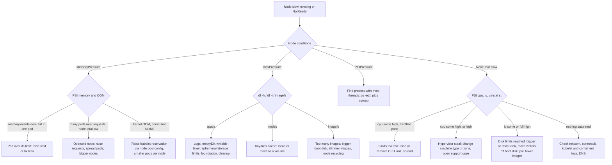

Pod troubleshooting stops at the pod. This runbook starts where it ends: the node is slow, pods on it are being evicted or throttled, or several unrelated pods misbehave at once. It looks at the node and the kernel, names the saturated resource, finds the pod or process responsible and picks a fix. It is written for GKE nodes running Container-Optimized OS (COS) and for GCE VMs, and for people who already know `kubectl`.

## When to use

- Several pods on one node are slow, restarting or `Evicted`, and a single pod's logs do not explain it. Start with [[kubernetes-pod-troubleshooting]] if only one pod is affected.
- `kubectl describe node` shows `MemoryPressure`, `DiskPressure` or `PIDPressure` as `True`, or the node flaps between `Ready` and `NotReady`.
- Latency rose on one node only, or `kubectl top node` shows a node far above its peers.
- A noisy neighbour is suspected: one workload starving others.

If the whole cluster is affected, or users see errors, run [[incident-response]] first and triage in parallel. A node that is `NotReady` after a cluster change may be an upgrade issue, see [[gke-cluster-upgrade]].

> [!info] Scope and sources
> Linux tools (`vmstat`, `mpstat`, `pidstat`, `iostat`, `ss`), the Linux pressure stall information (PSI) interface, cgroup v2 files and the kubelet eviction signals. The USE method is Brendan Gregg's: for every resource check Utilization, Saturation and Errors.

> [!note] Not verified
> Written from documentation knowledge, not run against a live cluster. Check before relying on it: whether `sysstat` tools are available on the node image you use (on COS they normally are not, so the steps use a toolbox or debug container), whether PSI is enabled and which cgroup version and path layout your node image uses, the kubelet eviction defaults GKE applies (the upstream defaults are quoted below), the `kubectl debug node` profile flag in your kubectl version, and the metric names from node_exporter and the kubelet.

## Preconditions

- `kubectl` access to the right cluster, and permission to create a pod in a namespace that allows a privileged debug pod. If [[pod-security-admission]] blocks it, use the break-glass namespace your platform team provides, not a policy change.
- Or SSH to the node through IAP or OS Login (`roles/compute.osLogin` and the IAP tunnel role). Nodes with no external IP need the IAP path.
- A debug image that contains `sysstat`, `procps`, `iproute2` and `util-linux`, hosted in your own registry. Do not pull an unreviewed public image onto a production node.
- Read-only intent. Nothing in the triage steps changes the node. Remediation steps are marked.

Set variables once:

```bash
NODE=gke-prod-pool-1-abcd1234-wxyz
NS=my-namespace
DEBUG_IMAGE=registry.example.com/tools/node-debug:1.0   # CHANGE: your reviewed image with sysstat
kubectl config current-context
kubectl get node "$NODE" -o wide
```

## Steps

### 1. Get a shell on the node

Option A, a node debug pod. It runs on the node, shares its PID and network namespaces and mounts the host file system at `/host`.

```bash
kubectl debug node/"$NODE" -it --image="$DEBUG_IMAGE" --profile=sysadmin -- bash
# Inside: processes and network are the node's. Host files are under /host.
# Host /proc is visible as /proc when the node's PID namespace is shared. The host's /sys,
# including cgroups, is under /host/sys: on cgroup v2 the debug container has a private
# cgroup namespace, so its own /sys/fs/cgroup shows only its own subtree.
```

The `--profile` flag exists in newer kubectl versions; on older ones the debug pod is unprivileged and sees less. Check `kubectl debug --help` (not verified for your version). Delete the pod when done:

```bash
kubectl get pods -A | grep node-debugger
kubectl delete pod node-debugger-<suffix> -n <namespace>
```

The debug pod is created in the namespace of your current kubectl context, not necessarily `default`; use that namespace here and in the Rollback section.

Option B, SSH and `toolbox`. COS has a small read-only root and no package manager. Its `toolbox` command starts a container with the host file systems mounted where you can install tools.

```bash
gcloud compute ssh "$NODE" --zone europe-west3-a --tunnel-through-iap   # CHANGE: your zone
toolbox
# inside toolbox: install tools if they are missing (needs egress; may not work on private nodes)
# apt-get update && apt-get install -y sysstat procps
```

Which tools ship in `toolbox` and whether it can install packages on a private node is not verified. Plan for a prepared debug image if your nodes have no internet egress, see [[private-gke-and-controlled-egress]].

> [!warning] Do not fix a production node by hand
> GKE manages the kubelet, container runtime and kernel settings on node pools. Changes you make over SSH are lost when the node is repaired, upgraded or recreated, and can mask the real cause. Use the shell to read. Make fixes in the workload, the node pool configuration or Terraform.

### 2. Look at the node object first

Before touching the node, read what the kubelet already says.

```bash
kubectl describe node "$NODE" | sed -n '/^Conditions:/,/^Addresses:/p'
kubectl describe node "$NODE" | sed -n '/^Allocated resources:/,/^Events:/p'
kubectl top node "$NODE"
# kubectl top cannot filter by node: list the node's pods, then compare with the top consumers.
kubectl get pods -A -o wide --field-selector spec.nodeName="$NODE"
kubectl top pod -A --sort-by=memory | head -20
```

Illustrative output (yours will differ):

```text
Conditions:
  Type             Status  Reason                       Message
  MemoryPressure   True    KubeletHasInsufficientMemory kubelet has insufficient memory available
  DiskPressure     False   KubeletHasNoDiskPressure     kubelet has no disk pressure
  PIDPressure      False   KubeletHasSufficientPID      kubelet has sufficient PID available
  Ready            True    KubeletReady                 kubelet is posting ready status
```

A `True` pressure condition is the kubelet's own verdict and the node is tainted (for example `node.kubernetes.io/memory-pressure`), so new best-effort pods are not scheduled. The next step finds out why. Compare **Allocated resources** (requests and limits sold) with real use: a node whose limits total far above capacity is overcommitted, which is normal until everyone bursts at once. See [[kubernetes-resource-requests-and-limits]].

### 3. USE per resource

Run these for about 30 seconds. Look at the busiest second, not the average.

```bash
vmstat 1 10
mpstat -P ALL 1 5
pidstat -u -r 1 5
iostat -xz 1 5
free -m
df -h /host/var /host/mnt/stateful_partition 2>/dev/null || df -h
df -i
ss -s
cat /proc/loadavg
```

What to read:

| Resource   | Utilization                                                             | Saturation                                                                            | Errors                                               |
| ---------- | ----------------------------------------------------------------------- | ------------------------------------------------------------------------------------- | ---------------------------------------------------- |
| CPU        | `mpstat`: `%usr + %sys` per core near 100                               | `vmstat` column `r` above core count; PSI `cpu some`; cgroup `nr_throttled`           | Rare; check `dmesg` for thermal or hardware messages |
| Memory     | `free -m` available low; `vmstat` low `free`                            | `vmstat` `si`/`so` above 0 (swap), many major faults; PSI `memory`                    | `dmesg` `Out of memory: Killed process`, OOM kills   |
| Disk I/O   | `iostat -xz`: `%util` near 100 (a weak signal on SSD and network disks) | `aqu-sz` (queue) high, `await` high, `r_await`/`w_await` in ms; PSI `io`              | `iostat` shows nothing; check `dmesg` for I/O errors |
| Disk space | `df -h` used; `df -i` inodes used                                       | Cannot write; kubelet `DiskPressure`                                                  | `No space left on device` in logs                    |
| Network    | `sar -n DEV 1` throughput against the VM limit                          | `ss -s` many `orphaned` or `timewait`; `netstat -s` retransmits; conntrack near limit | `ip -s link` drops and errors; `nstat` counters      |
| PIDs       | `ps -e --no-headers \| wc -l` against pid max                           | `fork: Resource temporarily unavailable` in logs                                      | Kubelet `PIDPressure`                                |

Short reading guide for the tools:

- `vmstat 1`: `r` is runnable tasks (more than the number of cores means CPU saturation), `b` is tasks blocked on I/O, `si` and `so` are swap in and out, `wa` is time waiting on I/O, `st` is time stolen by the hypervisor (high `st` on a VM means a noisy host or an undersized VM type).
- `mpstat -P ALL`: one hot core with the others idle points to a single-threaded process, not a node-wide shortage.
- `pidstat -u -r -d 1`: which process uses CPU (`-u`), memory and faults (`-r`) or disk (`-d`). Match a process to a pod with `cat /proc/<pid>/cgroup` (the path contains the pod UID).
- `iostat -xz 1`: `-z` hides idle devices. On cloud disks `%util` is misleading; watch `await` and queue size against the disk's IOPS and throughput limits.
- `ss -s`: counts of TCP states. Thousands of `timewait` or `orphaned` sockets point to short-lived connections without keep-alive.

Match a process to a pod. In the node shell:

```bash
PID=12345
cat /proc/$PID/cgroup
# Example (illustrative): 0::/kubepods.slice/kubepods-burstable.slice/kubepods-burstable-pod1a2b3c4d_....slice/cri-containerd-<id>.scope
# The pod UID appears with underscores instead of dashes.
```

On your workstation (kubectl is not available inside the node shell):

```bash
kubectl get pods -A -o jsonpath='{range .items[*]}{.metadata.uid}{" "}{.metadata.namespace}{"/"}{.metadata.name}{"\n"}{end}' | grep 1a2b3c4d
```

### 4. Read PSI (some versus full)

Pressure stall information tells you how much time tasks lost waiting for a resource. It is a direct saturation signal and avoids guessing from utilization.

```bash
cat /proc/pressure/cpu
cat /proc/pressure/memory
cat /proc/pressure/io
```

Illustrative output:

```text
$ cat /proc/pressure/memory
some avg10=12.40 avg60=8.15 avg300=3.02 total=918273645
full avg10=6.10 avg60=3.90 avg300=1.20 total=402948576

$ cat /proc/pressure/cpu
some avg10=0.50 avg60=0.40 avg300=0.35 total=51234567

$ cat /proc/pressure/io
some avg10=0.00 avg60=0.00 avg300=0.01 total=2345678
full avg10=0.00 avg60=0.00 avg300=0.00 total=1234567
```

How to read it:

- **`some`**: the share of time in the window (10, 60 and 300 seconds, as a percent) when at least one task was stalled waiting for the resource. Work was delayed, but something else ran.
- **`full`**: the share of time when all non-idle tasks were stalled at once. The node did no useful work for that resource. `full` memory or I/O pressure above a few percent means a severe, user-visible stall.
- **`total`**: cumulative stall time in microseconds. Sample it twice and subtract to get the stall time for an interval; this is what monitoring systems scrape.
- In the example, memory is the problem (`some` 12% and `full` 6% over ten seconds: the node spends a noticeable share of its time reclaiming memory), CPU is fine and I/O is idle.
- `cpu` historically exposes only `some` at the system level; whether a `full` line appears depends on the kernel version (not verified for your node image).

What counts as a problem is workload-dependent. Compare with the same node on a quiet day and with its peers. A steady `some avg300` above a few percent is worth a look; any sustained `full` is worth a page.

If `/proc/pressure/*` does not exist, PSI is disabled or the kernel is too old. Fall back to the USE columns above. Whether PSI is on for your node images is not verified.

### 5. cgroup pressure per pod

Node-level PSI says the node is stressed. Per-cgroup PSI says which pod is stalled or causing stalls. On cgroup v2 every cgroup has `cpu.pressure`, `memory.pressure` and `io.pressure`, plus `cpu.stat` for throttling and `memory.current` and `memory.events` for usage and OOM kills.

On your workstation (kubectl is not available inside the node shell), get the pod UID:

```bash
kubectl get pod my-pod-abc123 -n "$NS" -o jsonpath='{.metadata.uid}'
```

Then paste it into the node shell:

```bash
# Find the pod's cgroup directory from its UID (dashes become underscores).
# Use the host's cgroup tree under /host, not the debug container's private /sys/fs/cgroup.
POD_UID=<uid from the command above>
UID_US=${POD_UID//-/_}
CG=$(find /host/sys/fs/cgroup -type d -name "*pod${UID_US}*" | head -1)
echo "$CG"

cat "$CG/cpu.pressure"
cat "$CG/memory.pressure"
cat "$CG/io.pressure"
cat "$CG/cpu.stat"        # nr_periods, nr_throttled, throttled_usec
cat "$CG/memory.current"
cat "$CG/memory.events"   # oom, oom_kill counts
```

A typical path (illustrative; it depends on the cgroup driver, the QoS class and the node image):

```text
/host/sys/fs/cgroup/kubepods.slice/kubepods-burstable.slice/kubepods-burstable-pod1a2b3c4d_5e6f_7a8b_9c0d_1e2f3a4b5c6d.slice/cpu.pressure
```

Reading the result:

- `cpu.stat` with `nr_throttled` close to `nr_periods` means the pod hits its CPU limit and the kernel pauses it. This is slowness with an idle node. The fix is in the limit, see [[kubernetes-resource-requests-and-limits]].
- `memory.events` with `oom_kill` above 0 means the kernel killed something in that cgroup because it reached its memory limit. That is a pod problem, not a node problem.
- High `io.pressure` on a pod that writes logs or uses `emptyDir` on the boot disk points to the pod's own I/O.
- Several pods with high `memory.pressure` at the same time and a node with low available memory means the node is oversold.

Pod-level numbers are also available without a node shell through cAdvisor metrics in Prometheus, for example `container_cpu_cfs_throttled_periods_total` and `container_memory_working_set_bytes` (check the names in your setup).

cgroup v1 nodes have no per-cgroup PSI and a different layout (`/host/sys/fs/cgroup/cpu/kubepods/...`). Check which one you run: `stat -fc %T /host/sys/fs/cgroup` prints `cgroup2fs` on v2.

### 6. Map to kubelet eviction signals

The kubelet evicts pods before the kernel's OOM killer fires, when a signal crosses a threshold. The signals and the usual upstream defaults for hard eviction are:

| Signal              | Node condition | Upstream hard default (check GKE) | Typical cause                                                 |
| ------------------- | -------------- | --------------------------------- | ------------------------------------------------------------- |
| `memory.available`  | MemoryPressure | Less than 100Mi                   | Pods use more than they requested; overcommit                 |
| `nodefs.available`  | DiskPressure   | Less than 10%                     | Container logs, `emptyDir`, writable layers                   |
| `nodefs.inodesFree` | DiskPressure   | Less than 5%                      | Many small files, an unbounded cache directory                |
| `imagefs.available` | DiskPressure   | Less than 15%                     | Many or large images; image garbage collection cannot keep up |
| `pid.available`     | PIDPressure    | Not set by default (check)        | A fork bomb, a leaky process spawner                          |

GKE may set different defaults or reserve resources differently. Treat the numbers as the upstream values and look at what your nodes actually enforce: the kubelet configuration is visible through the API.

```bash
kubectl get --raw "/api/v1/nodes/$NODE/proxy/configz" | jq '.kubeletconfig | {evictionHard, evictionSoft, systemReserved, kubeReserved, maxPods}'
kubectl get --raw "/api/v1/nodes/$NODE/proxy/stats/summary" | jq '.node | {memory, fs, runtime}'
```

(The `nodes/proxy` call needs RBAC on `nodes/proxy`; many roles lack it, and it is a sensitive permission. If you do not have it, ask the platform team.)

How eviction picks victims: pods using more than they requested go first, then by priority, then by how far above the request they are. `BestEffort` pods go before `Burstable` pods that exceed requests, and `Guaranteed` pods last. Evicted pods appear as `Failed` with reason `Evicted`.

```bash
kubectl get events -A --field-selector reason=Evicted --sort-by=.lastTimestamp | tail -20
kubectl get pods -A --field-selector spec.nodeName="$NODE",status.phase=Failed
```

Do not confuse eviction with the OOM killer. Eviction is polite: the pod is terminated and rescheduled, with the reason in the event. An OOM kill is the kernel acting when a cgroup or the node ran out of memory; it shows in the kernel log:

```bash
dmesg -T | grep -iE "out of memory|oom-kill|killed process" | tail -20
```

Output with `constraint=CONSTRAINT_MEMCG` names a cgroup limit; `constraint=CONSTRAINT_NONE` means the whole node ran out, which means the kubelet's reservation and thresholds are too low for the workload mix.

### 7. kubelet and containerd service checks

If the node is slow or `NotReady` but resources look normal, the node services themselves may be unhealthy.

```bash
systemctl status kubelet containerd --no-pager
journalctl -u kubelet --since "30 min ago" --no-pager | tail -100
journalctl -u containerd --since "30 min ago" --no-pager | tail -100
journalctl -u kubelet --since "30 min ago" --no-pager | grep -iE "PLEG|evict|pressure|oom|timeout|deadline" | tail -30
crictl ps | head
crictl stats 2>/dev/null | head
```

What to look for:

- `PLEG is not healthy`: the kubelet cannot list containers fast enough. Causes include a slow disk, a container runtime under load, or too many pods or containers on the node.
- Repeated `context deadline exceeded` talking to containerd: runtime stuck, often disk I/O.
- Image pull timeouts and garbage collection messages: registry access or `imagefs` pressure.
- Evictions with the exact signal and threshold: matches the table above.

What GKE does not let you do (check the current docs for your mode):

- On GKE Autopilot you cannot SSH or run a privileged debug pod on the node at all. Use pod-level tools, Cloud Monitoring and support.
- On GKE Standard you can SSH to nodes, but kubelet flags, containerd configuration and sysctls are managed. Supported changes go through node pool settings (a node system configuration file) or a DaemonSet that sets allowed kernel parameters, see [[kubernetes-node-sysctls]]. Edits to unit files or `/etc` on the node are lost on repair or upgrade.
- Do not restart `kubelet` or `containerd` as a first reaction on a loaded production node. Restarting the runtime can disturb every container. Cordon first and prefer replacing the node.
- Auto-repair replaces a node that stays unhealthy for some time. Check the node pool's auto-repair setting rather than assuming you must act.

For network symptoms on the node (retransmits, drops, conntrack), take a capture with the steps in [[kubernetes-packet-capture]] rather than guessing.

### 8. Decide the fix



Fixes, grouped by what they touch. Take the least invasive that works.

1. **Stop the bleeding without losing data.** Cordon the node so no new pods land on it: `kubectl cordon "$NODE"`. If one pod is clearly the culprit and it is stateless, delete it so it reschedules elsewhere. Drain only if the node is to be replaced: `kubectl drain "$NODE" --ignore-daemonsets --delete-emptydir-data` (this deletes `emptyDir` data; check it first and respect PodDisruptionBudgets).
2. **Fix the workload.** Set requests close to real use, memory limit equal to request for critical pods, and `ephemeral-storage` requests and limits, see [[kubernetes-resource-requests-and-limits]]. Spread heavy pods with topology spread constraints. Right-size replicas with [[kubernetes-autoscaling]].
3. **Fix the node pool.** Change the machine type, boot disk size or type, or the max pods per node in Terraform, then roll the pool using the surge settings from [[gke-cluster-upgrade]]. Do not hand-edit nodes.
4. **Fix kernel settings** only through the supported route in [[kubernetes-node-sysctls]], and test them on one pool first.
5. **Replace the node.** If the cause is the node itself (steal, disk errors, a wedged runtime), cordon and drain it, then let the platform replace it: node auto-repair, a node pool upgrade or recreate through Terraform. Deleting the underlying VM by hand is a last resort and only for a drained node in a managed pool; check the current GKE guidance first (not verified).

## Verification

```bash
kubectl describe node "$NODE" | sed -n '/^Conditions:/,/^Addresses:/p'   # all pressure conditions False
kubectl get events -A --field-selector reason=Evicted --sort-by=.lastTimestamp | tail   # no new evictions
kubectl top node "$NODE"
# On the node, again:
cat /proc/pressure/memory /proc/pressure/cpu /proc/pressure/io   # avg10 back near the quiet baseline
```

Watch for at least one kubelet eviction-monitoring period plus a few minutes, and compare node-level PSI with the baseline you noted at the start. If you cordoned the node, uncordon it only after pressure stays low: `kubectl uncordon "$NODE"`.

## Rollback

- Debug pods: delete them (`kubectl delete pod node-debugger-... -n <namespace of your kubectl context>`).
- A cordoned node: `kubectl uncordon "$NODE"`.
- Limit or request changes made in Git: revert the commit and let the pipeline apply it. A manual `kubectl edit` is reverted with `kubectl rollout undo deployment/<name> -n "$NS"`, but a GitOps controller will undo manual edits anyway.
- A drained node cannot be restored; its pods are already rescheduled. Check capacity before draining: another node needs room for them.

## Symptom to metric

Use this table to decide which graph to open, and which alert to add so the next case is found by monitoring, not by a user. Metric names are common ones from node_exporter, cAdvisor and the kubelet; check that they exist in your setup (not verified).

| Symptom                                          | Metric to check                                                                        | Likely resource and meaning                  |
| ------------------------------------------------ | -------------------------------------------------------------------------------------- | -------------------------------------------- |
| Pods slow, node CPU not full                     | `container_cpu_cfs_throttled_periods_total` over `container_cpu_cfs_periods_total`     | CPU limit throttling                         |
| Node `MemoryPressure`, evictions                 | `node_memory_MemAvailable_bytes`, `kubelet_evictions`                                  | Memory oversold or leak                      |
| Pods restart with exit code 137                  | `container_oom_events_total`, `node_vmstat_oom_kill`                                   | Cgroup or node OOM kill                      |
| Stalls without high CPU                          | `node_pressure_memory_stalled_seconds_total`, `node_pressure_io_stalled_seconds_total` | Memory reclaim or I/O stall (PSI)            |
| Slow writes, high `await`                        | `node_disk_io_time_weighted_seconds_total`, `node_disk_write_time_seconds_total`       | Disk saturated or at its limit               |
| `DiskPressure`, `No space left on device`        | `node_filesystem_avail_bytes`, `node_filesystem_files_free`                            | Space or inodes on node or image file system |
| Timeouts to many services, retransmits           | `node_netstat_Tcp_RetransSegs`, `node_network_receive_drop_total`                      | Network drops or saturation                  |
| New connections fail, `nf_conntrack: table full` | `node_nf_conntrack_entries` against `node_nf_conntrack_entries_limit`                  | Conntrack table full                         |
| `fork: retry`, `PIDPressure`                     | `node_processes_pids`, `node_processes_max_processes`                                  | PID exhaustion                               |
| Node flaps `NotReady`                            | `kube_node_status_condition`, kubelet logs for PLEG                                    | Runtime or kubelet unhealthy                 |

## Troubleshooting

| Symptom                                            | Cause and fix                                                                                                                            |
| -------------------------------------------------- | ---------------------------------------------------------------------------------------------------------------------------------------- |
| `kubectl debug node` denied or pod stuck `Pending` | Pod Security Admission or policy blocks privileged pods, or the image cannot be pulled. Use the approved namespace and a mirrored image. |
| `vmstat: command not found` on the node            | COS has no sysstat. Use the debug image or `toolbox`.                                                                                    |
| `/proc/pressure` missing                           | PSI is off or the kernel is old. Use USE columns and node_exporter instead.                                                              |
| No `cpu.pressure` file in the cgroup               | cgroup v1 node, or the pod is in another path. Check `stat -fc %T /host/sys/fs/cgroup` and search by pod UID.                            |
| `nodes/proxy` forbidden                            | No RBAC on `nodes/proxy`. Read the same data from Cloud Monitoring or Prometheus, or ask the platform team.                              |
| Pressure returns right after a drain               | The load follows the pods (a bad rollout). Roll the workload back first, see [[helm-release-rollback]].                                  |
| Only one node is bad and everything looks normal   | Suspect the VM (steal, disk): replace the node, then compare. Keep the old instance's logs for the support case.                         |

For single-pod problems go to [[kubernetes-pod-troubleshooting]]. For networking see [[network-troubleshooting-dns-mtu-tls-load-balancers]].
