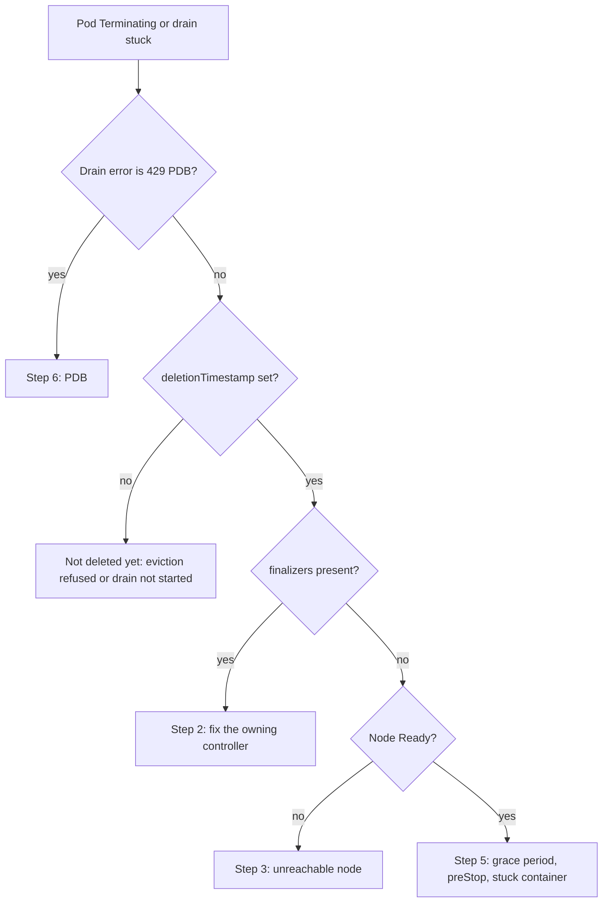

How to deal with a Pod that stays in `Terminating`, and with a `kubectl drain`, GKE node upgrade or node pool deletion that never finishes. Both problems have the same shape: Kubernetes is waiting for something that has not happened yet, such as a finalizer to be removed, a kubelet to confirm the containers stopped, or a PodDisruptionBudget (PDB) to allow one more disruption. The fix is to find that wait and satisfy it. Forcing past it is sometimes right, but it is a deliberate decision with known risks, not the first move.

> [!info] Scope and verification
> The commands were not run against a live cluster and the note is not marked `verified`. `kubectl drain` flags were checked against the kubectl source, eviction behaviour and PDB fields against the Kubernetes documentation sources, and GKE node drain settings against the `gcloud` help (SDK 570.0.0) and the GKE API reference, all on 2026-10-21. No Google Cloud documentation page could be read; GKE items marked **not verified** need checking against the current GKE documentation.

## When to use

- `kubectl get pods` shows `Terminating` for longer than the Pod's grace period plus a few minutes.
- `kubectl drain` loops on `error when evicting pods/... (will retry after 5s): Cannot evict pod as it would violate the pod's disruption budget.`
- A GKE node pool upgrade, auto-repair or node pool deletion stalls on one node.
- A Deployment or StatefulSet rollout waits because old Pods never go away.

For the same family of problems at other scopes, see [[namespace-stuck-terminating]] and [[pvc-stuck-terminating]]. If the node itself is `NotReady`, start with [[gke-node-notready-triage]].

## Preconditions

- Permission to read and patch Pods, Nodes and PDBs in the affected namespaces. Force deletion and finalizer removal need a change or incident record.
- You know what the workload is: stateless, stateful with a single writer (a database member, a leader), or a Job. The safe actions differ.
- For PDB changes: the PDB is managed in Git (Helm chart or GitOps). Edit it there, not with `kubectl edit`, or the controller reverts it.

```bash title="variables"
NS=app
POD=api-6b8f9c7d5-x2k4q
NODE=gke-prod-gke-general-1a2b3c4d-xyz1
CLUSTER=prod-gke
LOCATION=europe-west1
ZONE=europe-west1-b   # the node's zone: label topology.kubernetes.io/zone
POOL=general
```

## Steps



### 1. Classify the stuck Pod

Four fields tell you which case you are in.

```bash
kubectl -n "$NS" get pod "$POD" -o json | jq '{
  deletionTimestamp: .metadata.deletionTimestamp,
  deletionGracePeriodSeconds: .metadata.deletionGracePeriodSeconds,
  finalizers: .metadata.finalizers,
  node: .spec.nodeName,
  terminationGracePeriodSeconds: .spec.terminationGracePeriodSeconds,
  owner: [.metadata.ownerReferences[]? | "\(.kind)/\(.name)"],
  phase: .status.phase,
  containers: [.status.containerStatuses[]? | {name, state}]
}'

NODE=$(kubectl -n "$NS" get pod "$POD" -o jsonpath='{.spec.nodeName}')
kubectl get node "$NODE" -o custom-columns='NODE:.metadata.name,READY:.status.conditions[?(@.type=="Ready")].status,TAINTS:.spec.taints[*].key'

# All Pods stuck in Terminating across the cluster, oldest first
kubectl get pods -A -o json | jq -r '
  .items[] | select(.metadata.deletionTimestamp != null)
  | [.metadata.deletionTimestamp, .metadata.namespace, .metadata.name, .spec.nodeName, ((.metadata.finalizers // []) | join(","))] | @tsv' \
  | sort
```

| What you see                                                       | Case                                         | Go to   |
| ------------------------------------------------------------------ | -------------------------------------------- | ------- |
| `finalizers` not empty                                             | A controller has not finished its cleanup    | Step 2  |
| No finalizers, node `Ready` is `Unknown` or `False`, or node gone  | Kubelet cannot confirm the containers stopped | Step 3  |
| No finalizers, node `Ready`, deletion within the grace period      | Normal shutdown still running                | Step 5  |
| No finalizers, node `Ready`, deletion long past the grace period   | Kubelet or runtime stuck on that node        | Step 5  |
| `deletionTimestamp` empty and the drain loops                      | The eviction was refused, usually by a PDB    | Step 6  |

### 2. Pod finalizers: fix the owner, not the symptom

A finalizer means a controller asked to run cleanup before the Pod object is removed. After deletion starts, the API server lets you remove finalizer entries but not add new ones, and the object stays until the list is empty.

```bash
kubectl -n "$NS" get pod "$POD" -o jsonpath='{.metadata.finalizers}{"\n"}'
```

Find the controller that owns the finalizer from its name (it is usually namespaced like a domain) and check that it is running and healthy:

```bash
kubectl get pods -A | grep -Ei 'operator|controller' | grep -v Running
kubectl get deploy -A -o wide | grep -Ei 'operator|controller'
```

Typical causes are an operator that was uninstalled before its Pods were deleted, or a controller that is crash-looping or lacks RBAC. Restore the controller and the finalizer usually clears by itself.

> [!warning] Removing a finalizer skips its cleanup
> The Kubernetes documentation advises against removing finalizers by hand unless you understand what the finalizer does and that its purpose is achieved some other way. Skipping it can leave external resources (load balancer entries, volumes, registrations in other systems) behind.

Only when the owner is gone for good, and its cleanup is done or not needed:

```bash
kubectl -n "$NS" get pod "$POD" -o yaml > "pod-$POD-before.yaml"
kubectl -n "$NS" patch pod "$POD" --type=merge -p '{"metadata":{"finalizers":null}}'
```

Record which finalizer you removed and why in the incident record.

### 3. Pods on an unreachable node

When a node stops answering, its kubelet cannot confirm that containers stopped, so Pods on it stay `Terminating` (or show `Unknown`). This is a safety feature: the containers may still be running on a node that is cut off from the control plane but not from your database.

What Kubernetes does on its own:

- The node controller marks the node `Ready=Unknown` and adds the `node.kubernetes.io/unreachable` taint. Pods get an automatic toleration for that taint with `tolerationSeconds: 300` unless they set their own, so API-initiated eviction of those Pods starts after about **5 minutes**.
- The Pod objects are not removed until the kubelet comes back and confirms, the Node object is deleted, or someone force deletes them.
- If a Pod deletion has not completed for 6 minutes and the node is unhealthy, Kubernetes force detaches its volumes (this can corrupt data if the workload is in fact still running).

Your options, safest first:

1. **Bring the node back or confirm it is dead.** On GKE, check the VM: `gcloud compute instances describe "$NODE" --zone "$ZONE" --format="value(status)"`. Auto-repair may already be recreating it; see [[gke-node-notready-triage]].
2. **If the VM is confirmed gone or stopped,** deleting the Node object lets the Pods be cleaned up: `kubectl delete node "$NODE"`. On GKE the node pool's MIG will normally recreate the instance; let it.
3. **Non-graceful node shutdown.** If the node is confirmed shut down, the `node.kubernetes.io/out-of-service` taint (stable since Kubernetes 1.28) tells Kubernetes to force delete its Pods and detach volumes immediately. Remove the taint once the node is recovered or deleted.

```bash
# Only after confirming the VM is not running
kubectl taint nodes "$NODE" node.kubernetes.io/out-of-service=nodeshutdown:NoExecute
# Later, after recovery
kubectl taint nodes "$NODE" node.kubernetes.io/out-of-service=nodeshutdown:NoExecute-
```

### 4. Force delete: only when the Pod can never run again

```bash
kubectl -n "$NS" delete pod "$POD" --grace-period=0 --force
```

Force deletion removes the Pod object from the API **without** waiting for the kubelet to confirm the containers stopped. For a Deployment that is mostly harmless: a replacement starts, and if the old container was still running somewhere you have one extra replica for a while.

> [!danger] StatefulSet Pods: force deletion can cause split brain
> A StatefulSet guarantees at most one Pod per identity (`db-0`, `db-1`). Force deleting frees that name at once, and the controller creates a replacement with the **same identity** while the old one may still be running on a partitioned node. Two members with one identity can corrupt data or split a cluster. The Kubernetes documentation treats force deletion of a StatefulSet Pod as an assertion that the old Pod will never contact the other members again. Before you run it: confirm the node is powered off or deleted (step 3), or that the workload fences itself. Prefer deleting the dead Node object over force deleting its Pods. See [[stateful-workloads-gke]].

If a force-deleted Pod still shows up (for example stuck in `Unknown` with a finalizer), the last resort is the finalizer patch in step 2.

### 5. Long grace periods, preStop hooks and stuck containers

A Pod being deleted on a healthy node gets `SIGTERM`, waits up to `terminationGracePeriodSeconds` (default 30 seconds), then `SIGKILL`. A `preStop` hook runs first and **shares the same budget**; if the hook outlasts the grace period, the kubelet grants a one-off short extension and then kills the container.

```bash
kubectl -n "$NS" get pod "$POD" -o jsonpath='{.spec.terminationGracePeriodSeconds}{"\n"}'
kubectl -n "$NS" get pod "$POD" -o json | jq '.spec.containers[] | {name, preStop: .lifecycle.preStop}'
kubectl -n "$NS" describe pod "$POD" | sed -n '/Events:/,$p'
```

- **Large grace period by design** (for example 600 seconds for a queue worker that finishes its current job): the Pod is behaving as configured. Wait, or deliberately pass a shorter grace period: `kubectl -n "$NS" delete pod "$POD" --grace-period=60`.
- **preStop hook that hangs** (a `sleep`, or a call to a dependency that is down): fix the hook so it is bounded and shorter than the grace period.
- **Deletion long past the grace period on a Ready node:** the kubelet or container runtime on that node is struggling. Check the node's kubelet and runtime health and disk or PID pressure; see [[node-resource-pressure-triage]]. Cordon the node so nothing new lands there: `kubectl cordon "$NODE"`.

### 6. Drains blocked by a PodDisruptionBudget

`kubectl drain` uses the Eviction API, which respects PDBs. When an eviction would take a workload below its budget, the API server answers HTTP 429 with `Cannot evict pod as it would violate the pod's disruption budget.` and drain retries every 5 seconds, forever unless you set `--timeout` (its default of 0 means wait indefinitely).

```bash
kubectl get pdb -A
kubectl get pdb -A -o json | jq -r '.items[] | select(.status.disruptionsAllowed == 0)
  | [.metadata.namespace, .metadata.name, (.spec.minAvailable // "-"), (.spec.maxUnavailable // "-"),
     .status.currentHealthy, .status.desiredHealthy, .status.expectedPods,
     (.spec.unhealthyPodEvictionPolicy // "IfHealthyBudget")] | @tsv'

# Which PDBs select the Pods on the node being drained
kubectl get pods -A --field-selector spec.nodeName="$NODE" -o wide
```

Common reasons for `ALLOWED DISRUPTIONS` of 0:

| Cause                                                                                   | Fix                                                                                                                                       |
| --------------------------------------------------------------------------------------- | ----------------------------------------------------------------------------------------------------------------------------------------- |
| `minAvailable` equals the replica count, or `maxUnavailable: 0`                         | A PDB that allows no disruption can never be drained. Change it in Git to allow at least one; see [[pod-disruption-budgets-for-stateless-services]]. |
| A single-replica Deployment with `minAvailable: 1`                                      | Run at least two replicas, or accept a short outage and change the PDB for the window.                                                    |
| Some selected Pods are not Ready (crash-looping, failing probes)                        | With the default `IfHealthyBudget`, unhealthy running Pods count against the budget. Fix the app, or set `unhealthyPodEvictionPolicy: AlwaysAllow`. |
| The PDB selects Pods from two workloads, or two PDBs select the same Pod                | Overlapping PDBs make the Eviction API refuse with an error (HTTP 500 for more than one PDB). Make selectors unique.                      |
| All replicas sit on the nodes being drained                                             | Add replicas elsewhere first, or spread them with topology spread constraints.                                                             |

`unhealthyPodEvictionPolicy: AlwaysAllow` lets running but not-Ready Pods be evicted regardless of the budget. The Kubernetes documentation recommends it to keep misbehaving applications from blocking node drains. The field is stable since Kubernetes 1.31 (beta and on by default since 1.27).

```yaml title="charts/api/templates/pdb.yaml"
apiVersion: policy/v1
kind: PodDisruptionBudget
metadata:
  name: api
spec:
  maxUnavailable: 1
  unhealthyPodEvictionPolicy: AlwaysAllow
  selector:
    matchLabels:
      app.kubernetes.io/name: api
```

**Unblocking a drain now, in order of preference:**

1. **Temporarily add capacity:** scale the workload up by one so the budget has room, then drain. `kubectl -n "$NS" scale deploy/api --replicas=4`, and scale back afterwards (or let the HPA handle it).
2. **Time-boxed PDB change through Git:** relax `minAvailable` or `maxUnavailable` for the maintenance window in a reviewed change with a revert ready, then restore it.
3. **Drain with explicit limits** so it does not hang forever:

```bash
kubectl drain "$NODE" --ignore-daemonsets --delete-emptydir-data --timeout=15m
# Drain only part of the node first, for example everything except the blocked app
kubectl drain "$NODE" --ignore-daemonsets --delete-emptydir-data --pod-selector='app.kubernetes.io/name!=db' --timeout=10m
```

`--delete-emptydir-data` deletes the contents of `emptyDir` volumes on that node; make sure nothing irreplaceable lives there.

> [!danger] --disable-eviction bypasses PodDisruptionBudgets
> `kubectl drain --disable-eviction` makes drain delete Pods directly instead of evicting them, which skips every PDB check. Use it only when you accept that the workload may drop below its budget (for example, a single replica during an agreed window), and say so in the change record. Directly deleting the blocked Pod has the same effect, and the Kubernetes documentation lists it as the way out of a stuck eviction once you have paused the automation and waited.

```bash
kubectl drain "$NODE" --ignore-daemonsets --delete-emptydir-data --disable-eviction --timeout=10m
```

### 7. How GKE treats PDBs during upgrades and pool deletion

GKE drains nodes during node upgrades, auto-repair and some pool operations, and it respects PDBs **for a limited time only**: after that it evicts Pods anyway. The GKE API describes disruption events of type `POD_NOT_ENOUGH_PDB` (evictions blocked by a PDB) and `POD_PDB_VIOLATION` (Pods forcefully evicted after the PDB timeout, in violation of the PDB). The length of that default timeout is **not verified** here; check the current GKE upgrade documentation, and see [[gke-cluster-upgrade]].

Per node pool, `gcloud` (SDK 570.0.0) exposes the drain settings:

```bash
gcloud container node-pools describe "$POOL" --cluster "$CLUSTER" --location "$LOCATION" \
  --format="yaml(name,nodeDrainConfig,upgradeSettings)"

gcloud container node-pools update "$POOL" --cluster "$CLUSTER" --location "$LOCATION" \
  --node-drain-pdb-timeout-seconds=3600 \
  --node-drain-grace-period-seconds=120
```

- `--node-drain-pdb-timeout-seconds`: how long the drain waits on PDBs.
- `--node-drain-grace-period-seconds`: the grace period nodes get to drain before they are forcefully removed.
- `--respect-pdb-during-node-pool-deletion`: whether deleting a node pool respects PDBs.

Which operations these settings apply to, their defaults and their allowed ranges are **not verified**; check the GKE documentation before relying on them, and manage them in Terraform if your node pools are. The values above are examples. Do not treat the GKE timeout as the plan: fix PDBs that allow zero disruptions before an upgrade, so the timeout never fires. For upgrade strategy choices, see [[gke-node-pool-upgrade-strategies]].

## Validation

```bash
kubectl -n "$NS" get pod "$POD"                             # NotFound, or replaced by a new Pod
kubectl get pods -A -o json | jq '[.items[] | select(.metadata.deletionTimestamp != null)] | length'
kubectl get node "$NODE" -o wide                            # SchedulingDisabled after drain, or gone
kubectl get pods -A --field-selector spec.nodeName="$NODE"  # only DaemonSet Pods left
kubectl get pdb -A                                          # budgets back to their normal values
kubectl -n "$NS" get deploy,sts                             # desired replicas available
```

For a StatefulSet, also check from the application that each member has exactly one running instance and the cluster has a single leader.

## Rollback

- **PDB changes:** revert the Git change and let the controller sync; confirm `kubectl get pdb` shows the original values.
- **Temporary scale-ups:** scale back down, or remove the manual replica count so the HPA owns it again.
- **Cordoned nodes:** `kubectl uncordon "$NODE"` if the node stays in service.
- **out-of-service taint:** remove it as shown in step 3 once the node is recovered or deleted.
- **Force deletion and finalizer removal:** cannot be undone. Recreate objects from the saved YAML if needed, and check for leaked external resources the finalizer would have cleaned up.

## Troubleshooting

| Symptom                                                                | Likely cause and fix                                                                                                         |
| ---------------------------------------------------------------------- | ---------------------------------------------------------------------------------------------------------------------------- |
| Drain prints `will retry after 5s` forever                             | A PDB with no allowed disruptions. Step 6. Add `--timeout` so automation fails visibly instead of hanging.                   |
| Eviction fails with HTTP 500 mentioning more than one PDB             | Two PDBs select the Pod. Make the selectors unique.                                                                          |
| Drain refuses Pods without a controller                                | Bare Pods. `--force` lets drain delete them; they are not recreated, so confirm nobody needs them.                            |
| Drain refuses because of local storage                                 | `emptyDir` data. Add `--delete-emptydir-data` after confirming the data is disposable.                                        |
| Pod `Terminating` with finalizers after an operator was uninstalled    | Reinstall the operator long enough to clean up, or remove the finalizer knowing what it skips (step 2).                      |
| Many Pods `Terminating` on one node, node `NotReady`                   | Unreachable node. Step 3, then [[gke-node-notready-triage]].                                                                  |
| Force-deleted StatefulSet Pod comes back and the app reports two leaders | Split brain. Stop one member at once, fence the old node, then follow the application's recovery procedure.                  |
| GKE upgrade stuck on one node for a long time                          | PDB blocking the drain until the GKE timeout. Fix the PDB (step 6); see [[gke-cluster-upgrade]].                              |
| Namespace or PVC also stuck after the Pods are gone                    | Finalizers at that level; see [[namespace-stuck-terminating]] and [[pvc-stuck-terminating]].                                   |

## Related

- [[namespace-stuck-terminating]] and [[pvc-stuck-terminating]] for finalizers at namespace and volume scope.
- [[kubernetes-pod-troubleshooting]] for the wider Pod lifecycle.
- [[gke-cluster-upgrade]] and [[gke-node-pool-upgrade-strategies]] for upgrade planning, where blocked drains usually surface.
- [[pod-disruption-budgets-for-stateless-services]] for designing PDBs that allow drains.
- [[stateful-workloads-gke]] for StatefulSet identity and storage behaviour.
- [[gke-node-notready-triage]] and [[node-resource-pressure-triage]] for the node side.
- [[kubernetes-autoscaling]] for scale-down, which is also blocked by PDBs.

## Sources

- [Kubernetes: Force delete StatefulSet Pods](https://kubernetes.io/docs/tasks/run-application/force-delete-stateful-set-pod/): force deletion semantics and the StatefulSet identity risk.
- [Kubernetes: Specifying a Disruption Budget](https://kubernetes.io/docs/tasks/run-application/configure-pdb/) and [Disruptions](https://kubernetes.io/docs/concepts/workloads/pods/disruptions/): `ALLOWED DISRUPTIONS`, `unhealthyPodEvictionPolicy` and the `AlwaysAllow` recommendation.
- [Kubernetes: API-initiated eviction](https://kubernetes.io/docs/concepts/scheduling-eviction/api-eviction/): 429 and 500 responses, and troubleshooting stuck evictions.
- [Kubernetes: Finalizers](https://kubernetes.io/docs/concepts/overview/working-with-objects/finalizers/), [Pod lifecycle](https://kubernetes.io/docs/concepts/workloads/pods/pod-lifecycle/), [Node shutdowns](https://kubernetes.io/docs/concepts/cluster-administration/node-shutdown/), [Taints and tolerations](https://kubernetes.io/docs/concepts/scheduling-eviction/taint-and-toleration/) and [Nodes](https://kubernetes.io/docs/concepts/architecture/nodes/).
- The pages above were read from the `kubernetes/website` sources, and the `kubectl drain` flags and retry interval from the kubectl source, on 2026-10-21; the feature stages come from the Kubernetes feature-gate reference sources.
- `gcloud container node-pools update --help`, SDK 570.0.0, 2026-10-21, and the GKE API reference (`NodeDrainConfig`, `DisruptionEvent`), 2026-10-21.
- See also, not read for this note: [GKE: Node upgrade strategies](https://cloud.google.com/kubernetes-engine/docs/concepts/node-pool-upgrade-strategies).
