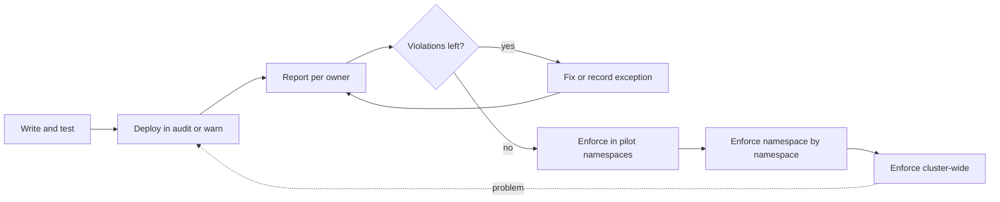

A policy that is enforced on day one breaks someone's deployment, and that someone then asks for the policy to be removed. This runbook turns a new rule into an enforced one in stages, so owners see violations before they are blocked. It is written for senior DevOps engineers running Gatekeeper or Kyverno on GKE with Argo CD. Choosing the engine is in [[tools/gatekeeper-vs-kyverno]]; the rules for exceptions are in [[compliance/policy-exception-and-waiver-process]].

> [!info] Scope and sources
> Written for Gatekeeper constraints and Kyverno ClusterPolicies deployed from Git by Argo CD. Based on the [Gatekeeper docs](https://open-policy-agent.github.io/gatekeeper/website/docs/) and the [Kyverno docs](https://kyverno.io/docs/). The same stages apply to a Conftest rule in CI ([[patterns/conftest-policy-gate-for-manifests]]), where `warn` plays the role of audit.

> [!note] Not verified
> The claims below were written from documentation knowledge and were not checked against a running system or the current docs: the field paths of the action in current versions (`enforcementAction` for Gatekeeper, `validationFailureAction` or the per-rule `failureAction` for Kyverno), the PolicyReport CRD names, and the number of violations Gatekeeper stores per constraint. Check them before relying on them.

## When to use

- You add a new admission policy (required labels, registry allowlist, no `latest` tag, resource limits).
- You tighten an existing policy so that more objects fail it.
- You move a policy from one namespace set to the whole cluster.

Do not use this for an emergency block of something actively harmful. For that, enforce immediately and accept the breakage; then run the audit stages afterwards for the long-term version.

## Preconditions

- An exception route exists and is documented ([[compliance/policy-exception-and-waiver-process]]), with an owner and an expiry for each exception.
- Namespace owners are known, for example through a `team` label on every namespace.
- You can read violations: Gatekeeper audit is running, or Kyverno background scanning is enabled, and `jq` is available.
- `kube-system` and the policy engine's own namespace are excluded from the policy.
- The policy is in the Git repository that Argo CD syncs, and the Application for it is healthy ([[runbooks/argocd-sync-failure-and-drift]]).
- A change record follows [[standards/production-change-checklist]].

## Stages



Every arrow forward is a merge request into Git. The dotted arrow back is the rollback: set the action back to audit or warn.

## Steps

### 1. Write and test the policy

Test the rule before it touches a cluster: Rego unit tests for Gatekeeper templates, a `kyverno test` run or a dry-run against sample manifests for Kyverno. Evaluate it against rendered manifests of a few real services in CI first.

Decide the scope now: kinds, namespaces to exclude, and the exact message people will read. A good message names the fix.

### 2. Deploy in audit or warn through Argo CD

Commit the policy with the non-blocking action. For Gatekeeper, the ConstraintTemplate goes in an earlier sync wave than the Constraint, because the Constraint CRD does not exist until the template is applied:

```yaml title="policies/templates/k8srequiredlabels.yaml (metadata excerpt)"
metadata:
  name: k8srequiredlabels
  annotations:
    argocd.argoproj.io/sync-wave: "0"
```

```yaml title="policies/constraints/deployments-need-team.yaml"
apiVersion: constraints.gatekeeper.sh/v1beta1
kind: K8sRequiredLabels
metadata:
  name: deployments-need-team
  annotations:
    argocd.argoproj.io/sync-wave: "1"
spec:
  enforcementAction: dryrun # audit only: records violations, blocks nothing
  match:
    kinds:
      - apiGroups:
          - apps
        kinds:
          - Deployment
    excludedNamespaces:
      - kube-system
      - gatekeeper-system
  parameters:
    labels:
      - team
```

For Kyverno, the first state is `Audit`:

```yaml title="policies/kyverno/restrict-image-registries.yaml (excerpt)"
spec:
  validationFailureAction: Audit
  background: true
```

If Kyverno should warn users at admission without blocking, use the engine's warning mechanism where the version supports it, and check the setting in its docs. A warning reaches the person running `kubectl apply`, but not someone whose change arrives through Argo CD, so reports (next step) matter more than warnings in a GitOps setup.

### 3. Report violations per owner

Let at least one full audit cycle pass (Gatekeeper audit runs on an interval; Kyverno scans in the background), then count by namespace:

```bash
set -euo pipefail

CONSTRAINT_KIND="k8srequiredlabels"      # change: the Constraint kind (lowercase)
CONSTRAINT_NAME="deployments-need-team"  # change: the Constraint name

# Gatekeeper: violations per namespace
kubectl get "${CONSTRAINT_KIND}" "${CONSTRAINT_NAME}" -o json |
  jq -r '.status.violations // [] | group_by(.namespace)[] | "\(length) \(.[0].namespace)"' |
  sort -rn

# Kyverno: failing results per namespace from PolicyReports
kubectl get policyreports -A -o json |
  jq -r '.items[] | select(.summary.fail > 0) | "\(.summary.fail) \(.metadata.namespace)"' |
  sort -rn

# Map namespaces to owners
kubectl get namespaces -L team
```

Gatekeeper stores a limited number of violations per constraint in its status, so a long list can be truncated; check its documented limit and metrics if the numbers look low. Send each owner their list with the policy message, the deadline for enforcement, and the exception route. Post the counts in the platform channel weekly so the trend is visible.

### 4. Fix or record exceptions

Owners either fix the manifests (the normal case) or request an exception. An exception is a time-limited, owned record, implemented as an exclusion in the policy (a namespace, a label selector, or an engine-specific exception resource) committed to Git with a link to the request and an expiry date. Do not enforce while violations without a fix or an exception remain. Repeat step 3 until the list is empty.

### 5. Enforce per namespace

Start with namespaces whose owners are ready: the platform team's own, then volunteers. For Gatekeeper, add a second Constraint in `deny` mode for the chosen namespaces and exclude them from the `dryrun` one so they are not counted twice:

```yaml title="policies/constraints/deployments-need-team-enforced.yaml"
apiVersion: constraints.gatekeeper.sh/v1beta1
kind: K8sRequiredLabels
metadata:
  name: deployments-need-team-enforced
  annotations:
    argocd.argoproj.io/sync-wave: "1"
spec:
  enforcementAction: deny
  match:
    kinds:
      - apiGroups:
          - apps
        kinds:
          - Deployment
    namespaces:
      - platform-tools # change: namespaces that have no open violations
      - payments
  parameters:
    labels:
      - team
```

For Kyverno, keep the policy-wide action at `Audit` and override it to `Enforce` for the chosen namespaces. Per-namespace overrides exist as `validationFailureActionOverrides` in some versions, so confirm the field for the one you run:

```text
 spec:
   validationFailureAction: Audit
+  validationFailureActionOverrides:
+    - action: Enforce
+      namespaces:
+        - platform-tools
+        - payments
```

The diff in the merge request then shows exactly which namespaces change. At the cluster-wide step the overrides are removed and the policy-wide action becomes `Enforce`.

Keep a namespace in this stage for at least a few deploy cycles. Watch for the failure modes in the Troubleshooting table, in particular Argo CD retry loops.

### 6. Enforce cluster-wide

When every owner is either clean or on a recorded exception, flip the remaining scope: merge the enforced namespace list into one Constraint with `deny` and no namespace list (still excluding `kube-system` and the engine namespace), delete the `dryrun` twin, or change the Kyverno policy to `Enforce` without overrides. Announce the date a week ahead, merge during working hours and not before a freeze ([[standards/production-change-checklist]]), and watch Argo CD sync status for the next hour.

Add the policy to the baseline for new namespaces so it is enforced from creation, alongside [[patterns/pod-security-admission]] labels.

## Validation

Expected state after step 6:

```bash
set -euo pipefail

# Gatekeeper: constraint exists, deny action, zero current violations
kubectl get constraints
kubectl get k8srequiredlabels deployments-need-team -o jsonpath='{.spec.enforcementAction}{"\n"}{.status.totalViolations}{"\n"}'
```

```text
deny
0
```

```bash
set -euo pipefail

# Kyverno: no failing results
kubectl get policyreports -A -o json | jq '[.items[].summary.fail] | add // 0'

# A deliberately bad object is refused (server-side dry run changes nothing)
kubectl create deployment policy-probe --image=docker.io/library/nginx:latest \
  --namespace payments --dry-run=server
```

```text
0
Error from server (Forbidden): admission webhook "validation.gatekeeper.sh" denied the request: [deployments-need-team-enforced] missing or empty required label "team"
```

The exact webhook name and message vary with the engine and policy. Also check that Argo CD shows the policy Application as `Synced` and `Healthy`, and that your own applications still sync.

## Rollback

Rollback is a Git change; no workload is redeployed. Set the action back and let Argo CD sync:

1. Revert the merge request, or edit the action (`enforcementAction: dryrun`, or `validationFailureAction: Audit`), and merge.
2. Sync the policy Application in Argo CD (automatic sync does this if enabled).
3. Confirm the action took effect with the validation commands above. Blocked deployments proceed on their next sync or retry.

If the engine itself is blocking all admission (webhook down or timing out) and Git-based rollback cannot get through because Argo CD is blocked too, relax the webhook directly as a break-glass step:

```bash
set -euo pipefail

WEBHOOK="gatekeeper-validating-webhook-configuration"  # change: your engine's ValidatingWebhookConfiguration name

kubectl get validatingwebhookconfiguration "${WEBHOOK}" -o yaml > "webhook-backup-$(date +%Y%m%d%H%M).yaml"
kubectl patch validatingwebhookconfiguration "${WEBHOOK}" --type=json \
  -p='[{"op":"replace","path":"/webhooks/0/failurePolicy","value":"Ignore"}]'
```

Record the change, then restore the committed configuration through Git as soon as the engine is healthy. Argo CD will report drift until you do; see [[runbooks/argocd-sync-failure-and-drift]].

## Troubleshooting

| Symptom                                                     | Cause                                                                                | Fix                                                                                               |
| ----------------------------------------------------------- | ------------------------------------------------------------------------------------ | ------------------------------------------------------------------------------------------------- |
| Argo CD Application stuck `OutOfSync` or retrying forever   | Policy denies a resource the Application creates; the retry reapplies the same thing | Fix the manifest or add an exception; pause automatic sync for that Application while you decide  |
| Constraint fails to sync: no matches for kind               | Constraint applied before its ConstraintTemplate created the CRD                     | Put the template in an earlier sync wave; enable retry on the Application                         |
| All deployments time out at admission                       | Engine pods down or overloaded and `failurePolicy: Fail`                             | Restore the engine; if urgent, use the break-glass step in Rollback                               |
| Violations list looks too short                             | Per-constraint violation limit in Gatekeeper status, or audit interval not elapsed   | Check the documented limit and the audit interval; use metrics or reports for totals              |
| `kube-system` workloads or the engine's own Pods are denied | Namespace not excluded                                                               | Add `kube-system` and the engine namespace to the exclusions                                      |
| Policy shows no violations but bad objects exist            | Wrong `match` kinds or namespaces, or Kyverno background scan disabled               | Test with a known bad object; fix the match; enable background mode                               |
| Owners report surprise denials after step 5                 | Namespace was enforced before their violations were fixed                            | Move the namespace back to audit, review the list with the owner, enforce again                   |
| Job in CI passes but the cluster denies the same manifest   | CI rule and cluster rule differ                                                      | Align them with [[patterns/conftest-policy-gate-for-manifests]]; test both from the same fixtures |

## Related

- [[tools/gatekeeper-vs-kyverno]]: how each engine expresses audit and enforce.
- [[compliance/policy-exception-and-waiver-process]]: how exceptions are requested, recorded and expired.
- [[runbooks/argocd-sync-failure-and-drift]]: diagnosing denied syncs and drift after a break-glass change.
- [[standards/production-change-checklist]]: the checks around the cluster-wide step.
- [[patterns/pod-security-admission]]: the same warn, audit, enforce progression for Pod Security labels.
