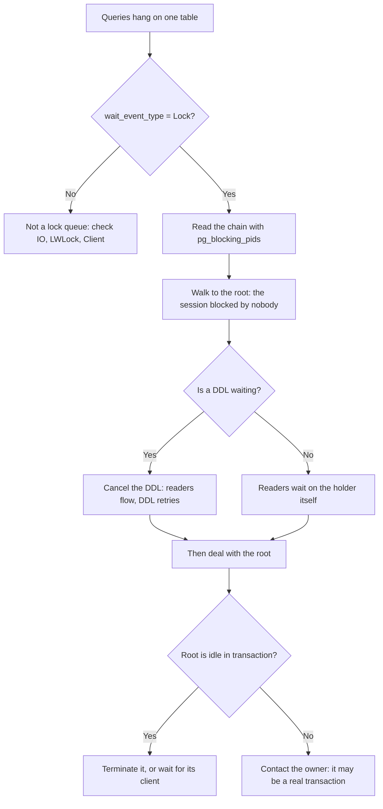

Queries on one table have stopped returning, nothing is obviously wrong with the database, and `pg_stat_activity` shows sessions waiting on `Lock`. This is the procedure for finding the head of the chain, choosing which session to act on, and stopping it from happening again.

It was written from [[postgres-lock-queue-lab]], a lab run that reproduced the exact chain: one `idle in transaction` session, an `ALTER` behind it, and ordinary reads behind the `ALTER`.

## When to use

- Requests to one table hang, time out, or queue, while other tables are fine.
- `pg_stat_activity` shows `wait_event_type = 'Lock'` for more than a moment.
- A migration, `ALTER TABLE`, `CREATE INDEX`, `VACUUM FULL` or `LOCK TABLE` is in flight.
- A deploy that runs a migration is stuck, and the application is degraded at the same time.

Use something else when:

- Sessions are waiting on `IO`, `LWLock` or `Client` rather than `Lock`: this is not a lock queue. See [[postgres-autovacuum-health-and-tuning]] for bloat and vacuum, and [[linux-performance-triage-with-mpstat-pidstat-sar-and-psi]] for a host that is slow rather than blocked.
- The symptom is connection failures rather than hangs: see [[postgres-connection-pooling-gke]].
- You are planning the schema change rather than recovering from it: [[postgres-expand-contract-migrations]] is the note for doing it without an outage.

## Preconditions

- A role that can read `pg_stat_activity` for all sessions and call `pg_cancel_backend` and `pg_terminate_backend`. On managed PostgreSQL this is usually the `pg_monitor` and `pg_signal_backend` roles, not superuser.
- `psql` access, or the provider's query console.
- An incident or change record if you are about to cancel or terminate anything: cancelling a customer transaction is a production action.
- The name of the table or service that is failing, so you can tell the relevant sessions from the rest.

```bash
# Fill these in. DB is the database name; TABLE is the table the failing queries use.
DB=lab
TABLE=accounts
```

> [!warning] Decide before you cancel
> `pg_cancel_backend` cancels the current statement and leaves the session connected; the transaction rolls back. `pg_terminate_backend` ends the session. Either can lose a customer's in-flight work. Read steps 3 and 4 before running either.



## Steps

### 1. Confirm it is a lock wait

```sql
SELECT pid, state, wait_event_type, wait_event,
       now() - state_change AS in_state_for
FROM pg_stat_activity
WHERE datname = current_database()
  AND wait_event_type = 'Lock'
ORDER BY in_state_for DESC;
```

Expected: one or more rows with `wait_event_type = Lock`. `wait_event` names the object type being waited on, commonly `relation`, `tuple`, `transactionid` or `extension`.

If the rows are waiting on `IO`, `LWLock`, `Client` or `IPC` instead, stop here: this is not a lock queue.

### 2. Read the chain

```sql
SELECT pid, state, wait_event_type, wait_event,
       pg_blocking_pids(pid) AS blocked_by,
       now() - xact_start AS xact_age,
       left(regexp_replace(query, '\s+', ' ', 'g'), 60) AS query
FROM pg_stat_activity
WHERE datname = current_database()
  AND pid <> pg_backend_pid()
ORDER BY pid;
```

Expected shape, from the lab:

```text
 pid |        state        | wait_event_type | blocked_by |                    query
-----+---------------------+-----------------+------------+------------------------------------------
 175 | idle in transaction | Client          | {}         | UPDATE accounts SET balance=balance-1 WH
 189 | active              | Lock            | {175}      | ALTER TABLE accounts ADD COLUMN note tex
 197 | active              | Lock            | {189}      | SELECT count(*) AS accounts FROM account
```

Read three things:

- **`state` of the top of the chain.** `idle in transaction` with `wait_event_type = Client` is a forgotten transaction. It is not doing work; it is holding locks while its client does nothing.
- **`blocked_by` is direct, not transitive.** The reader names the `ALTER`, not the holder.
- **Whether a DDL is in the chain.** An `ALTER`, `CREATE INDEX` or `LOCK TABLE` waiting for `ACCESS EXCLUSIVE` is what turns one blocked row into a blocked table.

### 3. Find the root

```sql
WITH RECURSIVE walk AS (
  SELECT pid AS blocked, pid AS node, 0 AS depth
  FROM pg_stat_activity
  WHERE cardinality(pg_blocking_pids(pid)) > 0
  UNION ALL
  SELECT w.blocked, b.pid, w.depth + 1
  FROM walk w
  CROSS JOIN LATERAL unnest(pg_blocking_pids(w.node)) AS b(pid)
  WHERE w.depth < 10
)
SELECT blocked, node AS root, max(depth) AS depth
FROM walk
WHERE cardinality(pg_blocking_pids(node)) = 0
GROUP BY blocked, node
ORDER BY blocked;
```

Expected:

```text
 blocked | root | depth
---------+------+-------
     189 |  175 |     1
     197 |  175 |     2
```

The `root` is the session to fix. The `blocked` column is what you may need to cancel to restore service. They are usually different sessions, and that is the whole point of the runbook.

### 4. Restore service: cancel the waiting DDL

If the chain contains a waiting DDL, cancel that session, not the holder. The DDL is normally a migration that will retry, and it is the only session that ordinary readers conflict with.

```sql
SELECT pg_cancel_backend(189);   -- the pid of the waiting ALTER
```

Expected, from the lab: the readers behind it disappear from `pg_stat_activity` immediately, and the holder is unchanged.

```text
 pid |        state        | wait_event_type | blocked_by |                    query
-----+---------------------+-----------------+------------+------------------------------------------
 175 | idle in transaction | Client          | {}         | UPDATE accounts SET balance=balance-1 WH
```

If there is no DDL in the chain, readers are waiting on the holder directly, and step 5 is the only lever.

### 5. Deal with the root

Only now look at the root session, with the information from step 2:

- **`idle in transaction`, old `xact_age`, `wait_event_type = Client`:** the client has abandoned an open transaction. It is safe to terminate; the transaction rolls back. `SELECT pg_terminate_backend(175);`
- **`active` on a real query:** this is a genuine transaction. Do not terminate it blind. Find the application and the owner from `application_name`, `client_addr` and `usename`, and decide with them.
- **`idle in transaction` but recent:** it may be a request between statements. Give it a few seconds and re-read the chain before acting.

Never start with `pg_terminate_backend` on an `active` session whose statement you have not read.

### 6. Stop it recurring

These are configuration changes, so they belong in a reviewed change, not in the incident:

```sql
-- Server-wide: end sessions that sit idle inside a transaction.
ALTER SYSTEM SET idle_in_transaction_session_timeout = '60s';
SELECT pg_reload_conf();
```

After the reload, run `SHOW idle_in_transaction_session_timeout;` in a fresh application connection. Expect `1min` if no role, database, or session setting overrides the cluster default.

```sql
-- Per migration session: fail fast instead of queueing readers behind the DDL.
SET lock_timeout = '3s';
```

`idle_in_transaction_session_timeout` is the setting that removes this class of holder. `lock_timeout` belongs on the migration path, as [[postgres-expand-contract-migrations]] describes. Both default to `0`, which disables them.

> [!note] PostgreSQL 17
> `transaction_timeout` caps the total time spent in a transaction. When enabled, it takes precedence over each `statement_timeout` or `idle_in_transaction_session_timeout` that is equal to or longer than it. Use `idle_in_transaction_session_timeout` to limit time spent idle within a transaction.

## Validation

The queue is gone when no session is waiting on `Lock` for the table:

```sql
SELECT count(*) AS waiting
FROM pg_stat_activity
WHERE datname = current_database()
  AND wait_event_type = 'Lock';
```

Expected: `0`, or only sessions you know about and have decided to leave.

Then confirm the application recovered, not just the database: the failing endpoint's error rate and latency should return to normal within one scrape interval, and the migration should either have retried successfully or be waiting for a human.

## Rollback

- `pg_cancel_backend` cannot be undone: the cancelled statement's transaction rolls back. For a DDL that is the intended outcome; the migration re-runs.
- `pg_terminate_backend` ends the session and rolls back its transaction. If that transaction was a customer's, the work is lost; this is why step 5 reads the statement first.
- Restore the previous `idle_in_transaction_session_timeout` value with `ALTER SYSTEM SET`, or use `ALTER SYSTEM RESET idle_in_transaction_session_timeout` if there was no previous `ALTER SYSTEM` override. Run `SELECT pg_reload_conf();` and verify the restored value with `SHOW idle_in_transaction_session_timeout;`. Existing sessions also pick up the reloaded default unless they have an override.
- If a cancelled migration leaves a partially applied change, re-run it through the normal migration path rather than repairing by hand.

## Troubleshooting

| Symptom                                                         | Cause                                                                             | Fix                                                                                              |
| --------------------------------------------------------------- | --------------------------------------------------------------------------------- | ------------------------------------------------------------------------------------------------ |
| `pg_blocking_pids` returns `{}` for every session               | The holder's transaction ended between your two queries                           | Re-read the chain; the outage may already be over                                                |
| The reader does not finish after the `ALTER` is cancelled       | Another waiting DDL is still in the queue                                         | Repeat step 4 for each waiting DDL, oldest first                                                 |
| `pg_cancel_backend` returns `t` but the session stays           | The session is between statements; cancel only affects a running statement        | Use `pg_terminate_backend` if the transaction must go, after step 5's checks                     |
| The chain reappears within minutes                              | The root is a connection pool or an application bug that leaves transactions open | Fix the client; see [[postgres-connection-pooling-gke]]                                          |
| `wait_event_type` is `Lock` but `wait_event` is `transactionid` | Two transactions waiting on each other's row locks, not a DDL                     | A deadlock resolves itself after `deadlock_timeout`; if it persists, treat the root as in step 5 |
| Permission denied on `pg_cancel_backend`                        | The role lacks `pg_signal_backend`                                                | Ask for the role, or use the provider's console with an admin role                               |

## Evidence

### Sources checked

- [PostgreSQL 17: Client Connection Defaults](https://www.postgresql.org/docs/17/runtime-config-client.html): `lock_timeout`, `idle_in_transaction_session_timeout`, `statement_timeout` and `transaction_timeout`, their scope and their zero defaults; checked 2026-11-22.
- [PostgreSQL 17: ALTER SYSTEM](https://www.postgresql.org/docs/17/sql-altersystem.html) and [Setting Parameters](https://www.postgresql.org/docs/17/config-setting.html) describe how to apply and reload cluster defaults.
- [PostgreSQL 17: Monitoring Database Activity](https://www.postgresql.org/docs/17/monitoring-stats.html): the `pg_stat_activity` columns and the `state` and `wait_event_type` values used above; checked 2026-11-22.
- [PostgreSQL 17: System Administration Functions](https://www.postgresql.org/docs/17/functions-admin.html): `pg_blocking_pids`, `pg_cancel_backend`, `pg_terminate_backend`, `pg_reload_conf`; checked 2026-11-22.
- [PostgreSQL 17: Lock Management](https://www.postgresql.org/docs/17/runtime-config-locks.html): `deadlock_timeout` and `log_lock_waits`; checked 2026-11-22.

### Not verified

- The procedure was run against a single-table lab database in one container, not against a production database with concurrent load, connection poolers or replicas.
- The `pg_monitor` and `pg_signal_backend` role names and their exact privileges were not exercised; the lab ran as the superuser.
- Managed-provider differences (Cloud SQL, RDS, Azure) in `pg_cancel_backend` permissions and in which settings can be changed were not tested. Check the provider's documentation before relying on step 6 there.
- The `transactionid` wait case in the troubleshooting table was not reproduced; it is the standard deadlock shape, not an observation from this run.
- The exact `psql` invocation used for steps 2 to 4 in the lab was not recorded; the SQL is the text of those steps.
- Behaviour behind a transaction-mode connection pooler (PgBouncer) was not tested; the session seen in `pg_stat_activity` may be the pooler's, not the client's.

### Environment

Docker 29.9.2 on Windows with `postgres:17-alpine`, server `PostgreSQL 17.12 on x86_64-pc-linux-musl`. The commands were run with `psql` from the same image.

### Prerequisites

A role that can read all of `pg_stat_activity` and signal backends, and a database you are allowed to run diagnostic queries against. Nothing is written to the target database by the diagnostic queries.

### Expected results

Step 2 returns a chain where each `blocked_by` names the previous session; step 3 returns the same root for every blocked session; cancelling the waiting DDL removes the readers from the queue while leaving the holder; step 6's settings make the next idle holder and the next blocked DDL fail fast instead of queueing.

### Failure conditions

- Step 2 returns no `Lock` waits: the incident has moved on, or the symptom is not a lock.
- Step 3 returns no rows: nothing is blocked, so there is no chain to walk.
- A cancel returns `t` and the wait persists: another blocker is still in the queue; repeat step 4.
- The queue returns after mitigation: the root cause is in the client, and only a client fix will stop it.

### Cleanup and rollback

No cleanup is needed for the diagnostic queries. The mitigation steps roll back as described in Rollback. If you set the server-wide timeout in step 6 during an incident, record it in the change and confirm it with the application owner, because it will terminate long-running idle transactions that other teams may rely on.

### Lab run

The full run, with every command and its output, is recorded in [[postgres-lock-queue-lab]]. The short version, on `postgres:17-alpine` (17.12) on 2026-11-22:

```bash
docker run -d --name pg-lock-lab -e POSTGRES_PASSWORD=lab -e POSTGRES_DB=lab postgres:17-alpine
docker exec pg-lock-lab psql -U postgres -d lab -c "CREATE TABLE accounts (id int PRIMARY KEY, balance numeric NOT NULL); INSERT INTO accounts VALUES (1, 100), (2, 100);"
# holder, then the ALTER, then a reader, each detached so they can wait
docker exec -d pg-lock-lab bash -c "(printf 'BEGIN;\nUPDATE accounts SET balance=balance-1 WHERE id=1;\n'; sleep 120) | psql -U postgres -d lab -q"
docker exec -d pg-lock-lab psql -U postgres -d lab -c "SET lock_timeout='0'; ALTER TABLE accounts ADD COLUMN note text;"
docker exec -d pg-lock-lab psql -U postgres -d lab -c "SELECT count(*) AS accounts FROM accounts;"
```

Then the SQL of steps 2, 3 and 4 was run, as written above, in `psql` inside the container; the output is below and in [[postgres-lock-queue-lab]].

```text
 pid |        state        | wait_event_type | blocked_by |                    query
-----+---------------------+-----------------+------------+------------------------------------------
 175 | idle in transaction | Client          | {}         | UPDATE accounts SET balance=balance-1 WH
 189 | active              | Lock            | {175}      | ALTER TABLE accounts ADD COLUMN note tex
 197 | active              | Lock            | {189}      | SELECT count(*) AS accounts FROM account

 blocked | root | depth
---------+------+-------
     189 |  175 |     1
     197 |  175 |     2
```

After `SELECT pg_cancel_backend(189)`, the reader (197) disappeared from `pg_stat_activity` and the holder (175) stayed.

## Related

- [[postgres-lock-queue-lab]]: the case this runbook came from, with the full lab transcript.
- [[postgres-expand-contract-migrations]]: how to run the DDL that caused the queue without an outage.
- [[postgres-autovacuum-health-and-tuning]]: long transactions and bloat, the other cost of an idle transaction.
- [[postgres-connection-pooling-gke]]: the client-side cause of repeated idle transactions.
- [[incident-response]]: when this becomes an incident with roles and comms.
