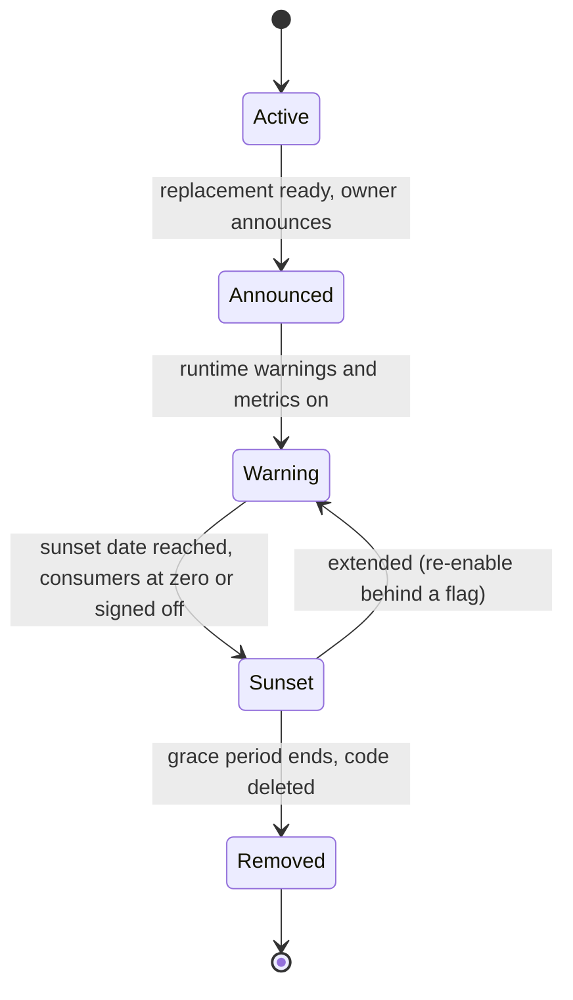

Everything we build has consumers, and removing something they use is an outage that we caused. The same is true in the other direction: Kubernetes removes API versions on a published schedule, and a manifest that still uses a removed version fails at the worst moment, in the middle of a cluster upgrade. This policy sets one lifecycle for retiring an interface, whether it is ours or upstream's: announce, warn, sunset, remove. It says how to signal deprecation, how to prove nobody is still using something before it goes, and how to gate GKE upgrades on removed APIs.

## Scope

- **Internal HTTP and gRPC APIs** served by our services.
- **Platform interfaces**: shared CI templates, Helm chart values ([[helm-chart-standard]]), Terraform module inputs and outputs ([[terraform-module-standard]]), and library or CLI flags.
- **Kubernetes APIs we consume**: the `apiVersion` values in our manifests and charts, and the beta features our clusters depend on.

> [!info] No version numbers here
> This note names no Kubernetes versions or removal releases on purpose, because they change with every release. Use the current deprecation guide and GKE documentation linked in the sources.

## Lifecycle stages



| Stage     | What happens                                                                                    | Exit criterion                                                |
| --------- | ----------------------------------------------------------------------------------------------- | ------------------------------------------------------------- |
| Active    | Supported and recommended                                                                       | A replacement exists and is documented                        |
| Announced | Deprecation notice, migration guide, dates published. Still fully works                         | Notice period (below) has started                             |
| Warning   | Responses and logs carry deprecation signals; usage is measured per consumer                    | Traffic is zero, or every remaining consumer has a dated plan |
| Sunset    | The interface stops working or is disabled by default; it can be turned back on in an emergency | Grace period passed without need to extend                    |
| Removed   | Code, routes and docs are deleted                                                               | Owner sign-off recorded                                       |

An interface is never removed without a replacement, an announced date and measured zero usage (or recorded owner sign-off for the consumers that remain).

## Notice periods by audience

The periods below are **proposed team defaults**, not standards from any vendor. A longer notice is always acceptable; a shorter one needs an exception.

| Audience of the interface                                       | Minimum notice from announcement to sunset          |
| --------------------------------------------------------------- | --------------------------------------------------- |
| Same team only (one repository)                                 | 2 weeks                                             |
| Other teams in the company                                      | 90 days                                             |
| Platform interfaces (CI templates, chart values, module inputs) | 1 minor release for a value, 90 days for a template |
| External or customer-facing                                     | Contractual period; at least 6 months               |

Security fixes may shorten the period; the owner announces why and offers help migrating. For upstream Kubernetes APIs the notice period is set by the [Kubernetes deprecation policy](https://kubernetes.io/docs/reference/using-api/deprecation-policy/) and is not ours to change.

## Signalling

Tell consumers in the channel they will actually see: the response itself.

- **`Deprecation` header** ([RFC 9745](https://www.rfc-editor.org/rfc/rfc9745)): says the resource is, or will be, deprecated. Its value is a **structured-field date** (an `@` followed by Unix seconds), not an HTTP-date. Check the RFC for the exact syntax before generating it.
- **`Sunset` header** ([RFC 8594](https://www.rfc-editor.org/rfc/rfc8594)): the moment after which the resource is expected to become unresponsive. Its value is an **HTTP-date**.
- **`Link` headers** with `rel="deprecation"` pointing to the migration guide and `rel="sunset"` pointing to the sunset policy.

```http title="Response from a deprecated endpoint"
HTTP/1.1 200 OK
Content-Type: application/json
Deprecation: @1788652800
Sunset: Sat, 06 Feb 2027 00:00:00 GMT
Link: <https://docs.example.com/api/v1-to-v2>; rel="deprecation"; type="text/html"
Link: <https://docs.example.com/api/sunset-policy>; rel="sunset"; type="text/html"

{"orders": []}
```

The `Deprecation` value above is Unix time for the moment the endpoint was deprecated. Generate it from the real date and verify the result with a structured-field parser, as it is easy to emit an HTTP-date by habit. Dates in the example are illustrative.

For gRPC, put the same information in response trailers or metadata, and use the `deprecated` option in the `.proto` so generated clients warn at compile time.

**Make deprecated calls countable.** The server logs a field and increments a metric on every call to a deprecated route, labelled by caller identity (service account, API key owner or `User-Agent`), following [[structured-logging-conventions]]:

```json
{
  "severity": "WARNING",
  "message": "deprecated endpoint called",
  "deprecated": true,
  "endpoint": "/v1/orders",
  "replacement": "/v2/orders",
  "caller": "billing-worker",
  "sunset": "2027-02-06"
}
```

```text title="Metric"
api_deprecated_requests_total{endpoint="/v1/orders",caller="billing-worker"}
```

Without a caller label you can see that someone is still using the endpoint but not who to ask.

## Tracking consumers before removal

1. **Measure.** Query the metric or the log field for the last 30 days (a proposed window; use the longest cycle of your consumers, such as a monthly batch job).
2. **Contact.** List every caller, find the owner, open a ticket with the migration guide and the sunset date.
3. **Reach zero or sign off.** Removal needs either measured zero traffic over the window, or a written sign-off from the owner of each remaining caller ("we accept the break" or "we migrated"). Record both in the removal change.
4. **Check the unmeasurable.** Interfaces with no caller identity (public webhooks, scripts, dashboards) need a longer window, and a brownout (a planned, short, announced outage of the old endpoint) to flush out the silent users.
5. **Remove behind a flag first.** Disable the route with a configuration flag, watch for errors for one release, then delete the code.

For Helm values and Terraform inputs, the "consumers" are repositories. Search the organisation for usages before removal, and use the warning mechanisms in the standards for those ([[helm-chart-standard]], [[terraform-module-standard]]).

## Kubernetes and GKE removed APIs

Kubernetes versions its APIs (alpha, beta, stable) and removes old versions according to the upstream policy. A control-plane upgrade that removes an API version makes every manifest, chart, operator and controller still using it fail. The step-by-step upgrade is in [[gke-cluster-upgrade]]; this section only states the gate. Do not copy removal lists into our docs; they go stale. Use the [deprecation guide](https://kubernetes.io/docs/reference/using-api/deprecation-guide/) and the [GKE deprecations page](https://cloud.google.com/kubernetes-engine/docs/deprecations) for the version you are heading to.

**Four layers of detection, cheapest first:**

1. **In CI, validate manifests against the target version's schemas.** Run kubeconform against the Kubernetes version you plan to upgrade to, so a removed `apiVersion` fails the merge request long before the upgrade:

```bash title="CI gate for the target version"
TARGET="1.31.0"   # example: set to the version you are upgrading to
helm template orders charts/orders-api -f ci/default-values.yaml \
  | kubeconform -strict -summary -kubernetes-version "${TARGET}"
```

Use the real target version; the value above is only a placeholder. Custom resources need their own schemas, as kubeconform's README describes. This is part of [[helm-chart-ci-quality-gates]].

2. **On the live cluster, read the API server's own counter.** The API server counts requests to deprecated API versions:

```bash title="Which deprecated APIs are being requested"
kubectl get --raw /metrics | grep apiserver_requested_deprecated_apis
```

Lines with `removed_release` set show which group, version and resource are in use and in which release they will go. The metric reports requests, not stored objects, and it needs access to the metrics endpoint. Confirm its labels in the current Kubernetes docs.

3. **In GKE, read the deprecation insights.** GKE reports deprecated API usage and upgrade blockers in the console and through the Recommender or insights API (check the [GKE deprecations page](https://cloud.google.com/kubernetes-engine/docs/deprecations) for the current mechanism). Treat an open insight as a blocker for the upgrade.
4. **Check the release schedule.** The [GKE release schedule](https://cloud.google.com/kubernetes-engine/docs/release-schedule) shows when a version reaches your release channel and when it goes out of support. Plan the API migration before the date, not after.

**Sign-off before the upgrade.** The upgrade change cannot proceed until (a) the CI gate is green for the target version on every repository that deploys to the cluster, (b) the deprecated-API metric shows no requests to APIs removed in the target release, or each remaining caller has an owner sign-off, and (c) the GKE insight is clear. The pre-upgrade checks are part of [[production-change-checklist]], and upgrades avoid freeze windows ([[change-freezes-and-maintenance-windows]]).

> [!warning] Control-plane rollback is limited
> After a control-plane upgrade you generally cannot return to the previous minor version yourself, and stored objects may already have been migrated to the new storage version. The only real safety net is testing the target version in a non-production cluster first and fixing deprecated usage beforehand. Check the current GKE docs for what rollback and patch downgrade options exist for your release channel.

## Exceptions

Skipping the notice period, removing an interface with known active consumers or upgrading with an open deprecated-API insight needs an exception: the reason, the affected consumers, who accepted the risk, a mitigation (a compatibility shim, a temporary flag) and a date by which it is closed. Security removals are the typical case; the owner still tells the consumers and offers migration help.

## Rolling back a sunset

A sunset that breaks something unexpected is reversed without waiting for a hotfix:

1. **Re-enable the old route behind a flag** (the reason removal happens in two steps). Flip the flag; do not redeploy old code under pressure.
2. **Extend the date.** Update the `Sunset` header, the announcement and the tracker, and name the new date.
3. **Find the missed consumer.** Add the caller to the tracking list with an owner, and add the gap to the checklist (an unauthenticated route, a monthly job).
4. **Retry** only after the consumer has migrated and the metric shows zero again.

For Kubernetes API removals, rollback means fixing the manifests and, if a controller or CRD is the cause, upgrading or replacing that component. It does not mean reverting the control plane.

## Sources

- [RFC 9745: The Deprecation HTTP Response Header Field](https://www.rfc-editor.org/rfc/rfc9745)
- [RFC 8594: The Sunset HTTP Header Field](https://www.rfc-editor.org/rfc/rfc8594)
- [Google Cloud API design guide: Versioning](https://cloud.google.com/apis/design/versioning)
- [Kubernetes: Deprecation policy](https://kubernetes.io/docs/reference/using-api/deprecation-policy/)
- [Kubernetes: Deprecated API migration guide](https://kubernetes.io/docs/reference/using-api/deprecation-guide/)
- [GKE: Deprecations](https://cloud.google.com/kubernetes-engine/docs/deprecations)
- [GKE: Release schedule](https://cloud.google.com/kubernetes-engine/docs/release-schedule)

## Related

- [[gke-cluster-upgrade]]: the upgrade runbook this gate feeds.
- [[helm-chart-ci-quality-gates]]: CI jobs that validate rendered manifests.
- [[change-freezes-and-maintenance-windows]]: when upgrades and removals may happen.
- [[production-change-checklist]]: pre-checks for the change.
- [[structured-logging-conventions]]: the log fields used to count deprecated calls.
- [[helm-chart-standard]]: deprecating chart values.
- [[terraform-module-standard]]: deprecating module inputs and outputs.
