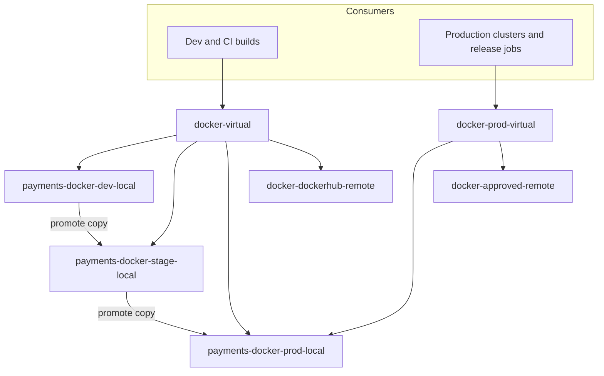

Names in Artifactory are load-bearing. Repository keys end up in hundreds of build files, permission targets and cleanup rules; artifact names and versions decide whether a deploy is reproducible; the order of repositories inside a virtual repository decides which package wins when two have the same name. This standard fixes the conventions so that they do not change with every reorganisation. It states naming and permission rules only. Promotion mechanics are in [[artifact-promotion-artifactory]] and retention is in [[artifact-retention-policy]].

## Scope

Applies to every repository, permission target and artifact we manage in Artifactory, for Docker, Helm, Maven, npm and generic (raw) packages. It builds on the layout accepted in ADR [[adr/0003-artifactory-repository-layout]] and the build-once model in ADR [[adr/0004-build-once-promote-between-repositories]]; if this note and an accepted ADR disagree, the ADR wins and this note is corrected.

> [!info] Check the current JFrog docs
> Repository settings, permission-target options and CLI flags differ between Artifactory versions and between SaaS and self-managed. Where a setting name appears below, confirm it in the current JFrog documentation for your version.

## Repository key pattern

Keys follow one scheme so a human can read the kind, type and stage from the name.

| Kind    | Pattern                                                                     | Examples                                                  |
| ------- | --------------------------------------------------------------------------- | --------------------------------------------------------- |
| Local   | `<team>-<type>-<stage>-local`                                               | `payments-docker-dev-local`, `payments-helm-prod-local`   |
| Remote  | `<type>-<upstream>-remote`                                                  | `npm-npmjs-remote`, `maven-central-remote`                |
| Virtual | `<type>-virtual`; `<type>-<group>-virtual` only after a new ADR (see below) | `docker-virtual`; with the new ADR, `docker-prod-virtual` |

- The group-virtual form `<type>-<group>-virtual` does not pass the key validation in ADR [[adr/0003-artifactory-repository-layout]] (`^[a-z0-9]+-virtual$`). Using it needs a new ADR that widens the check to `^[a-z0-9]+(-[a-z0-9]+)?-virtual$`; until then use `<type>-virtual`.
- `<type>` is the package type: `docker`, `helm`, `maven`, `npm`, `generic`.
- `<stage>` is `dev`, `stage` or `prod`, matching the promotion model.
- `<team>` is a stable team or product slug, not an org-chart name. A repository key is never renamed; a reorganisation changes permissions, not keys.
- Keys are lowercase, hyphen-separated, with no dots or underscores, so they are valid in URLs, Docker repository paths and CI variables.

In short, the pattern reads as type, stage and kind; the team prefix keeps local repositories from colliding. Repositories are created as code (the JFrog Terraform provider or the REST API from a reviewed repository), never by hand in the UI, and a validation job rejects a key that does not match the pattern.

## Repository kinds

- **Local** repositories hold what we build. Each stage has its own local repository per package type and team, so the stage of an artifact is visible in its path.
- **Remote** repositories proxy one upstream registry and cache what was fetched. Nobody deploys into them. They give us a cache, an audit trail of what we consumed and a place to block bad packages.
- **Virtual** repositories aggregate locals and remotes behind one URL. Consumers use virtual repositories only, so adding an upstream or moving an artifact never changes a client.



## Virtual resolution order

A virtual repository searches its members in order and returns the first match. Order is therefore a security decision.

1. **A production-facing virtual never includes a dev local.** The group that deploys to production resolves from prod locals and approved remotes only. The dev group's virtual may include all stages, as ADR 0003 describes, because it exists to find work in progress.
2. **Locals before remotes.** Our own artifacts win over an upstream package with the same name. This blocks the basic dependency-confusion attack, where a public package is published under the name of an internal one.
3. **Remote exclude patterns for internal namespaces.** For npm scopes, Maven group IDs and Docker paths that are ours, configure the remote's exclude patterns (check the current JFrog docs for the exact field names) so the remote never serves them, even when no local match exists. Make the internal namespace explicit and review it when a team is added.
4. **Default deploy target is the dev local.** A plain deploy through a virtual URL can land only in dev; stage and prod receive artifacts only from promotion.

> [!warning] Failure mode: a dev local shadows a prod package
> If `payments-docker-dev-local` sits before `payments-docker-prod-local` in a virtual that production resolves from, a dev build tagged `1.4.2` can be returned instead of the promoted `1.4.2`. The deploy "works" and runs untested bits. Fix: remove the dev local from the production virtual (create `docker-prod-virtual`), repoint the clusters and release jobs at it, then verify by digest that what runs matches the promoted artifact (`docker buildx imagetools inspect` on the tag against the recorded digest). Prevent a repeat with an audit job that fails when a production virtual contains a `-dev-` or `-stage-` local.

## Write permissions

Permissions follow the principle that humans read and automation writes.

- **Only CI service identities write**, and each identity writes only to the dev local of its own team. Humans have read access and no deploy rights in stage or prod.
- **Promotion is the only path into prod.** The promotion job copies or moves an artifact from the lower stage into the next; its identity is the only principal with deploy permission on stage and prod locals. See [[artifact-promotion-artifactory]].
- **Release repositories do not allow overwrite or delete** by CI identities: configure the permission target without the delete and overwrite rights on stage and prod (check the current JFrog docs for the exact permission names), and keep delete with the retention job and a small break-glass group.
- **Identities are short-lived tokens or OIDC, not shared passwords.** See [[artifactory-access-tokens-and-oidc-for-ci]].
- **Permission targets are code**, named after the repository set they cover (`payments-docker-write`, `payments-docker-read`) and reviewed in merge requests, like the repositories.

## Artifact naming per package type

Names are lowercase and stable. They describe the artifact, not the pipeline that built it.

| Package type | Name pattern                                                     | Example                                                              | Notes                                                                   |
| ------------ | ---------------------------------------------------------------- | -------------------------------------------------------------------- | ----------------------------------------------------------------------- |
| Docker       | `<registry>/<virtual-key>/<team>/<service>:<version>`            | `registry.example.com/docker-virtual/payments/orders-api:1.4.2`      | Path is lowercase; no `latest`; deploy by digest                        |
| Helm (OCI)   | `oci://<registry>/<helm-virtual-key>/<chart>` with chart version | `oci://registry.example.com/helm-virtual/orders-api` version `3.2.0` | Chart name equals the directory name; see [[helm-chart-standard]]       |
| Maven        | `<groupId>:<artifactId>:<version>`                               | `com.example.payments:orders-client:1.4.2`                           | `groupId` is reverse-DNS on a domain we own; no `-SNAPSHOT` in prod     |
| npm          | `@<scope>/<package>@<version>`                                   | `@example-payments/orders-client@1.4.2`                              | The scope is ours and is excluded from remotes                          |
| Generic      | `<team>/<service>/<version>/<file>`                              | `payments/orders-api/1.4.2/orders-api-linux-amd64.tar.gz`            | Include OS and architecture in the file name; ship a checksum alongside |

Image naming rules in the Dockerfile itself (labels, tags) are in [[dockerfile-standard]].

## Version rules

- **SemVer for releases**: `MAJOR.MINOR.PATCH` per [semver.org](https://semver.org/). A release version is immutable: **once published it is never overwritten**, and a fix is a new patch version.
- **`<semver>-<shortsha>` for builds** from branches and merge requests, for example `1.4.2-3f9a1c2`. This ties an artifact to a commit without claiming a release.
- **Digest for deploys.** Manifests and charts reference `image@sha256:...`. The tag is informational. The digest is what promotion records and what rollback redeploys (ADR [[adr/0048-rollback-by-redeploying-previous-digest]]).
- **`latest` is never a deploy reference**, and no pipeline pushes it. It may exist in a dev repository for convenience only if a policy allows; it is blocked in stage and prod.
- **Pre-releases never reach prod.** Maven `-SNAPSHOT` and npm pre-release tags (`-rc.1`) are valid in dev and stage; the prod local rejects them via repository layout or a promotion check.
- **No re-tagging.** Moving a tag to a different digest is treated as an incident. Enable the immutable-tag option where the package type offers it (check the current JFrog docs).

Choosing the version number itself, from commits to changelog, is automated in [[release-versioning-and-changelog-automation]]. Dependency bumps that consume these versions are handled by [[automated-dependency-updates]].

## Build-info and properties

Build-info records which modules, dependencies and environment produced a build, and ties artifacts to a pipeline run. It is the basis for promotion, scanning by build and provenance.

- **Build name equals the repository path**, for example `payments/orders-api`. It is stable across runs and unique per service. The **build number** is the pipeline ID, or `<semver>-<pipeline id>` when you release from tags.
- Publish build-info from the same job that uploads the artifacts, and attach VCS and CI environment variables, filtered so that no secret enters the record.
- Artifacts carry **properties** for the facts promotion and cleanup rely on: `build.name`, `build.number`, `vcs.revision`, `stage`, and `prod-promoted=true` set by the promotion job (the marker used by the retention rules in [[artifact-retention-policy]]).

```bash title="CI: upload and publish build-info"
set -Eeuo pipefail

export JFROG_CLI_BUILD_NAME="payments/orders-api"
export JFROG_CLI_BUILD_NUMBER="${CI_PIPELINE_ID}"

jf rt upload "dist/orders-api-linux-amd64.tar.gz" \
  "payments-generic-dev-local/payments/orders-api/${VERSION}/" \
  --props "vcs.revision=${CI_COMMIT_SHA};stage=dev"

jf rt build-collect-env
jf rt build-add-git
jf rt build-publish
```

Command names and flags are from the JFrog CLI command set as I know it; check the current JFrog CLI docs and run `jf rt build-publish --help` on the version your runners use. Environment variable names for the build name and number are also version-dependent. Provenance on top of build-info is covered in [[slsa-build-provenance]].

## Enforcement and audit

| Rule                                               | How it is enforced                                                                           |
| -------------------------------------------------- | -------------------------------------------------------------------------------------------- |
| Key matches the pattern                            | Validation in the repository-as-code merge request                                           |
| Production virtuals contain no dev or stage locals | A scheduled audit job that reads each virtual's members through the API and fails on a match |
| Only CI identities write; no human deploy in prod  | Permission targets as code; a periodic export compared with the expected state               |
| Releases are immutable                             | Repository settings without overwrite; an alert on any delete in prod locals                 |
| No `latest`, no snapshots in prod                  | Promotion job checks; admission policy on image references                                   |
| Build-info present for every promoted artifact     | The promotion job refuses an artifact without build-info                                     |

Audit with read-only API calls and keep the output as evidence; the access review process for the identities is part of your access governance, not this note.

## Sources

- [JFrog: Repository management](https://jfrog.com/help/r/jfrog-artifactory-documentation/repository-management)
- [JFrog: Virtual repositories](https://jfrog.com/help/r/jfrog-artifactory-documentation/virtual-repositories)
- [JFrog: Build integration](https://jfrog.com/help/r/jfrog-artifactory-documentation/build-integration)
- [JFrog documentation (CLI)](https://docs.jfrog.com/)
- [Semantic Versioning](https://semver.org/)
- [OCI Distribution Specification](https://github.com/opencontainers/distribution-spec)

## Related

- [[artifact-promotion-artifactory]]: how artifacts move between stages.
- [[artifact-retention-policy]]: cleanup rules that depend on these names and properties.
- [[dockerfile-standard]]: image labels and tags.
- [[helm-chart-standard]]: chart names and versions.
- [[automated-dependency-updates]]: consuming versions safely.
- [[slsa-build-provenance]]: provenance for the artifacts.
- [[artifactory-access-tokens-and-oidc-for-ci]]: how CI identities authenticate.
