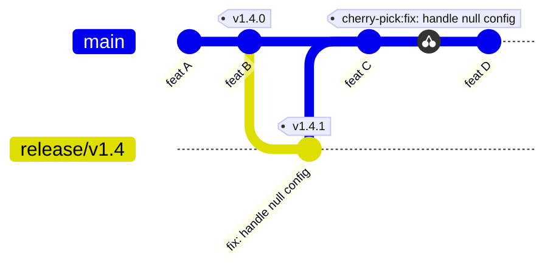

Branch rules look like housekeeping until the day a force-push erases a release, a squash merge hides which commit introduced a bug, or a hotfix goes to production and never reaches the main branch. This standard sets one model for infrastructure and site repositories: short-lived branches, a protected default branch, merge commits, tags created only by the release workflow, and a defined hotfix path. It follows the conventions on the [[standards/index|standards index]] and the workflow in [[ci-cd-concepts-and-branching]].

## Scope

Applies to repositories that hold infrastructure code (Terraform, Helm, CI templates, GitOps manifests) and the sites and services we deploy. A repository with its own documented flow (for example a promotion-branch flow) states it in its README; where it does not, this standard applies.

> [!info] UI names change
> GitHub and GitLab rename settings and move them between menus. The setting names below are marked and should be confirmed in the current docs for your plan and version.

## Branch model

The default is **trunk-based development**: one long-lived branch (`main`), short-lived topic branches that live for hours or a few days, and small merge requests. Environments are separated by deployment configuration, not by branches.

Promotion branches (`dev`, `stage`, `main`) are used only where an environment must hold a different version of the code for a long time, and the repository documents why.

| Question                   | Trunk with short-lived branches                                             | Promotion branches                                    |
| -------------------------- | --------------------------------------------------------------------------- | ----------------------------------------------------- |
| What is deployed where     | Config per environment, same commit promoted by digest                      | The branch name says it                               |
| Merge conflicts            | Rare, branches are short                                                    | Common, changes flow through several merges           |
| Hotfix cost                | One branch, one merge                                                       | Forward-port through every branch                     |
| Drift between environments | Visible in config only                                                      | Branches can diverge silently                         |
| Fits                       | Most services, GitOps repositories ([[gitops-repo-topology-and-promotion]]) | Sites with a strict stage preview, or long soak times |
| Main risk                  | Needs good CI and feature flags to merge safely                             | Branches drift; "stage" becomes a different codebase  |

If you use promotion branches, keep them as copies of each other: promote by pull request with a merge commit, keep the target ahead of nothing it has not already received, and never commit directly to the later branch.

## Naming

Branches are `<type>/<short-kebab>`, for example `feat/add-pdb-default` or `fix/helm-selector-label`.

The allowed types match Conventional Commits: `feat`, `fix`, `docs`, `style`, `refactor`, `perf`, `test`, `build`, `ci`, `chore`, `revert`. The slug is a few words, lowercase, hyphenated, and describes the change, not a ticket number alone. Do not put people's names, tool names or dates in branch names. Release branches, where used, are `release/vX.Y.Z`; hotfix branches are `fix/<short-kebab>` from the release tag or `main`.

## Commit messages

- **Conventional Commits**: `<type>(<optional scope>): <imperative subject>`, for example `fix(helm): remove version from selector`. The [specification](https://www.conventionalcommits.org/en/v1.0.0/) defines the types and the `!` or `BREAKING CHANGE:` marker for breaking changes.
- **Subject at most 72 characters**, imperative mood, no trailing period.
- **One logical change per commit**, so each can be reviewed and reverted on its own.
- The body explains why, not what. Reference the issue or incident.

The types feed [[release-versioning-and-changelog-automation]]: `feat` drives a minor bump, `fix` a patch, and a breaking marker a major, so the commit type is part of the release process and not decoration. This is consistent with the commit rules already in the standards index.

## Protection

Protect the default branch and every long-lived branch. The rules are the same on both platforms; the names differ.

- **Pull or merge request required.** No direct pushes, for anyone, including admins.
- **Required reviews**: at least one approval from someone other than the author, and a new push dismisses stale approvals. High-risk paths need a code owner (below).
- **Required status checks**: the lint, test and scan jobs from [[ci-pipeline-standard]], and branch must be up to date or merged through a queue where the platform offers one.
- **No force-push and no deletion** on protected branches and tags.
- **No bypass list for humans.** A bypass actor is acceptable only for the release automation that must push a tag or a version commit, and it is narrowly scoped. "Admin override" is not a plan; break-glass access is recorded and reviewed.
- **Resolved conversations required** before merge where the platform has the setting.
- **Signed commits** if your organisation requires them: check the setting name and the identity story in the current docs.

Platform specifics: use [GitHub rulesets](https://docs.github.com/en/repositories/configuring-branches-and-merges-in-your-repository/managing-rulesets/about-rulesets) (or classic branch protection where rulesets are not available) and GitLab [protected branches](https://docs.gitlab.com/user/project/protected_branches/) with approval rules. Both platforms rename options; check the current docs.

### CODEOWNERS

Code owners make the right people reviewers by default. Place the file at `.github/CODEOWNERS` (GitHub) or `CODEOWNERS` in the repository root, `docs/` or `.gitlab/` (GitLab). See [about code owners](https://docs.github.com/en/repositories/managing-your-repositorys-settings-and-features/customizing-your-repository/about-code-owners).

```text title=".github/CODEOWNERS"
# Default reviewers for everything
*                       @example-org/platform-team

# Infrastructure
/terraform/             @example-org/platform-team @example-org/security-team
/charts/                @example-org/platform-team

# CI and release machinery: changes alter every pipeline
/.gitlab-ci.yml         @example-org/platform-team
/.github/workflows/     @example-org/platform-team @example-org/security-team

# Policy and rules
/policy/                @example-org/security-team

# Ownership of this file is itself protected
/.github/CODEOWNERS     @example-org/platform-team
```

Use team aliases, never individual accounts. The last matching pattern wins on GitHub, so put specific paths after general ones. In GitLab, code owner approval is enforced through protected branch settings or approval rules.

### Audit the settings

Check protection from code, read-only, so drift is found.

```bash title="GitHub: list the repository's rulesets"
gh api repos/OWNER/REPO/rulesets
gh api repos/OWNER/REPO/rulesets/RULESET_ID
```

Replace `OWNER`, `REPO` and `RULESET_ID` with real values. The first call lists rulesets; the second shows the rules, targets and bypass actors of one ruleset. For repositories still on classic protection, `gh api repos/OWNER/REPO/branches/main/protection` shows it.

```bash title="GitLab: list protected branches"
glab api "projects/$(printf '%s' 'GROUP/PROJECT' | jq -sRr @uri)/protected_branches"
# or, with curl and a read-only token in $GITLAB_TOKEN. The header is read from a
# process substitution so the token is not in the process arguments:
curl -sS -K <(printf 'header = "PRIVATE-TOKEN: %s"\n' "$GITLAB_TOKEN") \
  "https://gitlab.example.com/api/v4/projects/PROJECT_ID/protected_branches"
```

Check the fields `allow_force_push`, `push_access_levels` and `merge_access_levels`; the API reference for your GitLab version lists them. Keep the token read-only and out of the shell history. Passing it with `--header` or `-u` would expose it to other users on a shared host through `ps`.

## Merge method

- **Merge commits** are the default and are required for promotion between long-lived branches. A merge commit keeps each commit as written, shows which merge request introduced a change, and lets you revert a whole merge request with one `git revert -m 1 <merge>`. It also preserves the provenance a reviewer approved: the commits that were tested are the commits in history.
- **Squash** is allowed only where a repository states it, for example a documentation repository with noisy commits. It loses the atomic history, so commit messages must then be rewritten as one good Conventional Commit.
- **Rebase and fast-forward** merges are allowed to update a topic branch before review, but not as the way into a protected branch, because they rewrite commit IDs and drop the merge marker. Rebase your own unpublished branch freely; never rewrite history that others have pulled. See [[git-merge-rebase-and-undo]].

## Tags and releases

- **Release tags are `vX.Y.Z`** (SemVer with a `v` prefix) and are created only by the release workflow (the "Cut release" job), never by hand from a laptop.
- **Protect tags** matching `v*`: only the release automation may create them, and no one may move or delete them. See GitLab [protected tags](https://docs.gitlab.com/user/project/protected_tags/) and the equivalent tag ruleset on GitHub.
- A release is cut from the default branch (or the hotfix branch) after the required checks pass. The release job computes the version and the changelog, creates the tag and builds the artifact once; production deploys that artifact by digest (ADR [[adr/0047-semver-release-tags-and-protected-production-deploys]]).
- The release job needs write access to create a tag, which is a good reason to scope its credential narrowly and to review who can change the workflow ([[separation-of-duties-in-deployments]]).
- A bad release is not fixed by moving the tag. Cut a new patch version or roll back by redeploying the previous digest (ADR [[adr/0048-rollback-by-redeploying-previous-digest]]).

## Hotfix path

A hotfix is a normal change made faster, never a different process. It keeps review and CI.

1. Branch from the **release tag** that is in production (or from `main` only if `main` equals the production tag): `fix/<short-kebab>`.
2. Make the smallest possible fix, with a test.
3. If `main` has moved past the production tag, create `release/vX.Y` from that tag and open the merge request into it; otherwise open it into `main`. Expedited review, same required checks.
4. Cut a patch release (`vX.Y.Z+1`) from the release branch, or from `main` only if `main` equals the production tag, and deploy it.
5. **Forward-port**: if the fix landed on a release branch, merge or cherry-pick it into `main` the same day, so the next release does not regress. A hotfix that exists only on a release branch is a regression waiting for the next release.



In the picture `main` has already moved past `v1.4.0` with `feat C`, so the fix is made on `release/v1.4`, branched from the production tag, and released as `v1.4.1` from there. `feat C` waits for the next minor. The fix is then forward-ported to `main` (merge or cherry-pick) the same day. If `main` still equals the production tag, skip the release branch and release the fix from `main`.

## Stale branches and cleanup

- **Delete the branch after merge.** Enable the platform option that deletes the source branch on merge.
- **Stale branches**: a branch with no commits for 30 days (a proposed team default) gets a comment from the owner or is deleted. A weekly job lists them; a person decides, and deletion of a branch someone else owns goes through them first.
- **Long-lived topic branches** are a smell. Break the work up, hide it behind a feature flag, or merge to `main` in safe steps.
- **Never rewrite pushed history on protected branches.** A mistaken secret in history is handled by rotating the secret first and then following the rewrite procedure agreed with the security team, not by an improvised force-push.

## Checklist

- [ ] The default branch requires a merge request, approval and the required checks; no force-push or deletion.
- [ ] No bypass list for humans; the release automation bypass, if any, is scoped.
- [ ] CODEOWNERS covers infrastructure, CI and policy paths, with team aliases.
- [ ] Branch name is `<type>/<short-kebab>`; commits are Conventional Commits, subject at most 72 characters.
- [ ] Merge method is a merge commit (or the documented repository exception).
- [ ] `v*` tags are protected and created only by the release workflow.
- [ ] The hotfix path is documented, with a forward-port step.
- [ ] Source branches delete on merge; stale branches are listed weekly.

## Sources

- [GitHub: About rulesets](https://docs.github.com/en/repositories/configuring-branches-and-merges-in-your-repository/managing-rulesets/about-rulesets)
- [GitHub: About code owners](https://docs.github.com/en/repositories/managing-your-repositorys-settings-and-features/customizing-your-repository/about-code-owners)
- [GitLab: Protected branches](https://docs.gitlab.com/user/project/protected_branches/)
- [GitLab: Protected tags](https://docs.gitlab.com/user/project/protected_tags/)
- [Conventional Commits 1.0.0](https://www.conventionalcommits.org/en/v1.0.0/)
- [Trunk Based Development](https://trunkbaseddevelopment.com/)

## Related

- [[code-review]]: what reviewers check before approving.
- [[release-versioning-and-changelog-automation]]: how tags and changelogs are produced.
- [[gitops-repo-topology-and-promotion]]: repository layout and promotion.
- [[ci-cd-concepts-and-branching]]: the concepts behind branching strategies.
- [[git-merge-rebase-and-undo]]: merge, rebase and reverting safely.
- [[separation-of-duties-in-deployments]]: who may approve and release.
- [[ci-pipeline-standard]]: the checks that protect the branch.
