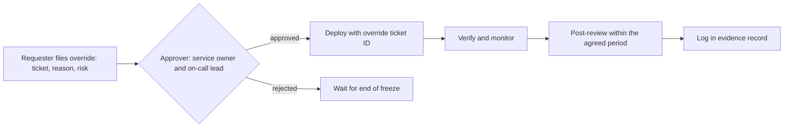

A freeze that lives only in a chat message fails the first time someone is in a hurry. This standard is for senior DevOps engineers and engineering managers: it says when to freeze, how to enforce the freeze in code on GKE, Argo CD and GitLab, how to override it with a review, and how to keep security fixes moving. Change classes are in [[standards/production-change-checklist]], cluster upgrades in [[runbooks/gke-cluster-upgrade]], and the evidence side in [[compliance/change-management-controls-and-pipeline-evidence]].

> [!note] Not verified
> The claims below were written from documentation knowledge and were not checked against a running system or the current docs: GKE maintenance exclusion scopes and maximum durations, the minimum maintenance availability per 32 days, the Terraform attribute names, the Argo CD sync window fields, and the GitLab freeze period API path and the `CI_DEPLOY_FREEZE` variable name. Check them before relying on them.

## Rules

- Times are in UTC, written with a date and a time, never "after lunch" or "over the holidays".
- A freeze is announced in advance, with a start, an end date, a reason and an owner who can extend or lift it.
- A freeze has an end. An open-ended freeze becomes a backlog of risky changes.
- Enforce the freeze in code where the tools allow it, and keep the enforcement in Git so it is reviewed.
- A freeze limits risk, not safety: security fixes and incident mitigations have a defined fast path.
- Overrides are requested, approved by a named role, logged and reviewed afterwards.
- Run maintenance (upgrades, node pool changes) in a window, not at a random time, and tell on-call (see [[management/on-call-health]]).
- Tell stakeholders when a freeze starts, when it ends and whom to contact (see [[management/stakeholder-communication]]).

## Kinds of freeze

| Kind                  | When                                            | Scope                              | Enforcement                                          |
| --------------------- | ----------------------------------------------- | ---------------------------------- | ---------------------------------------------------- |
| Business peak freeze  | Sales event, year-end, launch                   | Customer-facing services           | GitLab deploy freeze, Argo CD deny sync window       |
| Release freeze        | Days before a major release                     | The release's services             | Branch protection, deploy freeze, manual approval    |
| Platform upgrade hold | Change to a shared cluster or network under way | Shared infrastructure              | GKE exclusion, Argo CD window for platform apps      |
| Holiday and low staff | Few people on call                              | All, with the fast path open       | Deploy freeze, scheduled review of override requests |
| Incident freeze       | During an incident, until it is stable          | The affected services              | Pipeline pause by the incident commander             |
| Maintenance window    | Regular slot for planned work                   | Cluster maintenance, node upgrades | GKE maintenance window                               |

## GKE maintenance windows and exclusions

A maintenance window tells GKE when it may do automatic maintenance such as control plane and node upgrades. A maintenance exclusion blocks specific kinds of maintenance for a period. Which scopes exist and how long an exclusion may last are not verified here; check the GKE maintenance documentation, and note that security patches may still be applied within the limits Google documents.

```hcl title="gke/cluster.tf"
resource "google_container_cluster" "primary" {
  name     = "prod-gke-1"    # change: your cluster name
  location = "europe-west1"  # change: your region

  # ... other arguments omitted (networking, node pools, release channel)

  maintenance_policy {
    recurring_window {
      start_time = "2026-01-03T01:00:00Z" # anchor date; the recurrence sets the repeat
      end_time   = "2026-01-03T07:00:00Z" # change: 6 hours per occurrence
      recurrence = "FREQ=WEEKLY;BYDAY=SA,SU"
    }

    maintenance_exclusion {
      exclusion_name = "year-end-freeze"
      start_time     = "2026-12-15T00:00:00Z"
      end_time       = "2027-01-05T00:00:00Z"

      exclusion_options {
        scope = "NO_MINOR_UPGRADES"
      }
    }
  }
}
```

Practical points:

- GKE enforces a minimum amount of maintenance availability within a rolling 32-day period, made of blocks of at least a few hours (about 48 hours in total; check the current figure). A single 4-hour weekly window is below that and is likely to be rejected, so the example uses two 6-hour occurrences a week.
- Keep the window at a time when on-call is staffed and traffic is low, and long enough for the upgrade to finish.
- Put exclusions into Terraform with an end date so they cannot outlive the freeze.
- An exclusion does not stop your own deploys; it only stops automatic cluster maintenance. Pair it with the Argo CD and GitLab controls below.
- Before a window opens, check what is queued (see [[runbooks/gke-cluster-upgrade]]).

## Argo CD sync windows

Sync windows on an `AppProject` allow or deny syncs on a schedule. A deny window with `manualSync: true` stops automated syncs but lets an authorised person sync by hand, which is the override path and shows up in the sync history.

```yaml title="argocd/appproject-prod.yaml"
apiVersion: argoproj.io/v1alpha1
kind: AppProject
metadata:
  name: prod
  namespace: argocd
spec:
  description: Production applications
  sourceRepos:
    - https://gitlab.example.com/platform/deploy-manifests.git
  destinations:
    - server: https://kubernetes.default.svc
      namespace: shop
  syncWindows:
    - kind: deny
      schedule: "0 0 15 12 *"
      duration: 504h
      timeZone: UTC
      applications:
        - "*"
      manualSync: true
```

This window starts at 00:00 UTC on 15 December and lasts 504 hours (21 days), until 5 January. The schedule is a cron expression, so it repeats yearly; remove or update it after the freeze, or the next one arrives unannounced. The field names and the behaviour of overlapping windows are not verified; check the Argo CD sync windows documentation for your version.

## GitLab deploy freezes

GitLab can define freeze periods per project. During a freeze it sets a CI variable, so a job can refuse to deploy. The API path and variable name below are from documentation knowledge and are not verified.

```bash
set -euo pipefail

GITLAB_URL="https://gitlab.example.com"  # change: your GitLab base URL
PROJECT_ID="1234"                        # change: numeric project ID
# GITLAB_API_TOKEN comes from a masked CI/CD variable or a secret manager; never type or commit it.
: "${GITLAB_API_TOKEN:?set GITLAB_API_TOKEN from a masked variable}"

# Freeze from 00:00 UTC on 15 December until 00:00 UTC on 5 January. The values are cron expressions.
curl --fail --silent --show-error \
  --request POST \
  --header "PRIVATE-TOKEN: ${GITLAB_API_TOKEN}" \
  --data-urlencode "freeze_start=0 0 15 12 *" \
  --data-urlencode "freeze_end=0 0 5 1 *" \
  --data-urlencode "cron_timezone=UTC" \
  "${GITLAB_URL}/api/v4/projects/${PROJECT_ID}/freeze_periods"
```

Manage the same thing in Terraform if you manage GitLab projects there, so the freeze is reviewed. In the pipeline, skip deploy jobs during a freeze unless an override ticket is supplied:

```yaml title=".gitlab-ci.yml"
deploy-production:
  stage: deploy
  environment:
    name: production
    deployment_tier: production
  rules:
    # Block during a freeze unless a ticket ID was passed when the pipeline was started.
    - if: $CI_DEPLOY_FREEZE != null && $FREEZE_OVERRIDE_TICKET == null
      when: never
    - if: $CI_COMMIT_BRANCH == $CI_DEFAULT_BRANCH
  script:
    - echo "Freeze override ticket - ${FREEZE_OVERRIDE_TICKET:-none}"
    - ./ci/deploy.sh production
```

Anyone who can run a pipeline can pass a variable when starting it, so a protected variable alone does not stop a developer from supplying the override. Restrict pipeline variables to Maintainers or above (the project setting for the minimum role allowed to set pipeline variables; setting name not verified), and pair the override with the production protected-environment deployment approval, so a second person still approves during a freeze. Otherwise the check is a formality. See [[compliance/separation-of-duties-in-deployments]].

## Override flow



- The request names the change, why it cannot wait, the rollback plan and the blast radius.
- The approver is not the requester and has authority over the service.
- The deploy uses the normal pipeline with the ticket ID attached, so the evidence record carries it.
- The post-review checks whether the override was justified and whether the freeze rules need changing.

## Security fast path

A freeze must not hold a known-exploitable vulnerability open. Define the fast path before you need it.

- Security fixes for actively exploited or critical issues use the override flow with a shorter approval, by the security lead or on-call lead, and may proceed in parallel with the review.
- Routine dependency updates wait until the freeze ends (see [[patterns/automated-dependency-updates]]).
- Keep the change minimal: patch, rebuild, deploy by digest, no feature work riding along.
- Record the fix in the evidence record like any other change, with the ticket ID.
- After the freeze, review which fixes went through and whether the criteria were applied consistently.

## Checklist

```text
[ ] Freeze has start, end (UTC), reason and owner, announced in advance
[ ] Stakeholders and on-call informed (start, end, contact)
[ ] GKE maintenance window and exclusion set in Terraform with end date
[ ] Argo CD deny sync window defined; manualSync decision made on purpose
[ ] GitLab freeze period created; deploy jobs check CI_DEPLOY_FREEZE
[ ] Override approvers named; override ticket ID recorded in the pipeline
[ ] Security fast path agreed with the security lead
[ ] Pending upgrades and expiring certificates checked before the freeze starts
[ ] Freeze configuration removed or updated after the end date
[ ] Post-review of overrides done within the agreed period
```

## Related

- [[standards/production-change-checklist]]: risk classes and checks for each change, including during freezes.
- [[runbooks/gke-cluster-upgrade]]: planned cluster upgrades that fit into maintenance windows.
- [[compliance/change-management-controls-and-pipeline-evidence]]: evidence that overrides were approved and reviewed.
- [[management/on-call-health]]: protecting on-call during freezes and windows.
- [[management/stakeholder-communication]]: announcing freezes and overrides.
