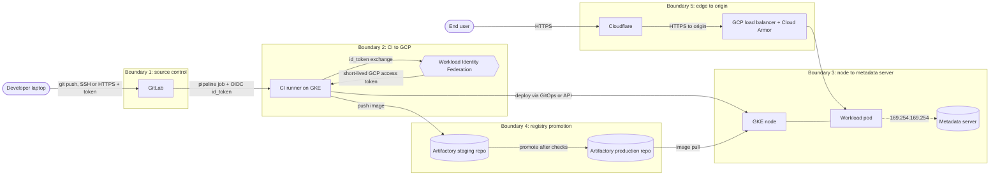

A platform has many security controls and no way to know which one is missing. Threat modelling is the method for finding out. This standard sets a small, repeatable process: draw how data and credentials flow, mark where trust changes, ask six STRIDE questions at each boundary, record the threats in a register, and link each one to a control or a decision.

The focus is the **platform**: the path from a developer's laptop through GitLab, CI runners, the registry and GCP into GKE, and the edge in front of it. Threats inside an application (injection, business logic) need their own model and are out of scope.

> [!info] What was checked
> The MITRE ATT&CK technique IDs below are from memory and were not looked up, so check each one against the current ATT&CK matrix before it goes into a register. Current GKE metadata protection defaults and whether Google publishes its own GKE threat model were not checked. The method itself (data flow diagram, trust boundaries, STRIDE) is long established.

## When to threat-model

Threat-model when the platform's trust relationships change, not on a calendar alone. Triggers:

- A new cluster, environment, project or landing zone, or a change to the tenancy model.
- A new way to authenticate: Workload Identity Federation for a new CI system, a new service account pattern, a new identity provider.
- A new path into or out of the platform: a new ingress, a Cloudflare route, a VPN or interconnect, a new egress to a SaaS.
- A new component with high privilege: an admission controller, a GitOps controller, a CI runner pool, a secrets operator, a service mesh.
- A major version change of a core component, or a security incident that exposed a gap, see [[compromised-cloud-cluster-containment]].
- Before a production readiness sign-off for a new platform capability, see [[production-readiness-review]].

Keep each session small: 60 to 90 minutes, a platform engineer, a security engineer, someone who runs the on-call rota and, for a new capability, its designer. Bring the architecture diagram. The output is a diagram, a register and a list of actions, not a long document.

## Draw the data flow

Start with a data flow diagram (DFD). It shows processes (things that run code), data stores, external actors, the flows between them, and the **trust boundaries** that flows cross. Draw it at the level of components that hold credentials or make access decisions, not every pod.

Rules of thumb:

- Draw **credential flows** as well as data flows: where tokens, keys and OIDC identity tokens are minted, stored and presented.
- Name each flow with its protocol and authentication (`HTTPS + OIDC token`, `mTLS`, `service account token`).
- Put a boundary wherever the party in control changes, or the same party has a different privilege level.
- Keep it on one page. If it will not fit, split by boundary.

An example for this stack. Adapt the boxes to your real platform:



Save the diagram source with the register, in Git, so it is reviewed like code.

## Trust boundaries in this stack

A trust boundary is where data or a credential moves between parties with different levels of trust. These five are the starting set for the owner's stack (GitLab, runners on GKE, Artifactory, GCP, GKE, Cloudflare). Add your own.

1. **Developer to GitLab.** A person (and their laptop, tokens and browser) pushes code into the system that decides what is built and deployed. Trust is placed in identity (SSO, MFA, signed commits) and in review rules (protected branches, required approvals), see [[code-review]].
2. **CI runner to GCP through Workload Identity Federation.** A job proves who it is with an OIDC identity token from GitLab and exchanges it for a short-lived Google access token. The trust decision is the attribute condition on the pool provider: which project, branch, ref or environment may impersonate which service account. See [[iam-groups-and-ci-workload-identity-federation]] and [[gitlab-runners-on-gke]].
3. **Node to metadata server.** Every pod on a GKE node can try to reach the instance metadata server. Without protection a pod could obtain the node service account's token. See [[gke-workload-identity]].
4. **Registry promotion.** An artifact moves from a build repository to a repository that production pulls from. The trust decision is the evidence required to promote: scans, tests, signatures. See [[artifact-promotion-artifactory]] and [[image-signing-and-admission-verification]].
5. **Cloudflare to origin.** Internet traffic is filtered at Cloudflare and then reaches your GCP load balancer. The trust decision is that only Cloudflare can reach the origin, and that the origin treats forwarded headers correctly. See [[cloudflare-access-service-tokens]].

Other boundaries to consider when they apply: pod to pod across namespaces (see [[kubernetes-network-policies]]), user to internal tools (see [[zero-trust-access-iap-and-vpc-service-controls]]), cluster to internet egress (see [[private-gke-and-controlled-egress]]), tenant to tenant, cluster admin to workload, on-premises to cloud, and your platform to each SaaS it calls.

## STRIDE per boundary

STRIDE is six categories of threat. For each boundary, ask each question and write down the realistic answers:

- **S**poofing: can someone pretend to be another identity?
- **T**ampering: can data, code or configuration be changed without authority?
- **R**epudiation: can an actor deny an action because there is no reliable record?
- **I**nformation disclosure: can data or credentials leak to someone who should not see them?
- **D**enial of service: can the service or the pipeline be made unavailable?
- **E**levation of privilege: can someone gain access beyond what they were granted?

One row per boundary, with examples to start the discussion (not an exhaustive list). Technique IDs are MITRE ATT&CK; they are not verified, check them before use.

| Boundary                     | Spoofing                                                                            | Tampering                                                                 | Repudiation                                                | Information disclosure                                                   | Denial of service                                           | Elevation of privilege                                                                       |
| ---------------------------- | ----------------------------------------------------------------------------------- | ------------------------------------------------------------------------- | ---------------------------------------------------------- | ------------------------------------------------------------------------ | ----------------------------------------------------------- | -------------------------------------------------------------------------------------------- |
| 1. Developer to GitLab       | Stolen personal access token or session (T1078)                                     | Unreviewed change merged to a protected branch; CI config edited (T1195)  | Shared accounts; no audit of who changed settings          | Secrets committed to a repository (T1552.001)                            | Runner queue flooded with jobs                              | A maintainer grants themselves broader rights; a fork pipeline runs with protected variables |
| 2. Runner to GCP through WIF | Another project's job satisfies a loose attribute condition (T1078.004)             | Job script changes what is deployed after review                          | Pipeline actions not tied to a person in cloud audit logs  | OIDC token or access token printed in a job log (T1528)                  | Token exchange quota exhausted                              | Service account has `Owner` or token-creator rights beyond what the job needs                |
| 3. Node to metadata server   | Pod presents itself as the node (T1552.005)                                         | Pod alters node metadata or startup scripts if the node account allows it | Calls attributed to the node account, not the pod          | Pod reads the node service account token and node attributes (T1552.005) | Pod floods the metadata server                              | Node account permissions used from a compromised pod (T1078.004)                             |
| 4. Registry promotion        | Image pushed under a trusted name by an unauthorised identity (T1525)               | Image or dependency replaced between scan and deploy (T1195.002)          | Promotion without a record of who or what approved it      | Private images readable by too many identities                           | Registry storage or rate limits exhausted                   | CI token with write access to the production repository                                      |
| 5. Cloudflare to origin      | Traffic reaches the origin directly with a forged `CF-Connecting-IP` or host header | Request smuggling or header manipulation between edge and origin (T1190)  | Origin logs show Cloudflare addresses, not the real client | Origin address exposed in DNS history, certificates or error pages       | Volumetric or application-layer flood on the origin (T1499) | Edge rule changed by someone with broad Cloudflare rights, bypassing protection              |

Prioritise by asking how likely, how bad and how easy to detect, not by counting cells. Most rows will have a threat that is already handled; the value is in the empty or doubtful cells.

## Threat register

Record every threat you decide matters in a register kept in Git next to the diagram. It is the output the team keeps; the session is only how you fill it.

Fields:

| Field         | Content                                                                             |
| ------------- | ----------------------------------------------------------------------------------- |
| ID            | Stable ID such as `TM-2026-001`                                                     |
| Boundary      | Which of the numbered boundaries                                                    |
| Threat        | One sentence: who does what, to what, with what result                              |
| STRIDE        | The letters that apply                                                              |
| ATT&CK        | Technique ID(s), checked against the current matrix                                 |
| Control       | The existing or planned control, linked to the note, ADR or code that implements it |
| Owner         | One named team or person, not "security"                                            |
| Residual risk | What remains after the control: low, medium or high, with a sentence of reasoning   |
| Detection     | The log, alert or test that would show the control failing                          |
| Status        | `open`, `mitigated`, `accepted` (with approver and date) or `transferred`           |

A template to copy:

```markdown title="threat-register.md"
## TM-YYYY-NNN: Short threat title

- **Boundary:** 3. Node to metadata server
- **Threat:** A compromised pod reads the node service account token from the metadata server and calls GCP APIs as the node.
- **STRIDE:** S, I, E
- **ATT&CK:** T1552.005 (check against the current matrix)
- **Control:** Workload Identity on the node pool; see [[gke-workload-identity]]. Network policy denies pod egress to the metadata address except for the GKE metadata server path.
- **Owner:** Platform team
- **Residual risk:** Low. Pods with `hostNetwork: true` and node-level compromise are not covered.
- **Detection:** Cloud Audit Log alert on node service account use from outside the node; admission policy blocking `hostNetwork`.
- **Status:** mitigated (2026-10-17), review at next cluster upgrade
```

### Worked example: the metadata server

**The threat.** On a GKE node, pods can send HTTP requests to the instance metadata server at `169.254.169.254` (also reachable as `metadata.google.internal`). If the node pool runs with the node's default identity, the response to a token request is an access token for the node's Google service account. A pod that is compromised through a vulnerable dependency can fetch that token and call Google APIs with every permission the node account has. The attacker gets cloud access without ever breaking out of the container. The relevant ATT&CK technique is Cloud Instance Metadata API, T1552.005 (not verified).

**STRIDE reading.** Spoofing (the pod acts as the node), Information disclosure (the token leaks to the pod) and Elevation of privilege (workload gains the node's cloud rights).

**Mitigations, from strongest to weakest:**

1. **Enable Workload Identity on the cluster and the metadata server on every node pool.** The GKE metadata server then intercepts calls to the metadata address from pods and returns the identity of the pod's Kubernetes service account (mapped to a Google service account you chose) instead of the node's. The node pool's own account is no longer reachable from pods that use the standard path. Setup and checks are in [[gke-workload-identity]]. Whether this is the default for new clusters or node pools in your GKE version is not verified: check it explicitly, do not assume.
2. **Give the node service account almost no permissions.** Use a dedicated node account with only the roles needed to run nodes (logging, monitoring, pulling images), never the default Compute account with `Editor`. This limits the damage if any path to the node token still exists.
3. **Restrict network access.** A default-deny egress policy blocks the metadata address for pods that do not need it, see [[kubernetes-network-policies]]. Confirm how your dataplane treats traffic to the metadata server; this is not verified.
4. **Stop pods that bypass the interception.** Pods with `hostNetwork: true` or privileged access can reach the real metadata server. Block them with the restricted Pod Security Standard, see [[pod-security-admission]].
5. **Detect.** Alert on the node service account making calls from IP addresses outside the cluster, or on any use of its token for APIs the node does not need, see [[gcp-audit-logs-siem]].

**Verify the control, do not trust it.** From a test pod in a namespace without special permissions:

```bash
NS=default
kubectl run mds-check -n "$NS" --rm -it --restart=Never --image=curlimages/curl:8.10.1 -- \
  curl -s -H "Metadata-Flavor: Google" \
  "http://metadata.google.internal/computeMetadata/v1/instance/service-accounts/default/email"
```

With Workload Identity working, the answer is the Google service account bound to the pod's Kubernetes service account, or a clear error if none is bound, and **not** the node's account (usually ending in `-compute@developer.gserviceaccount.com` for the default account). The image tag is an example; pin the current tag you trust. If you see the node account, the control is not working and the register entry is `open`, not `mitigated`.

**Residual risk.** Low for pods on the standard network path. Remaining: `hostNetwork` pods if admission policy is missing, a mis-bound Kubernetes service account that grants a pod more than it should have, and attackers who already hold the node. These become their own register rows.

## Linking controls to ADRs

A control is only durable if the reason for it is recorded. Link each register row to the thing that makes it stick:

- **A decision record** when the control is a choice with alternatives: use [[adr/template]] to write one, for example "Use Workload Identity Federation for all CI cloud access". Put the ADR link in the Control field. Existing records are listed in [[adr/index]].
- **A policy as code rule** when it can be enforced automatically, such as an admission policy or a Terraform plan check, see [[conftest-policy-gate-for-manifests]] and [[terraform-plan-policy-checks]].
- **A pattern or runbook note** for how to build and operate it.
- **An alert or test** under Detection, so the control's failure is noticed.

When a threat is accepted instead of mitigated, record who accepted it, when, and when it will be reviewed. Accepting a risk without a name and a date is the same as ignoring it.

## Keeping it current

- **Version the model.** Keep the diagram and register in Git, in the repository that owns the platform. Changes go through review like code.
- **Review on the triggers above**, plus once a year as a floor. When reviewing, delete rows that no longer apply and re-check `mitigated` rows by repeating the verification, not by re-reading the old note.
- **Feed it from incidents and findings.** After an incident, add the missed threat. When a vulnerability finding exposes a boundary, see [[vulnerability-management-slas]], check whether the register covered it.
- **Check the ATT&CK mapping.** Technique IDs and names change between matrix versions. Re-check them when you update the register.
- **Do not model alone.** A model written only by the security team misses how things really run; one written only by the platform team misses attacker thinking. Both in the room.
- **Track actions as work.** Every `open` row gets a ticket with an owner and a date, and the register shows the ticket link. A register nobody acts on is documentation, not security.
- **Check what Google publishes.** Whether Google publishes a threat model for GKE is not verified. If it does, use it to cross-check your boundaries and do not copy it as your own.
