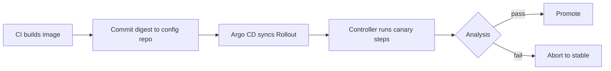
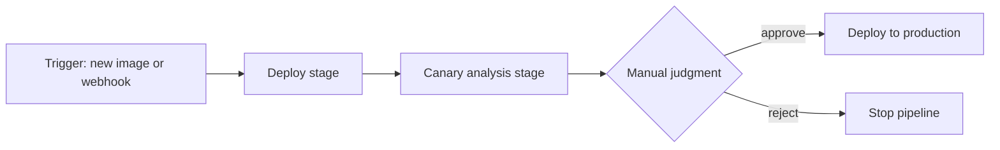

This note compares two ways to run canary releases and approvals: a controller inside the cluster that is driven by Git (Argo Rollouts, usually with Argo CD), and a continuous delivery platform with pipelines, bake and canary stages and automated canary analysis (Spinnaker). It is for senior DevOps engineers who run Spinnaker today or are deciding what to adopt. It does not repeat how to build a canary with Argo Rollouts ([[patterns/progressive-delivery-argo-rollouts]]) or how Argo CD compares with Flux ([[tools/argocd-vs-flux]]).

> [!info] Scope and sources
> Written against the public documentation of Argo Rollouts at [argo-rollouts.readthedocs.io](https://argo-rollouts.readthedocs.io/en/stable/), Spinnaker at [spinnaker.io](https://spinnaker.io/docs/) and Flagger at [flagger.app](https://docs.flagger.app/). The comparison is about design, not benchmarks.

> [!note] Not verified
> The claims below were written from documentation knowledge and were not checked against a running system or the current docs: Spinnaker's release cadence and maintenance status in 2026, the status of Kayenta, the exact Spinnaker stage JSON, and which features exist in current Argo Rollouts versions. No adoption statistics are given. Check them before relying on them.

## At a glance

| Concern                   | Argo Rollouts with Argo CD                                      | Spinnaker                                                                                 |
| ------------------------- | --------------------------------------------------------------- | ----------------------------------------------------------------------------------------- |
| GitOps fit                | Native: the Rollout is a manifest in Git, reconciled by Argo CD | Pipelines are the source of truth; Git holds pipeline definitions only if you export them |
| Targets beyond Kubernetes | Kubernetes only                                                 | Kubernetes, and VM-based targets such as managed instance groups (check provider support) |
| Operational weight        | One controller plus a kubectl plugin; small                     | Several microservices, a datastore and a cache; heavy                                     |
| Approvals and audit       | Pause steps and Git merge requests; audit is Git history        | Manual judgment stages with a pipeline UI; audit is pipeline execution history            |
| Analysis                  | AnalysisTemplates against Prometheus and other providers        | Automated canary analysis (Kayenta) and pipeline stages for checks                        |
| Multi-cluster             | One controller per cluster; Argo CD fans out                    | One platform deploys to many accounts and clusters                                        |
| Team skills               | Kubernetes, Git, YAML                                           | Spinnaker concepts, pipeline expressions, JVM service operations                          |
| Release trigger           | A commit to the config repository                               | A trigger on an artifact, a webhook or a schedule                                         |

## How each models a release

In the Argo model a release is a change of desired state. The pipeline that built the image edits Git and the cluster converges on it. Rollout steps are part of the manifest.



In the Spinnaker model a release is a pipeline execution. The platform pulls the artifact, deploys, waits, analyses and asks for approval, and the pipeline history is the record.



The practical difference is where state lives. With Argo, cluster state is derived from Git, so a rebuilt cluster re-converges without replaying history. With Spinnaker, the pipeline defines what happens, and the cluster state is the result of past executions unless you deploy manifests from Git inside the pipeline.

A minimal Rollout in the Argo model (the complete example is in [[patterns/progressive-delivery-argo-rollouts]]):

```yaml title="rollout-fragment.yaml"
strategy:
  canary:
    steps:
      - setWeight: 10
      - pause: { duration: 5m }
      - setWeight: 50
      - pause: {}
```

A pipeline fragment in the Spinnaker model with a deploy stage followed by a manual judgment. The schema below is illustrative; the exact stage fields were not verified and the platform version in use decides them.

```json
{
  "application": "payments",
  "name": "deploy-prod",
  "stages": [
    {
      "refId": "1",
      "requisiteStageRefIds": [],
      "type": "deployManifest",
      "name": "Deploy to production",
      "account": "gke-prod",
      "cloudProvider": "kubernetes",
      "source": "text",
      "moniker": { "app": "payments" },
      "manifests": [
        {
          "apiVersion": "apps/v1",
          "kind": "Deployment",
          "metadata": { "name": "payments", "namespace": "payments" },
          "spec": {
            "replicas": 6,
            "selector": { "matchLabels": { "app": "payments" } },
            "template": {
              "metadata": { "labels": { "app": "payments" } },
              "spec": {
                "containers": [
                  {
                    "name": "payments",
                    "image": "europe-docker.pkg.dev/my-project/apps/payments:1.8.0"
                  }
                ]
              }
            }
          }
        }
      ]
    },
    {
      "refId": "2",
      "requisiteStageRefIds": ["1"],
      "type": "manualJudgment",
      "name": "Confirm production health",
      "instructions": "Check the dashboards and approve to finish the release.",
      "failPipeline": true
    }
  ]
}
```

### Concept mapping

| Spinnaker concept               | Argo equivalent                               | Note                                                             |
| ------------------------------- | --------------------------------------------- | ---------------------------------------------------------------- |
| Application                     | Argo CD Application or AppProject             | Spinnaker applications group clusters and pipelines              |
| Pipeline                        | Rollout steps plus CI pipeline                | No single object; the flow is split between CI and the Rollout   |
| Deploy manifest stage           | Argo CD sync                                  | Sync is declarative and continuous                               |
| Manual judgment stage           | `pause: {}` step, or a merge request approval | Approver identity is in Git or in the CLI audit trail            |
| Canary analysis stage (Kayenta) | AnalysisTemplate and AnalysisRun              | Different statistical approach; do not expect identical verdicts |
| Account                         | Cluster registered in Argo CD                 | Access control differs; see below                                |
| Trigger                         | Commit to the config repository               | Triggers move to CI                                              |
| Server group or cluster (VMs)   | No equivalent                                 | Keep Spinnaker, or move VMs to another mechanism                 |

## Operating cost

Argo Rollouts is one controller per cluster. It has CRDs to upgrade, a plugin for operators, and a metrics provider to keep reachable. Its failure mode is local: if the controller is down, existing Pods keep running and new rollouts do not progress.

Spinnaker is a set of services (for pipelines, cloud provider integration, authorization, the UI and the API) with persistent storage and often a Redis-style cache. Someone owns upgrades, credentials for every cloud account, and backups of pipeline definitions. That work is justified only when the platform gives you something the in-cluster controller cannot. Check the project's release cadence and maintenance status before betting a new estate on it. The 2026 status was not verified.

Access control also differs. In Argo CD, permissions come from AppProjects, RBAC policy and Git permissions. In Spinnaker, they come from its own authorization service and per-account roles. If your audit story for production approvals depends on a pipeline UI, plan how the equivalent evidence (merge request approval, change record) is produced in the Git model. The compliance angle is covered in the compliance notes, not here.

## Flagger

Flagger is the progressive delivery controller in the Flux ecosystem. It keeps your Deployment, creates the primary and canary copies, and shifts traffic through a mesh, ingress or Gateway based on metric checks. If you have chosen Flux ([[tools/argocd-vs-flux]]), Flagger is the natural counterpart to Argo Rollouts; the trade-off is that the canary is configured through a separate Canary object and not through the workload kind itself.

## Migration paths

### Spinnaker estate to GitOps

1. List what the pipelines do: deploy, bake, analyse, approve, notify. Many pipelines are three stages and a notification.
2. Move manifests into the config repository ([[architecture/gitops-repo-topology-and-promotion]]) and let Argo CD deploy them in non-production first.
3. Convert the canary pipeline of one service to a Rollout with an AnalysisTemplate. Run both for one release cycle and compare verdicts.
4. Replace manual judgment with a merge request approval on the production overlay.
5. Retire pipelines service by service, and keep Spinnaker running until the last one is gone.

### Keeping Spinnaker for VM deploys

If part of the estate deploys to VMs or managed instance groups, keep Spinnaker for those pipelines only and move the Kubernetes services to Argo. This leaves a smaller Spinnaker to operate, but it is still a platform. Set an end date: either move the VM services to images with another deploy mechanism, or accept the cost explicitly.

## Recommendation

For Kubernetes-only estates that already use or plan to use GitOps, use Argo Rollouts with Argo CD. It adds one controller, keeps the release definition in Git, and fits the decision recorded in [[adr/0001-gitops-with-argocd]].

Use Spinnaker when you must deploy to VMs or several clouds from one place, when release approvals must be done in a pipeline UI that the organisation already trusts, or when a team already runs it well and the migration cost has no payback.

Drop Spinnaker if:

- Spinnaker's maintenance status or release cadence becomes a risk for your support needs;
- your Spinnaker estate becomes Kubernetes-only, which removes its main advantage.

Prefer something other than Argo Rollouts if:

- you adopt Flux, in which case evaluate Flagger first;
- Argo Rollouts needs a traffic router your clusters cannot provide, such as a Gateway integration that is not mature enough.

CI stays separate in both models. Building, testing and pushing the image is the job of GitLab CI or Jenkins ([[tools/gitlab-ci-vs-jenkins]]); this decision is only about what happens after the image exists.

## Related

- [[patterns/progressive-delivery-argo-rollouts]]: the full canary pattern with analysis and operations.
- [[tools/argocd-vs-flux]]: the GitOps controller choice that decides whether Argo Rollouts or Flagger fits.
- [[adr/0001-gitops-with-argocd]]: the recorded decision that favours the Git-driven model.
- [[tools/gitlab-ci-vs-jenkins]]: the CI side that feeds either delivery model.
- [[architecture/gitops-repo-topology-and-promotion]]: the repository layout used when migrating pipelines to GitOps.
