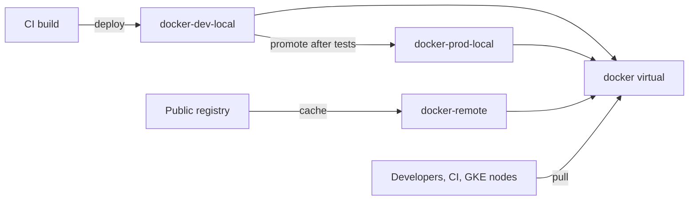

A well-designed Artifactory layout is boring: clients use one URL per package type, internal artefacts always win over public ones, CI can write only where it should, and nobody needs to ask which repository to use. A poor layout shows up as wrong versions, stale caches and dependency-confusion exposure. This note covers the design; promotion between maturity levels is in [[artifact-promotion-artifactory]].

> [!info] Not checked against current releases
> Repository settings, UI labels and defaults change between Artifactory versions and tiers. Confirm each setting in the current JFrog documentation before applying it.

## Goals

- **One endpoint per package type** for developers and CI, so client configuration is stable.
- **Internal names cannot be shadowed** by public packages.
- **Least privilege**: readers read, CI deployers write to one maturity level, nobody deploys anonymously.
- **Predictable growth**: every repository has an owner and a retention rule.
- **Observable**: scanning and audit hooks attach to repositories, not to individual builds. See [[jfrog-xray-vs-trivy-vs-grype]].

## Local repositories (per package type and maturity)

A local repository stores artefacts you publish. Create one per package type and per maturity level, so that promotion is a move or copy between repositories and permissions differ by level.



Do not create one repository per team or per service; that multiplies permission targets and cleanup rules. Use path prefixes inside a repository for ownership (`team-a/service-x`) and permission patterns to scope access.

## Remote repositories and caching (metadata retrieval cache period, offline mode)

A remote repository proxies and caches an upstream such as Docker Hub, npmjs, PyPI or Maven Central.

- **Metadata retrieval cache period** controls how long index data (package lists, `maven-metadata.xml`, `index.json`) is trusted before Artifactory asks the upstream again. A long period saves requests and hides new upstream versions; a short one does the opposite. Pick a value per package type and write it down.
- **Missed retrieval cache period** controls how long a "not found" is remembered. This is the source of the common "package exists upstream but Artifactory returns 404" problem right after a publish.
- **Offline mode** serves only what is cached. It is a useful emergency switch when the upstream is down or blocked, and a good test that your builds do not depend on live internet.
- Store credentials for authenticated upstreams in the remote repository, not in clients, and use a read-only upstream account.
- Enable only the checks you can maintain (for example blocking packages from untrusted namespaces); check the current docs for the options your tier offers.

## Virtual repositories and resolution order (dependency-confusion risk)

A virtual repository aggregates local and remote repositories behind one URL, and resolves in the order listed.

**Put local repositories before remote ones.** If a public package has the same name as an internal one and the remote comes first (or the highest version wins), builds can pull the public, possibly malicious, package. That is dependency confusion. Defences, in order of strength:

1. Local first in the virtual repository's list.
2. Include/exclude patterns on the remote repository, so internal namespaces (`com/example/**`, `@example/*`, `example-internal-*`) can never be fetched from the public upstream.
3. Separate virtual repositories for build-time and runtime where policy differs.
4. Lockfiles and hash pinning in the clients (`package-lock.json`, `pip --require-hashes`, Maven checksums).

Internal base images are covered by the same rule; see [[dockerfile-hardening]].

## Naming convention

Use `<type>-<purpose>-<kind>` for concrete repositories and the bare type for the virtual one, so the URL tells you what you are touching.

| Repository          | Kind    | Purpose                                   |
| ------------------- | ------- | ----------------------------------------- |
| `docker-dev-local`  | local   | Every CI build lands here                 |
| `docker-prod-local` | local   | Promoted, release-quality images only     |
| `docker-remote`     | remote  | Cache of Docker Hub (and other upstreams) |
| `docker`            | virtual | The one URL clients use                   |
| `helm-prod-local`   | local   | Released Helm charts                      |
| `npm-remote`        | remote  | Cache of npmjs                            |
| `npm`               | virtual | Internal npm scope plus the cache         |

## Permission targets and groups (CI deployers vs readers, no anonymous deploy)

Model access with groups mapped from your identity provider, never with personal accounts.

| Group           | Repositories         | Actions                  |
| --------------- | -------------------- | ------------------------ |
| `art-readers`   | virtual repositories | read                     |
| `art-ci-dev`    | `*-dev-local`        | read, deploy, annotate   |
| `art-promoters` | `*-prod-local`       | read, deploy (promotion) |
| `art-admins`    | all                  | manage (break-glass)     |

- Anonymous access off. If anonymous read is unavoidable for a public mirror, keep anonymous deploy off regardless.
- CI uses short-lived access tokens scoped to one group, not the admin password. Rotate on the schedule in [[leaked-credential-rotation]].
- Deleting and overwriting artefacts is a separate action from deploying; grant it only to promoters or admins, and enable immutable releases where your version supports it (check the current docs).

## Client configuration (Docker, Helm, npm or pip, Maven)

```bash title="clients.sh"
ART=artifactory.example.com

# Docker: pull through the virtual repository
docker login "$ART"
docker pull "$ART/docker/library/alpine:3.20"

# Helm (classic repository index)
printf '%s' "$ART_TOKEN" | helm repo add example "https://$ART/artifactory/helm" --username ci-reader --password-stdin
helm repo update

# npm: scoped registry plus the virtual repository
npm config set registry "https://$ART/artifactory/api/npm/npm/"

# pip: --index-url points at the virtual PyPI repository
pip install --index-url "https://$ART/artifactory/api/pypi/pypi/simple" requests
```

```xml title="~/.m2/settings.xml"
<settings>
  <mirrors>
    <mirror>
      <id>artifactory</id>
      <mirrorOf>*</mirrorOf>
      <url>https://artifactory.example.com/artifactory/maven</url>
    </mirror>
  </mirrors>
  <servers>
    <server>
      <id>artifactory</id>
      <username>${env.ART_USER}</username>
      <password>${env.ART_TOKEN}</password>
    </server>
  </servers>
</settings>
```

The Docker URL form (repository path, subdomain or port) depends on how the reverse proxy is configured; confirm which method your instance uses. Never put tokens in files committed to Git.

Validation after any change:

```bash title="validate.sh"
jf config add example --url=https://artifactory.example.com --user=ci-reader --access-token="$ART_TOKEN" --interactive=false
jf rt ping --server-id=example

curl -sS -I -H "Authorization: Bearer $ART_TOKEN" \
  https://artifactory.example.com/artifactory/api/repositories/docker

docker pull artifactory.example.com/docker/library/alpine:3.20
printf '%s' "$ART_TOKEN" | helm repo add example https://artifactory.example.com/artifactory/helm --username ci-reader --password-stdin && helm search repo example
```

Check the JFrog CLI documentation for the current flags before putting these in a pipeline.

## Hooks for Xray watches and retention

Attach scanning and retention to repositories, using the naming convention as the selector.

- An Xray watch on `docker-dev-local` and `docker-prod-local` with a policy that fails on critical findings with a fix available. Exceptions are time-limited and follow [[policy-exception-and-waiver-process]].
- A watch on `docker-remote` so cached upstream images are scanned too.
- Retention: dev repositories keep the last N versions or N days; prod repositories keep everything referenced by a release. Run any cleanup against a copy or in dry-run first.
- License information on packages feeds [[open-source-license-compliance]].

## Failure modes

| Symptom                                                     | Likely cause                                             | Fix                                                              |
| ----------------------------------------------------------- | -------------------------------------------------------- | ---------------------------------------------------------------- |
| New upstream version not visible                            | Metadata retrieval cache period too long                 | Lower the period or zap the cache for that path                  |
| 404 for a package that exists upstream                      | Negative result cached (missed retrieval period)         | Zap caches, wait the period, then retry; lower the period        |
| Virtual repo returns an unexpected (older or newer) version | Repository order, or "highest version wins" across repos | Reorder, add include/exclude patterns, pin versions in lockfiles |
| Public package shadows internal name                        | Remote before local, no exclude patterns                 | Local first plus exclude patterns for internal namespaces        |
| Disk full on a self-hosted instance                         | No retention on dev or remote repositories               | Retention, then a garbage collection run in a quiet window       |
| CI cannot push                                              | Token expired or group missing deploy permission         | Rotate the token, check the permission target                    |

Rollback for a layout change is to restore the previous virtual repository list and patterns (keep them in Terraform or an exported configuration) and re-point clients; the data in local repositories is untouched.

## Related

- [[artifact-promotion-artifactory]]
- [[artifactory-vs-nexus-vs-artifact-registry]]
- [[jfrog-xray-vs-trivy-vs-grype]]
- [[dockerfile-hardening]]
- [[open-source-license-compliance]]

## Sources

- [JFrog Artifactory documentation](https://jfrog.com/help/r/jfrog-artifactory-documentation)
- [JFrog CLI documentation](https://docs.jfrog-applications.jfrog.io/jfrog-applications/jfrog-cli) (confirm the current URL)
