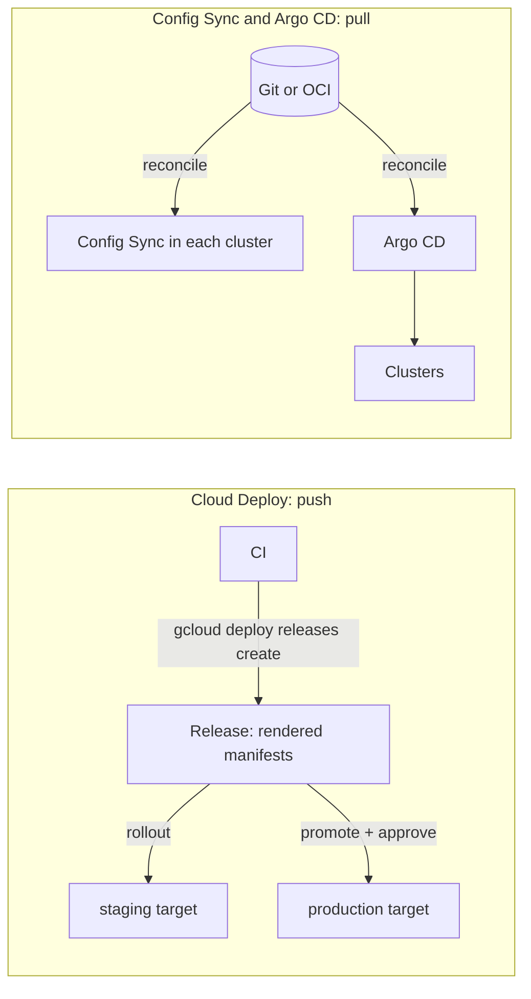

[[0001-gitops-with-argocd]] made Argo CD the only path for workloads into clusters, and [[0017-argo-cd-and-rollouts-not-spinnaker]] added Argo Rollouts for progressive delivery. GCP-first teams are still offered two managed alternatives in nearly every architecture review: **Cloud Deploy**, a managed delivery pipeline service, and **Config Sync**, Google's GitOps reconciler for GKE fleets. This note records how they compare with Argo CD, so the question can be answered with facts rather than reopened each time.

Short answer: both ADRs stand. Config Sync is a reasonable fit for a platform baseline on a large fleet, and Cloud Deploy for Cloud Run or for teams that want a managed, approval-gated push pipeline, but neither replaces Argo CD plus Rollouts for this platform's application delivery.

> [!info] Not checked against current releases
> Command flags were checked against the local `gcloud` 570.0.0 help, and resource fields against the Google Terraform provider documentation and the Config Sync and Cloud Deploy sample repositories (main branches), on 2026-10-21. Not verified: pricing and any free tier of either service; the full list of Cloud Deploy target types and which are GA; Deploy Policy and Automation behaviour; the IAM role names for approvers; the requirements for Gateway API canaries on GKE; the YAML (camelCase) spelling of the canary settings; Config Sync's `nomos` CLI, its Git authentication type strings and its Workload Identity fields inside `RootSync`; and how drift prevention behaves when its webhook is unavailable. Check the official pages under Sources before relying on them.

## The models in one picture



- **Cloud Deploy is push.** CI creates a release, Cloud Deploy renders it once (through Skaffold) and rolls it out to a sequence of targets. Promotion and approval are API calls. Git is the input to a release, not the live source of truth.
- **Config Sync is pull.** A reconciler in each cluster watches a Git repository, an OCI image or a Helm chart and applies what it finds, continuously.
- **Argo CD is pull** as well, with a central control plane, a UI for application teams, and Argo Rollouts for canaries ([[argocd-vs-flux]] compares it with the other open-source GitOps controller).

## Criteria

| Criterion                | Why it matters here                                                                                        |
| ------------------------ | ---------------------------------------------------------------------------------------------------------- |
| Push or pull             | ADR 0001 keeps cluster credentials out of CI; a push model moves them to a managed service                 |
| Promotion and approvals  | Production deploys are protected ([[0047-semver-release-tags-and-protected-production-deploys]])           |
| Rollback                 | ADR 0048 rolls back by reverting to the previous digest in Git                                             |
| Progressive delivery     | Canary with automated analysis is the default for services that need it                                    |
| Fleet scale              | Many clusters per environment and region ([[gke-platform-topology-and-tenancy]])                           |
| Drift                    | Manual changes must be detected or prevented                                                               |
| Developer UI             | Application teams see their own deployments without cluster credentials                                    |
| IAM and audit            | Who deployed what, and who approved it ([[separation-of-duties-in-deployments]])                          |
| Cost and lock-in         | Managed services cost money per use and tie the pipeline to GCP                                            |

## At a glance

| Concern               | Cloud Deploy                                                                  | Config Sync                                                                     | Argo CD plus Rollouts                                                  |
| --------------------- | ----------------------------------------------------------------------------- | ------------------------------------------------------------------------------- | ---------------------------------------------------------------------- |
| Model                 | Push: releases rolled out to targets                                          | Pull: reconciler per cluster                                                    | Pull: central controller, many clusters                                |
| Source                | Skaffold render of manifests, Helm or Kustomize at release time               | Git, OCI image or Helm chart                                                    | Git (plain, Kustomize, Helm), OCI depending on version                 |
| Targets               | GKE, Cloud Run and other types (check the docs), custom targets               | The cluster it runs in                                                          | Any registered Kubernetes cluster                                      |
| Promotion             | `releases promote`, serial pipeline stages                                    | Change the commit, branch or tag the sync points at                             | Git change per environment ([[gitops-repo-topology-and-promotion]])     |
| Approval              | `requireApproval` on a target; `rollouts approve` or `reject`                 | Git review only                                                                 | Git review; optional sync windows                                      |
| Rollback              | `targets rollback` to a prior release                                         | Revert the source                                                               | Revert the Git commit (ADR 0048); Rollouts abort for canaries           |
| Canary                | Built-in canary strategy for GKE (Gateway API or Service networking) and Cloud Run | None                                                                       | Argo Rollouts with analysis ([[progressive-delivery-argo-rollouts]])    |
| Drift                 | Not its job after the rollout                                                 | Continuous; optional admission webhook to prevent drift                         | Continuous detection, self-heal                                        |
| UI                    | Cloud console                                                                 | Cloud console for fleets; `kubectl` status                                      | Argo CD UI with SSO and project RBAC                                    |
| Operated by           | Google                                                                        | Google (fleet feature) or you (open-source manifests)                          | You                                                                    |
| Lock-in               | High: pipeline, targets and approvals are GCP resources                       | Medium: plain manifests, GKE-specific CRDs and install                          | Low: open source, any cluster                                          |
| Cost                  | Check the [pricing page](https://cloud.google.com/deploy/pricing)             | Check the current GKE and fleet pricing                                         | Your cluster resources and operating time                               |

## Cloud Deploy

### Pipeline and targets

A delivery pipeline is a list of stages, each pointing at a target. `gcloud deploy apply` applies a YAML file that contains delivery pipelines, targets, custom target types, deploy policies and automations. The shape below follows Google's `cloud-deploy-samples` repository; `requireApproval` is the YAML form of the target's `require_approval` field.

```yaml title="clouddeploy.yaml"
apiVersion: deploy.cloud.google.com/v1
kind: DeliveryPipeline
metadata:
  name: payments-api
serialPipeline:
  stages:
    - targetId: staging
      profiles: [staging]
    - targetId: production
      profiles: [production]
---
apiVersion: deploy.cloud.google.com/v1
kind: Target
metadata:
  name: staging
gke:
  cluster: projects/example-project/locations/europe-west1/clusters/stage-1
---
apiVersion: deploy.cloud.google.com/v1
kind: Target
metadata:
  name: production
requireApproval: true
gke:
  cluster: projects/example-project/locations/europe-west1/clusters/prod-1
```

```bash title="register the pipeline"
REGION="europe-west1"
gcloud deploy apply --file=clouddeploy.yaml --region="${REGION}"
gcloud deploy delivery-pipelines describe payments-api --region="${REGION}"
```

### Releases, promotion and approval

A release captures rendered manifests for a set of images. Release names accept `$DATE` and `$TIME` inside single quotes. Pass images by digest, in line with [[0048-rollback-by-redeploying-previous-digest]].

```bash title="release, promote, approve"
set -euo pipefail
REGION="europe-west1"
PIPELINE="payments-api"
IMAGE="europe-west1-docker.pkg.dev/example-project/apps/payments-api@${IMAGE_DIGEST}"

# Render with Skaffold from the current directory and roll out to the first target.
gcloud deploy releases create 'rel-$DATE-$TIME' \
  --delivery-pipeline="${PIPELINE}" --region="${REGION}" \
  --source=. --images="payments-api=${IMAGE}"

# Later: promote the release to the next stage after the farthest target it reached.
RELEASE="$(gcloud deploy releases list --delivery-pipeline="${PIPELINE}" \
  --region="${REGION}" --sort-by=~createTime --limit=1 --format='value(name.basename())')"
gcloud deploy releases promote --release="${RELEASE}" \
  --delivery-pipeline="${PIPELINE}" --region="${REGION}"

# The production rollout waits for approval because the target has requireApproval.
gcloud deploy rollouts list --release="${RELEASE}" \
  --delivery-pipeline="${PIPELINE}" --region="${REGION}"
gcloud deploy rollouts approve "${ROLLOUT}" --release="${RELEASE}" \
  --delivery-pipeline="${PIPELINE}" --region="${REGION}"
```

`IMAGE_DIGEST` and `ROLLOUT` come from your build and from the `rollouts list` output. `releases list` sorting and the `name.basename()` projection are standard `gcloud` list behaviour, but run the list command on its own first to see the fields. Other confirmed knobs: `--to-target` on `create` and `promote`, `--disable-initial-rollout`, `--skaffold-version`, `--helm-version` and `--kustomize-version` to pin the renderers, and `--from-k8s-manifest` to skip Skaffold for a single manifest.

Who may approve is an IAM question. Give the approver role to a group that does not also author the change, which is the separation-of-duties control auditors look for. The exact role names were not verified; read the Cloud Deploy IAM page.

### Canary

Cloud Deploy has a canary strategy per stage. For GKE it either rewrites an `HTTPRoute` (Gateway API) or manipulates Services and Deployments (service networking). In the Terraform provider this is `strategy { canary { ... } }` on a stage:

```hcl title="clouddeploy-pipeline.tf"
resource "google_clouddeploy_delivery_pipeline" "payments_api" {
  project  = "example-project"
  location = "europe-west1"
  name     = "payments-api"

  serial_pipeline {
    stages {
      target_id = "staging"
      profiles  = ["staging"]
    }
    stages {
      target_id = "production"
      profiles  = ["production"]
      strategy {
        canary {
          runtime_config {
            kubernetes {
              gateway_service_mesh {
                http_route = "payments-api"
                service    = "payments-api"
                deployment = "payments-api"
              }
            }
          }
          canary_deployment {
            percentages = [10, 50] # ascending, each at least 0 and below 100
            verify      = true     # run the verify job after each phase
          }
        }
      }
    }
  }
}
```

`gateway_service_mesh` also takes `route_update_wait_time` (at most three hours), `stable_cutback_duration` (15 seconds to an hour) and `pod_selector_label`; `custom_canary_deployment` with `phase_configs` replaces the fixed percentages. Targets can name `associated_entities` so the Gateway API canary updates routes on other clusters. Some provider examples use `google-beta`, so check whether each field is GA in the provider version you pin. A verify job runs tests you supply; it is not the metric analysis that Argo Rollouts' `AnalysisTemplate` does against Prometheus.

### Rollback

```bash title="roll back a target"
gcloud deploy targets rollback production \
  --delivery-pipeline=payments-api --region=europe-west1
```

Without `--release`, this rolls the target back to the last successfully deployed release. Two caveats:

- `gcloud deploy releases abandon` stops new rollouts from a release, and rollouts of abandoned releases cannot be rolled back to. Abandon only what you are sure you will never want again.
- Rollback creates a new rollout of an older release. Git does not change. If your manifests also live in a GitOps repository, the two now disagree until someone reverts Git, which is the exact state ADR 0048 forbids leaving open.

## Config Sync

Config Sync reconciles `RootSync` (cluster-scoped, for the platform) and `RepoSync` (namespace-scoped, for a team) objects in the `configsync.gke.io` API group. A sync's source type is `git` (the default), `oci` or `helm`, and the source format is `hierarchy` (the default) or `unstructured`. Use `unstructured` unless you want the hierarchical repository layout.

### Installing on a fleet

On GKE fleets, Config Sync is a fleet feature, configured per membership. The Terraform form:

```hcl title="config-sync.tf"
resource "google_gke_hub_feature_membership" "config_sync_prod_1" {
  project    = "example-project"
  location   = "global"
  feature    = "configmanagement"
  membership = "prod-1"

  configmanagement {
    config_sync {
      enabled       = true # must be set explicitly
      source_format = "unstructured"
      prevent_drift = true # admission webhook; needs Config Sync 1.10.0 or later

      oci {
        sync_repo                 = "europe-west1-docker.pkg.dev/example-project/config/platform-baseline"
        policy_dir                = "."
        secret_type               = "gcpserviceaccount"
        gcp_service_account_email = "config-sync@example-project.iam.gserviceaccount.com"
        sync_wait_secs            = 30
      }
    }
  }
}
```

Use either `git` or `oci`, not both. OCI sources need Config Sync 1.12.0 or later, and `secret_type` for OCI is `gcenode`, `gcpserviceaccount` or `none`. The `git` block takes `sync_repo`, `sync_branch` (default `master`, so set it), `sync_rev` (default `HEAD`), `policy_dir`, `secret_type`, `gcp_service_account_email` and `https_proxy`. Check whether your feature membership also needs `membership_location` and a pinned `configmanagement` version.

`gcloud container fleet config-management` in `gcloud` 570.0.0 offers only `describe` and `disable` at GA, so install through Terraform or the console, not through an install CLI.

Outside a fleet, the open-source project publishes a manifest per release (`config-sync-manifest.yaml` under the GitHub release of the version you pick). Pin a release; never apply a `latest` URL to a production cluster.

### Checking sync status

The status has three stages, `source`, `rendering` and `sync`, each with the commit it reached and its errors, and the CRD's print columns show them:

```bash title="sync status"
kubectl get crd rootsyncs.configsync.gke.io -o jsonpath='{.spec.versions[*].name}{"\n"}'
kubectl get rootsyncs.configsync.gke.io -A
kubectl get reposyncs.configsync.gke.io -A

# Errors per stage for one RootSync (name and namespace as installed on your cluster).
kubectl get rootsyncs.configsync.gke.io root-sync -n config-management-system \
  -o jsonpath='{.status.source.errors}{"\n"}{.status.rendering.errors}{"\n"}{.status.sync.errors}{"\n"}'
```

The name `root-sync` and the `config-management-system` namespace are the usual defaults for the fleet install; the default namespace was not verified, so read it from the `get -A` output. Alert when the source commit and the sync commit differ for longer than a few sync periods: that is a stuck reconciler.

### Drift prevention

With `prevent_drift`, an admission webhook rejects changes to objects Config Sync manages, so a `kubectl edit` fails instead of being reverted later. That is stronger than Argo CD's self-heal, and it also blocks break-glass edits during an incident. Decide before you enable it how an emergency change is made (a commit through the incident path), and test what happens to writes when the webhook is unavailable; its failure behaviour was not verified.

## Argo CD

Argo CD and Rollouts are covered in [[argocd-vs-flux]], [[argo-rollouts-vs-spinnaker]], [[progressive-delivery-argo-rollouts]] and [[gitops-repo-topology-and-promotion]]. What matters for this comparison: one control plane for many clusters, a UI with SSO and project RBAC for application teams, Git as the only source of truth, and canary analysis against Prometheus that aborts on its own.

## Combinations seen in practice

- **Config Sync for the platform baseline, Argo CD for applications.** Namespaces, RBAC, network policies, quotas and policy constraints arrive through Config Sync from the platform repository on every fleet member, including the clusters that host Argo CD. Applications use Argo CD. The boundary must be explicit: no object may be managed by both, or they fight.
- **Cloud Deploy for Cloud Run, Argo CD for GKE.** Cloud Run services have no in-cluster reconciler, and Cloud Deploy's Cloud Run targets and canaries fit them well.
- **Cloud Deploy in front of GitOps.** The samples repository lists a custom GitOps target, where the rollout commits to a Git repository that a reconciler then applies. It keeps approvals in Cloud Deploy and keeps Git as the source of truth; the details were not verified. It also adds a second system to debug when a deploy stalls.

## Failure modes and rollback

| Tool         | Failure                                                         | What to do                                                                                       |
| ------------ | --------------------------------------------------------------- | ------------------------------------------------------------------------------------------------ |
| Cloud Deploy | Render works in staging but fails for production profile        | Render every profile in CI before creating the release                                           |
| Cloud Deploy | Approval stuck, approver unavailable                            | A second approver group; never grant the author the approver role as a workaround                |
| Cloud Deploy | Rollback target abandoned                                       | Roll back to an older non-abandoned release, or create a new release from the previous digest   |
| Cloud Deploy | Canary leaves the `HTTPRoute` split                             | Check the rollout phase, advance or roll back; inspect the route on every associated cluster    |
| Config Sync  | Source unreachable (Git outage, registry permission)            | The cluster keeps its last applied state; fix access and watch `source.errors`                   |
| Config Sync  | Bad commit applied to the whole fleet                           | Revert the commit or repoint the sync to the previous tag or digest; roll out by fleet ring      |
| Config Sync  | Webhook blocks an urgent fix                                    | Make the fix through Git; `stop_syncing` on the feature membership pauses syncing (check its exact effect first) |
| Argo CD      | Covered in [[argocd-vs-flux]] and [[0048-rollback-by-redeploying-previous-digest]] | Revert in Git; Rollouts abort for a canary                                  |

For Config Sync, point production at an immutable OCI digest or Git tag rather than a branch, so "roll back" is a single field change in Terraform and the fleet converges on known bytes.

## Recommendation

- **Keep Argo CD and Argo Rollouts** for application delivery to GKE, as ADR 0001 and ADR 0017 decided. The pull model, the shared UI and metric-driven canaries are the reasons, and neither Google service replaces all three.
- **Consider Config Sync** for the platform baseline when the fleet grows to the point where bootstrapping each cluster's Argo CD registration and baseline is itself toil, or when drift prevention (not only detection) is a requirement. Write an ADR for the boundary first.
- **Consider Cloud Deploy** for Cloud Run services, or for a team whose release process is approval-heavy and whose services have no GitOps repository yet. Do not run it and Argo CD against the same workloads.
- **Revisit** if the team can no longer staff Argo CD upgrades and security fixes, if Google adds metric-based canary analysis comparable to Rollouts, or if audit requirements demand approvals recorded in a managed GCP service rather than in Git review.

## Related

- [[0001-gitops-with-argocd]]
- [[0017-argo-cd-and-rollouts-not-spinnaker]]
- [[0047-semver-release-tags-and-protected-production-deploys]]
- [[0048-rollback-by-redeploying-previous-digest]]
- [[argocd-vs-flux]]
- [[argo-rollouts-vs-spinnaker]]
- [[gitops-repo-topology-and-promotion]]
- [[progressive-delivery-argo-rollouts]]
- [[gke-platform-topology-and-tenancy]]
- [[separation-of-duties-in-deployments]]

## Sources

- [Cloud Deploy overview](https://cloud.google.com/deploy/docs/overview)
- [Cloud Deploy canary deployments](https://cloud.google.com/deploy/docs/deployment-strategies/canary)
- [Cloud Deploy: promote a release](https://cloud.google.com/deploy/docs/promote-release)
- [Cloud Deploy pricing](https://cloud.google.com/deploy/pricing)
- [Cloud Deploy samples](https://github.com/GoogleCloudPlatform/cloud-deploy-samples)
- [Google provider: `google_clouddeploy_delivery_pipeline`](https://registry.terraform.io/providers/hashicorp/google/latest/docs/resources/clouddeploy_delivery_pipeline)
- [Google provider: `google_gke_hub_feature_membership`](https://registry.terraform.io/providers/hashicorp/google/latest/docs/resources/gke_hub_feature_membership)
- [Config Sync installation](https://docs.cloud.google.com/kubernetes-engine/config-sync/docs/how-to/installing-config-sync) (the path cited by `gcloud container fleet config-management --help`; the documentation has moved before, so search the GKE docs if it redirects)
- [Config Sync open-source repository](https://github.com/GoogleContainerTools/kpt-config-sync) (check the current repository name; the project has been renamed)
- `gcloud deploy ... --help` and `gcloud container fleet config-management --help`, `gcloud` 570.0.0, read 2026-10-21
