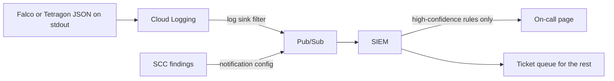

The supply chain notes stop at the cluster door: images are scanned, signed and admitted ([[software-supply-chain-end-to-end]]), admission policy rejects risky pod specs ([[gatekeeper-vs-kyverno]], [[pod-security-admission]]), and [[cis-benchmarks-with-kube-bench]] checks node and control-plane posture. None of that sees what a container does after it starts: a shell spawned in a web pod, a write under `/etc`, an unexpected outbound connection, a binary that was not in the image. [[compromised-cloud-cluster-containment]] describes what to do once you suspect a compromise but needs a detection source to start from. [[threat-detection-and-response-gcp-gke]] places runtime detection in the detection and response pipeline; this note picks the tool. It compares three: Falco, Tetragon, and Google's Security Command Center (SCC) Container Threat Detection.

> [!info] Not checked against current releases
> Written from the Falco and Tetragon documentation source, the Falco chart README and the `gcloud` 570.0.0 help text on 2026-10-21; not checked against the published documentation pages, so verify there. Not verified: the SCC tier that includes Container Threat Detection, its supported GKE versions and node images, its detection list and price; the current scope of the GKE security posture dashboard and any deprecations; whether Falco or Tetragon run on GKE Autopilot (Google's Autopilot partner allowlist); kernel and BTF availability per GKE node image; how Cloud Logging maps Falco's JSON fields to severity; the Falco Operator's install steps. No CPU overhead figures are given because none were found in the sources.

## Criteria

| Criterion       | Question to answer                                                                           |
| --------------- | -------------------------------------------------------------------------------------------- |
| Signal source   | Kernel events per node (eBPF or kernel module), or a managed service you cannot see inside.  |
| Detect or block | Alert only, or also kill or deny the operation in the kernel.                                |
| Rule language   | Who writes and reviews rules, and how hard it is to write one that is not noisy.             |
| Autopilot fit   | Whether a privileged node agent can run at all on the cluster mode you use.                  |
| Output routing  | How findings reach the SIEM and on-call, with enough context (pod, namespace, image) to act. |
| Overhead        | Per-node CPU and memory, and what happens under event bursts.                                |
| Ownership       | Who upgrades the agent, tunes rules, and answers the page.                                   |

## At a glance

| Concern           | Falco                                                               | Tetragon                                                                  | SCC Container Threat Detection           |
| ----------------- | ------------------------------------------------------------------- | ------------------------------------------------------------------------- | ---------------------------------------- |
| What it is        | CNCF runtime detection engine, DaemonSet                            | eBPF security observability and enforcement agent from the Cilium project | Google-managed detection service for GKE |
| Signal            | Syscalls via modern eBPF probe (default) or kernel module           | kprobes, tracepoints, uprobes, LSM hooks                                  | Managed; internals not exposed           |
| Default content   | Large maintained rule set, extended with your own rules             | Process exec and exit events; detections come from your TracingPolicies   | Google's detector list                   |
| Enforcement       | Detection only (response via external automation)                   | In-kernel `Sigkill`, `Signal` and `Override` actions                      | Detection only                           |
| Output            | stdout, file, syslog, program, HTTP; Falcosidekick fans out to many | JSON events to stdout or file export                                      | SCC findings, Pub/Sub notifications      |
| Runs on Autopilot | Not verified (partner allowlist)                                    | Not verified (partner allowlist)                                          | Not verified; check the SCC page         |
| You operate       | Agent, driver, rules, routing                                       | Agent, policies, routing                                                  | Enablement and routing only              |

## Falco on GKE Standard

Falco reads kernel events and evaluates rules against them. Two drivers are supported: the **modern eBPF probe**, which is the default and embedded in the Falco binary, and the **kernel module**. The modern probe usually needs kernel 5.8 or later with the BPF ring buffer and BTF exposed; the kernel module needs full privileges and cannot run with Linux capabilities alone. On a node you can check support with the commands from the Falco documentation:

```bash title="on a node, check modern eBPF prerequisites"
sudo bpftool feature probe kernel | grep -q "map_type ringbuf is available" && echo true || echo false
sudo bpftool feature probe kernel | grep -q "program_type tracing is available" && echo true || echo false
```

The Falco documentation now recommends the Falco Operator on Kubernetes and says the Helm chart remains fully supported. The chart is what most teams pin today:

```bash title="install Falco with the modern eBPF driver and JSON output"
CHART_VERSION="<pin a chart version you have reviewed>"
helm repo add falcosecurity https://falcosecurity.github.io/charts
helm repo update
helm upgrade --install falco falcosecurity/falco \
  --namespace falco --create-namespace \
  --version "${CHART_VERSION}" \
  --set driver.kind=modern_ebpf \
  --set falco.json_output=true \
  --set collectors.kubernetes.enabled=true \
  -f falco-custom-rules.yaml
kubectl -n falco wait pods --for=condition=Ready --all --timeout=5m
```

- `driver.kind` defaults to `auto`, which tries the modern eBPF probe first and falls back to the kernel module. Setting `modern_ebpf` explicitly makes a node that cannot run it fail loudly instead of silently loading a kernel module. The chart README spells the value differently in one example, so check the values table of your pinned chart.
- `collectors.kubernetes.enabled=true` deploys the k8s-metacollector and the k8smeta plugin. Without it, Falco reads pod metadata from container runtime labels and only a few `k8s.*` fields work, such as `k8s.pod.name` and `k8s.ns.name`. The namespace field is spelled `k8s.ns.name` in long-standing Falco releases while the chart README uses `k8s.pod.namespace.name`; confirm which one your build exposes with `falco --list | grep k8s.` before loading the rule below.
- The chart runs Falco as a privileged DaemonSet. Give it a priority class and resource requests ([[priority-classes-and-preemption]], [[kubernetes-resource-requests-and-limits]]) so it is not the first pod evicted under node pressure.

A custom rule, loaded through the chart's `customRules` value:

```yaml title="falco-custom-rules.yaml"
customRules:
  rules-platform.yaml: |-
    - list: platform_shell_binaries
      items: [bash, sh, ash, dash, zsh, ksh]

    - rule: Shell spawned in production workload
      desc: An interactive or scripted shell started inside a container in a production namespace
      condition: >
        spawned_process and container
        and proc.name in (platform_shell_binaries)
        and k8s.ns.name startswith "prod-"
      output: >
        Shell in production container (user=%user.name ns=%k8s.ns.name
        pod=%k8s.pod.name image=%container.image.repository cmdline=%proc.cmdline parent=%proc.pname)
      priority: WARNING
      tags: [platform, shell]
      exceptions:
        - name: known_debug_images
          fields: [container.image.repository]
          comps: [=]
          values:
            - [example.com/platform/debug-toolbox]
```

Rule exceptions (the `exceptions:` key, available since Falco 0.28.0) are the maintainable way to tune: each has a name, the fields, the comparison operators and the values. Prefer an exception over appending `and not ...` to a condition, because reviewers can see each allowed case.

Falco's JSON output on stdout is collected by GKE's normal container log pipeline. Whether Cloud Logging maps the `priority` field to log severity was not verified; route on the `priority` and `rule` fields explicitly in the log sink filter. Falcosidekick (`--set falcosidekick.enabled=true`) forwards to many targets; its README lists Pub/Sub, Cloud Storage, Cloud Run and Cloud Functions on Google Cloud, not Cloud Logging directly.

## Tetragon

Tetragon attaches eBPF programs to kernel functions and filters in the kernel, so it can both observe and act. Out of the box it exports process execution and exit events; everything else comes from `TracingPolicy` resources (`cilium.io/v1alpha1`) that hook kprobes, tracepoints or uprobes and filter with selectors.

```bash title="install Tetragon and read events"
CHART_VERSION="<pin a chart version you have reviewed>"
helm repo add cilium https://helm.cilium.io
helm repo update
helm upgrade --install tetragon cilium/tetragon -n kube-system --version "${CHART_VERSION}"
kubectl rollout status -n kube-system ds/tetragon -w

kubectl exec -ti -n kube-system ds/tetragon -c tetragon -- \
  tetra getevents -o compact --pods api-7d9c8b5f6-abcde
```

Two defaults matter for detection: Tetragon filters `kube-system` events by default to reduce noise, and the default export deny list drops events from the host (empty namespace), `cilium` and `kube-system`. A SIEM rule about node-level processes will see nothing until you change `tetragon.exportDenyList`.

Start every policy in observe mode. This one reports reads of `/etc/shadow` by anything; the default action is `Post`, which emits an event:

```yaml title="tracingpolicy-shadow-observe.yaml"
apiVersion: cilium.io/v1alpha1
kind: TracingPolicy
metadata:
  name: observe-etc-shadow
spec:
  kprobes:
    - call: "fd_install"
      syscall: false
      args:
        - index: 0
          type: int
        - index: 1
          type: "file"
      selectors:
        - matchArgs:
            - index: 1
              operator: "Equal"
              values:
                - "/etc/shadow"
```

Enforcement adds `matchActions`. The documentation's example kills any process other than namespace PID 0 or 1 that writes to `/etc/passwd` via `sys_write`:

```yaml title="selector with Sigkill (from the Tetragon selectors documentation)"
selectors:
  - matchPIDs:
      - operator: NotIn
        followForks: true
        isNamespacePID: true
        values: [0, 1]
    matchArgs:
      - index: 0
        operator: "Prefix"
        values: ["/etc/passwd"]
    matchActions:
      - action: Sigkill
```

> [!warning] Enforcement can kill legitimate work and still not stop the operation
> Tetragon's enforcement documentation says a `SIGKILL` sent during `write()` does not guarantee the data is not written; to stop the operation, combine `Signal` or `Sigkill` with `Override`. It also warns that TracingPolicies are low level and need kernel knowledge to avoid problems such as time-of-check to time-of-use bugs. Run every policy in observe mode first, and enforce only on narrowly scoped, well-understood paths.

Tetragon needs Linux 4.19 or later (5.10 or later recommended on arm64) and BTF; its FAQ covers start-up failures when the BTF file is missing.

## SCC Container Threat Detection and the posture dashboard

Container Threat Detection is a Security Command Center service. It is managed: you enable it, and findings appear in SCC. The CLI names the service `container-threat-detection`:

```bash title="enable Container Threat Detection and route findings (verify tier and scope first)"
ORG_ID="123456789012"
PROJECT_ID="example-project"
TOPIC="projects/example-security/topics/scc-findings"

gcloud scc manage services update container-threat-detection \
  --organization="${ORG_ID}" --enablement-state=ENABLED

gcloud scc notifications create ctd-to-siem \
  --organization="${ORG_ID}" \
  --pubsub-topic="${TOPIC}" \
  --filter='state="ACTIVE"'
```

Which SCC tier includes the service, what it detects, which GKE versions and node images it supports, and whether it covers Autopilot were not verified; read the Container Threat Detection overview before you rely on it. The filter uses the SCC finding filter syntax; narrow it to the categories you will act on once you have seen real findings.

The GKE security posture dashboard is a separate feature. The CLI exposes `--security-posture=disabled|standard|enterprise` and `--workload-vulnerability-scanning=disabled|standard|enterprise` on `gcloud container clusters create|update`. Its current scope and any deprecations were not verified; treat it as posture and vulnerability visibility, not runtime detection.

## Autopilot

[[0018-gke-autopilot-for-new-clusters]] makes Autopilot the default for new clusters, and Autopilot does not allow arbitrary privileged DaemonSets. The `gcloud` help lists `allow-net-admin` as the only generic Autopilot workload policy, which does not cover a kernel-level agent. Third-party agents run on Autopilot only through Google's partner allowlist, and whether Falco or Tetragon are on it today was not verified. On Autopilot, plan on SCC Container Threat Detection unless the allowlist page says otherwise. On Standard clusters, any of the three work.

## Routing findings and paging

Send everything to the SIEM; page on very little. Owner lookup and the severity map for all finding sources, not only runtime ones, are in [[threat-detection-and-response-gcp-gke#Routing and severity|the detection and response design]].



- Join runtime findings with the audit trail in the SIEM ([[gcp-audit-logs-siem]]): "shell in pod" plus "who ran `kubectl exec`" is a much better signal than either alone.
- Page only on rules that have run in audit mode for weeks with near-zero false positives, and give each a runbook ([[alert-and-runbook-standard]]).
- Everything else becomes a ticket for the owning team, deduplicated by rule, namespace and image.
- Use the threat model ([[platform-threat-modelling]]) to decide which few behaviours deserve a page.

## Rollout from audit to page

Treat detection rules like admission policies ([[policy-rollout-audit-to-enforce]]):

1. Deploy the agent to one non-production node pool with the default rules, export only.
2. Watch volume per rule for two weeks; add exceptions for known tools (debug images, backup agents, CI runners).
3. Promote to production node pools, still export only.
4. Pick three to five high-confidence rules to page on; the rest go to tickets.
5. For Tetragon, enforce only after a policy has been observed on production traffic and reviewed by the service owner.

## Validation

```bash title="trigger a known rule in a test namespace (Standard cluster, test only)"
NS=prod-falco-test   # matches the custom rule's "prod-" prefix; use a dedicated test cluster
kubectl create namespace "${NS}"
kubectl -n "${NS}" run shell-test --image=busybox:stable --restart=Never -- sleep 3600
kubectl -n "${NS}" wait pod/shell-test --for=condition=Ready --timeout=2m
kubectl -n "${NS}" exec shell-test -- sh -c 'id'

# Falco: did the rule fire? (label and container names depend on the chart version)
kubectl -n falco logs -l app.kubernetes.io/name=falco -c falco --since=5m | grep 'Shell in production container'

# Agent health and per-node usage
kubectl -n falco get ds
kubectl -n falco top pods

kubectl delete namespace "${NS}"
```

Check also that the event arrived in the SIEM, not only in the pod log: an end-to-end test that stops at the agent proves nothing about routing. Repeat the test after every node pool upgrade.

## Failure modes

- **Driver mismatch after a node upgrade.** A new node image changes the kernel; the agent fails to load its probe and the DaemonSet crash-loops or, with `auto`, quietly falls back. Alert on DaemonSet pods not ready and on the driver type the agent reports at start.
- **Dropped events.** Under bursts the kernel-to-user buffer overflows and events are lost. Falco logs drop statistics; watch them and size the buffer before adding more rules.
- **Alert fatigue.** Default rules on a busy cluster generate thousands of events; teams mute the channel and miss the real one. Tune in audit mode first.
- **Blind spots by default.** Tetragon's default export denies host and `kube-system` events; Falco without the metacollector gives thin Kubernetes context.
- **Enforcement kills legitimate processes.** A Tetragon `Sigkill` on a broad selector takes down a production service. Scope by namespace and binary, and roll out like any risky change.
- **Agent as an attack surface.** A privileged DaemonSet on every node is a high-value target. Pin images by digest, restrict who can change its namespace, and watch its own config changes in the audit log.

## When to choose which

- **Falco** when you run Standard clusters and want broad, maintained detection content with a readable rule language, and you can own tuning.
- **Tetragon** when you need in-kernel enforcement or deep process and network observability, have eBPF and Cilium experience in the team, and accept writing low-level policies.
- **SCC Container Threat Detection** when you run Autopilot, want no agent to operate, and already use Security Command Center for the rest of Google Cloud.

## Recommendation

Enable SCC Container Threat Detection wherever its tier is available, because it costs no operational work and covers Autopilot (once confirmed on the overview page). On Standard clusters that run sensitive workloads, add Falco with the modern eBPF driver, JSON output to Cloud Logging, and a small set of custom rules rolled out from audit to page. Use Tetragon only for specific enforcement needs, such as blocking writes to a protected path, after observing the policy in production. Route all of it into the same SIEM pipeline and pair it with [[kubernetes-network-policies]], so the alert and the containment control already exist when [[compromised-cloud-cluster-containment]] starts.

## Related

- [[compromised-cloud-cluster-containment]]
- [[software-supply-chain-end-to-end]]
- [[gatekeeper-vs-kyverno]]
- [[pod-security-admission]]
- [[cis-benchmarks-with-kube-bench]]
- [[gcp-audit-logs-siem]]
- [[platform-threat-modelling]]
- [[threat-detection-and-response-gcp-gke]]

## Sources

- [Falco documentation](https://falco.org/docs/)
- [Falco kernel event sources and drivers](https://falco.org/docs/concepts/event-sources/kernel/)
- [Falco on Kubernetes](https://falco.org/docs/setup/kubernetes/)
- [Falco rule exceptions](https://falco.org/docs/concepts/rules/exceptions/)
- [Falco Helm chart](https://github.com/falcosecurity/charts/tree/master/charts/falco)
- [Falcosidekick](https://github.com/falcosecurity/falcosidekick)
- [Tetragon documentation](https://tetragon.io/docs/)
- [Tetragon tracing policies](https://tetragon.io/docs/concepts/tracing-policy/)
- [Tetragon enforcement](https://tetragon.io/docs/concepts/enforcement/)
- [Container Threat Detection overview](https://cloud.google.com/security-command-center/docs/concepts-container-threat-detection-overview)
- [GKE security posture dashboard](https://cloud.google.com/kubernetes-engine/docs/concepts/about-security-posture-dashboard)
- [GKE Autopilot partners](https://cloud.google.com/kubernetes-engine/docs/resources/autopilot-partners)
- [gcloud scc manage services update](https://cloud.google.com/sdk/gcloud/reference/scc/manage/services/update)
- [gcloud scc notifications create](https://cloud.google.com/sdk/gcloud/reference/scc/notifications/create)
