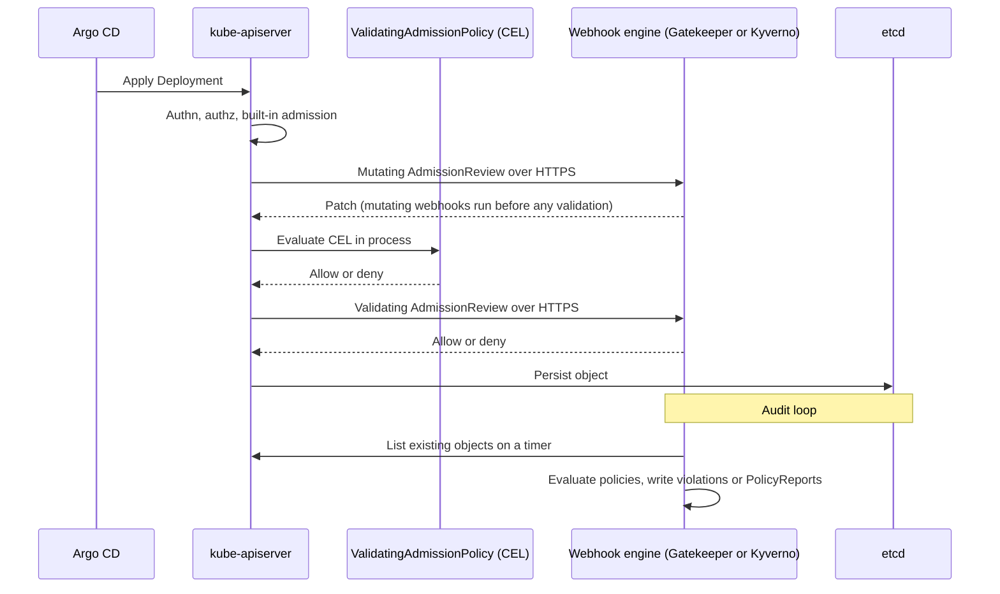

Pod Security admission covers a fixed list of Pod rules. Everything else you want the API server to refuse (required labels, allowed registries, no `latest` tags, mandatory resource limits) needs a policy engine. This note is the decision for senior DevOps engineers: Gatekeeper, Kyverno or the built-in ValidatingAdmissionPolicy. [[patterns/pod-security-admission]] introduces the first two briefly and is the place to start for Pod hardening. The CI-side check on rendered manifests is in [[patterns/conftest-policy-gate-for-manifests]], and the safe way to turn a new policy on is in [[runbooks/policy-rollout-audit-to-enforce]].

> [!info] Scope and sources
> Written against the upstream documentation of OPA Gatekeeper, Kyverno and the Kubernetes ValidatingAdmissionPolicy API (`admissionregistration.k8s.io/v1`), with GKE as the target platform. Based on the [Kubernetes ValidatingAdmissionPolicy docs](https://kubernetes.io/docs/reference/access-authn-authz/validating-admission-policy/), the [Gatekeeper docs](https://open-policy-agent.github.io/gatekeeper/website/docs/) and the [Kyverno docs](https://kyverno.io/docs/).

> [!note] Not verified
> The claims below were written from documentation knowledge and were not checked against a running system or the current docs: the Gatekeeper `enforcementAction` values, where Kyverno expects `validationFailureAction` in current versions, the Kubernetes version in which ValidatingAdmissionPolicy became GA, and the current status of GKE Policy Controller. Check them before relying on them.

## At a glance

| Concern                      | Gatekeeper                                                                       | Kyverno                                        | ValidatingAdmissionPolicy                          |
| ---------------------------- | -------------------------------------------------------------------------------- | ---------------------------------------------- | -------------------------------------------------- |
| Policy language              | Rego, wrapped in ConstraintTemplate and CRDs                                     | YAML rules with patterns, JMESPath and CEL     | CEL expressions in YAML                            |
| Mutation                     | Yes, through separate mutation resources                                         | Yes, `mutate` rules                            | Not in the validating API                          |
| Generate resources           | No                                                                               | Yes, `generate` rules                          | No                                                 |
| Image signature verification | Not built in; possible via external data providers such as Ratify (not verified) | `verifyImages` rules                           | No                                                 |
| Audit of existing objects    | Yes, periodic audit with violations on the CRD                                   | Yes, background scan into PolicyReports        | Audit through `validationActions`, new writes only |
| Reporting                    | Violations in Constraint status, metrics                                         | PolicyReport and ClusterPolicyReport resources | Audit annotations and events                       |
| Availability impact          | Admission webhook, needs pods running                                            | Admission webhook, needs pods running          | In-process in the API server, no webhook           |
| GitOps fit                   | Template must exist before Constraint                                            | One resource per policy, simple ordering       | Policy before binding, both built in               |
| Skills needed                | Rego (shared with Conftest)                                                      | Kubernetes YAML, a little JMESPath             | CEL                                                |
| Extra components to operate  | Controller and audit pods                                                        | Several controllers                            | None                                               |

Two points decide most cases. First, only the webhook engines can mutate, generate or verify image signatures. Second, only ValidatingAdmissionPolicy cannot take your deployments down by being unavailable, because it runs inside the API server.

## Admission flow

All three sit in the same place: after authentication and authorisation, before the object is stored. The webhook engines add a network hop, and they add a second loop that rechecks what is already in the cluster.



The audit loop is what lets you add a policy without breaking running workloads: it tells you what would be denied (see [[runbooks/policy-rollout-audit-to-enforce]]).

## Same policy three ways

The rule: every Deployment must carry a non-empty `team` label so cost and incident ownership can be traced. The registry allowlist is shown in Kyverno because that is where it is shortest.

### Gatekeeper

The ConstraintTemplate defines the Rego and the parameters schema. The Constraint applies it.

```yaml title="gatekeeper/template-required-labels.yaml"
apiVersion: templates.gatekeeper.sh/v1
kind: ConstraintTemplate
metadata:
  name: k8srequiredlabels
spec:
  crd:
    spec:
      names:
        kind: K8sRequiredLabels
      validation:
        openAPIV3Schema:
          type: object
          properties:
            labels:
              type: array
              items:
                type: string
  targets:
    - target: admission.k8s.gatekeeper.sh
      rego: |
        package k8srequiredlabels

        import rego.v1

        violation contains {"msg": msg} if {
          labels := object.get(input.review.object.metadata, "labels", {})
          some required in input.parameters.labels
          not non_empty(labels, required)
          msg := sprintf("missing or empty required label %q", [required])
        }

        non_empty(labels, key) if {
          count(labels[key]) > 0
        }
```

```yaml title="gatekeeper/constraint-deployments-need-team.yaml"
apiVersion: constraints.gatekeeper.sh/v1beta1
kind: K8sRequiredLabels
metadata:
  name: deployments-need-team
spec:
  enforcementAction: dryrun # dryrun first, then deny (see the rollout runbook)
  match:
    kinds:
      - apiGroups:
          - apps
        kinds:
          - Deployment
    excludedNamespaces:
      - kube-system
      - gatekeeper-system
  parameters:
    labels:
      - team
```

Whether the Gatekeeper version you run accepts `import rego.v1` in templates should be confirmed in its docs; if it does not, drop the import and use the older `violation[{"msg": msg}] { ... }` form.

### Kyverno

A ClusterPolicy that allows images only from one Artifactory Docker repository.

```yaml title="kyverno/restrict-image-registries.yaml"
apiVersion: kyverno.io/v1
kind: ClusterPolicy
metadata:
  name: restrict-image-registries
spec:
  validationFailureAction: Audit # change to Enforce after the audit period
  background: true
  rules:
    - name: allowed-registry
      match:
        any:
          - resources:
              kinds:
                - Pod
      exclude:
        any:
          - resources:
              namespaces:
                - kube-system
      validate:
        message: "Images must come from artifactory.example.com/docker-prod/."
        pattern:
          spec:
            containers:
              - image: "artifactory.example.com/docker-prod/*" # change: your Artifactory host and repository
            =(initContainers):
              - image: "artifactory.example.com/docker-prod/*" # change: same value
```

In recent Kyverno versions the failure action may be set per rule under `validate` instead of at the top of `spec`. Check the field placement for the version you install.

### ValidatingAdmissionPolicy

The same label rule as the Gatekeeper example, in CEL. No webhook and no extra pods are needed. The policy defines the rule; the binding decides where it applies and what happens on failure.

```yaml title="vap/require-team-label.yaml"
apiVersion: admissionregistration.k8s.io/v1
kind: ValidatingAdmissionPolicy
metadata:
  name: deployments-need-team
spec:
  failurePolicy: Fail
  matchConstraints:
    resourceRules:
      - apiGroups:
          - apps
        apiVersions:
          - v1
        operations:
          - CREATE
          - UPDATE
        resources:
          - deployments
  validations:
    - expression: "has(object.metadata.labels) && 'team' in object.metadata.labels && size(object.metadata.labels['team']) > 0"
      message: "Deployments must have a non-empty team label."
---
apiVersion: admissionregistration.k8s.io/v1
kind: ValidatingAdmissionPolicyBinding
metadata:
  name: deployments-need-team
spec:
  policyName: deployments-need-team
  validationActions:
    - Warn
    - Audit
  matchResources:
    namespaceSelector:
      matchExpressions:
        - key: kubernetes.io/metadata.name
          operator: NotIn
          values:
            - kube-system
```

Change `validationActions` to `Deny` when the audit period is over. The registry allowlist is also expressible in CEL, for example `object.spec.template.spec.containers.all(c, c.image.startsWith('artifactory.example.com/docker-prod/'))`, but you then handle init containers and Pods and other workload kinds yourself, which is where Kyverno's auto-generated rules for controllers save time.

### Commands to see what each engine reports

```bash
set -euo pipefail

# Gatekeeper: constraints and their violation counts
kubectl get constraints
kubectl get k8srequiredlabels deployments-need-team -o yaml

# Kyverno: policy reports in all namespaces
kubectl get policyreports -A
kubectl get clusterpolicyreports

# ValidatingAdmissionPolicy: definitions and bindings
kubectl get validatingadmissionpolicies
kubectl get validatingadmissionpolicybindings
```

## Availability and failure policy

A webhook engine is a Deployment in your cluster that the API server calls on every matching request. If it is down or slow, the webhook's `failurePolicy` decides the outcome:

- `Fail` blocks all matching writes while the engine is unavailable. That is the secure choice and also the way to turn a policy-engine outage into a deployment outage, including for the engine's own upgrade.
- `Ignore` lets writes through while the engine is down, so policy is silently skipped during exactly the moments the cluster is under stress.

Practical rules, whichever engine you pick:

- Run at least two replicas with a PodDisruptionBudget and spread them across zones, as in [[patterns/zero-downtime-deployments-kubernetes]].
- Exclude `kube-system` and the engine's own namespace from enforcement, and use a short webhook timeout, so a broken engine cannot block its own repair.
- Prefer scoping webhooks with namespace and resource selectors over matching everything.
- Keep a known break-glass step (remove or relax the webhook configuration) in your incident runbook, and test it.
- Roll out in Git through Argo CD. Template or CRD resources must be applied before the resources that use them; use sync waves, and add the `SkipDryRunOnMissingResource=true` sync option to Gatekeeper Constraints, because Argo CD dry-runs every manifest before applying any wave and the Constraint CRD is created by the Gatekeeper controller, not from Git (see [[runbooks/policy-rollout-audit-to-enforce]]). See [[runbooks/argocd-sync-failure-and-drift]] when a sync is denied by a policy it just installed.

ValidatingAdmissionPolicy avoids most of this because evaluation is in the API server. Its trade-off is expressiveness: CEL expressions are bounded, there is no mutation in this API, and cross-object lookups are limited.

## Recommendation

- Start with Pod Security admission for Pod hardening ([[patterns/pod-security-admission]]) and ValidatingAdmissionPolicy for simple field checks such as required labels, replica minimums and disallowed settings. It adds nothing to operate.
- Add Kyverno when you need mutation, generated defaults (for example a NetworkPolicy per namespace), or image signature verification ([[patterns/image-signing-and-admission-verification]]), and your team prefers YAML over a new language.
- Choose Gatekeeper when your organisation already writes Rego, so the same policies run in CI with Conftest and in the cluster, and you accept the template and constraint model.
- Pick one webhook engine, not two. Two engines mean two failure modes, two reporting formats and two sets of exceptions to maintain.

This changes when: ValidatingAdmissionPolicy gains the features you wait for (parameterised policies cover more cases, mutation arrives in the built-in API), when managed policy offerings on GKE fit your fleet and their status is confirmed, or when you need a second team's rules written in a language only they know.

For org-level guardrails that apply before the cluster exists, see [[compliance/gcp-organization-policy-guardrails]].

## Related

- [[patterns/pod-security-admission]]: the built-in Pod rules to enable before any engine.
- [[patterns/conftest-policy-gate-for-manifests]]: the same Rego policies applied in CI, before Argo CD.
- [[runbooks/policy-rollout-audit-to-enforce]]: how to turn a new policy on without breaking deployments.
- [[patterns/image-signing-and-admission-verification]]: verifying image signatures at admission.
- [[runbooks/argocd-sync-failure-and-drift]]: what to do when a sync is denied by admission.
- [[compliance/gcp-organization-policy-guardrails]]: guardrails at the organisation level.
