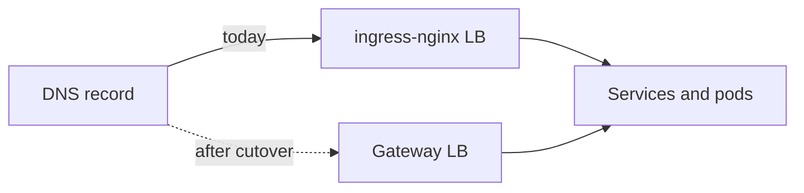

[[0023-gateway-api-for-north-south-traffic]] proposes Gateway API with the GKE Gateway controller for new HTTP entry points, and notes that the retirement of ingress-nginx makes a choice unavoidable. The ADR is still `proposed`: it asks for a pilot on a non-production cluster first. This note is the tool-level evidence for that pilot. It compares the two realistic replacements on GKE, maps the ingress-nginx annotations people actually use, and gives an inventory script and a cutover plan that can be rolled back.

The overall edge design (Cloudflare in front, Google Cloud load balancers, Gateway API in the cluster) is in [[edge-and-ingress-cloudflare-gclb-gateway-api]]; Gateway API basics are in [[kubernetes-services-and-ingress]].

> [!warning] ingress-nginx no longer receives security fixes
> The [ingress-nginx README](https://github.com/kubernetes/ingress-nginx) states that best-effort maintenance continues until March 2026, and that afterwards there are no further releases, no bug fixes and no updates for security vulnerabilities. Existing deployments keep working, and the Helm charts and images stay available. As of 2026-10-21 that window has ended, so any new vulnerability in the controller stays open. Read the [Kubernetes blog announcement](https://www.kubernetes.io/blog/2025/11/11/ingress-nginx-retirement/) for the authoritative wording; this note quotes the README, not the blog. This retirement concerns the community `kubernetes/ingress-nginx` project, not other NGINX-based controllers.

> [!info] Not checked against current releases
> Checked on 2026-10-21 against the ingress-nginx and ingress2gateway READMEs, the ingress2gateway provider and emitter docs and source, and the Envoy Gateway API reference on its main branch (which can be ahead of the release you install). Not verified: current GKE GatewayClass names and the Gateway API features and versions each supports; the field lists and defaults of `HealthCheckPolicy` and `GCPBackendPolicy` (only their API group, version and kind are confirmed, from ingress2gateway's code); Cloud Armor attachment steps and TLS options on GKE Gateway; WebSocket and gRPC behaviour on each; Envoy Gateway's install chart and the load balancer it creates on GKE; the Gateway API conformance table; default body size and timeout limits of nginx and of Google Cloud load balancers; and the cost of each option.

## The two candidates

- **GKE Gateway controller.** Google-managed. A `Gateway` becomes a Google Cloud load balancer (forwarding rule, URL map, backend services, health checks) that sends traffic straight to pod IPs through network endpoint groups. There is no proxy in the cluster to scale or patch. Extensions come as GKE policy CRDs in `networking.gke.io/v1`: `GCPBackendPolicy`, `GCPGatewayPolicy`, `HealthCheckPolicy` and `GCPHTTPFilter` (kinds as referenced by ingress2gateway's GKE emitter; confirm against the GKE policy reference). WAF and rate limiting go through Cloud Armor.
- **Envoy Gateway.** Open source, CNCF Envoy project. A controller in the cluster programs Envoy proxies that run as pods behind a Service of type `LoadBalancer`, so on GKE a passthrough network load balancer sits in front of an in-cluster data plane you operate. Extensions come as CRDs in `gateway.envoyproxy.io/v1alpha1`: `BackendTrafficPolicy`, `ClientTrafficPolicy`, `SecurityPolicy`, `EnvoyExtensionPolicy`, `EnvoyProxy`, `EnvoyPatchPolicy`, `HTTPRouteFilter` and `Backend`. Its GatewayClass `controllerName` is `gateway.envoyproxy.io/gatewayclass-controller`.

Both speak Gateway API, so `Gateway`, `HTTPRoute`, `GRPCRoute` and `BackendTLSPolicy` look the same. The differences are where the data plane runs and how you express everything Gateway API does not standardise.

## Criteria

| Criterion           | Why it matters                                                                                                  |
| ------------------- | --------------------------------------------------------------------------------------------------------------- |
| Data plane location | Managed load balancer outside the cluster vs proxies you scale, patch and monitor inside it                     |
| Annotation parity   | ingress-nginx has about a hundred custom annotations without a direct Gateway API mapping (per ingress2gateway) |
| TLS                 | Certificate source ([[cert-manager-vs-google-managed-certificates]]), minimum versions, mTLS to backends        |
| WAF and rate limits | Cloud Armor on Google's edge vs Envoy rate limiting; Envoy Gateway's `SecurityPolicy` has no WAF field          |
| Client IP           | What the application sees in `X-Forwarded-For` after the change                                                 |
| Upgrade ownership   | Google rolls the GKE controller; you upgrade Envoy Gateway and its CRDs                                         |
| Portability         | GKE policy CRDs are GKE-only; Envoy Gateway runs on any cluster                                                 |
| Mesh interplay      | East-west traffic and a mesh's own gateway ([[service-mesh-on-gke]])                                            |
| Cost                | Load balancer charges vs node capacity for proxies; check current pricing for both                              |

## At a glance

| Concern                 | ingress-nginx (today)                         | GKE Gateway controller                                | Envoy Gateway on GKE                                                                                                                          |
| ----------------------- | --------------------------------------------- | ----------------------------------------------------- | --------------------------------------------------------------------------------------------------------------------------------------------- |
| Status                  | Retired: no fixes after March 2026 per README | Managed GKE feature                                   | Active open-source project                                                                                                                    |
| Data plane              | nginx pods behind a network LB                | Google Cloud application load balancer, pods via NEGs | Envoy pods behind a network LB                                                                                                                |
| Extension model         | Annotations, ConfigMap, snippets              | `networking.gke.io` policy CRDs                       | `gateway.envoyproxy.io` policy CRDs                                                                                                           |
| WAF                     | ModSecurity annotation                        | Cloud Armor via `GCPBackendPolicy` `securityPolicy`   | No WAF field; check whether Cloud Armor can protect the network LB in front of Envoy, otherwise use the edge WAF ([[edge-waf-rate-limiting]]) |
| IP allow lists          | `whitelist-source-range`                      | Cloud Armor rules                                     | `SecurityPolicy` authorization with `clientCIDRs`                                                                                             |
| Auth at the edge        | `auth-url`, `auth-signin`                     | Check IAP support for Gateway on GKE                  | `SecurityPolicy` `extAuth`, `oidc`, `jwt`, `basicAuth`, `apiKeyAuth`                                                                          |
| Who patches it          | Nobody now                                    | Google                                                | You                                                                                                                                           |
| ingress2gateway emitter | n/a                                           | `gce`                                                 | `envoy-gateway`                                                                                                                               |

## Step 1: inventory what you have

Before choosing, find out which annotations are in use. The script below is read-only. It saves the Ingress list to a local file (annotations can contain URLs and internal names, so keep the file out of Git and shared channels), then prints each Ingress with its class and ingress-nginx annotations, the annotation usage counts, the Ingresses using snippet annotations, and the rewrite targets that use regex capture groups.

```bash title="ingress-inventory.sh"
#!/usr/bin/env bash
# Read-only inventory of ingress-nginx annotations across all namespaces.
set -euo pipefail

OUT_DIR="${1:-./ingress-inventory}"
PREFIX="nginx.ingress.kubernetes.io/"
mkdir -p "${OUT_DIR}"
chmod 700 "${OUT_DIR}"

kubectl get ingress --all-namespaces -o json > "${OUT_DIR}/ingress.json"

echo "== Ingress, class, ingress-nginx annotations"
jq -r --arg p "${PREFIX}" '
  .items[]
  | (.metadata.annotations // {}) as $a
  | [ "\(.metadata.namespace)/\(.metadata.name)",
      (.spec.ingressClassName // $a["kubernetes.io/ingress.class"] // "-"),
      ([$a | keys[] | select(startswith($p)) | ltrimstr($p)] | join(","))
    ]
  | @tsv' "${OUT_DIR}/ingress.json" | tee "${OUT_DIR}/by-ingress.tsv"

echo "== Annotation usage, most used first"
jq -r --arg p "${PREFIX}" '
  [ .items[] | (.metadata.annotations // {}) | keys[] | select(startswith($p)) | ltrimstr($p) ]
  | group_by(.) | map("\(length)\t\(.[0])") | .[]' "${OUT_DIR}/ingress.json" \
  | sort -rn | tee "${OUT_DIR}/annotation-counts.tsv"

echo "== Ingresses with snippet annotations (review first)"
jq -r '
  .items[]
  | select((.metadata.annotations // {}) | keys | any(endswith("-snippet")))
  | "\(.metadata.namespace)/\(.metadata.name)"' "${OUT_DIR}/ingress.json"

echo "== rewrite-target values with capture groups (need manual rewrite)"
jq -r --arg k "${PREFIX}rewrite-target" '
  .items[]
  | select(((.metadata.annotations // {})[$k] // "") | test("\\$[0-9]"))
  | "\(.metadata.namespace)/\(.metadata.name)\t\(.metadata.annotations[$k])"' "${OUT_DIR}/ingress.json"
```

The `jq` expressions were tested on 2026-10-21 against a sample Ingress list, including Ingresses without any annotations (`.metadata.annotations // {}` keeps them from breaking the run).

Treat the snippet list as a security finding, not just a migration item. Snippet annotations (`configuration-snippet`, `server-snippet` and similar) inject raw nginx configuration supplied through the Ingress object, so anyone who can write an Ingress can change proxy behaviour for the whole controller. Review each one, check the project's security advisories, and do not carry the intent forward without understanding it.

## Step 2: map the annotations

The table maps the ingress-nginx annotations that ingress2gateway documents, plus the common ones it does not list. "No converter support listed" means ingress2gateway's provider documentation does not mention it; decide by hand, and do not assume an equivalent exists.

| ingress-nginx annotation                                            | Gateway API or extension                                                                                  | ingress2gateway                                                         |
| ------------------------------------------------------------------- | --------------------------------------------------------------------------------------------------------- | ----------------------------------------------------------------------- |
| `rewrite-target` (plain path)                                       | `HTTPRoute` `URLRewrite` filter                                                                           | Converted; capture groups (`$1`) flagged unsupported                    |
| `app-root`                                                          | `RequestRedirect` filter on `/`                                                                           | Converted                                                               |
| `permanent-redirect`, `temporal-redirect` (and `-code`)             | `RequestRedirect` filter with a status code                                                               | Converted                                                               |
| `ssl-redirect`                                                      | An HTTP listener route with a `RequestRedirect` to `https`                                                | `ssl-redirect=false` converted                                          |
| `canary`, `canary-weight`, `canary-weight-total`                    | Weighted `backendRefs`                                                                                    | Converted                                                               |
| `canary-by-header`, `canary-by-header-value`                        | Header match in an `HTTPRoute` rule                                                                       | Converted                                                               |
| `canary-by-header-pattern`, `canary-by-cookie`                      | Decide by hand                                                                                            | Recognised, warning only                                                |
| `upstream-vhost`, `x-forwarded-prefix`, `connection-proxy-header`   | Header and rewrite filters                                                                                | Converted                                                               |
| `custom-headers`                                                    | `RequestHeaderModifier` or `ResponseHeaderModifier`                                                       | Recognised, warning only                                                |
| `proxy-connect-timeout`, `proxy-send-timeout`, `proxy-read-timeout` | `HTTPRoute` timeouts where supported; Envoy `BackendTrafficPolicy` `timeout`; GKE backend policy (verify) | Converted                                                               |
| `proxy-body-size`, `client-body-buffer-size`                        | Envoy `BackendTrafficPolicy` `requestBuffer`; GKE: check the load balancer limits                         | Converted                                                               |
| `backend-protocol: GRPC` or `GRPCS`                                 | `GRPCRoute`                                                                                               | Converted                                                               |
| `backend-protocol: HTTPS`, `proxy-ssl-*`                            | `BackendTLSPolicy`                                                                                        | Converted; `proxy-ssl-verify-depth`, `proxy-ssl-protocols` warning only |
| `ssl-passthrough`                                                   | `TLSRoute` (check the channel your implementation supports)                                               | Converted                                                               |
| `use-regex`                                                         | `RegularExpression` path match (implementation-specific support)                                          | Converted                                                               |
| CORS annotations                                                    | Envoy `SecurityPolicy` `cors`; GKE: decide by hand                                                        | Converted                                                               |
| `whitelist-source-range`, `denylist-source-range`                   | Envoy `SecurityPolicy` authorization; GKE: Cloud Armor                                                    | Converted                                                               |
| `configuration-snippet`, `server-snippet`                           | None. Rewrite the intent explicitly                                                                       | No converter support listed                                             |
| `auth-url`, `auth-signin`                                           | Envoy `SecurityPolicy` `extAuth` or `oidc`; GKE: decide by hand                                           | No converter support listed                                             |
| `limit-rps`, `limit-connections`                                    | Envoy `BackendTrafficPolicy` `rateLimit`; GKE: Cloud Armor rate limiting                                  | No converter support listed                                             |
| `enable-modsecurity` and other WAF annotations                      | GKE: Cloud Armor; Envoy Gateway: none, use the edge WAF                                                   | No converter support listed                                             |

## Step 3: convert with ingress2gateway, then review by hand

[ingress2gateway](https://github.com/kubernetes-sigs/ingress2gateway) reads Ingresses from the cluster or from files and prints Gateway API resources. Version 1.0 emits Gateway API v1.5.0 resources, which its README describes as generally forward compatible with v1.4. Its README is explicit that it "is not intended to copy annotations", and that widely used annotations may still not be supported, which is why every output file is reviewed by a person.

```bash title="convert"
set -euo pipefail
# Install a pinned release (building from source needs a recent Go; see the README).
# Set the tag from the releases page: https://github.com/kubernetes-sigs/ingress2gateway/releases
I2G_VERSION="<release tag from the releases page>"
go install "github.com/kubernetes-sigs/ingress2gateway@${I2G_VERSION}"

# From the live cluster, all namespaces, for the GKE Gateway controller:
ingress2gateway print --providers=ingress-nginx --all-namespaces \
  --emitter=gce -o yaml > gateway-gke.yaml

# Or from saved manifests, for Envoy Gateway:
kubectl get ingress --all-namespaces -o yaml > ingress-inventory/ingress.yaml
ingress2gateway print --providers=ingress-nginx \
  --input-file=ingress-inventory/ingress.yaml \
  --emitter=envoy-gateway -o yaml > gateway-envoy.yaml
```

Useful flags: `--ingress-nginx-ingress-class` (default `nginx`) if your class has another name, `--gce-gateway-class-name` for the GKE class, and `--allow-experimental-gw-api` if you accept experimental-channel resources. When two Ingresses conflict, the oldest creation timestamp wins (then namespace and name) and later conflicting rules are reported as errors: read that output, because it is where two teams claimed the same host and path.

Review checklist for each generated file:

- Every warning from the tool has an owner and a decision.
- The `Gateway` is the platform-owned one from ADR 0023, not one Gateway per Ingress; routes attach to it with `parentRefs` and are allowed by `allowedRoutes`.
- Hostnames, path match types and ordering match the original. For GKE's own Ingress class, ingress2gateway maps `/*` to `/` as a prefix, `/v1` to an exact match and `/v1/*` to `/v1` as a prefix; check the edge cases its README documents.
- Pick the GatewayClass by load balancer type from `kubectl get gatewayclass` and the current GKE GatewayClass table: `gke-l7-global-external-managed`, `gke-l7-regional-external-managed`, `gke-l7-rilb` (regional internal) and `gke-l7-gxlb` (classic global external) select different load balancers, so choose deliberately rather than copying a class from an old recipe or a v1alpha1-era example.

## Step 4: the target resources

### GKE Gateway controller

The `Gateway` and `HTTPRoute` are standard. The class name below is the one ADR 0023 uses; confirm it in the current GKE documentation.

```yaml title="gke-gateway.yaml"
apiVersion: gateway.networking.k8s.io/v1
kind: Gateway
metadata:
  name: external-http
  namespace: infra-gateway
spec:
  gatewayClassName: gke-l7-global-external-managed
  listeners:
    - name: https
      protocol: HTTPS
      port: 443
      hostname: "*.example.com"
      tls:
        mode: Terminate
        certificateRefs:
          - name: wildcard-example-com
      allowedRoutes:
        namespaces:
          from: Selector
          selector:
            matchLabels:
              gateway-access: external-http
---
apiVersion: gateway.networking.k8s.io/v1
kind: HTTPRoute
metadata:
  name: shop-web
  namespace: shop
spec:
  parentRefs:
    - name: external-http
      namespace: infra-gateway
      sectionName: https
  hostnames: ["shop.example.com"]
  rules:
    - matches:
        - path: { type: PathPrefix, value: /api }
      filters:
        - type: URLRewrite
          urlRewrite:
            path: { type: ReplacePrefixMatch, replacePrefixMatch: / }
      backendRefs:
        - name: shop-api
          port: 8080
    - backendRefs:
        - name: shop-web
          port: 8080
```

GKE policies attach to a `Service` with a single `targetRef`. The kinds and the `securityPolicy` field of `GCPBackendPolicy` are confirmed from ingress2gateway's GKE emitter; the health check fields are not, so compare them with the current GKE page before applying.

```yaml title="gke-policies.yaml"
apiVersion: networking.gke.io/v1
kind: GCPBackendPolicy
metadata:
  name: shop-api
  namespace: shop
spec:
  default:
    securityPolicy: shop-edge-policy # Cloud Armor policy name
  targetRef:
    group: ""
    kind: Service
    name: shop-api
---
apiVersion: networking.gke.io/v1
kind: HealthCheckPolicy
metadata:
  name: shop-api
  namespace: shop
spec:
  default:
    # Field names not verified: check the GKE "configure Gateway resources" page.
    config:
      type: HTTP
      httpHealthCheck:
        requestPath: /healthz
  targetRef:
    group: ""
    kind: Service
    name: shop-api
```

### Envoy Gateway

Envoy Gateway policies attach with `targetRefs` (a list) or `targetSelectors`. A route-level policy takes precedence over a Gateway-level one; between two policies at the same level, the oldest wins.

```yaml title="envoy-gateway-policies.yaml"
apiVersion: gateway.envoyproxy.io/v1alpha1
kind: SecurityPolicy
metadata:
  name: shop-admin-allowlist
  namespace: shop
spec:
  targetRefs:
    - group: gateway.networking.k8s.io
      kind: HTTPRoute
      name: shop-admin
  authorization:
    defaultAction: Deny
    rules:
      - name: office-and-vpn
        action: Allow
        principal:
          clientCIDRs:
            - 203.0.113.0/24
            - 198.51.100.0/24
---
apiVersion: gateway.envoyproxy.io/v1alpha1
kind: BackendTrafficPolicy
metadata:
  name: shop-api
  namespace: shop
spec:
  targetRefs:
    - group: gateway.networking.k8s.io
      kind: HTTPRoute
      name: shop-web
  timeout:
    http:
      requestTimeout: 60s
  requestBuffer:
    limit: 10Mi # mode defaults to BufferAndLimit, which is incompatible with streaming and upgrades
---
apiVersion: gateway.envoyproxy.io/v1alpha1
kind: ClientTrafficPolicy
metadata:
  name: external-http
  namespace: infra-gateway
spec:
  targetRefs:
    - group: gateway.networking.k8s.io
      kind: Gateway
      name: external-http
  clientIPDetection:
    xForwardedFor:
      numTrustedHops: 1 # count of proxies in front of Envoy that you trust
  timeout:
    http:
      idleTimeout: 60s
```

`clientCIDRs` matching uses the client IP that Envoy derives from `X-Forwarded-For`, a custom header or the PROXY protocol, so set `clientIPDetection` to match your real chain (Cloudflare, then a load balancer, then Envoy) before relying on an allow list. A wrong hop count either lets a forged header through or blocks everyone. `requestBuffer` comes from the project's latest API reference; check that your installed version has it.

## Step 5: parallel run and cutover

Run the new path next to ingress-nginx, then move traffic by DNS. Nothing is deleted until the new path has carried real traffic.



1. **Lower the TTL** of each record to be moved (for example to 60 seconds) at least one old TTL before the cutover, so a rollback propagates quickly. With [[external-dns-on-gke]], change the TTL through its annotation, not by hand.
2. **Deploy the Gateway and routes** next to the existing Ingresses. Both point at the same Services.
3. **Test the new path without DNS**, pinning the hostname to the new address:

   ```bash title="test the new load balancer"
   set -euo pipefail
   HOST="shop.example.com"
   NEW_IP="$(kubectl get gateway external-http -n infra-gateway -o jsonpath='{.status.addresses[0].value}')"
   curl -sS -o /dev/null -w '%{http_code} %{time_total}\n' \
     --resolve "${HOST}:443:${NEW_IP}" "https://${HOST}/healthz"
   kubectl get httproute -A -o wide
   kubectl describe gateway external-http -n infra-gateway | sed -n '/Conditions/,$p'
   ```

4. **Run the checks in the failure-mode table below** against the new address: large uploads, long requests, WebSockets, gRPC, redirects, client IP seen by the app.
5. **Switch DNS** for one low-risk hostname, watch error rate and latency on the SLO dashboard, then move the rest in batches.
6. **Keep ingress-nginx running** and unchanged for at least a week of real traffic. Then remove the Ingress objects, then the controller.

**Rollback** at any point before step 6 is pointing the DNS record back at the ingress-nginx load balancer; with the low TTL it takes effect within minutes. After step 6, rollback means redeploying the controller from its pinned chart, so do not rush it. More on blue-green style switching is in [[gke-blue-green-releases]].

## Failure modes to test before cutover

| Area             | What breaks                                                                                                                | How to check                                                                                |
| ---------------- | -------------------------------------------------------------------------------------------------------------------------- | ------------------------------------------------------------------------------------------- |
| Health checks    | GKE load balancer health checks hit the pods directly; an app that does not answer on the checked path is marked unhealthy | Gateway and backend status, then a `HealthCheckPolicy` that targets the real readiness path |
| Timeouts         | Long requests or downloads cut off at a different limit than nginx's                                                       | Time a known slow endpoint through both paths; set explicit timeouts                        |
| WebSockets, gRPC | Connections dropped at an idle or backend timeout, or the wrong protocol to the backend                                    | A long-lived WebSocket test and a gRPC health check through the new address                 |
| Client IP        | The app logs the proxy's address, or rate limits by the wrong IP                                                           | Compare `X-Forwarded-For` as seen by the app on both paths                                  |
| Body size        | Uploads rejected with 413, or accepted when they should be refused                                                         | Upload just under and just over the intended limit                                          |
| Redirects        | HTTP to HTTPS loops when an upstream proxy already terminates TLS                                                          | `curl -I http://...` and follow redirects with `-L --max-redirs 5`                          |
| TLS              | Wrong certificate, missing intermediate, older clients rejected                                                            | `openssl s_client -connect` to the new address with `-servername`                           |

The general network debugging path is in [[network-troubleshooting-dns-mtu-tls-load-balancers]].

## Recommendation

- **Default on GKE: the GKE Gateway controller**, as ADR 0023 proposes. There is no proxy to patch, Cloud Armor provides WAF and rate limiting at Google's edge, and Google-managed certificates fit ([[cert-manager-vs-google-managed-certificates]]). The price is GKE-specific policy CRDs and fewer knobs.
- **Envoy Gateway when** you need features the GKE controller does not offer (external authorisation, OIDC at the gateway, fine-grained rate limiting, request buffering control), need the same gateway on non-GKE clusters, or already run Envoy for a mesh. Budget for operating it: upgrades, CRD changes, capacity and a WAF in front.
- **Either way:** inventory first, treat snippet annotations as a security review, convert with ingress2gateway and review every file, run in parallel, cut over by DNS with a low TTL, and keep the old controller until the new path has served real traffic. Record the pilot results in ADR 0023 before it moves to `accepted`.

## Related

- [[0023-gateway-api-for-north-south-traffic]]
- [[edge-and-ingress-cloudflare-gclb-gateway-api]]
- [[cert-manager-vs-google-managed-certificates]]
- [[service-mesh-on-gke]]
- [[edge-waf-rate-limiting]]
- [[gke-blue-green-releases]]
- [[network-troubleshooting-dns-mtu-tls-load-balancers]]
- [[kubernetes-services-and-ingress]]

## Sources

- [Ingress NGINX retirement announcement](https://www.kubernetes.io/blog/2025/11/11/ingress-nginx-retirement/)
- [ingress-nginx repository and README](https://github.com/kubernetes/ingress-nginx) (retirement wording, read 2026-10-21)
- [ingress2gateway](https://github.com/kubernetes-sigs/ingress2gateway) (flags, providers, emitters, converted annotations, read 2026-10-21)
- [GKE Gateway API concepts](https://cloud.google.com/kubernetes-engine/docs/concepts/gateway-api)
- [Configure Gateway resources on GKE](https://cloud.google.com/kubernetes-engine/docs/how-to/configure-gateway-resources)
- [Envoy Gateway documentation](https://gateway.envoyproxy.io/docs/) (API reference read from the project repository's latest docs, 2026-10-21)
- [Gateway API implementations](https://gateway-api.sigs.k8s.io/implementations/)
