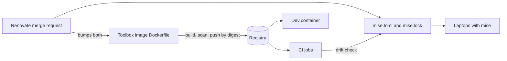

A surprising share of "works on my machine" incidents in infrastructure work are version drift between a laptop and a CI runner. A newer `terraform` on one engineer's laptop writes state that the pipeline's older binary then has to read. `helm` renders a chart differently after a minor upgrade. `kubectl` drifts more than one minor version from the cluster and starts behaving oddly. Nobody changed the code; the tools changed underneath it.

The fix is to pin the toolchain in the repository and to make CI fail when what runs differs from what is pinned. This note compares three ways to do the pinning, **mise**, **asdf** and **dev containers**, and recommends a setup where the CI toolbox image is the source of truth and a version file mirrors it for laptops.

> [!info] Not checked against current releases
> Checked on 2026-10-21 against the mise documentation source on its main branch (which mentions release v2026.10.4 and can be ahead of the version you install: compare with your `mise --version`), the asdf changelog and README, the Dev Container specification, the Kubernetes version skew policy, Helm's chart documentation and Terraform's language documentation. Not verified: mirroring mise tool downloads through Artifactory (only a mirror for mise's own release binaries is documented); Renovate support for `mise.toml` and `mise.lock`; per-tool behaviour on Windows and Apple Silicon; mise version syntax beyond exact versions; asdf plugin pinning commands and asdf's Windows support; dev container host support and CLI flags for CI; the `terraform providers lock` platform flag; and the exact JSON field names printed by `terraform`, `kubectl` and `helm` (the drift check below parses them and was tested only with stand-in binaries for those three).

## Pin inside the tools too

A version manager decides which binary runs. The tools themselves can also refuse to run with the wrong version, and those guards stay in force whatever installs the binary.

- **Terraform:** `required_version` in the `terraform` block makes Terraform exit with an error when the running version does not satisfy the constraint, including constraints from modules. Commit `.terraform.lock.hcl`: it pins **provider** versions and checksums, but at present it tracks only provider dependencies, not remote modules and not the CLI version. Whether a newer CLI changes the state format in a way older binaries cannot read depends on the release; check the upgrade guide before every minor bump. See [[terraform-module-standard]] and [[terraform-vs-opentofu]].
- **kubectl:** the Kubernetes version skew policy supports kubectl within one minor version (older or newer) of `kube-apiserver`. During a control plane upgrade with two minor versions present, only the overlap is supported. Pin kubectl per cluster generation, not to "latest".
- **Helm:** `kubeVersion` in `Chart.yaml` is an optional SemVer range of compatible Kubernetes versions; set it on charts you own. Helm's own skew page describes which Kubernetes versions each Helm release supports; read it before upgrading Helm ([[helm-vs-kustomize]]).

```hcl title="versions.tf"
terraform {
  # Pessimistic constraint: patch releases of one minor version only. The value is an
  # example of the syntax; use the minor version your CI image ships.
  required_version = "~> 1.13.0"
}
```

Root modules pin the CLI this tightly; shared modules state a looser minimum so they work across teams ([[terraform-module-standard]]).

```bash title="lock providers for every platform that runs terraform"
# Linux runners and Apple Silicon laptops; check the flag with `terraform providers lock -help`.
terraform providers lock -platform=linux_amd64 -platform=darwin_arm64
git add .terraform.lock.hcl
```

## Criteria

| Criterion          | Why it matters                                                                                    |
| ------------------ | ------------------------------------------------------------------------------------------------- |
| Declaration file   | One reviewed file that says which versions this repository needs                                  |
| Download integrity | Checksums or signatures checked on install, so a tampered download fails                          |
| Plugin trust       | Who wrote the code that downloads and installs each tool, and whether it runs on your machine     |
| CI reuse           | The same file drives CI, or CI proves it matches                                                  |
| OS support         | Linux runners, macOS (Intel and Apple Silicon) and Windows laptops                                |
| Speed              | Install time on a cold runner and switching cost between repositories                             |
| Corporate network  | Works behind a proxy, and through an internal mirror ([[artifactory-remote-repo-caching-for-ci]]) |
| Update automation  | A bot can bump versions in a reviewed merge request ([[renovate-vs-dependabot]])                  |

## At a glance

| Concern          | mise                                                                                                       | asdf                                                                | Dev container                                                          |
| ---------------- | ---------------------------------------------------------------------------------------------------------- | ------------------------------------------------------------------- | ---------------------------------------------------------------------- |
| What it is       | Single binary tool manager with several backends                                                           | Tool manager driven by per-tool plugins (rewritten in Go in 0.16.0) | A container image plus `devcontainer.json`, opened by an editor or CLI |
| Declaration      | `mise.toml` (also reads `.tool-versions`)                                                                  | `.tool-versions` (also `.node-version`, `.nvmrc`, `.ruby-version`)  | `devcontainer.json`: `image` or `build`, plus `features`               |
| Lockfile         | `mise.lock`: resolved versions, URLs and checksums where the backend provides them                         | None                                                                | The image digest is the lock                                           |
| Integrity checks | Checksums, Cosign or Minisign signatures, SLSA provenance, GitHub attestations, per backend; on by default | Up to each plugin                                                   | Whatever the image build did; Features are OCI artefacts               |
| Plugin model     | Prefers aqua and GitHub release backends; remaining asdf plugins live in a separate org                    | Shell-script plugins cloned from Git                                | Features: OCI-published install scripts                                |
| CI               | `mise install --locked`, then `mise exec -- <cmd>`                                                         | Install plugins and versions in the job                             | Run CI in the same image                                               |
| Windows          | Documented (winget, Scoop, Chocolatey)                                                                     | Not verified                                                        | Through a container runtime; not verified                              |
| Isolation        | None: tools run on the host                                                                                | None                                                                | Tools run in a container                                               |
| Best for         | Most laptops and CI jobs                                                                                   | Existing asdf users who have not migrated                           | Teams that want the CI image on the laptop, or Windows users           |

## mise

mise reads a `mise.toml` in the repository. Its `[tools]` table holds version requests, which mise resolves to concrete versions; for a toolchain that must match CI, use exact versions.

```bash title="pin tools with mise"
# Exact versions: use the ones your CI toolbox image ships.
mise use "terraform@<terraform-version-in-ci-image>"
mise use "kubectl@<kubectl-version-in-ci-image>"
mise use "helm@<helm-version-in-ci-image>"

# Write mise.lock for every platform that runs these tools, without installing.
mise lock --platform linux-x64,linux-arm64,macos-arm64

mise ls --current      # what this directory resolves to
mise config            # which config files were loaded, in order
```

Replace each `<...>` with the exact version printed by the CI image (the drift check below shows how to read them). `mise use` writes the entry to `mise.toml`:

```toml title="mise.toml"
[settings]
lockfile = true # create and update mise.lock automatically

[tools]
terraform = "<terraform-version-in-ci-image>"
kubectl = "<kubectl-version-in-ci-image>"
helm = "<helm-version-in-ci-image>"
```

Points that matter in production:

- **The lockfile.** `mise.lock` records the exact resolved versions, download URLs and checksums where the backend provides them. `mise install --locked` installs exactly what the lock records and fails if a tool has no entry. A locked install is not an offline install: it still downloads. Tools that appear only in `.tool-versions` are not locked, and lockfiles for `mise.local.toml` are not committed.
- **Integrity.** mise verifies downloads itself, with checks that depend on the backend and on what upstream publishes; a failed check aborts the install. `mise tool terraform` shows which checks apply to a tool.
- **Backends.** In the mise registry, `terraform`, `kubectl`, `helm` and `opentofu` resolve through aqua backends. `gcloud` resolves only through vfox and asdf backends, so do not assume lockfile or checksum guarantees for it, and on macOS it also needs a matching Python already installed. Install gcloud from the CI image or Google's own installer instead.
- **Plugins.** The mise security page calls asdf plugins dangerous because a plugin repository can be compromised and inject code, and the asdf-plugin backend does not support the lockfile. Avoid asdf-backed tools where an aqua or GitHub release backend exists.
- **Trust.** Config that can run code (tasks, hooks, `[env]` templates) needs `mise trust`; a plain `[tools]` table does not. In CI mise trusts config automatically. A job that reads branches you did not write while holding secrets should set `MISE_SAFE=1`, which refuses tasks, plugin installs and project environment variables.
- **Activation.** `mise activate` is for interactive shells, `mise activate --shims` for editors and login profiles, and `mise exec` or `mise run` for scripts and CI, where no activation is needed. The shim directory is `~/.local/share/mise/shims`.

In CI, run the same file:

```yaml title=".gitlab-ci.yml (mise in CI)"
terraform-plan:
  stage: plan
  image: ${MISE_IMAGE} # a pinned mise image, by digest
  variables:
    MISE_DATA_DIR: $CI_PROJECT_DIR/.mise
    MISE_CACHE_DIR: $CI_PROJECT_DIR/.mise/cache
  cache:
    key:
      prefix: mise-amd64
      files: [mise.toml, mise.lock]
    paths:
      - .mise/cache/
  script:
    - mise install --locked
    - mise exec -- terraform version
    - mise exec -- terraform init -input=false -lockfile=readonly
    - mise exec -- terraform plan -input=false -out=plan.tfplan
```

The mise CI documentation warns that a restored tool cache is trusted as is: mise does not check installed files against `mise.lock`. Caching only the download cache (as above, which keeps the content-addressed `downloads-cas` store under `MISE_CACHE_DIR`) means every job unpacks tools again and checks them, at the cost of some time. GitLab accepts at most two files in `cache:key:files` by default. Check `-lockfile=readonly` with `terraform init -help` in your version.

## asdf

asdf reads `.tool-versions`, one tool and version per line, and installs each through a plugin: a Git repository of shell scripts that downloads and installs the tool. Version 0.16.0 was a rewrite in Go with breaking changes (`asdf set` replaced `asdf local` and `asdf global`); at the time of writing the latest release listed in the changelog is 0.20.2 (2026-09-22), and 0.20.0 made plugin clones shallow. If you are on a version before 0.16, read the upgrade guide before anything else.

```text title=".tool-versions"
terraform <terraform-version-in-ci-image>
kubectl <kubectl-version-in-ci-image>
helm <helm-version-in-ci-image>
```

The supply-chain question with asdf is the plugin. A plugin runs with your user's rights on every install, and whether it verifies checksums is entirely up to its author. To reduce the risk:

- install only plugins from the community list, and read the install script of each before adding it;
- pin each plugin to a reviewed commit. Older documentation shows `asdf plugin update <name> <git-ref>` for this; the command in current releases was not verified, so check `asdf plugin --help` on your version;
- never install plugins in a CI job that also holds deploy credentials.

mise reads `.tool-versions` and can convert it to `mise.toml`; the command `mise generate config --tool-versions .tool-versions` was not verified against a release, so check `mise generate --help` (or `mise config --help`) on your version. The two must not share install directories; mise installs its own copies.

## Dev containers

A dev container runs the tools inside a container, described by `devcontainer.json`: an `image` (or a `build` with a Dockerfile), optional `features`, the user (`remoteUser`, `containerUser`) and lifecycle commands such as `postCreateCommand`. Point it at the **same toolbox image CI uses**, pinned by digest, and laptop and runner execute identical binaries.

```json title=".devcontainer/devcontainer.json"
{
  "name": "platform-toolbox",
  "image": "registry.example.com/platform/toolbox@sha256:<digest-of-the-ci-toolbox-image>",
  "remoteUser": "toolbox",
  "postCreateCommand": "bash scripts/check-toolchain.sh mise.toml"
}
```

Replace the digest with the one your CI template uses (read it with `crane digest` or `docker buildx imagetools inspect`), and `remoteUser` with the non-root user your image defines. Avoid adding Features on top of a toolbox image: each Feature is an install script fetched from an OCI registry, and a Feature reference without a version gets `:latest` implicitly. If you use one, pin it to a version.

Dev containers cost a container runtime on every laptop, slower file access on some hosts, and friction with editors and credentials (gcloud and kubeconfig must be mounted or re-authenticated inside). They are the strongest guarantee, and the right default for Windows users and for onboarding, but most engineers on Linux and macOS prefer mise.

## Recommended setup



1. **The CI toolbox image is the source of truth.** It is built in the central CI repository, scanned and pushed by digest, and the versioned central templates reference it by digest ([[0013-versioned-central-ci-templates]], [[ci-pipeline-standard]]). It holds terraform, kubectl, helm and gcloud, installed with checksum verification.
2. **`mise.toml` and `mise.lock` mirror it** in each repository, with exact versions, for laptops. Teams that prefer it open the dev container on the same image.
3. **One merge request bumps both.** The update bot changes the Dockerfile's versions and the version file together, so they are reviewed and merged as one change ([[dependency-update-policy]]). Whether Renovate updates `mise.toml` natively was not verified; if it does not, a regex custom manager covers it ([[renovate-vs-dependabot]]).
4. **CI fails on drift.** A job running in the toolbox image compares the pinned versions with what is on `PATH`:

```bash title="scripts/check-toolchain.sh"
#!/usr/bin/env bash
# Fails when the tools on PATH differ from the exact versions pinned in mise.toml.
# Run it inside the CI toolbox image. Needs awk, jq and sed.
set -euo pipefail

CONFIG="${1:-mise.toml}"

# Print the version pinned for a tool in the [tools] table, or nothing.
pinned() {
  awk -v tool="$1" '
    /^[[:space:]]*\[/ { in_tools = ($0 ~ /^[[:space:]]*\[tools\][[:space:]]*$/); next }
    in_tools && $0 ~ ("^[[:space:]]*\"?" tool "\"?[[:space:]]*=[[:space:]]*\"") {
      line = $0
      sub(/^[^=]*=[[:space:]]*"/, "", line)
      sub(/".*$/, "", line)
      print line
      exit
    }
  ' "${CONFIG}"
}

# Print the version of the tool found on PATH.
installed() {
  case "$1" in
    terraform) terraform version -json | jq -r '.terraform_version' ;;
    kubectl)   kubectl version --client -o json | jq -r '.clientVersion.gitVersion' | sed 's/^v//' ;;
    helm)      helm version --short | sed -E 's/^v//; s/\+.*$//' ;;
    gcloud)    gcloud version --format=json | jq -r '."Google Cloud SDK"' ;;
    *)         echo "unknown tool $1" >&2; return 1 ;;
  esac
}

status=0
for tool in terraform kubectl helm gcloud; do
  want="$(pinned "${tool}")"
  if [ -z "${want}" ]; then
    echo "skip   ${tool}: not pinned in ${CONFIG}"
    continue
  fi
  if ! command -v "${tool}" >/dev/null 2>&1; then
    echo "FAIL   ${tool}: pinned ${want}, not installed"
    status=1
    continue
  fi
  have="$(installed "${tool}")"
  if [ "${have}" = "${want}" ]; then
    echo "ok     ${tool} ${have}"
  else
    echo "FAIL   ${tool}: pinned ${want}, installed ${have}"
    status=1
  fi
done
exit "${status}"
```

The parser reads the plain string form in the `[tools]` table, with or without spaces around `=` (`terraform = "1.9.8"` or `terraform="1.9.8"`). A tool written as an inline table, such as `gcloud = { version = "..." }`, is reported as `skip`, so keep the pins that CI checks in the plain form.

```yaml title=".gitlab-ci.yml (drift check)"
toolchain-drift:
  stage: verify
  image: ${TOOLBOX_IMAGE} # registry.example.com/platform/toolbox@sha256:..., from the central template
  script:
    - bash scripts/check-toolchain.sh mise.toml
```

The script was tested on 2026-10-21: the `mise.toml` parsing (skipping other tables and inline comments) and the comparison logic with stand-in binaries for terraform, kubectl and helm, and against a real `gcloud` 570.0.0, where `gcloud version --format=json` printed `"Google Cloud SDK": "570.0.0"`. Run it once by hand in your toolbox image to confirm the other three commands print what the parser expects. gcloud is listed only if you pin it in `mise.toml` for documentation; installing it through mise is not recommended above.

## Validation

```bash title="on a laptop"
mise doctor
command -v terraform kubectl helm   # should point into mise's install or shim directories
mise ls --current
terraform version && kubectl version --client && helm version --short
bash scripts/check-toolchain.sh mise.toml
```

In CI, the `toolchain-drift` job must be required for merge. Test it once by changing a version in `mise.toml` on a branch: the job must fail.

## Failure modes

| Failure                    | Symptom                                                                  | Fix                                                                                                      |
| -------------------------- | ------------------------------------------------------------------------ | -------------------------------------------------------------------------------------------------------- |
| PATH order                 | `terraform version` shows a Homebrew or system binary, not the pin       | `command -v terraform`; put mise activation after other PATH changes in the shell profile; `mise doctor` |
| Two managers               | asdf and mise shims both on PATH, versions flip between shells           | Pick one; remove the other's shims from the profile                                                      |
| Local or global override   | A `mise.local.toml` or global config pins a different version            | `mise config` lists loaded files; remove the override                                                    |
| Blocked downloads          | Install fails behind the corporate proxy or firewall                     | Use the toolbox image or dev container; a locked install still needs the network                         |
| Restored cache             | CI uses a tool from a stale cache that no longer matches the lock        | Cache downloads, not installs; key caches on `mise.lock`                                                 |
| Apple Silicon              | No arm64 build of an older tool version, or a lock without `macos-arm64` | Lock every platform you use; check the tool's release assets                                             |
| Unpinned plugin or Feature | An upstream change alters what installs, without a commit in your repo   | Prefer aqua or GitHub release backends; pin plugins and Features; review bumps                           |

Rollback is a revert of the bump merge request: the previous image digest and the previous version file come back together, and the drift check confirms they agree.

## Related

- [[terraform-vs-opentofu]]
- [[helm-vs-kustomize]]
- [[renovate-vs-dependabot]]
- [[terraform-module-standard]]
- [[ci-pipeline-standard]]
- [[dependency-update-policy]]
- [[lab-setup]]
- [[k9s-kubectx-stern-toolbox]]

## Sources

- [mise documentation](https://mise.jdx.dev/) (lockfile, CI, shims, trust, security; read from its source repository on 2026-10-21)
- [mise repository](https://github.com/jdx/mise) (registry backends, comparison with asdf)
- [asdf documentation](https://asdf-vm.com/)
- [asdf repository and changelog](https://github.com/asdf-vm/asdf)
- [devcontainer.json reference](https://containers.dev/implementors/json_reference/)
- [Kubernetes version skew policy](https://kubernetes.io/releases/version-skew-policy/)
- [Terraform: the terraform block](https://developer.hashicorp.com/terraform/language/terraform) (`required_version`)
- [Terraform: dependency lock file](https://developer.hashicorp.com/terraform/language/files/dependency-lock)
- [Helm: charts](https://helm.sh/docs/topics/charts/) (`kubeVersion`)
- [Helm: version skew](https://helm.sh/docs/topics/version_skew/)
