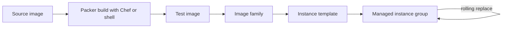

Packer and Chef are often presented as alternatives, but they answer different questions. Packer builds an image once, and every instance starts from it. Chef converges a running machine to a desired state, repeatedly. The useful question is when configuration should happen: at build time, at boot, or continuously.

> [!info] Not checked against current releases
> Versions, licences and plugin names were not checked when this note was written. Confirm them in the current documentation before relying on them.

## Short answer

For new GCE fleets, bake images with Packer and keep instances immutable: replace, do not patch. Run Chef (or Cinc) inside the Packer build if you already have cookbooks, so the same code produces the image. Keep a long-running Chef client only for hosts that cannot be rebuilt cheaply, such as pets with local state. Migration steps are in [[chef-to-immutable-images-migration]].

## Bake vs converge

**Bake** means all configuration happens when the image is built. Instances boot ready in seconds, are identical, and there is no configuration drift because there is nothing running that changes configuration. Changes ship as a new image and a rollout.

**Converge** means a client on each machine periodically applies the desired state. It repairs drift, handles hosts that exist for years, and can change running systems without a reboot. It also depends on a configuration server and network at runtime, and it makes "what is on this host" a function of history.



## At a glance

| Concern            | Packer                               | Chef (long-running client)                             |
| ------------------ | ------------------------------------ | ------------------------------------------------------ |
| When it runs       | Build time                           | Boot and then periodically                             |
| Output             | An image                             | A configured, mutable host                             |
| Drift              | None by design                       | Possible between runs; repaired on next run            |
| Start-up time      | Fast                                 | Slower: run list applied at boot                       |
| Rollback           | Previous image                       | Previous cookbook version, if the change is reversible |
| Runtime dependency | None                                 | Chef server (or local mode) and network                |
| Best for           | Autoscaled and replaceable instances | Long-lived, stateful hosts                             |

## Packer on GCE: googlecompute builder, image families, promotion by family

A minimal HCL2 template for a GCE image that applies a Chef run and then a shell hardening step:

```hcl title="base.pkr.hcl"
packer {
  required_plugins {
    googlecompute = {
      source  = "github.com/hashicorp/googlecompute"
      version = ">= 1.1.0" # check the current release and pin a range you have tested
    }
  }
}

variable "project_id" {
  type    = string
  default = "example-project"
}

variable "build_id" {
  type    = string
  default = "local"
}

source "googlecompute" "base" {
  project_id          = var.project_id
  zone                = "europe-west1-b"
  source_image_family = "debian-12"
  source_image_project_id = ["debian-cloud"]
  ssh_username        = "packer"
  image_name          = "example-base-${var.build_id}"
  image_family        = "example-base"
  image_labels = {
    build = var.build_id
  }
  service_account_email = "packer-build@example-project.iam.gserviceaccount.com"
}

build {
  sources = ["source.googlecompute.base"]

  provisioner "shell" {
    inline = ["sudo apt-get update", "sudo apt-get -y install curl"]
  }

  provisioner "chef-solo" {
    cookbook_paths = ["cookbooks"]
    run_list       = ["recipe[base_hardening]"]
    # Use a Chef/Cinc client version you have tested; set the install options here
  }

  provisioner "shell" {
    inline = ["sudo rm -rf /tmp/* /var/tmp/*", "sudo truncate -s 0 /etc/machine-id"]
  }
}
```

```bash title="build.sh"
packer init .
packer validate -var "build_id=$(date +%Y%m%d%H%M)" .
packer build -var "build_id=$(date +%Y%m%d%H%M)" .

# Which image does the family currently resolve to?
gcloud compute images describe-from-family example-base --project=example-project
```

**Image families** are a moving pointer to the newest non-deprecated image. Instance templates that reference the family pick up new images when you create a new template. Prefer referencing a specific image in production templates and updating them by pull request, so a rebuild cannot change production silently. Check the current guidance on image family best practice.

Build with a dedicated service account with least privilege (create instances and images in a build project only), and no access to production data. The same account scope concern appears for image builders in [[kaniko-vs-buildkit-vs-cloud-build]].

## Chef at build time vs at boot vs continuously

- **At build time** (Chef inside Packer): cookbooks run once on a temporary VM. Fast boots, reproducible. Best default if you have cookbooks.
- **At boot**: a startup script runs `chef-client` for last-mile configuration such as joining a cluster. Keep this short and idempotent, because it blocks readiness and fails open or closed depending on your choice.
- **Continuously**: a daemon converges every N minutes. Needed for long-lived pets; it also masks mistakes by repairing them silently, so alert on resources that change repeatedly.

Hardening cookbooks and tests belong to [[linux-host-hardening-with-chef-and-inspec]]; the same cookbooks run unchanged in all three modes.

## Drift, patching cadence and rebuild cost

Immutable images move patching from "run updates on hosts" to "rebuild and roll". Set a cadence (weekly, plus out-of-band for critical CVEs), build automatically from a pipeline, and measure how old the oldest running image is. Rebuild cost is build minutes and a rollout; for most fleets that is cheaper than the incidents caused by hosts that no longer match any known state. For hosts you converge, drift shows up as repeated resource changes in Chef reports; treat them as findings.

## Testing images (InSpec against the built image)

Test the image, not just the cookbook. Launch a temporary instance from the new image in a test project and run InSpec profiles against it, failing the pipeline on any control failure. A small smoke test (boots, SSH works, agent running, time sync, no unexpected listening ports) catches most broken builds. Keep test instances short-lived and labelled so a cleanup job can remove leftovers.

## Rollback via image family and instance template

Rollback means making the previous good image the active one and rolling instances back to it:

1. Deprecate the bad image so the family no longer resolves to it:

```bash title="rollback.sh"
gcloud compute images deprecate example-base-202610191200 \
  --project=example-project \
  --state=DEPRECATED
gcloud compute images describe-from-family example-base --project=example-project
```

2. Point the instance template (or a new one) at the previous image and start a rolling update of the managed instance group.
3. Verify with health checks, then keep the bad image deprecated (not deleted) for investigation.

Chef rollback is pinning the previous cookbook version and running again, which only works for changes that can be reversed by convergence; deleted files, data migrations and package removals often cannot.

## Licensing (Packer BSL, Chef and Cinc; check the current docs)

Packer is under HashiCorp's Business Source License since 2023, as Terraform is; the situation and alternatives are discussed in [[terraform-vs-opentofu]]. Chef's licensing and distribution terms for its binaries have changed over the years, and Cinc is a community distribution of the open-source Chef code. Check the current licence terms and your support needs before standardising.

## When to choose which

- **Packer alone**: simple images configured by shell or Ansible-style steps, no cookbooks.
- **Packer with Chef inside**: you have cookbooks and want immutable images from them.
- **Chef continuously**: stateful, long-lived hosts you cannot replace cheaply.

## Recommendation

Bake with Packer, run your Chef or Cinc cookbooks inside the build, test with InSpec, and roll instances by replacing them. Reference exact image names in production templates, and keep the family for development. Retire the long-running client as the fleet becomes replaceable. What would change this: a fleet of stateful hosts that cannot be rebuilt, or a build time so long that daily patching is impractical. For other configuration tools, see [[ansible-vs-chef-vs-salt]]. Infrastructure for the instance templates is described in Terraform; see [[building-and-shipping-images]] for the container-side equivalent.

## Related

- [[chef-to-immutable-images-migration]]
- [[linux-host-hardening-with-chef-and-inspec]]
- [[ansible-vs-chef-vs-salt]]
- [[terraform-vs-opentofu]]
- [[building-and-shipping-images]]

## Sources

- [Packer documentation](https://developer.hashicorp.com/packer/docs)
- [Packer googlecompute integration](https://developer.hashicorp.com/packer/integrations/hashicorp/googlecompute)
- [Chef documentation](https://docs.chef.io/)
- [Cinc](https://cinc.sh/)
- [Image families best practices](https://cloud.google.com/compute/docs/images/image-families-best-practices) (verify the current page)
