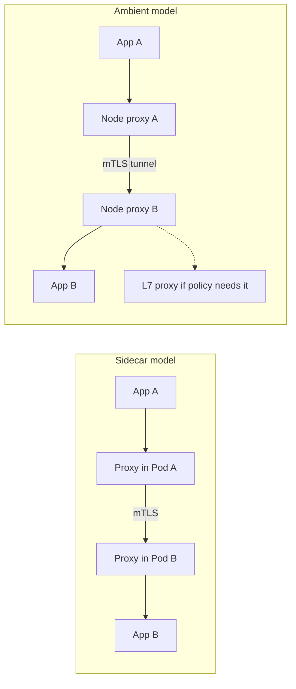

This note helps a senior DevOps engineer decide whether to adopt a service mesh on GKE, and if so which model: Istio with sidecars, Istio ambient, Linkerd, or Google's managed Cloud Service Mesh. It also covers Gateway API, which is useful with or without a mesh. It leaves pure network policy to [[patterns/kubernetes-network-policies]], rollout strategy to [[patterns/progressive-delivery-argo-rollouts]], and the telemetry backend to [[architecture/observability-pipeline-opentelemetry]].

> [!info] Scope and sources
> Written against the public documentation of Istio (istio.io), Linkerd (linkerd.io), the Kubernetes Gateway API (gateway-api.sigs.k8s.io) and Google Cloud's Cloud Service Mesh and GKE Gateway documentation on cloud.google.com. No cluster was used.

> [!note] Not verified
> The claims below were written from documentation knowledge and were not checked against a running system or the current docs: Istio ambient mode maturity and feature coverage, Linkerd's release and licensing model (which has changed over time), Cloud Service Mesh feature parity with upstream Istio, Gateway API versions and supported features on GKE, and the Istio API versions in the examples. No overhead numbers are given on purpose; measure your own.

## Do you need a mesh

A mesh adds a proxy layer to every service call. Answer these first, because tools you already run cover several of the common reasons.

| Need                             | Without a mesh                                           | Mesh needed when                                                          |
| -------------------------------- | -------------------------------------------------------- | ------------------------------------------------------------------------- |
| Block traffic between workloads  | NetworkPolicy ([[patterns/kubernetes-network-policies]]) | You need identity-based L7 rules (method, path), not only IP and port     |
| Cloud API access without keys    | Workload Identity ([[patterns/gke-workload-identity]])   | Not a mesh concern                                                        |
| Edge TLS and routing             | Ingress or Gateway API with a managed load balancer      | Not a mesh concern                                                        |
| Encryption in transit in-cluster | Application TLS, or node-level encryption options        | You need mTLS between all services without changing every application     |
| Per-request retries, timeouts    | Client libraries                                         | Many languages and teams cannot keep client behaviour consistent          |
| Traffic splitting for releases   | Gateway API weights, Argo Rollouts                       | You need splitting between internal services, not only at the edge        |
| Service-to-service telemetry     | OpenTelemetry instrumentation                            | You cannot instrument every service, and golden-signal metrics are enough |

If none of the right-hand cases is a real, current requirement, do not adopt a mesh yet. Adopt Gateway API and NetworkPolicy first, and revisit when the requirement appears.

## At a glance

| Concern             | Istio sidecar                  | Istio ambient                               | Linkerd                                   | Cloud Service Mesh                           |
| ------------------- | ------------------------------ | ------------------------------------------- | ----------------------------------------- | -------------------------------------------- |
| mTLS                | Yes, per-Pod proxy             | Yes, per-node proxy for L4                  | Yes, on by default between meshed Pods    | Yes, Istio-based                             |
| L7 policy           | Rich (routes, authz, JWT)      | Needs an additional L7 proxy where required | Narrower, simpler policy model            | Rich, follows its supported Istio API subset |
| Resource overhead   | A proxy per Pod; measure       | Lower per-Pod footprint expected; measure   | Light proxy per Pod; measure              | Same as Istio sidecar, managed control plane |
| Upgrade coupling    | Proxies roll with Pod restarts | Fewer Pod restarts for data-plane upgrades  | Proxies roll with Pod restarts            | Google manages the control plane             |
| Managed option      | Self-run                       | Self-run                                    | Self-run (vendor offerings exist)         | Yes, Google-managed                          |
| Licensing / release | Open source, CNCF project      | Open source, CNCF project                   | Check current release and licensing terms | Google Cloud product terms and pricing       |
| Multi-cluster       | Supported, operationally heavy | Evolving; check docs                        | Supported via multicluster extension      | Supported across GKE clusters; check docs    |

Treat this table as a map of questions to verify, not as final answers. Several cells are marked "check" because the facts move quickly.

## Data paths



With sidecars, every Pod gets a proxy, so Pod count drives overhead and upgrades need Pod restarts. With ambient, a node-level component handles L4 and mTLS, and L7 features are added only where a workload needs them. The trade is a newer model against a long-proven one.

## Cost estimate method

Do not trust vendor or blog overhead numbers for your workload. Estimate from your own cluster:

1. Install the mesh in a staging namespace with representative services.
2. Run a realistic load for long enough to see steady state and peaks.
3. Measure per-proxy CPU and memory from the metrics you already collect, at p50 and p99.
4. Multiply: total overhead = per-proxy resource requests x Pod count (sidecar), or per-node component requests x node count (ambient), plus control-plane cost.
5. Add latency: compare p50 and p99 request latency with and without the mesh on the same traffic.
6. Add people cost: upgrade effort per release, on-call burden, and training. Often larger than the compute.

Set proxy resource requests and limits explicitly (see [[patterns/kubernetes-resource-requests-and-limits]]), or Pod sizing will surprise you.

## Gateway API as the shared traffic API

Gateway API is the Kubernetes API for routing and is supported by GKE's Gateway controller and by the meshes above. Writing routes with it keeps your traffic configuration portable across these choices.

```yaml title="httproute-canary.yaml"
apiVersion: gateway.networking.k8s.io/v1
kind: HTTPRoute
metadata:
  name: shop
  namespace: shop
spec:
  parentRefs:
    - name: external-gateway # change: your Gateway name
      namespace: infra # change: namespace holding the Gateway
  hostnames:
    - shop.example.com # change: your hostname
  rules:
    - backendRefs:
        - name: shop-stable
          port: 8080
          weight: 90
        - name: shop-canary
          port: 8080
          weight: 10
```

The Gateway's listeners must allow routes from the `shop` namespace (`allowedRoutes`), or the route will not attach.

## Adoption plan

1. Pick one non-critical namespace with a few services and an owner who will be on call for it.
2. Install the control plane. Pin versions and keep the install in Git (see [[adr/0001-gitops-with-argocd]]).
3. Enrol the namespace in permissive mode: traffic is meshed, plaintext still accepted.
4. Confirm telemetry and that every client is meshed; look for plaintext callers.
5. Switch the namespace to strict mTLS.
6. Add authorisation policy gradually: deny by default only after observing real traffic.
7. Roll out namespace by namespace. Keep a documented way to remove a workload from the mesh.

```yaml title="peer-authentication-strict.yaml"
apiVersion: security.istio.io/v1 # check that your Istio or Cloud Service Mesh version serves v1
kind: PeerAuthentication
metadata:
  name: default
  namespace: shop # change: the namespace you are enrolling
spec:
  mtls:
    mode: STRICT # use PERMISSIVE first, then switch after verifying all callers are meshed
```

```bash
set -euo pipefail

NAMESPACE="shop"  # change: the namespace you enrolled

# Istio / Cloud Service Mesh: static analysis of configuration in the namespace.
istioctl analyze --namespace "$NAMESPACE"

# Linkerd: control plane health, then data-plane proxies.
linkerd check
linkerd check --proxy
```

## Recommendation

- Default: no mesh until a concrete requirement exists. Use Gateway API, NetworkPolicy, Workload Identity and OpenTelemetry.
- If you need mTLS and L7 policy on GKE and want less control-plane work: start with the managed Cloud Service Mesh, accepting its supported feature set and pricing.
- If you want a small, simple mTLS-and-metrics mesh and accept its narrower policy model: evaluate Linkerd, after checking the current release and licensing terms.
- If you run upstream Istio yourself and sidecar overhead or restart-coupled upgrades hurt: evaluate ambient in staging.

This recommendation changes if ambient mode proves production-ready for your features, if licensing or pricing of your chosen option changes, if a compliance requirement mandates in-cluster encryption, or if your service count grows enough that consistent client behaviour becomes impossible without a mesh.

## Related

- [[patterns/kubernetes-network-policies]]: the first tool for in-cluster traffic control, before a mesh.
- [[patterns/progressive-delivery-argo-rollouts]]: traffic-weighted releases that can use Gateway API or a mesh.
- [[architecture/observability-pipeline-opentelemetry]]: where mesh and application telemetry go.
- [[patterns/kubernetes-resource-requests-and-limits]]: sizing proxies and measuring their cost.
- [[runbooks/network-troubleshooting-dns-mtu-tls-load-balancers]]: diagnosing network failures when proxies add another hop.
