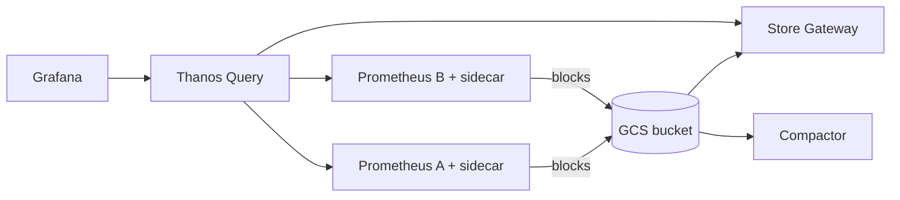

A single Prometheus server is the right answer until it is not. When you need retention beyond local disk, one query across several clusters, or a backend that survives the loss of a Prometheus pod without gaps, you add a long-term storage layer. The three open-source options most teams shortlist are Thanos, Grafana Mimir and VictoriaMetrics. Google Cloud Managed Service for Prometheus is the managed alternative, and the choice between self-managed Prometheus and the managed service is in [[prometheus-vs-cloud-monitoring]]; this note starts after you have decided to run the storage layer yourself.

> [!info] Not checked against current releases
> Versions, licences, enterprise-only features, limits and prices were not checked when this note was written. Confirm them in each project's current documentation and `LICENSE` file before relying on them.

## When plain Prometheus stops being enough

Concrete triggers, in the order they usually appear:

- **Retention.** Local TSDB retention is bounded by disk. Keeping a year of data on a PersistentVolume is possible but expensive and makes the server slow to restart.
- **High availability.** Two identical Prometheus replicas scrape the same targets, and every dashboard has to choose one of them. Gaps appear when a replica restarts.
- **Global view.** Several GKE clusters, each with its own Prometheus, and a need to answer "what is the error rate across all regions".
- **Multi-tenancy.** Several teams share a backend and must not see or overload each other.
- **Cardinality and cost.** Local Prometheus falls over on memory before it falls over on disk.

If none of these apply, stay on the simple setup. Every layer below is another thing to upgrade, monitor and restore.

## At a glance

| Concern            | Thanos                                                             | Grafana Mimir                                             | VictoriaMetrics                                                           | Managed Service for Prometheus      |
| ------------------ | ------------------------------------------------------------------ | --------------------------------------------------------- | ------------------------------------------------------------------------- | ----------------------------------- |
| Model              | Adds a global layer next to existing Prometheus servers            | Central write path: Prometheus remote-writes into it      | Central write path (single node or cluster), or scrape directly           | Google runs storage and query       |
| Ingest path        | Sidecar uploads blocks, or Receive accepts remote write            | `remote_write` to the distributor                         | `remote_write` or `vmagent` scraping                                      | Managed or self-deployed collectors |
| Long-term store    | Object storage (GCS) holding TSDB blocks                           | Object storage (GCS) holding blocks                       | Local disk or PVs; cluster version shards data; check the docs for backup | Google backend                      |
| Components to run  | Query, Store Gateway, Compactor, Ruler, Sidecar or Receive         | Microservices or monolithic mode, plus memcached          | One binary (single node) or vminsert, vmselect, vmstorage                 | None beyond collectors              |
| Query language     | PromQL                                                             | PromQL                                                    | MetricsQL, a PromQL superset                                              | PromQL                              |
| Multi-tenancy      | Via external labels and per-tenant receive routing; check the docs | Built in, tenant ID per request                           | Cluster version has tenants in the URL; check the docs                    | Per project                         |
| Operational weight | Medium: several stateless components and one singleton compactor   | High in microservices mode; lower in monolithic mode      | Low for single node; medium for cluster                                   | Lowest                              |
| Licence to verify  | Check the repository `LICENSE`                                     | Check the repository `LICENSE` and any enterprise add-ons | Check which features are open source and which are enterprise             | Commercial service                  |

## Architecture

### Thanos

Thanos keeps your Prometheus servers as they are and adds components around them.



Each Prometheus runs a sidecar that uploads completed two-hour blocks to object storage. Thanos Query fans out to the sidecars for recent data and to Store Gateways for historical data, and deduplicates replicas by an external label. The Compactor merges and downsamples blocks in the bucket. The alternative ingest path, Thanos Receive, accepts `remote_write` and suits remote or firewalled clusters where Thanos Query cannot reach a sidecar, or where you prefer a push model.

The attraction is that adoption is incremental: you can add a sidecar to an existing Prometheus without changing how you scrape.

### Mimir

Mimir is a horizontally scalable, multi-tenant, Prometheus-compatible store. Prometheus (or Grafana Alloy, or the OpenTelemetry Collector) remote-writes into it, and it handles ingestion, long-term storage and query. It can run as a set of microservices or as a single binary in monolithic mode, which is the sensible starting point for a modest installation.

```yaml title="prometheus.yml (remote_write to Mimir)"
remote_write:
  - url: https://mimir.example.com/api/v1/push
    headers:
      X-Scope-OrgID: team-payments
    queue_config:
      max_samples_per_send: 2000
      capacity: 10000
```

The `X-Scope-OrgID` header is the tenant. In production put an authenticating proxy in front of it rather than letting clients choose their own tenant.

### VictoriaMetrics

VictoriaMetrics is a time-series database with its own storage engine, not a layer over Prometheus blocks. The single-node binary is small and efficient and is often enough. The cluster version splits `vminsert`, `vmselect` and `vmstorage`. `vmagent` can scrape Prometheus-style targets and forward them, so you can drop Prometheus servers entirely.

```yaml title="prometheus.yml (remote_write to VictoriaMetrics)"
remote_write:
  - url: https://vm.example.com/api/v1/write
```

Its query language, MetricsQL, is a superset of PromQL. That is convenient, but dashboards that use MetricsQL-only functions do not run on a plain Prometheus, so keep to PromQL if portability matters.

## Object storage on GCS with Workload Identity

Thanos and Mimir keep long-term data in a GCS bucket. On GKE, do not mount a JSON key: bind a Google service account to the Kubernetes service account with Workload Identity, as in [[gke-workload-identity]].

```bash title="bucket and bucket-scoped IAM"
PROJECT=example-project
BUCKET=example-thanos-metrics
GSA=thanos-storage@${PROJECT}.iam.gserviceaccount.com

gcloud storage buckets create "gs://${BUCKET}" \
  --project="${PROJECT}" --location=europe-west1 \
  --uniform-bucket-level-access

gcloud iam service-accounts create thanos-storage --project="${PROJECT}"

# Bucket-level grant only, never project-wide storage.admin
gcloud storage buckets add-iam-policy-binding "gs://${BUCKET}" \
  --member="serviceAccount:${GSA}" \
  --role="roles/storage.objectAdmin"

# Workload Identity binding (namespace monitoring, KSA thanos)
gcloud iam service-accounts add-iam-policy-binding "${GSA}" \
  --role="roles/iam.workloadIdentityUser" \
  --member="serviceAccount:${PROJECT}.svc.id.goog[monitoring/thanos]"
```

```yaml title="objstore.yml (Thanos and Mimir-style block storage config)"
type: GCS
config:
  bucket: example-thanos-metrics
```

With no `service_account` key in the config the client uses Application Default Credentials, which Workload Identity supplies. Mimir has its own storage configuration syntax; take the exact keys from its current documentation.

Notes on the bucket:

- Use uniform bucket-level access and a single-purpose bucket so the IAM grant is narrow.
- Enable object versioning only if you have a cleanup rule, otherwise deleted blocks linger and cost money. The Compactor deletes blocks through its own lifecycle and expects the bucket to reflect that.
- Pick a location close to the cluster; cross-region reads from Store Gateway add latency and egress cost. Check the current pricing page.

## Query, downsampling and retention

- **Thanos** supports downsampling to 5-minute and 1-hour resolution in the Compactor, with separate retention per resolution. That keeps year-long graphs fast at the price of coarser data. Dashboards must tolerate that, so use the `max_source_resolution` setting deliberately.
- **Mimir** stores raw samples and relies on caching (memcached) and query sharding for speed. Retention is set per tenant through limits. Check the current docs for downsampling support.
- **VictoriaMetrics** has a global retention flag, and its enterprise offering adds downsampling; check which features are in the open-source edition.

Whatever you choose, agree retention per use case: seven to fifteen days of raw data for alerting, longer for capacity planning. Alert rules should evaluate against recent data in the layer closest to the source, not against a year-long store.

## Multi-tenancy and HA

HA means two things: surviving the loss of a Prometheus replica, and surviving the loss of the storage layer.

- **Replica deduplication.** Run two Prometheus replicas with a distinguishing external label. Thanos deduplicates on that label at query time. Mimir and VictoriaMetrics have HA-pair handling on ingest; check the docs for the exact label names.
- **Storage HA.** Thanos and Mimir lean on GCS durability and run stateless or replicated components. VictoriaMetrics cluster replicates across `vmstorage` nodes; single node is a single point of failure that you protect with snapshots and a restore drill.
- **Tenancy.** Mimir is multi-tenant by design. Thanos and VictoriaMetrics reach similar outcomes with routing and separate instances. If tenants must be hard-isolated, test it: send a query as tenant A and confirm it cannot see tenant B.

## Failure modes

- **Duplicate or missing external labels (Thanos).** Every Prometheus needs a unique `external_labels` set, for example `cluster` and `replica`. Two servers with the same labels uploading to one bucket produce overlapping blocks and confusing results.
- **More than one Compactor.** The Thanos Compactor must run as a single instance per bucket. Two compactors corrupt each other's work. Use a Deployment with one replica and no rolling surge, or a StatefulSet.
- **Overlapping or corrupt blocks.** Run the bucket verifier on a schedule and after any incident:

```bash title="check the bucket"
thanos tools bucket verify --objstore.config-file=objstore.yml
thanos tools bucket ls --objstore.config-file=objstore.yml
```

- **Cardinality explosions.** A label such as a user ID or a pod UID turns millions of series into hundreds of millions. All three systems get slow or expensive. Set per-tenant series limits (Mimir), watch the series-count metric, and drop high-cardinality labels at the scrape with `metric_relabel_configs`.
- **Remote write backlog.** When the backend is slow, the Prometheus remote-write queue grows in memory and eventually drops samples. Alert on the remote-write lag and dropped-sample metrics.
- **Store Gateway cold start.** Thanos Store Gateway syncs block indexes on startup; with many blocks it can take minutes. Give it a persistent volume for its index cache.
- **Cost drift.** Query-heavy dashboards that scan long ranges at raw resolution dominate cost. Prefer recording rules for expensive aggregations.

Link the alerting side to [[slo-burn-rate-alerting]]: burn-rate rules need low-latency data, which argues for evaluating them close to the source, with the long-term store used for review and capacity work.

## Licence and enterprise-only features

Licensing for observability projects has changed over the years, and it is exactly the kind of fact that goes stale. For each candidate, open the `LICENSE` file in the repository for the exact version you plan to run, and read the project's page on enterprise features. Questions to answer in writing before adopting:

- Is the licence one your organisation's policy accepts? See [[open-source-license-compliance]].
- Which features you need (downsampling, multi-tenancy limits, authentication, backup tooling) are open source and which are enterprise only?
- Does the vendor offer a managed version, and is that on your list of acceptable processors for your data?

## When to choose which

Choose **Thanos** when:

- you already run Prometheus per cluster and want a global view and cheap retention with the smallest change;
- you are comfortable running several components and want data in plain TSDB blocks in your own bucket.

Choose **Mimir** when:

- you want a central, multi-tenant write path for many teams, with strong per-tenant limits;
- you already run the Grafana stack and want one vendor's documentation and tooling.

Choose **VictoriaMetrics** when:

- operational simplicity and resource efficiency matter most, and a single node (with backups) meets your availability needs;
- you want to replace Prometheus servers with `vmagent` and accept MetricsQL.

Choose the **managed service** when nobody on the team wants to be paged for a metrics database. The trade-offs are in [[prometheus-vs-cloud-monitoring]].

## Recommendation

For a platform team already running Prometheus on GKE, start with Thanos sidecars and a GCS bucket for retention and a global view, or go straight to the managed service if running the layer yourself is not a goal. Move to Mimir when you need genuine multi-tenancy for many teams. Choose VictoriaMetrics when a small footprint beats ecosystem alignment and you have a restore-tested backup plan. Whatever you pick: bucket-scoped IAM through Workload Identity, unique external labels, a single Compactor, cardinality limits and an alert on the pipeline itself. Revisit if a licence changes, if tenant count grows, or if the managed service meets your needs at acceptable cost.

Pair this with [[observability-pipeline-opentelemetry]] for how metrics reach the backend, and [[grafana-vs-cloud-monitoring-dashboards]] for the dashboard layer.

## Related

- [[prometheus-vs-cloud-monitoring]]
- [[observability-pipeline-opentelemetry]]
- [[slo-burn-rate-alerting]]
- [[grafana-vs-cloud-monitoring-dashboards]]
- [[gke-workload-identity]]

## Sources

- [Thanos documentation](https://thanos.io/tip/thanos/getting-started.md/)
- [Grafana Mimir documentation](https://grafana.com/docs/mimir/latest/)
- [VictoriaMetrics documentation](https://docs.victoriametrics.com/)
- [Google Cloud Managed Service for Prometheus](https://cloud.google.com/stackdriver/docs/managed-prometheus)
