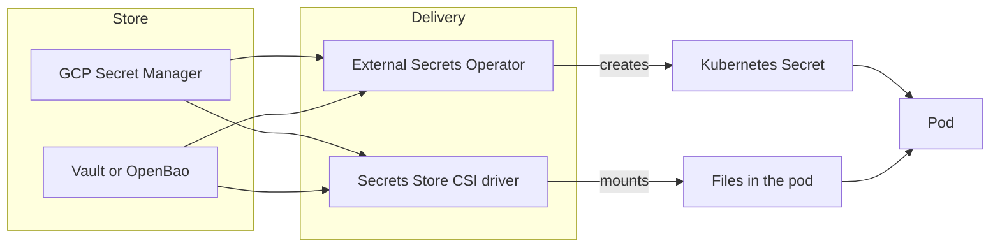

"Where do secrets live" and "how do they reach a pod" are two separate decisions that are often argued as one. The store is HashiCorp Vault or Google Secret Manager (or the OpenBao fork of Vault). The delivery path is the External Secrets Operator (ESO) or the Secrets Store CSI driver. Pick each on its own merits; most combinations work.

> [!info] Not checked against current releases
> Versions, licences, add-on names, limits and prices were not checked when this note was written. Confirm them in the current documentation before relying on them.

## Two decisions, store and delivery



## At a glance

| Concern             | GCP Secret Manager                      | Vault / OpenBao                                      |
| ------------------- | --------------------------------------- | ---------------------------------------------------- |
| Operations          | Managed by Google                       | You run it (or buy the hosted offering)              |
| Secret model        | Versioned static secrets                | Static secrets plus dynamic, leased secrets          |
| Access control      | Cloud IAM per secret                    | Policies per path                                    |
| Dynamic credentials | No (rotate by writing new versions)     | Yes: database, cloud and PKI engines                 |
| Encryption          | Google-managed or customer-managed keys | Seal with an auto-unseal key (for example Cloud KMS) |
| Audit               | Cloud Audit Logs                        | Audit devices                                        |
| Portability         | GCP only                                | Any cloud or on premises                             |

| Concern       | External Secrets Operator                 | Secrets Store CSI driver                               |
| ------------- | ----------------------------------------- | ------------------------------------------------------ |
| Output        | Kubernetes `Secret` objects               | Files mounted in the pod (optional sync to a `Secret`) |
| etcd exposure | Secret value is stored in etcd            | Not stored unless sync is enabled                      |
| Refresh       | Polling interval, then the Secret updates | Rotation feature, remounts on interval                 |
| Consumption   | Env vars or volumes, standard Kubernetes  | Volumes (env vars only via the sync option)            |

## Secret model: versions and IAM vs leases and dynamic secrets

Secret Manager stores secret **versions**. Access is IAM, auditing is Cloud Audit Logs, and rotation is writing a new version and moving consumers to it. For API keys, passwords and certificates that change rarely, this is sufficient and nearly free of operations.

```bash title="secret-manager.sh"
gcloud secrets create example-db-password --replication-policy=automatic --project=example-project
printf '%s' 'not-a-real-password' | gcloud secrets versions add example-db-password --data-file=- --project=example-project

# Prints the secret to stdout: use only in a lab, never in a shared terminal or CI log
gcloud secrets versions access latest --secret=example-db-password --project=example-project
```

Vault adds **leases and dynamic secrets**: it creates a database user on demand with a TTL and revokes it afterwards, so there is no long-lived password to leak. That is the capability Secret Manager lacks, and the reason to choose Vault when you have many databases or want per-job credentials. The cost is operating a critical, stateful service.

## Auth from GKE: Vault Kubernetes auth vs Workload Identity

With Secret Manager, a pod authenticates as a Google identity through [[gke-workload-identity]]: bind a Kubernetes service account to a Google service account that has `roles/secretmanager.secretAccessor` on specific secrets, and no credentials exist in the cluster.

Vault uses its Kubernetes auth method: the pod presents its service account token, Vault validates it against the cluster's API, and returns a Vault token with the policies of a role.

```bash title="vault-k8s-auth.sh"
# vault server -dev is for a lab only: in-memory, unsealed, not for real data.
export VAULT_ADDR=https://vault.example.com:8200

vault auth enable kubernetes

vault write auth/kubernetes/config \
  kubernetes_host="https://203.0.113.10:443" \
  kubernetes_ca_cert=@ca.crt

vault policy write app-read - <<'EOF'
path "secret/data/app/*" { capabilities = ["read"] }
EOF

vault write auth/kubernetes/role/app \
  bound_service_account_names=app \
  bound_service_account_namespaces=app \
  policies=app-read ttl=15m
```

Details of the configuration (token reviewer, issuer, newer JWT validation options) have changed across Vault releases; follow the current Kubernetes auth documentation.

## Delivery: ESO creating Kubernetes Secrets vs CSI-mounted files (etcd exposure, sync option)

**ESO** reads from the store and creates ordinary Kubernetes Secrets, so applications, Helm charts and operators work unchanged. The trade-off: the value sits in etcd (encrypt etcd secrets at rest, ideally with a customer-managed key, and restrict `get secret` RBAC). Install and configuration are in [[external-secrets-with-secret-manager]].

```bash title="verify-eso.sh"
kubectl get externalsecret -A
kubectl describe externalsecret app-db -n app # look at Status: SecretSynced, and the last sync time
```

**The CSI driver** mounts secrets as files at pod start, and with the provider's rotation option updates them while the pod runs. Nothing lands in etcd unless you enable the sync-to-Secret option. The trade-off: the pod cannot start if the mount fails, applications must read files, and env vars need the sync option. On GKE there is a Google-managed Secret Manager add-on for the CSI driver; check the current docs for its exact name and how to enable it.

```yaml title="secretproviderclass.yaml"
apiVersion: secrets-store.csi.x-k8s.io/v1
kind: SecretProviderClass
metadata:
  name: app-secrets
  namespace: app
spec:
  provider: gke # provider name for the managed add-on; verify in the current docs
  parameters:
    secrets: |
      - resourceName: "projects/example-project/secrets/example-db-password/versions/latest"
        path: "db-password"
```

```yaml title="pod-volume.yaml (fragment)"
volumes:
  - name: secrets
    csi:
      driver: secrets-store.csi.k8s.io
      readOnly: true
      volumeAttributes:
        secretProviderClass: app-secrets
```

Pin versions of secrets in production instead of `latest` where you need controlled rollouts, so a bad value does not reach all pods at once.

## Rotation, reload and audit

Rotation has three parts: write a new value, deliver it, and make the application use it. Stores handle the first, ESO or CSI the second, and the application the third. Env vars never refresh in a running pod; files can, if the application rereads them. Use a reloader controller or a rolling restart when the application cannot. Audit with Cloud Audit Logs data-access logs for Secret Manager (enable them for the secrets that matter) and Vault audit devices; alert on reads from unexpected identities. For an incident, follow [[leaked-credential-rotation]].

## Operations and failure modes (Vault seal and HA, regional outage, stale secrets, deleted upstream)

- **Vault sealed.** After a restart or failure Vault needs unsealing; use auto-unseal with Cloud KMS ([[cloud-kms-key-management]]), run HA with integrated storage, and back up snapshots. Practise restoring.
- **Vault outage blocks pod start** (CSI) or secret refresh (ESO). ESO keeps the last Secret, so running pods survive; CSI at start does not.
- **Secret Manager regional or API outage.** Replication policy and cached Secrets matter; test pod restarts during an outage drill.
- **Stale secrets.** A refresh interval of hours plus no restart means the application keeps the old value after rotation.
- **Deleted or disabled upstream secret.** ESO marks the sync as failed but typically keeps the existing Secret; alert on `SecretSyncedError`.
- **Over-broad IAM.** A single `secretAccessor` on the whole project gives every workload every secret. Grant per secret.

## Licensing (Vault BSL and the OpenBao fork; check the current status)

HashiCorp moved Vault from the Mozilla Public License to the Business Source License in 2023, and the community created OpenBao as a fork under the Linux Foundation. Check the current licence terms, the status of OpenBao and the vendor's hosted options before committing. The same pattern as for Terraform is described in [[terraform-vs-opentofu]].

## When to choose which

- **Secret Manager** when you are on GCP and need static secrets with IAM and audit, without running a service.
- **Vault or OpenBao** when you need dynamic secrets, PKI at scale, multi-cloud or on-premises, or a single store across clusters.
- **ESO** when applications expect Kubernetes Secrets and you value compatibility.
- **CSI driver** when you want to keep values out of etcd and your applications can read files.

## Recommendation

Default to Secret Manager with ESO: managed store, Workload Identity, no credentials in the cluster, standard Kubernetes Secrets, with etcd encryption and tight RBAC. Use the CSI driver for the few workloads where keeping the value out of etcd matters. Adopt Vault only for a concrete need such as dynamic database credentials or multi-cloud, and then run it with auto-unseal, HA and tested restores. Revisit if the Vault licence or OpenBao's status changes your risk, or if Secret Manager's feature set grows to cover dynamic secrets.

## Related

- [[external-secrets-with-secret-manager]]
- [[gke-workload-identity]]
- [[cloud-kms-key-management]]
- [[leaked-credential-rotation]]
- [[terraform-vs-opentofu]]

## Sources

- [Secret Manager documentation](https://cloud.google.com/secret-manager/docs)
- [Vault documentation](https://developer.hashicorp.com/vault/docs)
- [Vault Kubernetes auth method](https://developer.hashicorp.com/vault/docs/auth/kubernetes)
- [OpenBao](https://openbao.org/)
- [External Secrets Operator](https://external-secrets.io/latest/)
- [Secrets Store CSI driver](https://secrets-store-csi-driver.sigs.k8s.io/)
