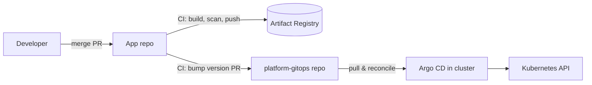

| Field | Value |
| --- | --- |
| Status | Accepted |
| Date | 2026-10-10 |
| Deciders | Platform team |
| Supersedes | — |

## Context

Workloads were deployed by CI jobs running `helm upgrade --install` against each
cluster. That gave us three recurring problems:

1. **Drift.** Manual `kubectl edit` hot-fixes were never written back, so the next
   pipeline run silently reverted them — or did not, depending on which values changed.
2. **Credential sprawl.** Every pipeline that deployed needed cluster-admin-level
   credentials for every target cluster.
3. **No single source of truth.** Answering "what is running in prod-eu right now?"
   meant reading pipeline logs.

## Decision

Cluster state is declared in Git and **pulled** into each cluster by Argo CD.

- One `platform-gitops` repository holds `ApplicationSet`s per environment.
- CI only builds, scans and publishes images and charts, then opens a PR that bumps
  the version in the GitOps repo. CI has **no** cluster credentials.
- Argo CD runs in each cluster (no hub-and-spoke), with `selfHeal: true` and
  `prune: true` on everything except stateful workloads, where pruning is manual.
- Access to the Argo CD UI goes through SSO; `admin` is disabled.



## Consequences

**Positive**

- Drift is detected and reverted automatically; the diff is visible in the UI.
- Rollback is `git revert` on the GitOps repo — auditable and reviewable.
- Pipelines lose cluster credentials entirely, which shrinks the blast radius of a
  leaked CI token.

**Negative**

- A second repository and a promotion PR per release add latency (minutes, not hours).
- Argo CD itself becomes a tier-0 component: it needs monitoring, backups of its
  config and an upgrade runbook.
- Secrets still need a separate mechanism — see [[gke-workload-identity]] and External Secrets.

> [!warning] Stateful workloads
> `prune: true` on a StatefulSet-backed app can delete PVC-owning resources when a
> manifest is removed by mistake. Keep pruning manual for anything with data.

## Alternatives considered

Flux was the main alternative; the comparison is in [[argocd-vs-flux]].
Continuing with push-based Helm from CI was rejected because it does not address drift.

## Validation

```bash
# Every Application is Synced and Healthy
argocd app list -o json | jq -r '.[] | select(.status.sync.status != "Synced" or .status.health.status != "Healthy") | .metadata.name'

# No pipeline service account can reach the cluster API
gcloud projects get-iam-policy "$PROJECT_ID" --format=json \
  | jq '.bindings[] | select(.role | test("container\\.")) | .members[]' | grep -i ci || echo "ok: no CI principals"
```
