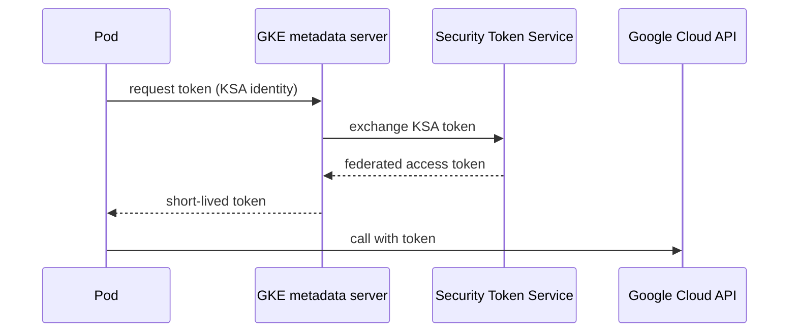

**Problem:** pods need to call Google Cloud APIs (GCS, Pub/Sub, Secret Manager).
Mounting an exported service account JSON key works, but the key is long-lived,
hard to rotate and easy to leak.

**Solution:** Workload Identity Federation for GKE maps a Kubernetes
ServiceAccount (KSA) to an IAM principal. Pods get short-lived tokens from the
GKE metadata server; no key ever exists.

> [!tip] Prefer direct resource access
> You can grant IAM roles straight to the KSA principal, without a Google
> service account in between. Use a GSA only when you need impersonation or a
> product that does not yet accept federated principals. Check the current list
> in the official GKE docs before deciding.

## How it fits together



## Implementation

### 1. Enable on the cluster and node pool

```bash
PROJECT_ID=my-platform-prod
CLUSTER=prod-eu
REGION=europe-west1

gcloud container clusters update "$CLUSTER" --region "$REGION" \
  --workload-pool="${PROJECT_ID}.svc.id.goog"

gcloud container node-pools update default-pool --cluster "$CLUSTER" --region "$REGION" \
  --workload-metadata=GKE_METADATA
```

> [!caution] Node pool update recreates nodes
> Changing `--workload-metadata` rolls the node pool. Schedule it, and check
> PodDisruptionBudgets first.

### 2. Grant IAM to the Kubernetes ServiceAccount

```bash
PROJECT_NUMBER=$(gcloud projects describe "$PROJECT_ID" --format='value(projectNumber)')

gcloud storage buckets add-iam-policy-binding gs://reports-prod \
  --role=roles/storage.objectViewer \
  --member="principal://iam.googleapis.com/projects/${PROJECT_NUMBER}/locations/global/workloadIdentityPools/${PROJECT_ID}.svc.id.goog/subject/ns/reports/sa/reports-reader"
```

### 3. Use the ServiceAccount in the workload

```yaml
apiVersion: v1
kind: ServiceAccount
metadata:
  name: reports-reader
  namespace: reports
---
apiVersion: apps/v1
kind: Deployment
metadata:
  name: reports
  namespace: reports
spec:
  replicas: 2
  selector:
    matchLabels: { app: reports }
  template:
    metadata:
      labels: { app: reports }
    spec:
      serviceAccountName: reports-reader
      automountServiceAccountToken: true
      containers:
        - name: app
          image: europe-docker.pkg.dev/my-platform-prod/apps/reports:1.4.2
```

## Validation

```bash
kubectl -n reports run wi-test --rm -it --restart=Never \
  --overrides='{"spec":{"serviceAccountName":"reports-reader"}}' \
  --image=google/cloud-sdk:slim -- gcloud auth list
# Expect the federated identity, then:
#   gcloud storage ls gs://reports-prod
```

## Troubleshooting

| Symptom | Likely cause | Check |
| --- | --- | --- |
| `403 Permission denied` | IAM binding on the wrong principal string | Compare namespace and KSA name in the `principal://` member |
| Pod gets node's SA identity | Node pool still on `GCE_METADATA` | `gcloud container node-pools describe … --format='value(config.workloadMetadataConfig)'` |
| Works in one namespace only | Binding is per namespace/KSA by design | Add a binding for each KSA |

## Rollback

Remove the IAM binding first, then (only if needed) revert the node pool
metadata mode. Workloads fall back to failing closed, not to node credentials,
as long as the node pool keeps `GKE_METADATA`.

Related: [[0001-gitops-with-argocd]] — the KSA and its annotations are managed in Git.
